# Bài 3: PingSignalR – Báo cáo thực hành

> Cách dùng: chạy từng lệnh, chụp terminal rồi lưu ảnh vào thư mục `images/` đúng tên file ở mỗi mục (Windows: `Win + Shift + S`).
> Phần "Kết quả mong đợi" lấy từ slide, hãy so với kết quả thật trên máy bạn.

---

## Bước 1.1: Tạo thư mục, solution, 2 project

```powershell
mkdir PingSignalR
cd PingSignalR
dotnet new sln -n PingSignalR
dotnet new web -n Ping.Api -o src/Ping.Api
dotnet new console -n Ping.Client -o src/Ping.Client
ls src
```

**Kết quả mong đợi:** `ls src` ra đúng 2 thư mục `Ping.Api` và `Ping.Client`.

📸 `images/buoc-1-1.png`

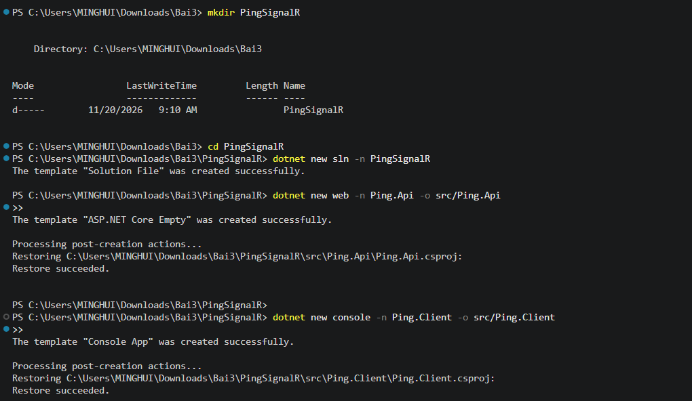

---

## Bước 1.2: Ghi danh project, thêm gói SignalR Client, build

```powershell
dotnet sln add src/Ping.Api/Ping.Api.csproj
dotnet sln add src/Ping.Client/Ping.Client.csproj
dotnet add src/Ping.Client package Microsoft.AspNetCore.SignalR.Client --version 10.0.15
dotnet new gitignore
dotnet build
```

**Kết quả mong đợi:** `Build succeeded. 0 Warning(s) 0 Error(s)`, và `Ping.Client.csproj` có dòng `PackageReference`.

> Nếu gặp lỗi `NU1301 Unable to load the service index`: máy không vào được nuget.org, hãy kiểm tra mạng/proxy.

📸 `images/buoc-1-2.png`

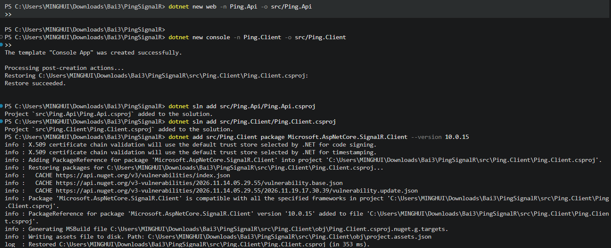

---

## Bước 2: Máy chủ có hub SignalR

Thay toàn bộ `src/Ping.Api/Program.cs`:

```csharp
using Microsoft.AspNetCore.SignalR;

var builder = WebApplication.CreateBuilder(args);
// Việc 1: đăng ký SignalR vào DI
builder.Services.AddSignalR();

var app = builder.Build();

app.MapGet("/", () => Results.Ok(
    new { service = "PingApi", status = "running" }));

// Việc 2: ánh xạ hub vào tuyến /hubs/ping
app.MapHub<PingHub>("/hubs/ping");

app.Run();

sealed class PingHub : Hub { }   // bước 3 thêm phương thức
```

### Bước 2 kiểm tra (bằng curl)

**Terminal 1 – máy chủ (để nguyên, không tắt):**

```powershell
dotnet run --project src/Ping.Api --urls http://localhost:5200
```

**Terminal 2 – ba lệnh kiểm tra:**

```powershell
curl.exe http://localhost:5200/
curl.exe -X POST "http://localhost:5200/hubs/ping/negotiate?negotiateVersion=1"
curl.exe -i http://localhost:5200/hubs/ping
```

**Kết quả mong đợi:**
- Lệnh 1: `{"service":"PingApi","status":"running"}`
- Lệnh 2: JSON có `connectionId`, `connectionToken`, `availableTransports` (WebSockets, ServerSentEvents, LongPolling)
- Lệnh 3: `HTTP/1.1 400 Bad Request ... Connection ID required`

📸 `images/buoc-2-terminal1.png`, `images/buoc-2-terminal2.png`

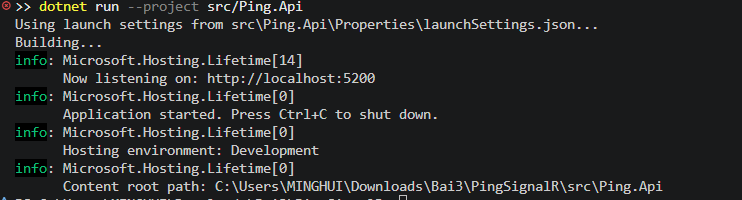
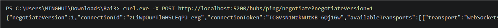

---

## Bước 3: Phương thức Echo

Thay lớp `PingHub` (cuối `Program.cs` của Ping.Api):

```csharp
sealed class PingHub : Hub
{
    // Máy khách gọi Echo -> trả lời RIÊNG người gọi
    public async Task Echo(string message)
    {
        await Clients.Caller.SendAsync("EchoResponse", $"Echo: {message}");
    }
}
```

> Nhớ: dừng máy chủ (Ctrl+C) và chạy lại sau mỗi lần sửa `Program.cs`.
> Bước này chưa test được bằng curl, test ở bước 4.

---

## Bước 4: Máy khách

Thay toàn bộ `src/Ping.Client/Program.cs`:

```csharp
using Microsoft.AspNetCore.SignalR.Client;

var serverUrl = args.Length > 0 ? args[0].TrimEnd('/')
                                : "http://localhost:5200";
var name = args.Length > 1 ? args[1] : "Client";

// ① Xây dựng kết nối tới hub
await using var connection = new HubConnectionBuilder()
    .WithUrl($"{serverUrl}/hubs/ping")
    .WithAutomaticReconnect()
    .Build();

// ② Đăng ký hàm xử lý cho từng TÊN thông điệp
connection.On<string>("EchoResponse",
    msg => Console.WriteLine($"[Echo] {msg}"));

// ③ Mở kết nối: negotiate + chọn WebSocket
await connection.StartAsync();
Console.WriteLine($"{name} da ket noi den PingApi.");

// Gọi phương thức Echo trên hub
await connection.InvokeAsync("Echo", $"Xin chao SignalR tu {name}");

Console.WriteLine("Dang cho thong diep... Nhan Enter de thoat.");
Console.ReadLine();
```

**Chạy:**

```powershell
# Terminal 1 (chạy lại máy chủ)
dotnet run --project src/Ping.Api --urls http://localhost:5200

# Terminal 2
dotnet run --project src/Ping.Client -- http://localhost:5200 An
```

**Kết quả mong đợi:**

```
An da ket noi den PingApi.
[Echo] Echo: Xin chao SignalR tu An
Dang cho thong diep... Nhan Enter de thoat.
```

📸 `images/buoc-4.png`

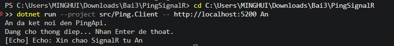

---

## Bước 5: Phát rộng (Broadcast) và nhóm (Group)

### 5.1 Thêm vào `PingHub` (Ping.Api)

```csharp
public async Task Broadcast(string message)
    => await Clients.All.SendAsync("BroadcastMessage", message);

public async Task JoinGroup(string groupName)
{
    await Groups.AddToGroupAsync(Context.ConnectionId, groupName);
    await Clients.Group(groupName).SendAsync("GroupMessage",
        $"{Context.ConnectionId[..8]} da tham gia nhom {groupName}");
}

public async Task SendToGroup(string groupName, string message)
    => await Clients.Group(groupName).SendAsync("GroupMessage", message);
```

### 5.2 Thêm vào Ping.Client

Hai dòng `On` (dán **trước** `StartAsync`):

```csharp
connection.On<string>("BroadcastMessage",
    m => Console.WriteLine($"[Broadcast] {m}"));
connection.On<string>("GroupMessage",
    m => Console.WriteLine($"[Group] {m}"));
```

Ba lời gọi (dán **sau** lời gọi Echo, **trước** `Console.ReadLine()`):

```csharp
await connection.InvokeAsync("JoinGroup",
    "lop-hoc-01");
await connection.InvokeAsync("SendToGroup",
    "lop-hoc-01", $"Thong bao nhom tu {name}");
await connection.InvokeAsync("Broadcast",
    $"Xin chao tat ca tu {name}");
```

### 5.3 Chạy ba terminal theo thứ tự

```powershell
# Terminal 1 – máy chủ, chạy trước (Ctrl+C nếu đang chạy)
cd PingSignalR
dotnet run --project src/Ping.Api --urls http://localhost:5200

# Terminal 2 – An, chạy thứ hai
cd PingSignalR
dotnet run --project src/Ping.Client -- http://localhost:5200 An

# Terminal 3 – Bình, chạy sau cùng
cd PingSignalR
dotnet run --project src/Ping.Client -- http://localhost:5200 Binh
```

📸 `images/buoc-5-terminal1.png`, `images/buoc-5-terminal2.png`, `images/buoc-5-terminal3.png`

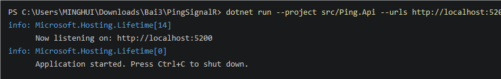
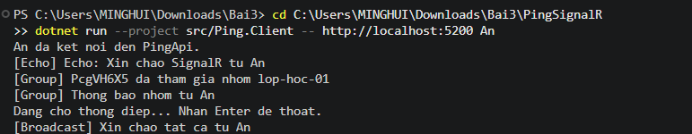
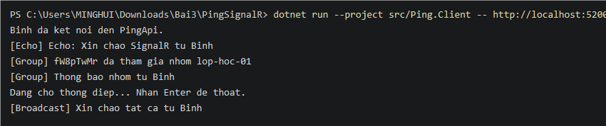

---

## Bước 6: Vòng đời kết nối

### Thêm vào `PingHub` (Ping.Api)

```csharp
public override async Task OnConnectedAsync()
{
    Console.WriteLine($"[Hub] + {Context.ConnectionId[..8]} ket noi");
    await Clients.All.SendAsync("SystemMessage",
        $"Client {Context.ConnectionId[..8]} da ket noi.");
    await base.OnConnectedAsync();
}

public override async Task OnDisconnectedAsync(Exception? ex)
{
    Console.WriteLine($"[Hub] - {Context.ConnectionId[..8]} ngat");
    await Clients.All.SendAsync("SystemMessage",
        $"Client {Context.ConnectionId[..8]} da ngat ket noi.");
    await base.OnDisconnectedAsync(ex);
}
```

### Thêm vào Ping.Client (trước `StartAsync`)

```csharp
connection.On<string>("SystemMessage",
    m => Console.WriteLine($"[System] {m}"));

connection.Reconnecting += _ => {
    Console.WriteLine("[Lifecycle] Dang ket noi lai...");
    return Task.CompletedTask; };

connection.Reconnected += newId => {
    Console.WriteLine($"[Lifecycle] Da ket noi lai: {newId?[..8]}");
    return Task.CompletedTask; };

connection.Closed += _ => {
    Console.WriteLine("[Lifecycle] Ket noi da dong.");
    return Task.CompletedTask; };
```

### Cách kiểm tra

1. Chạy lại Terminal 1 (máy chủ), rồi Terminal 2 (An): máy chủ in `[Hub] + ... ket noi`.
2. Chạy Terminal 3 (Bình): An nhận `[System] Client ... da ket noi.`
3. Nhấn Enter ở Terminal 3 để thoát: máy chủ in `[Hub] - ... ngat`, An nhận thông báo ngắt.
4. Tắt máy chủ (Ctrl+C): client in `[Lifecycle] Dang ket noi lai...` rồi `Ket noi da dong.`

📸 `images/buoc-6-terminal1.png`, `images/buoc-6-terminal2.png`, `images/buoc-6-terminal3.png`

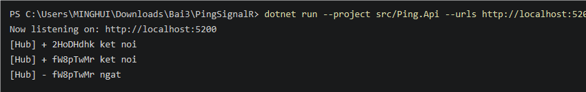
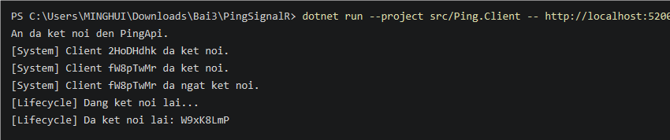
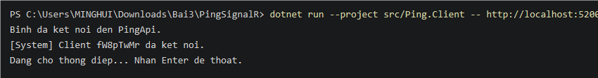
