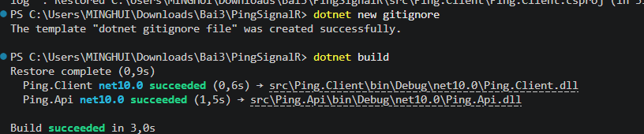
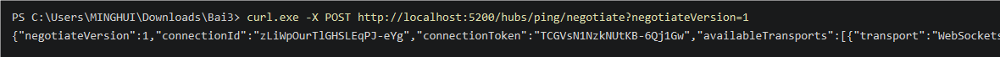
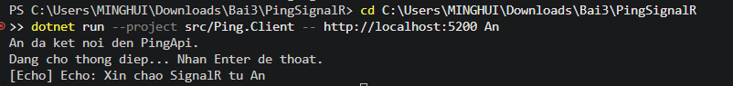
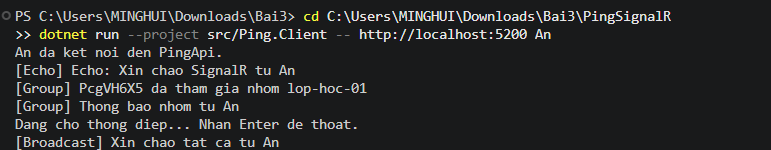
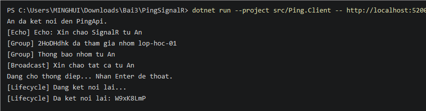
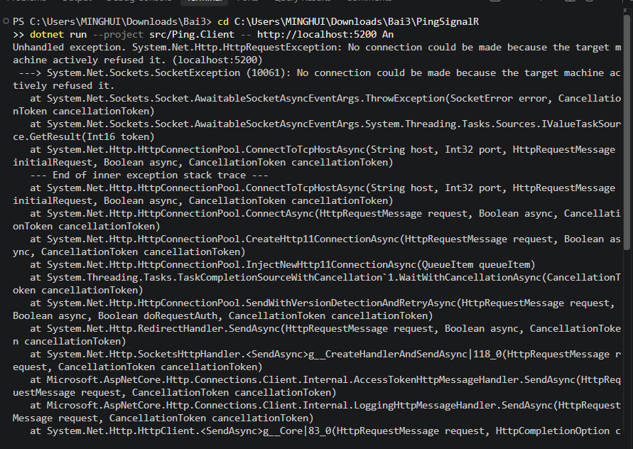
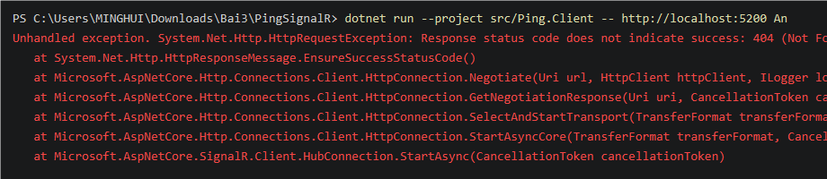
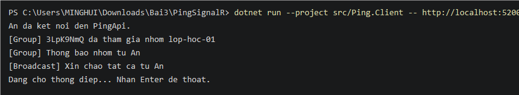

# Bài 3: SignalR PingHub

## Bước 1: Build dự án

Thấy: `dotnet build` trả về `Build succeeded, 0 Warning(s), 0 Error(s)`.
Giải thích: Cả 2 dự án Ping.Api và Ping.Client biên dịch thành công.

## Bước 2: negotiate

Thấy: curl trả về connectionId và danh sách availableTransports.
Giải thích: Máy chủ báo các phương thức truyền tải hỗ trợ (WebSockets, ServerSentEvents, LongPolling).

## Bước 3–4: Máy chủ chạy, máy khách Echo

Thấy: Máy khách kết nối thành công và in `[Echo] Echo: Xin chao SignalR tu An`.
Giải thích: Phương thức `Echo` trên Hub dùng `Clients.Caller.SendAsync` để trả lời riêng cho máy khách gọi.

## Bước 5: Hai máy khách thấy tin nhóm và broadcast

Thấy: Máy khách thấy thông báo tham gia nhóm, tin nhắn nhóm `[Group]` và tin `[Broadcast]`, không thấy tin Echo của người khác.
Giải thích: `SendToGroup` chỉ gửi cho thành viên trong group `lop-hoc-01`, `Broadcast` gửi cho tất cả máy khách kết nối (`Clients.All`).

## Bước 6: Tự động kết nối lại (Lifecycle)

Thấy: Khi ngắt máy chủ hiện `[Lifecycle] Dang ket noi lai...`, khi máy chủ bật lại hiện `[Lifecycle] Da ket noi lai: ...`.
Giải thích: Cấu hình `WithAutomaticReconnect()` giúp máy khách tự động thử kết nối lại khi mất liên lạc với máy chủ.

## Bước 7: Ba lỗi cố ý
### Lỗi 1: Máy chủ chưa chạy

Thấy: `System.Net.Http.HttpRequestException: No connection could be made because the target machine actively refused it. (localhost:5200)`.
Giải thích: Máy khách cố gắng kết nối tới cổng 5200 khi máy chủ Ping.Api chưa được khởi động.

### Lỗi 2: Sai đường dẫn hub (thiếu s: /hub/ping)

Thấy: `HttpRequestException: Response status code does not indicate success: 404 (Not Found)`.
Giải thích: Máy chủ chỉ đăng ký route `/hubs/ping`, đường dẫn `/hub/ping` không tồn tại.

### Lỗi 3: Sai tên thông điệp (EchoRespone)

Thấy: Máy khách kết nối bình thường, không báo lỗi nhưng không in dòng `[Echo]`.
Giải thích: Tên sự kiện lắng nghe ở client không khớp với tên sự kiện máy chủ phát đi (`EchoResponse`).
