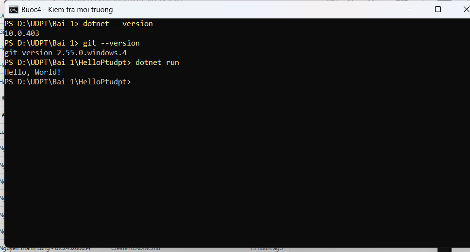
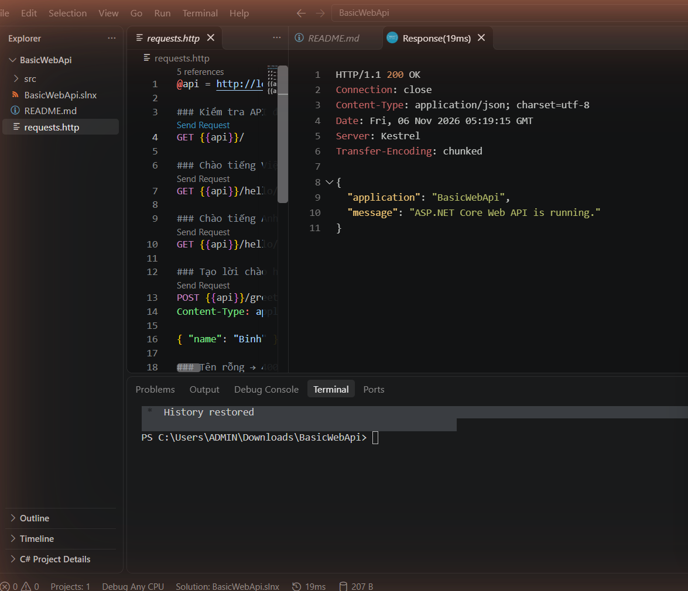
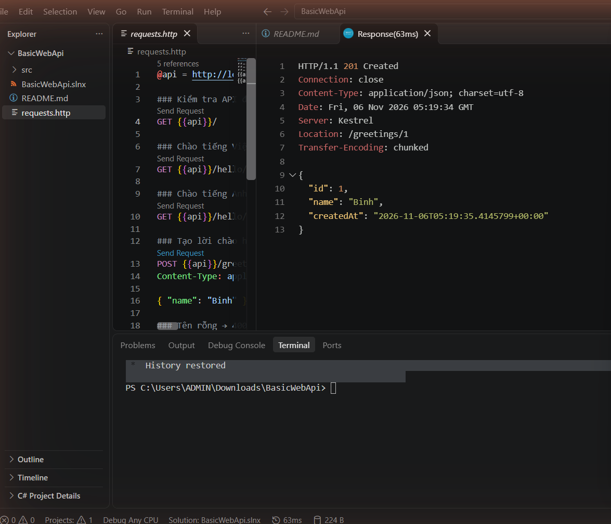
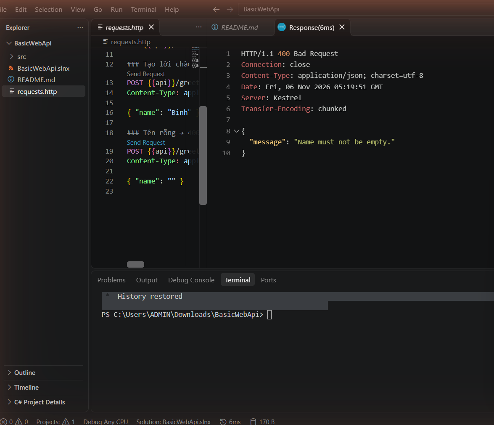
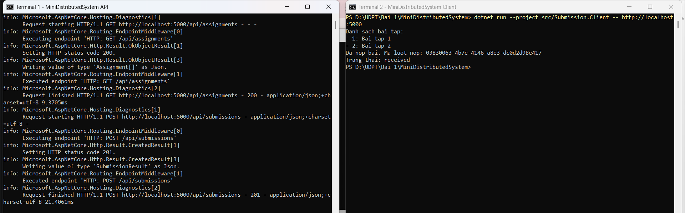
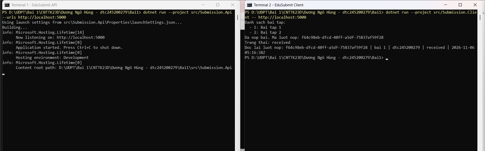

# Bài 1 – Tổng quan hệ thống và MEP

Họ tên: Dương Ngô Hùng   MSSV: dtc245200279   Lớp: CNTT K23D

## 1. Cài đặt (ảnh Bước 4)

- `dotnet --version` → `10.0.403`
- `git --version` → `git version 2.55.0.windows.4`
- VS Code extension: C# Dev Kit, C#, .NET Install Tool, REST Client



## 2. MepDemo

1. **MEP 3 (queue):** mỗi bài nộp `sub-x` chỉ do **một** worker xử lý. Worker-A chấm sub-1, sub-4; Worker-B chấm sub-2, sub-3 → các worker cạnh tranh, chia nhau việc trong hàng đợi.
2. **MEP 4 (publish–subscribe):** một sự kiện `SubmissionGraded` tới **cả 3** dịch vụ: ScoreService, NotificationService, StatsService.
3. Mô tả từng MEP:
   - **Request–response:** bên gửi gửi yêu cầu rồi chờ phản hồi; nếu quá thời gian chờ (timeout) thì báo lỗi hoặc thử lại.
   - **One-way:** bên gửi gửi thông điệp đi rồi làm việc khác ngay, không chờ kết quả (ví dụ ghi log).
   - **Queue-based:** công việc được đẩy vào hàng đợi, API trả về ngay `processing`, các worker lấy job ra xử lý dần, mỗi job chỉ một worker làm.
   - **Publish–subscribe:** một sự kiện được phát ra, mọi dịch vụ đăng ký đều nhận được bản sao và tự xử lý.
   - **Streaming / push:** máy khách nhận liên tục các cập nhật trạng thái (received → processing 30% → 70% → graded) mà không phải hỏi lại.

## 3. BasicWebApi

Kết quả gửi request (`requests.http`):

| Request | Kết quả |
|---|---|
| `GET /` | 200 OK, `application = BasicWebApi` |
| `GET /hello/An?language=en` | 200 OK, `{"message":"Hello, An!"}` |
| `POST /greetings` `{"name":"Binh"}` | 201 Created, header `Location: /greetings/1` |
| `POST /greetings` `{"name":""}` | 400 Bad Request, `Name must not be empty.` |







**Câu 1:** `builder.Services.AddSingleton<GreetingService>()` phải đứng **trước** `var app = builder.Build();`. Dịch vụ phải được đăng ký vào DI container trong pha chuẩn bị; sau khi `Build()` thì danh sách dịch vụ đã bị khóa, không thêm được nữa.

**Câu 2:** Trong `/hello/{name}?language=en`, `name` lấy từ **route** (đoạn đường dẫn `{name}`), `language` lấy từ **query string** (`?language=en`).

**Câu 3:** POST tạo ra một tài nguyên mới, nên trả **201 Created** đúng ngữ nghĩa HTTP, kèm header `Location` cho biết địa chỉ của tài nguyên vừa tạo. `200 OK` chỉ báo "thành công" chung chung, không nói có gì được tạo ra.

## 4. MiniDistributedSystem

Terminal 1 chạy `Submission.Api` ở `http://localhost:5000`, Terminal 2 chạy client:

```text
Danh sach bai tap:
- 1: Bai tap 1
- 2: Bai tap 2
Da nop bai. Ma luot nop: <GUID>
Trang thai: received
```



1. **Client gọi những endpoint nào?**
   - `GET /api/assignments` → `200 OK`, trả mảng bài tập.
   - `POST /api/submissions` → `201 Created`, trả lượt nộp có `id`, `status = received`.
2. **Client có dùng chung code với API không?** Không. Client không tham chiếu project API. Hai bên chỉ thống nhất với nhau bằng **hợp đồng dữ liệu**: URL, method, và hình dạng JSON (mỗi bên tự khai báo `record` giống nhau).
3. **Vì sao địa chỉ API truyền qua tham số?** Để cùng một client chạy được với nhiều môi trường (máy mình, máy chủ thật, cổng khác) mà không phải sửa và build lại code.

## 5. Thí nghiệm lỗi

Thực hiện trên EduSubmit tự làm. Sau mỗi thí nghiệm đã trả code về như cũ.

| # | Dự đoán | Thực tế | Đúng/Sai | Giải thích |
|---|---|---|---|---|
| a | Client in ra 3 bài tập, không cần sửa code client. | Client in `1: Bai tap 1`, `2: Bai tap 2`, `3: Bai tap 3`, nộp bài vẫn thành công. | Đúng | Client đọc danh sách từ API rồi lặp `foreach`, không biết trước có bao nhiêu bài. Dữ liệu thay đổi ở máy chủ, hợp đồng (hình dạng JSON) không đổi nên client không phải sửa. |
| b | Client báo lỗi không kết nối được. | `HttpRequestException: No connection could be made because the target machine actively refused it. (localhost:5000)` | Đúng | Không có tiến trình nào lắng nghe cổng 5000 nên hệ điều hành từ chối kết nối. Gọi qua mạng phụ thuộc vào một tiến trình khác và đường truyền, cả hai đều có thể hỏng; gọi hàm trong cùng chương trình thì code luôn nằm sẵn trong bộ nhớ của chính tiến trình đó. |
| c | API trả 400, client dừng với lỗi. | Client in được danh sách bài tập, rồi `HttpRequestException: Response status code does not indicate success: 400 (Bad Request)` tại dòng `EnsureSuccessStatusCode()`. | Đúng | API kiểm tra `StudentCode` rỗng → `400`. `EnsureSuccessStatusCode()` ném ngoại lệ nếu mã không phải 2xx, để client không đọc nhầm thông báo lỗi thành dữ liệu hợp lệ. Máy chủ phải tự kiểm tra vì không thể tin máy khách: client có thể bị sửa, viết sai, hoặc ai cũng có thể gửi request bằng curl/REST Client. |
| d | Client báo lỗi kết nối như thí nghiệm b. | API chạy cổng 5050, client gọi 5000 → `actively refused it (localhost:5000)`. | Đúng | Sửa không cần đổi code: truyền địa chỉ đúng qua tham số `dotnet run --project src/Submission.Client -- http://localhost:5050` → client chạy thành công. |

## 6. Dự án EduSubmit tự làm

Cấu trúc: `EduSubmit.slnx`, `src/Submission.Api`, `src/Submission.Client`, `requests.http`.

**Kiểm thử `requests.http`:**

| # | Request | Kết quả |
|---|---|---|
| 1 | `GET /` | 200 `{"service":"Submission.Api","status":"running"}` |
| 2 | `GET /api/assignments` | 200, mảng 2 bài tập |
| 3 | `POST /api/submissions` hợp lệ | 201 + `Location: /api/submissions/{id}` |
| 4 | `POST` thiếu `studentCode` | 400 `{"message":"Du lieu nop bai khong hop le"}` |
| 5 | `POST` với `assignmentId = 0` | 400 |
| 6 | `GET /api/submissions/{id}` có thật | 200 |
| 7 | `GET /api/submissions/00000000-...` | 404 Not Found |

**Kết quả client** (chạy 2 lần, mã lượt nộp đổi mỗi lần):

```text
Danh sach bai tap:
  - 1: Bai tap 1
  - 2: Bai tap 2
Da nop bai. Ma luot nop: 6983be40-6895-4381-aac0-ba98b137d8c0
Trang thai: received
Doc lai luot nop: 6983be40-6895-4381-aac0-ba98b137d8c0 | bai 1 | dtc245200279 | received | 2026-11-06 05:02:59Z
```



**Luồng thông điệp:**

```text
Client --(HTTP GET  /api/assignments)------> Api : request–response
Client --(HTTP POST /api/submissions)------> Api : request–response (201 Created)
Client --(HTTP GET  /api/submissions/{id})-> Api : request–response (200 / 404)
```

**Phần phải xem code mẫu:** có tham khảo `MiniDistributedSystem` cho cách viết kiểm tra dữ liệu và `Results.Created`.

**Bài mở rộng:** API lưu lượt nộp vào `List<SubmissionResult>`; `GET /api/submissions/{id:guid}` trả 200 nếu tìm thấy, 404 nếu không. Client sau khi nộp gọi lại endpoint này và in lượt nộp.

## 7. Khó khăn và cách giải quyết

- **Không ghi được file vào thư mục trên ổ D:** thư mục chỉ cho nhóm Administrators quyền ghi → chạy `icacls` bằng PowerShell quyền admin để cấp quyền Modify cho tài khoản của mình.
- **Gửi JSON bằng `curl` trong PowerShell bị lỗi 400 "invalid start of a property name":** PowerShell làm mất dấu `"` khi truyền chuỗi cho `curl.exe` → ghi JSON ra file rồi gửi bằng `--data-binary @file.json`, hoặc dùng REST Client.
- **Build lỗi "file is locked by Submission.Client.exe":** tiến trình client bị lỗi lúc trước vẫn còn chạy và giữ file `.exe` → tắt tiến trình đó (Task Manager) rồi build lại.
