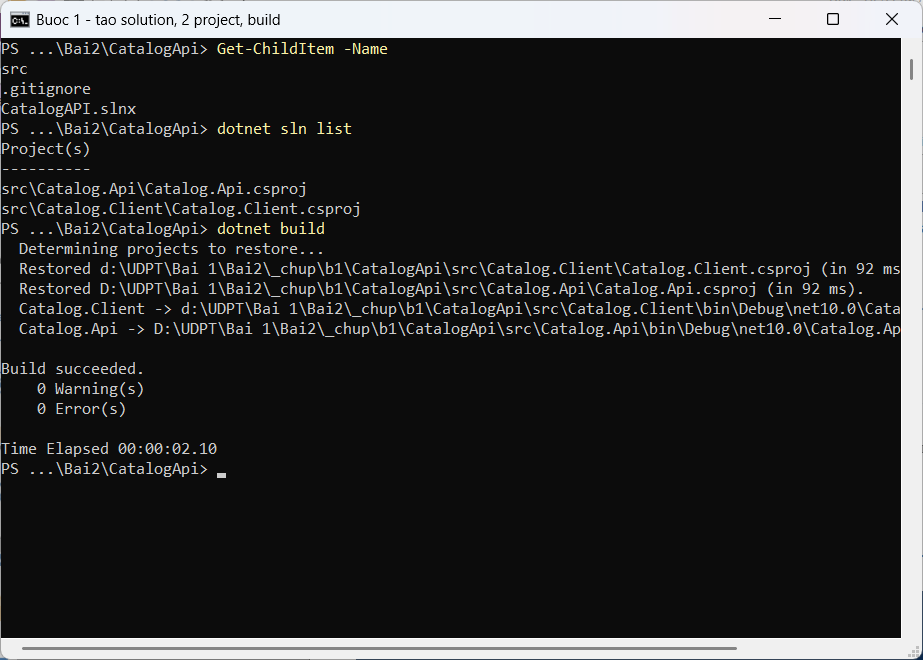
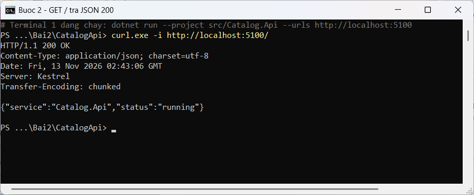
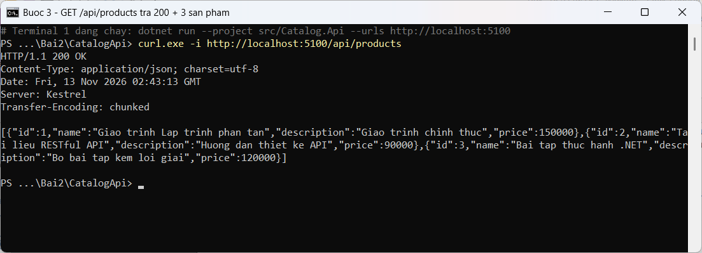
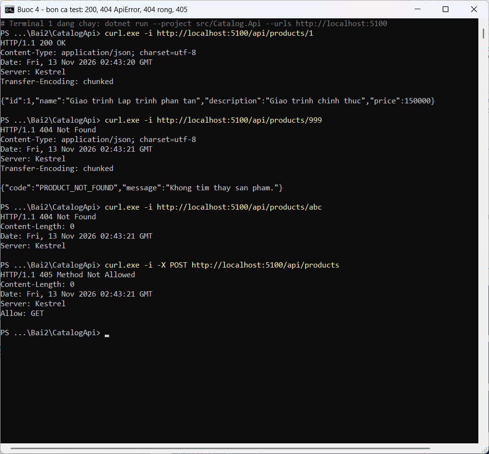
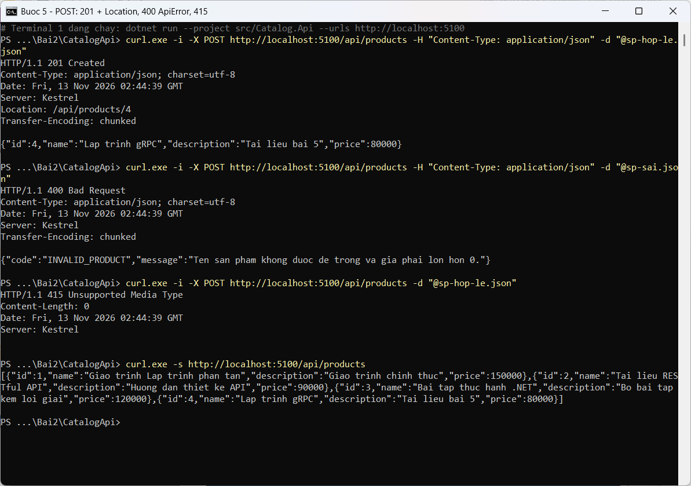
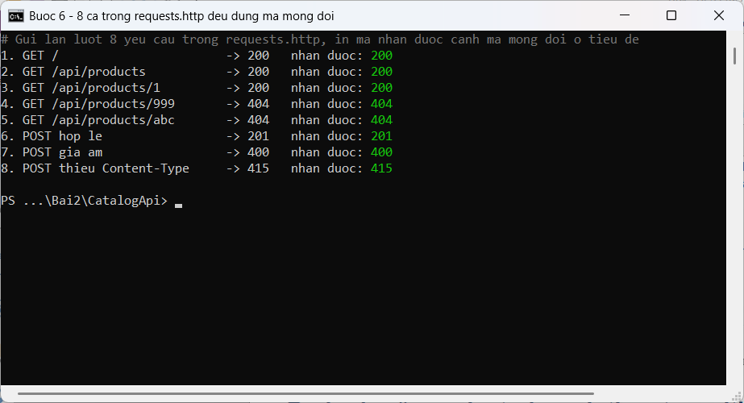
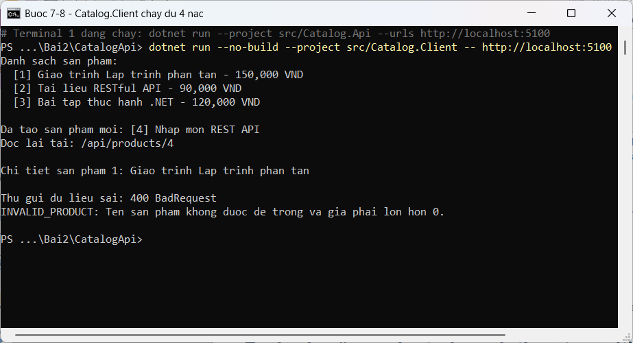
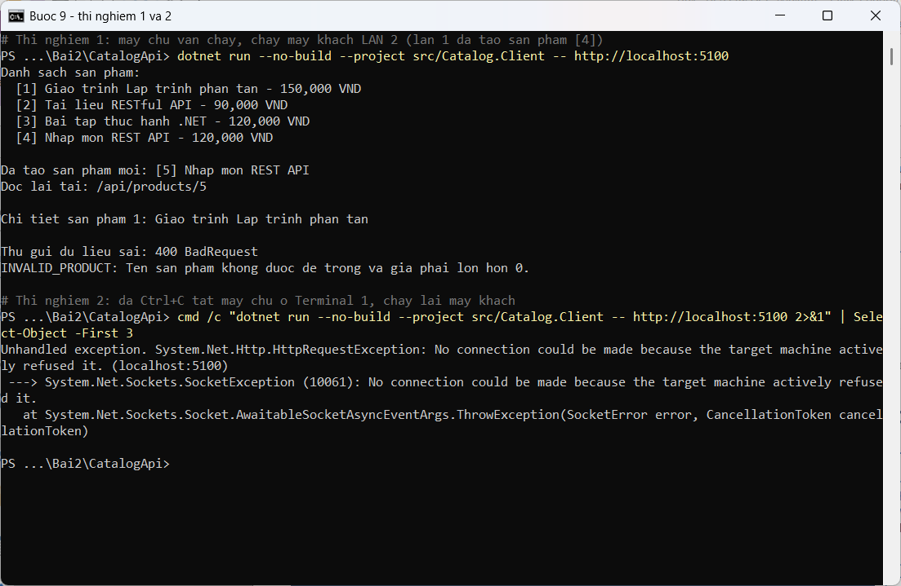
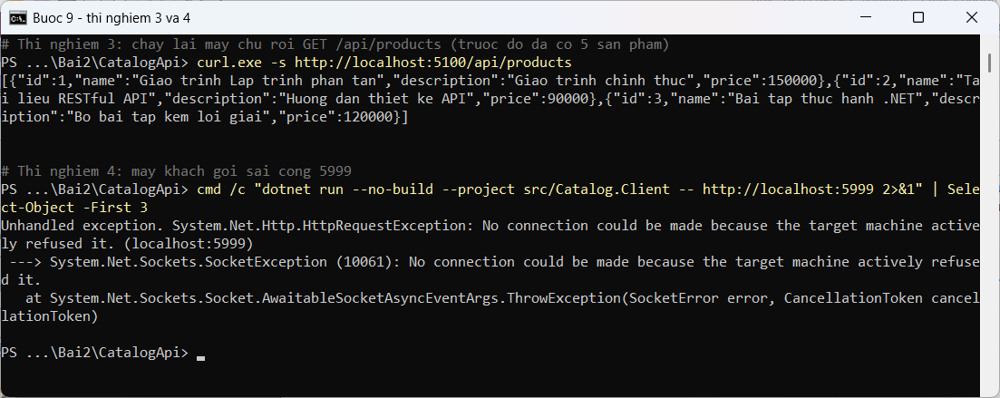

# Catalog API (Bài 2, Phần 2: thực hành trên lớp)

Hệ phân tán thu nhỏ gồm hai chương trình, hai tiến trình:

- `src/Catalog.Api`: máy chủ ASP.NET Core Minimal API, cổng 5100, giữ danh sách sản phẩm trong bộ nhớ.
- `src/Catalog.Client`: máy khách console, gọi máy chủ bằng `HttpClient`.

## Cách chạy

```powershell
# Terminal 1: máy chủ
dotnet run --project src/Catalog.Api --urls http://localhost:5100

# Terminal 2: máy khách
dotnet run --project src/Catalog.Client -- http://localhost:5100
```

Các ca kiểm thử nằm trong `requests.http` (dùng extension REST Client) và `sp-hop-le.json`, `sp-sai.json` (dùng với `curl.exe -d "@tep.json"`).

## Hợp đồng API

| Phương thức | URI | Thành công | Lỗi |
|---|---|---|---|
| GET | `/` | 200 + `{service, status}` | – |
| GET | `/api/products` | 200 + danh sách | – |
| GET | `/api/products/{id:int}` | 200 + một sản phẩm | 404 `PRODUCT_NOT_FOUND`; 404 rỗng nếu id không phải số |
| POST | `/api/products` | 201 + `Location` + sản phẩm mới | 400 `INVALID_PRODUCT`; 415 nếu thiếu `Content-Type` |

## Nhật ký từng bước

Mỗi ảnh được chụp khi chạy đúng mã nguồn của commit tương ứng.

### Bước 1: tạo solution, 2 project, build

Commit `Buoc 1: tao solution CatalogApi`. Solution có 2 project, `dotnet build` báo 0 lỗi.



### Bước 2: GET / trả JSON

`Results.Ok(new { service, status })` trả 200 và JSON; tên thuộc tính tự đổi sang camelCase.



### Bước 3: DTO và GET /api/products

`List<ProductDto>` thành mảng JSON gồm 3 sản phẩm; `decimal Price` thành số, không có dấu nháy.



### Bước 4: GET /api/products/{id:int}, bốn ca

| Ca | Kết quả | Ai trả lời |
|---|---|---|
| `/1` | 200 + sản phẩm | Handler: tìm thấy |
| `/999` | 404 + `PRODUCT_NOT_FOUND` | Handler: không tìm thấy, tự trả 404 có body |
| `/abc` | 404, `Content-Length: 0` | Framework: `:int` không khớp, handler không chạy |
| `POST` | 405, `Allow: GET` | Framework: URI có nhưng chưa có POST |



### Bước 5: POST /api/products, ba ca

| Ca | Kết quả | Ai từ chối |
|---|---|---|
| `sp-hop-le.json` | 201 + `Location: /api/products/4` | – (handler tạo, Id = 3 + 1) |
| `sp-sai.json` (giá âm) | 400 + `INVALID_PRODUCT` | Handler: khối `if` kiểm tra tại biên |
| Thiếu `Content-Type` | 415 | Framework: không biết đọc body, chặn trước handler |

Gọi lại `GET /api/products` thấy 4 sản phẩm. Ảnh chụp từ commit Bước 6 vì hai tệp JSON được thêm ở bước đó; mã máy chủ giống hệt commit Bước 5.



### Bước 6: requests.http

Cả 8 yêu cầu trong `requests.http` cho đúng mã ghi ở tiêu đề.



### Bước 7–8: Catalog.Client, 4 nấc

Liệt kê, tạo mới (kiểm tra 201 trước khi đọc body, in `Location`), đọc lại chi tiết, cố ý gửi sai và đọc `ApiError`.



### Bước 9: bốn thí nghiệm phân tán

| # | Thí nghiệm | Quan sát | Bài học |
|---|---|---|---|
| 1 | Chạy máy khách lần 2 | Danh sách có 4 sản phẩm, tạo mới ra [5] | Trạng thái nằm ở máy chủ |
| 2 | Tắt máy chủ, chạy máy khách | `HttpRequestException`: connection refused (localhost:5100) | Bên kia có thể vắng mặt |
| 3 | Chạy lại máy chủ, GET danh sách | Chỉ còn 3 sản phẩm | Dữ liệu trong bộ nhớ mất khi tiến trình dừng |
| 4 | Máy khách gọi cổng 5999 | Connection refused (localhost:5999) | Hai bên phải thống nhất địa chỉ |




