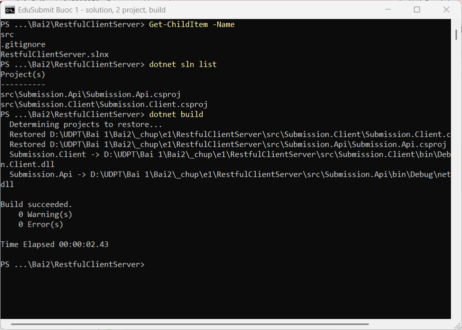
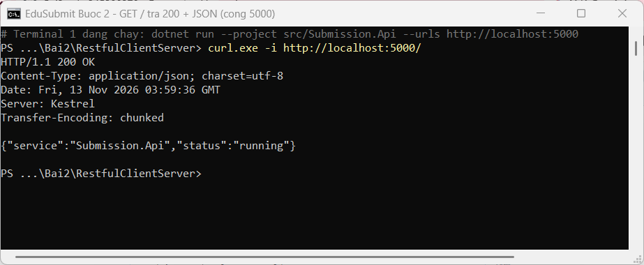
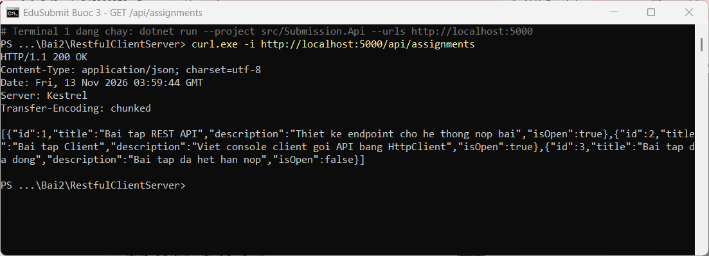
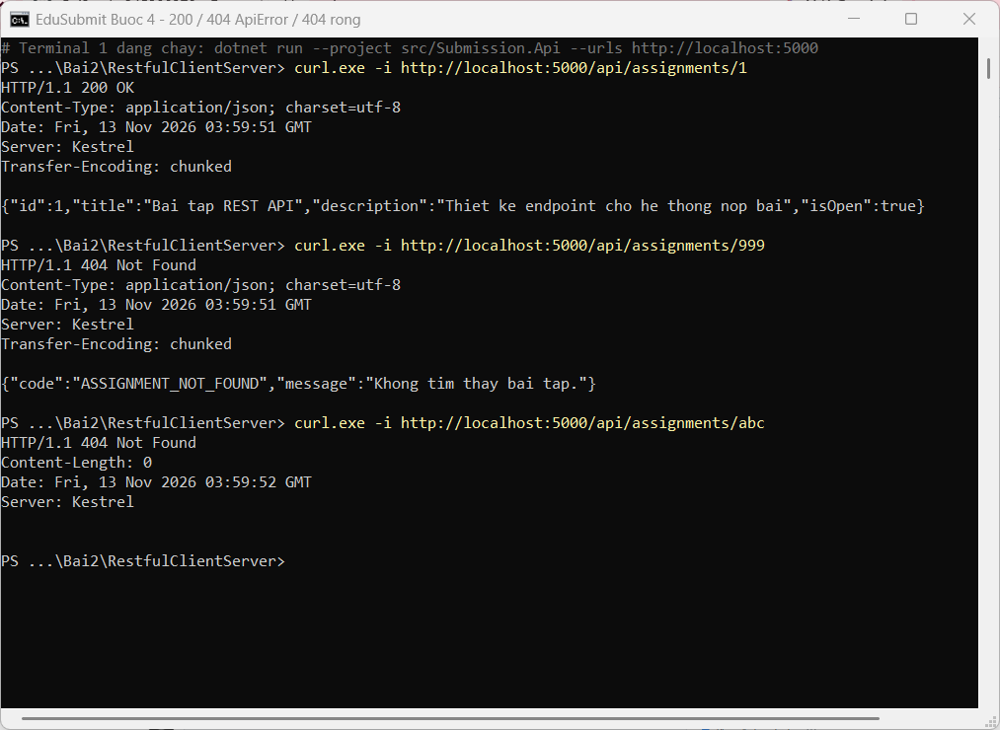
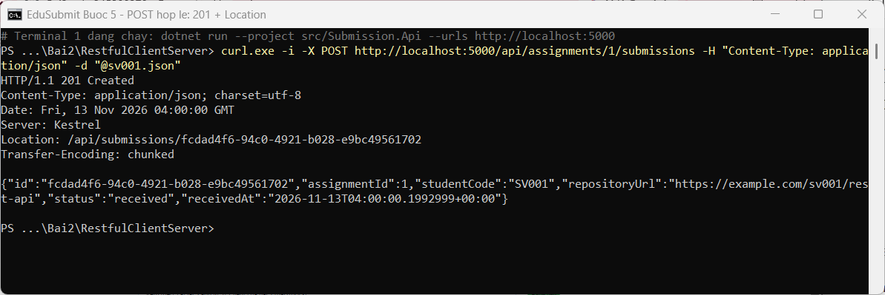
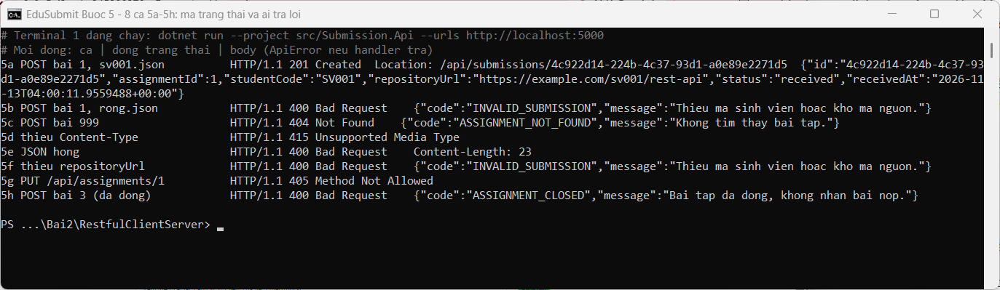
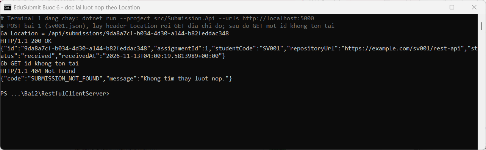
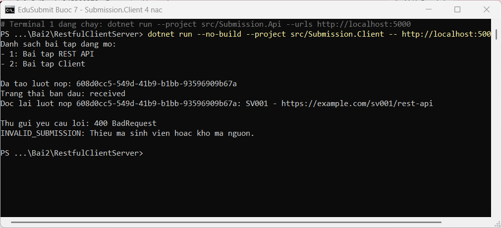
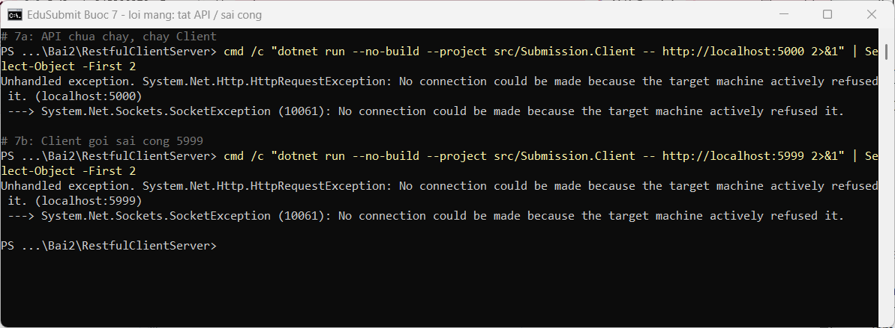
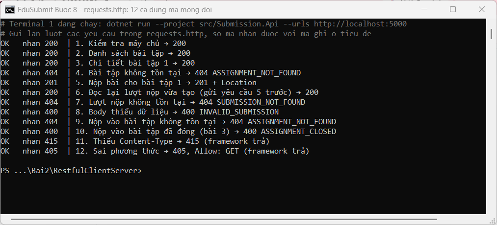

# Nhật ký Bài 2: EduSubmit (RestfulClientServer)

Sinh viên: Dương Ngô Hùng, MSSV dtc245200279. Ngày làm: 13/11/2026.

Mỗi bước là một commit (`EduSubmit buoc 1` … `EduSubmit buoc 8`); ảnh được chụp khi chạy đúng mã nguồn của commit đó. Máy chủ chạy ở Terminal 1, lệnh gọi thử ở Terminal 2.

## 1. Các bước và lệnh đã chạy

### Bước 1: dựng solution, hai project, `.gitignore`

```powershell
mkdir RestfulClientServer ; cd RestfulClientServer
dotnet new sln -n RestfulClientServer
dotnet new web -n Submission.Api -o src/Submission.Api
dotnet new console -n Submission.Client -o src/Submission.Client
dotnet sln add src/Submission.Api/Submission.Api.csproj
dotnet sln add src/Submission.Client/Submission.Client.csproj
dotnet new gitignore
dotnet build
```

Kết quả: `Build succeeded`, 0 Error(s).



### Bước 2: chạy máy chủ ở cổng 5000 cố định, `GET /`

```powershell
dotnet run --project src/Submission.Api --urls http://localhost:5000   # Terminal 1
curl.exe -i http://localhost:5000/                                     # Terminal 2
```

Kết quả: `200 OK`, body `{"service":"Submission.Api","status":"running"}`.



### Bước 3: DTO, dữ liệu mẫu, `GET /api/assignments`

```powershell
curl.exe -i http://localhost:5000/api/assignments
```

Kết quả: `200 OK` + mảng 3 bài tập. `IsOpen` trong C# thành `isOpen` trong JSON (camelCase).



### Bước 4: `GET /api/assignments/{assignmentId:int}`

```powershell
curl.exe -i http://localhost:5000/api/assignments/1
curl.exe -i http://localhost:5000/api/assignments/999
curl.exe -i http://localhost:5000/api/assignments/abc
```

Kết quả: `/1` → 200; `/999` → 404 + `ASSIGNMENT_NOT_FOUND` (handler trả); `/abc` → 404, `Content-Length: 0` (framework trả vì `abc` không khớp ràng buộc `:int`, handler không chạy).



### Bước 5: POST nộp bài qua 3 cổng kiểm tra

```powershell
curl.exe -i -X POST http://localhost:5000/api/assignments/1/submissions -H "Content-Type: application/json" -d "@sv001.json"
```

Kết quả: `201 Created`, `Location: /api/submissions/{guid}`, body có `status: "received"`. Máy chủ tự sinh `Id`, `Status`, `ReceivedAt`; `assignmentId` lấy từ URI.



Tám ca 5a–5h (bảng phá thử ở mục 2):



### Bước 6: đọc lại lượt nộp theo `Location`

Kết quả: GET đúng địa chỉ trong `Location` → 200 + đúng lượt nộp; GET một Guid không tồn tại → 404 + `SUBMISSION_NOT_FOUND`.



### Bước 7: máy khách 4 nấc

```powershell
dotnet run --project src/Submission.Client -- http://localhost:5000
```

Kết quả: in danh sách bài tập đang mở → tạo lượt nộp (in Guid, trạng thái `received`) → đọc lại theo `Location` → cố ý gửi sai, nhận `400 BadRequest` và in `INVALID_SUBMISSION`, chương trình không sập.





### Bước 8: `requests.http`

12 yêu cầu, phủ 200, 201, 400, 404, 405, 415; cả 12 cho đúng mã ghi ở tiêu đề. Yêu cầu 6 lấy `id` từ phản hồi của yêu cầu 5 (`# @name createSubmission`).



## 2. Bảng phá thử: 8 ca POST ở Bước 5

| Ca | Yêu cầu | Kết quả thật | Ai trả | Ý nghĩa |
|---|---|---|---|---|
| 5a | POST bài 1, `sv001.json` | 201 + `Location` | Handler | Tạo thành công, có địa chỉ đọc lại |
| 5b | POST bài 1, `rong.json` | 400 `INVALID_SUBMISSION` | Handler | Body thiếu dữ liệu |
| 5c | POST bài 999 | 404 `ASSIGNMENT_NOT_FOUND` | Handler | Tài nguyên cha không tồn tại |
| 5d | Bỏ `Content-Type` | 415, body rỗng | Framework | Không biết body là JSON, handler không chạy |
| 5e | JSON hỏng (`hong.json`) | 400, không có `ApiError` | Framework | Không đọc được body |
| 5f | Thiếu `repositoryUrl` (`thieu-truong.json`) | 400 `INVALID_SUBMISSION` | Handler | Trường thiếu thành null, handler bắt được |
| 5g | `PUT /api/assignments/1` | 405 | Framework | URI có, phương thức không hỗ trợ |
| 5h | POST bài 3 (đã đóng) | 400 `ASSIGNMENT_CLOSED` | Handler | Đúng cú pháp, sai quy tắc nghiệp vụ |

Nhận xét: mọi lỗi do handler trả đều có cùng dạng `ApiError { code, message }`, nên máy khách đọc bằng một hàm `PrintApiErrorAsync`. Ba ca do framework trả (5d, 5e, 5g) không có `ApiError`.

## 3. Thí nghiệm lỗi phân tán

| # | Thí nghiệm | Quan sát thật | Giải thích |
|---|---|---|---|
| 4b/4c | GET `/api/assignments/999` và `/abc` | Cả hai 404; `/999` có body `ASSIGNMENT_NOT_FOUND`, `/abc` body rỗng | `/999` do handler trả; `/abc` không khớp tuyến `:int` nên framework trả, máy khách phân biệt bằng body |
| 6c | Nộp bài, tắt API rồi chạy lại, GET lại đúng `Location` cũ | Trước khi tắt: 200; sau khi chạy lại: 404 `SUBMISSION_NOT_FOUND` | Lượt nộp chỉ nằm trong `List` bộ nhớ của tiến trình máy chủ, tiến trình dừng là mất |
| 7a | API chưa chạy, chạy Client | `HttpRequestException`: connection refused (localhost:5000) | Lỗi mạng: không có phản hồi nào, khác với lỗi HTTP 4xx (có phản hồi) |
| 7b | Client gọi sai cổng 5999 | `HttpRequestException`: connection refused (localhost:5999) | Hai bên phải thống nhất địa chỉ; địa chỉ là cấu hình truyền qua `args[0]` |
| 7c | Chạy Client lần 2 khi API vẫn chạy | Tạo thêm một lượt nộp với Guid mới | Trạng thái nằm ở máy chủ; máy khách chỉ hỏi và gửi |
