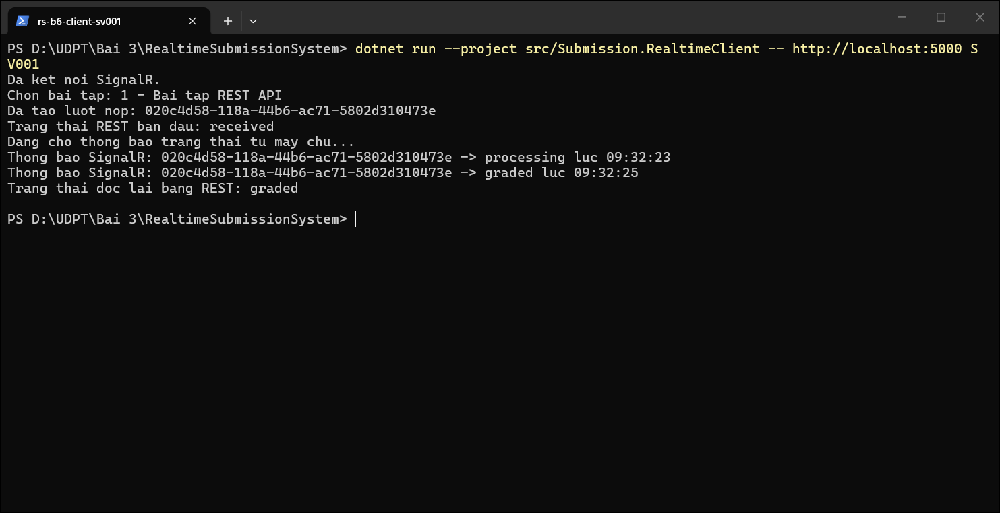

# Bài 3 – SignalR: máy chủ chủ động đẩy trạng thái tới máy khách

Sinh viên: Dương Ngô Hùng – MSSV dtc245200279 – Lớp CNTT K23D

| Thư mục | Nội dung |
|---|---|
| [`PingSignalR/`](PingSignalR/) | Phần 2: hub `PingHub` (`/hubs/ping`, cổng 5200) + máy khách console. Echo, Broadcast, nhóm, vòng đời kết nối, thí nghiệm lỗi. Nhật ký: [`PingSignalR/docs/nhat-ky.md`](PingSignalR/docs/nhat-ky.md) |
| [`RealtimeSubmissionSystem/`](RealtimeSubmissionSystem/) | Phần 3: EduSubmit realtime – REST của Bài 2 + hub `/hubs/submissions` (cổng 5000), máy khách hai kênh. Nhật ký: [`RealtimeSubmissionSystem/docs/nhat-ky.md`](RealtimeSubmissionSystem/docs/nhat-ky.md), `requests.http` 9 ca |

Build cả 2 solution (4 project): Build succeeded ([ảnh](RealtimeSubmissionSystem/docs/build-ca-hai-solution.png)). Ảnh minh chứng của từng bước nằm trong `docs/` của mỗi solution và được dẫn trong nhật ký.

## Cách chạy

```powershell
# PingSignalR (từ thư mục PingSignalR)
dotnet build PingSignalR.slnx
dotnet run --project src/Ping.Api --urls http://localhost:5200                 # Terminal 1
dotnet run --project src/Ping.Client -- http://localhost:5200 An               # Terminal 2 (Enter để thoát)

# RealtimeSubmissionSystem (từ thư mục RealtimeSubmissionSystem)
dotnet build RealtimeSubmissionSystem.slnx
dotnet run --project src/Submission.RealtimeApi --urls http://localhost:5000   # Terminal 1
dotnet run --project src/Submission.RealtimeClient -- http://localhost:5000 SV001   # Terminal 2 (tự thoát sau graded)
# Bài tập 2: tham số thứ 3 là kho mã nguồn; http:// → failed
dotnet run --project src/Submission.RealtimeClient -- http://localhost:5000 SV002 http://example.com/sv002/signalr
```

## Kết quả chạy máy khách EduSubmit (8 dòng)

```text
Da ket noi SignalR.
Chon bai tap: 1 - Bai tap REST API
Da tao luot nop: 020c4d58-118a-44b6-ac71-5802d310473e
Trang thai REST ban dau: received
Dang cho thong bao trang thai tu may chu...
Thong bao SignalR: 020c4d58-118a-44b6-ac71-5802d310473e -> processing luc 09:32:23
Thong bao SignalR: 020c4d58-118a-44b6-ac71-5802d310473e -> graded luc 09:32:25
Trang thai doc lai bang REST: graded
```



Máy chủ cùng lúc in: `[Hub] … theo doi submission:{id}` → `[Push] … -> processing` → `[Push] … -> graded` ([ảnh](RealtimeSubmissionSystem/docs/rs-b6-may-chu.png)). Máy khách Ping nhận Echo: [ảnh](PingSignalR/docs/b4-client-echo-an.png).

## Trả lời 3 câu hỏi đầu giờ

1. **Máy chủ có thể chủ động báo cho máy khách mà không cần máy khách hỏi không?**
   Có, nếu máy khách mở sẵn một kết nối lâu dài (SignalR, ưu tiên WebSocket). Qua kết nối đó máy chủ gửi bất cứ lúc nào bằng `Clients.Group(...).SendAsync(...)`; khi gửi từ ngoài hub (tác vụ chấm nền) thì dùng `IHubContext<SubmissionHub>`. Ở bài này máy khách chỉ gọi `WatchSubmission` một lần, sau đó hai thông báo `processing`, `graded` tự đến mà máy khách không hề hỏi.
2. **Đã có REST rồi, vì sao còn cần SignalR? Hai thứ chia việc thế nào?**
   REST tạo và đọc tài nguyên với mã trạng thái rõ ràng (`POST` → 201, `GET` → 200/404) và là **nguồn sự thật** (trạng thái lưu ở máy chủ). SignalR chỉ **đẩy các thay đổi phát sinh sau** yêu cầu ban đầu, để máy khách biết sớm mà không phải hỏi liên tục (polling). SignalR không thay thế REST: máy khách luôn chốt trạng thái cuối bằng `GET /api/submissions/{id}`.
3. **Nếu mạng đứt đúng lúc máy chủ báo graded thì sao?**
   Tin đó mất – SignalR không lưu tin để gửi lại. `WithAutomaticReconnect` nối lại với **ConnectionId mới** (đã thấy ở thí nghiệm PingSignalR: `5Y-Svh_M` → `GumIlr3X`) nên nhóm cũ cũng mất; máy khách phải gọi lại `WatchSubmission` và gọi `GET /api/submissions/{id}` để lấy trạng thái cuối. Thí nghiệm 5 bên dưới cho thấy đúng điều này: vào nhóm muộn thì lỡ hết tin, nhưng REST vẫn trả `graded`. **Push để nhanh, REST để chắc.**

## Năm thí nghiệm Bước 7 (dự đoán + kết quả thật)

| # | Thí nghiệm | Dự đoán | Kết quả thật | Giải thích |
|---|---|---|---|---|
| 1 | Hai máy khách SV001, SV002 cùng lúc | Mỗi máy khách chỉ nhận tin lượt nộp của mình | Máy chủ đẩy xen kẽ 2 lượt nộp; mỗi cửa sổ chỉ có id của mình | Nhóm `submission:{id}` tách người nhận |
| 2 | Máy chủ chưa chạy | Lỗi kết nối | `HttpRequestException: … actively refused it. (localhost:5000)` | Lần nối đầu không được tự thử lại |
| 3 | `WithUrl` thành `/hub/submissions` | 404 | `HttpRequestException: … 404 (Not Found)` tại negotiate | Đường dẫn phải khớp `MapHub` |
| 4 | `On("SubmissionStatusChange")` | Không lỗi, không có thông báo | Không lỗi; `Qua thoi gian cho thong bao graded.`; REST `graded` | Sai tên chiều xuống = im lặng |
| 5 | Chờ 4 giây rồi mới `WatchSubmission` | Lỡ hết thông báo | Không nhận tin nào; REST đọc lại `graded` | Vào nhóm muộn là lỡ tin; REST là nguồn sự thật |

Chi tiết và ảnh từng thí nghiệm: [`RealtimeSubmissionSystem/docs/nhat-ky.md`](RealtimeSubmissionSystem/docs/nhat-ky.md#bước-7-năm-thí-nghiệm-phân-tán-slide-5860).

## requests.http

[`RealtimeSubmissionSystem/requests.http`](RealtimeSubmissionSystem/requests.http): 9 ca – 200, 200, 201, 200, 400, 404, 404, 200 (negotiate), 404 (sai hub); cả 9 đúng mã ([ảnh](RealtimeSubmissionSystem/docs/rs-b8-requests-9-ca.png)).

## Bài tập vận dụng

Bài tập 2 – trạng thái `failed`: kho mã nguồn không bắt đầu bằng `https://` thì trạng thái cuối là `failed`; máy khách in cảnh báo màu đỏ ([ảnh](RealtimeSubmissionSystem/docs/rs-bt2-http-failed.png)).

## Kiểm tra lại trước hạn nộp

Ngày 26/11/2026 09:14: build lại cả 2 solution (4 project) – Build succeeded, 0 lỗi.
