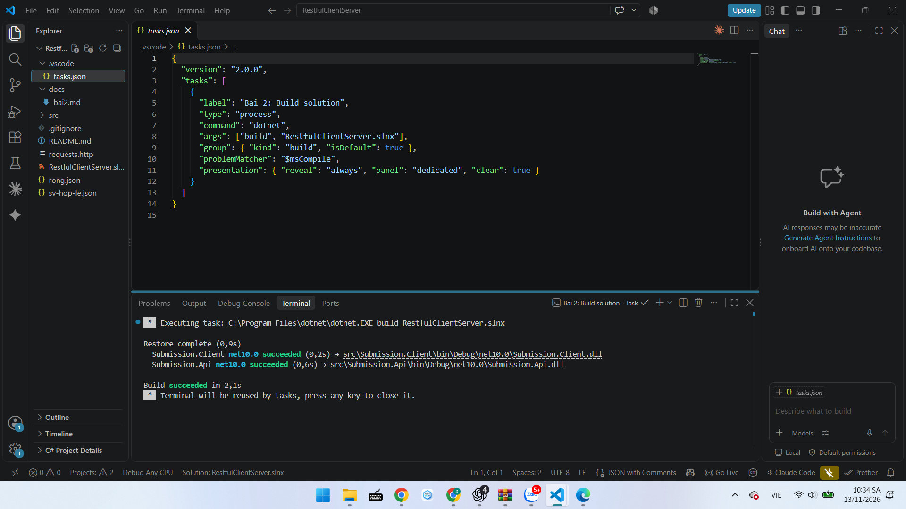
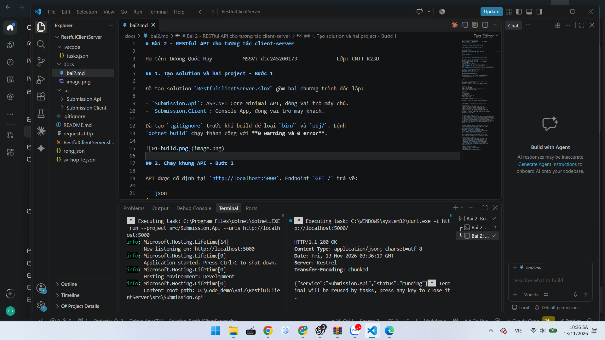
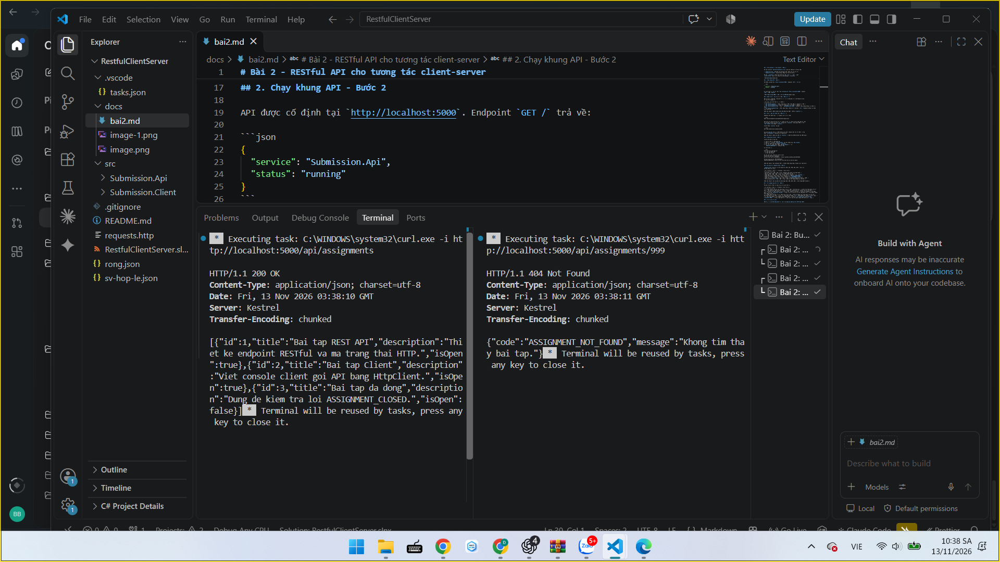
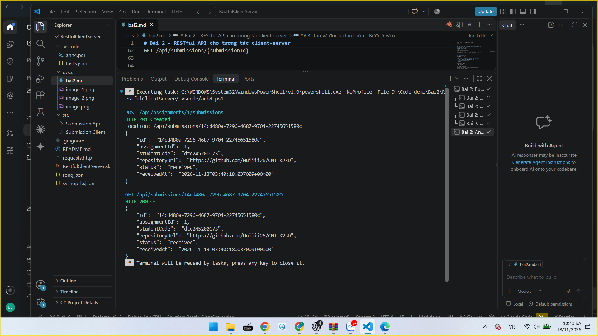
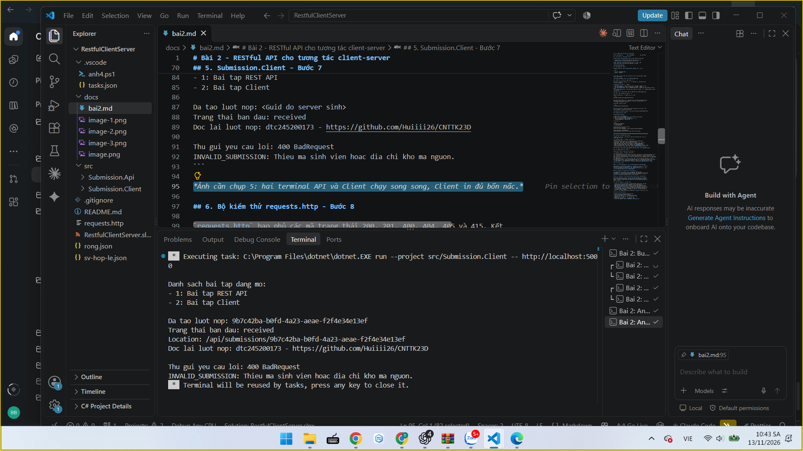
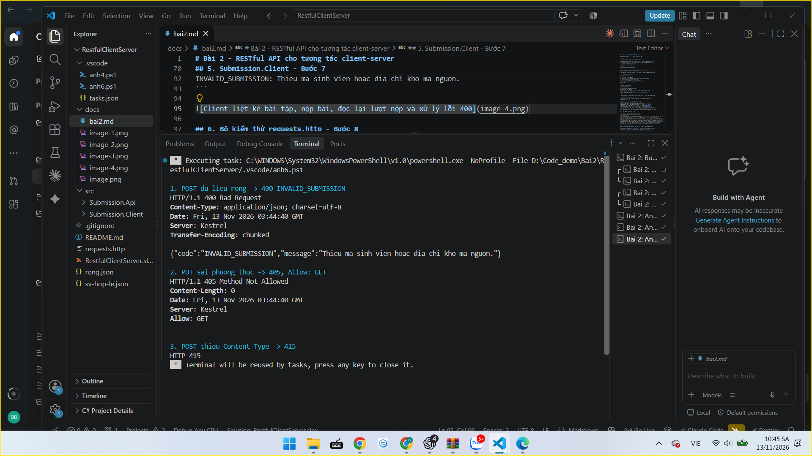

# Bài 2 - RESTful API cho tương tác client-server

Họ tên: Dương Quốc Huy          MSSV: dtc245200173             Lớp: CNTT K23D

## 1. Tạo solution và hai project - Bước 1

Đã tạo solution `RestfulClientServer.slnx` gồm hai chương trình độc lập:

- `Submission.Api`: ASP.NET Core Minimal API, đóng vai trò máy chủ.
- `Submission.Client`: Console App, đóng vai trò máy khách.

Đã tạo `.gitignore` trước khi build để loại `bin/` và `obj/`. Lệnh
`dotnet build` chạy thành công với **0 warning và 0 error**.



## 2. Chạy khung API - Bước 2

API được cố định tại `http://localhost:5000`. Endpoint `GET /` trả về:

```json
{
  "service": "Submission.Api",
  "status": "running"
}
```

Kết quả thực tế: máy chủ ghi `Now listening on: http://localhost:5000`; request
`GET /` nhận `200 OK`.



## 3. Danh sách và chi tiết bài tập - Bước 3 và 4

API có ba bài tập mẫu, trong đó bài 1 và bài 2 đang mở, bài 3 đã đóng để kiểm
thử quy tắc nghiệp vụ.

| Yêu cầu | Kết quả thực tế | Ý nghĩa |
|---|---|---|
| `GET /api/assignments` | 200 + mảng ba bài tập | Đọc tập tài nguyên bài tập. |
| `GET /api/assignments/1` | 200 + bài tập số 1 | Tìm thấy tài nguyên. |
| `GET /api/assignments/999` | 404 + `ASSIGNMENT_NOT_FOUND` | Handler chạy nhưng không tìm thấy bài tập. |
| `GET /api/assignments/abc` | 404, body rỗng | Route có ràng buộc `:int`, framework không tìm thấy tuyến phù hợp. |



## 4. Tạo và đọc lại lượt nộp - Bước 5 và 6

Endpoint tạo lượt nộp là tài nguyên con của bài tập:

```text
POST /api/assignments/{assignmentId}/submissions
```

API kiểm tra theo đúng thứ tự: bài tập tồn tại, bài tập còn mở, body hợp lệ. Khi
thành công, server tự sinh `Id`, trạng thái `received`, thời gian nhận và trả
`201 Created` kèm header `Location`.

Client dùng `Location` để gọi:

```text
GET /api/submissions/{submissionId}
```

Kết quả kiểm thử thực tế: POST hợp lệ trả 201; request đọc lại trả 200 và đúng
MSSV `dtc245200173` cùng địa chỉ repository.



## 5. Submission.Client - Bước 7

Client đã chạy đủ bốn nấc:

1. Liệt kê hai bài tập đang mở.
2. Nộp bài và chỉ đọc `SubmissionDto` sau khi nhận đúng `201 Created`.
3. Đọc lại lượt nộp theo header `Location`.
4. Cố ý gửi dữ liệu rỗng, nhận `400 Bad Request` và in
   `INVALID_SUBMISSION` mà không bị sập.

Kết quả thực tế:

```text
Danh sach bai tap dang mo:
- 1: Bai tap REST API
- 2: Bai tap Client

Da tao luot nop: <Guid do server sinh>
Trang thai ban dau: received
Doc lai luot nop: dtc245200173 - https://github.com/Huiiii26/CNTTK23D

Thu gui yeu cau loi: 400 BadRequest
INVALID_SUBMISSION: Thieu ma sinh vien hoac dia chi kho ma nguon.
```



## 6. Bộ kiểm thử requests.http - Bước 8

`requests.http` bao phủ các mã trạng thái 200, 201, 400, 404, 405 và 415. Kết
quả đã chạy trực tiếp:

| Ca | Dự đoán | Thực tế | Đúng/Sai | Giải thích |
|---|---|---|---|---|
| GET danh sách | 200 | 200 | Đúng | Endpoint đọc danh sách hoạt động. |
| GET bài 999 | 404 | 404 | Đúng | Bài tập không tồn tại. |
| POST hợp lệ | 201 | 201 | Đúng | Server tạo tài nguyên và trả `Location`. |
| POST body rỗng | 400 | 400 | Đúng | Handler trả `INVALID_SUBMISSION`. |
| POST bài đã đóng | 400 | 400 | Đúng | Handler trả `ASSIGNMENT_CLOSED`. |
| POST thiếu `Content-Type` | 415 | 415 | Đúng | Framework không biết body là JSON. |
| PUT sai phương thức | 405 | 405 | Đúng | URI tồn tại nhưng không hỗ trợ PUT. |



Các ảnh 3 và 4 phía trên minh họa thêm 404 và 201. Các request được chạy từ terminal VS Code để quan sát mã và body HTTP.

## 7. Thí nghiệm hệ phân tán - Bước 9

Đã ghi dự đoán trước rồi đối chiếu kết quả thực tế.

| # | Dự đoán | Thực tế | Đúng/Sai | Giải thích |
|---|---|---|---|---|
| a | Chạy Client lần hai vẫn thấy danh sách bài tập và tạo Guid mới. | Client lấy cùng danh sách từ API và tạo thêm một lượt nộp mới. | Đúng | Trạng thái nằm ở máy chủ; Client chỉ gửi yêu cầu. |
| b | Tắt API rồi chạy Client sẽ báo lỗi kết nối, không có mã HTTP. | Client báo không kết nối được API và hiển thị `Connection refused`. | Đúng | Tiến trình ở xa có thể vắng mặt; đây là lỗi mạng, không phải phản hồi 4xx. |
| c | Khởi động lại API làm các lượt nộp cũ biến mất. | Guid cũ không còn trong danh sách bộ nhớ và GET theo Guid cũ trả 404. | Đúng | Dữ liệu đang lưu bằng `List`, không được ghi xuống cơ sở dữ liệu. |
| d | Gọi cổng 5999 sẽ lỗi nhưng Client không sập. | Client in `No connection could be made ... (localhost:5999)`. | Đúng | URL dịch vụ là cấu hình; hai bên phải thống nhất địa chỉ và cổng. |

## 8. Trả lời ba câu hỏi

### 8.1. Vì sao URI dùng danh từ, còn hành động do phương thức HTTP đảm nhận?

URI định danh tài nguyên như `assignments` và `submissions`; phương thức HTTP mới
biểu diễn hành động. `GET` dùng để đọc, `POST` dùng để tạo. Ví dụ
`POST /api/assignments/1/submissions` cho biết đang tạo lượt nộp thuộc bài tập 1
rõ hơn một URI chứa động từ như `/submitAssignment`.

### 8.2. “Stateless” thể hiện ở đâu trong code đã viết?

Mỗi request mang đủ dữ liệu cần thiết: `assignmentId` nằm trên URI,
`studentCode` và `repositoryUrl` nằm trong JSON body. API không phải nhớ Client đã
gọi request nào trước đó. Stateless không có nghĩa server không lưu dữ liệu; các
bài tập và lượt nộp vẫn nằm trong bộ nhớ của tiến trình API.

### 8.3. Vì sao Client và Server mỗi bên khai báo DTO riêng mà vẫn khớp nhau?

Hai project không chia sẻ code mà cùng tuân theo hợp đồng JSON. Khi tên trường và
kiểu dữ liệu tương ứng giống nhau, `System.Text.Json` vẫn chuyển đổi đúng giữa
JSON và record của mỗi bên. Nhờ đó hai chương trình độc lập, không cần tham chiếu
project của nhau.

## 9. Khó khăn gặp phải và cách giải quyết

- `dotnet new` trong môi trường hạn chế không đọc được `NuGet.Config`. Đã chạy
  restore/build với quyền đọc cấu hình NuGet của máy; build đạt 0 lỗi.
- Cổng sinh ngẫu nhiên khiến Client không biết gọi đâu. Đã cố định API ở cổng
  5000 trong `launchSettings.json` và vẫn hỗ trợ truyền URL qua đối số Client.
- `GetFromJsonAsync` có thể ném ngoại lệ khi gặp 4xx. Client dùng `GetAsync` hoặc
  `PostAsJsonAsync`, kiểm tra `StatusCode` trước rồi mới chọn DTO để đọc body.
- Các lỗi do framework như 405 và 415 không có `ApiError`. Bộ test phân biệt rõ
  lỗi handler với lỗi framework.
- `bin/` và `obj/` được sinh khi build nhưng đã bị `.gitignore` loại khỏi bài nộp.

## 10. Kiểm tra trước khi nộp

- Solution build thành công: 0 warning, 0 error.
- API có đủ 4 endpoint nghiệp vụ theo đề.
- Client chạy đủ bốn nấc và xử lý lỗi 400 không bị sập.
- `requests.http` bao phủ 200, 201, 400, 404, 405 và 415.
- Không nộp `bin/`, `obj/`.
- Thư mục nộp: `Dương Quốc Huy - dtc245200173/Bai2`.
- Tiêu đề Pull Request: `Bai2 - dtc245200173 - Dương Quốc Huy`.
