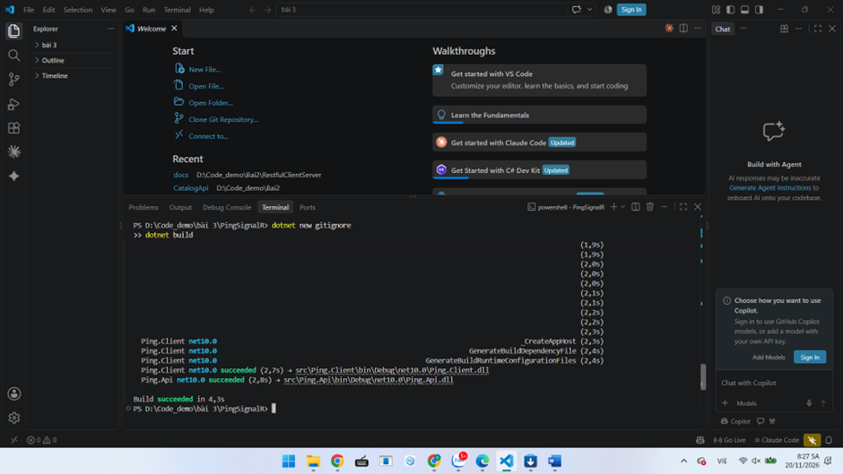
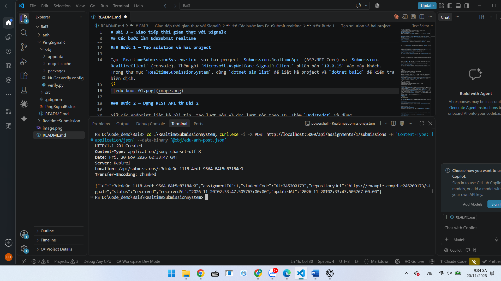
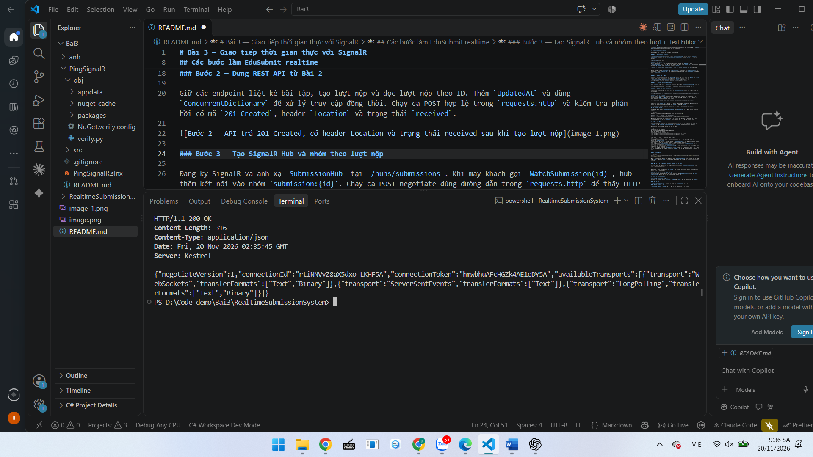
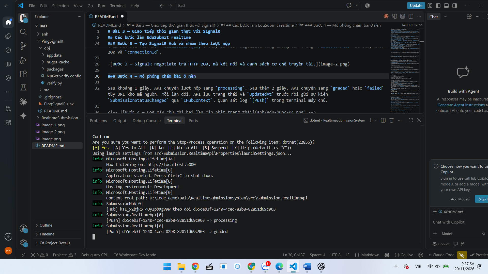
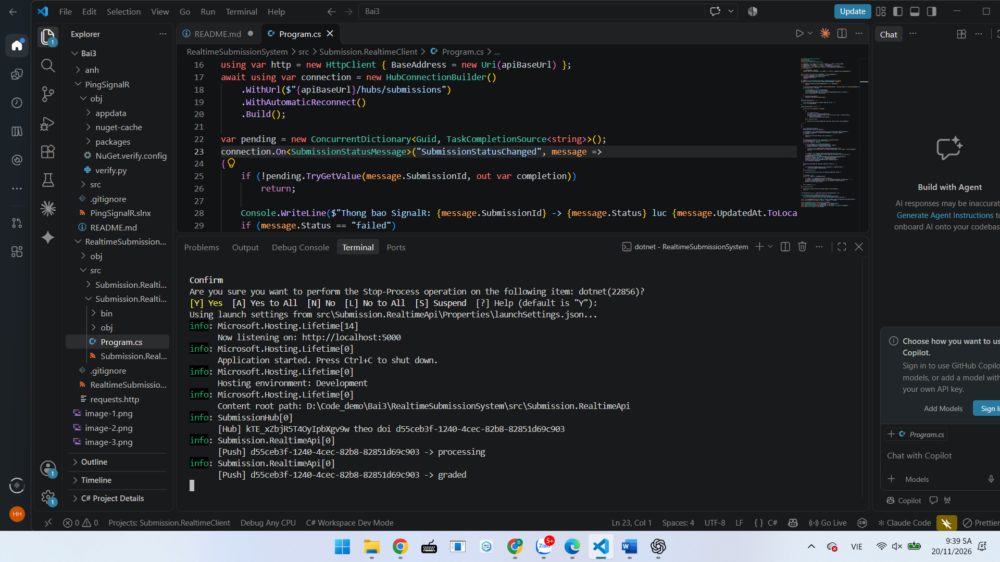
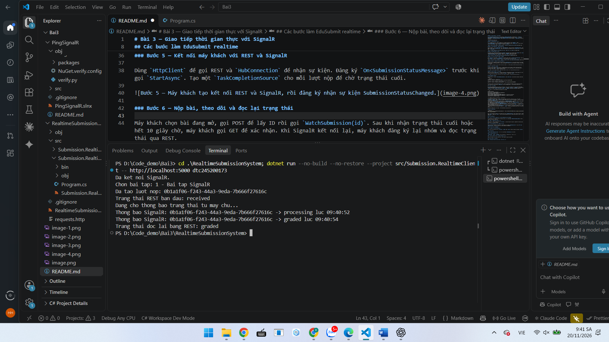
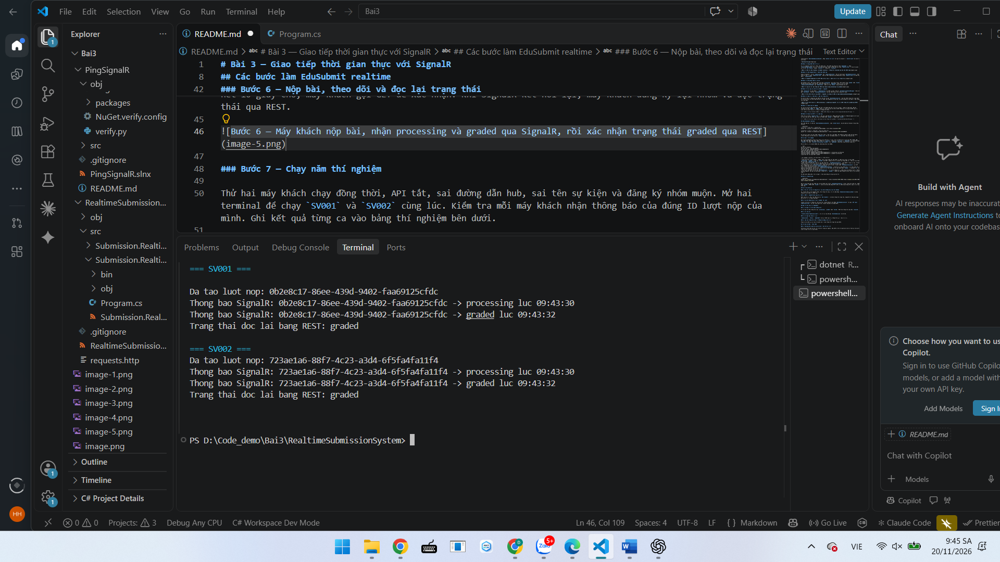
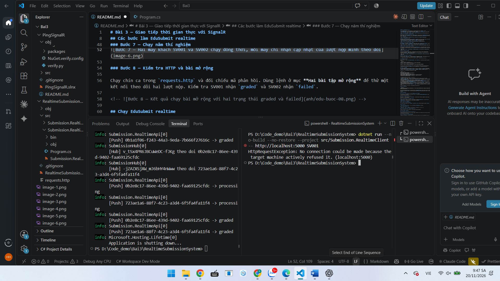
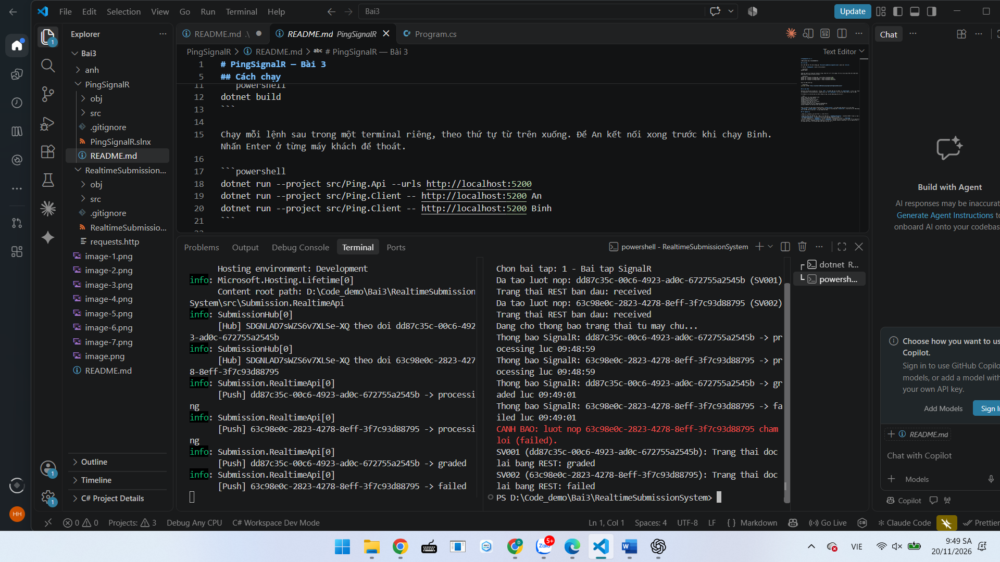

# Bài 3 — Giao tiếp thời gian thực với SignalR

**Dương Quốc Huy · dtc245200173**

- [PingSignalR](PingSignalR/README.md) chạy trên cổng 5200. Hướng dẫn có ví dụ An và Bình.
- [EduSubmit realtime](RealtimeSubmissionSystem/RealtimeSubmissionSystem.slnx) chạy trên cổng 5000. Bộ [requests.http](RealtimeSubmissionSystem/requests.http) có 9 yêu cầu kiểm tra.

## Các bước làm EduSubmit realtime

Ảnh minh chứng có thể lưu trong thư mục `Bai3/anh/`. Sau khi thêm ảnh, bỏ dấu chú thích `<!--` và `-->` quanh dòng ảnh tương ứng. Nếu tên tệp khác, sửa đường dẫn trên dòng đó.

### Bước 1 — Tạo solution và hai project

Tạo `RealtimeSubmissionSystem.slnx` với hai project `Submission.RealtimeApi` (ASP.NET Core) và `Submission.RealtimeClient` (console). Thêm gói `Microsoft.AspNetCore.SignalR.Client` phiên bản `10.0.15` vào máy khách. Trong thư mục `RealtimeSubmissionSystem`, dùng `dotnet sln list` để liệt kê project và `dotnet build` để kiểm tra biên dịch.



### Bước 2 — Dựng REST API từ Bài 2

Giữ các endpoint liệt kê bài tập, tạo lượt nộp và đọc lượt nộp theo ID. Thêm `UpdatedAt` và dùng `ConcurrentDictionary` để xử lý truy cập đồng thời. Chạy ca POST hợp lệ trong `requests.http` và kiểm tra phản hồi có mã `201 Created`, header `Location` và trạng thái `received`.



### Bước 3 — Tạo SignalR Hub và nhóm theo lượt nộp

Đăng ký SignalR và ánh xạ `SubmissionHub` tại `/hubs/submissions`. Khi máy khách gọi `WatchSubmission(id)`, hub thêm kết nối vào nhóm `submission:{id}`. Chạy ca POST negotiate đúng đường dẫn trong `requests.http` để thấy HTTP 200 và `connectionId`.



### Bước 4 — Mô phỏng chấm bài ở nền

Sau khoảng 1 giây, API chuyển lượt nộp sang `processing`. Sau thêm 2 giây, API chuyển sang `graded` hoặc `failed` tùy URL kho mã nguồn. Mỗi lần đổi, API lưu trạng thái và `UpdatedAt` trước rồi gửi sự kiện `SubmissionStatusChanged` qua `IHubContext`. Quan sát log `[Push]` trong terminal máy chủ.



### Bước 5 — Kết nối máy khách với REST và SignalR

Dùng `HttpClient` để gọi REST và `HubConnection` để nhận sự kiện. Đăng ký `On<SubmissionStatusMessage>` trước khi gọi `StartAsync`. Tạo một `TaskCompletionSource` cho mỗi lượt nộp để chờ trạng thái cuối.



### Bước 6 — Nộp bài, theo dõi và đọc lại trạng thái

Máy khách chọn bài đang mở, gọi POST để lấy ID rồi gọi `WatchSubmission(id)`. Sau khi nhận trạng thái cuối hoặc hết 10 giây chờ, máy khách gọi GET để xác nhận. Khi SignalR kết nối lại, máy khách đăng ký lại nhóm và đọc trạng thái qua REST.



### Bước 7 — Chạy năm thí nghiệm

Thử hai máy khách chạy đồng thời, API tắt, sai đường dẫn hub, sai tên sự kiện và đăng ký nhóm muộn. Mở hai terminal để chạy `SV001` và `SV002` cùng lúc. Kiểm tra mỗi máy khách nhận thông báo của đúng ID lượt nộp của mình. Ghi kết quả từng ca vào bảng thí nghiệm bên dưới.



### Bước 8 — Kiểm tra HTTP và bài mở rộng

Chạy chín ca trong `requests.http` và đối chiếu mã phản hồi. Dùng lệnh ở mục **Hai bài tập mở rộng** để thử một kết nối theo dõi hai lượt nộp. Kiểm tra SV001 nhận `graded` và SV002 nhận `failed`.



## Chạy EduSubmit realtime

Cần .NET SDK 10. Từ thư mục `RealtimeSubmissionSystem`, chạy `dotnet build`. Sau đó mở hai terminal trong cùng thư mục:

```powershell
# Terminal 1: REST API và SignalR Hub
dotnet run --project src/Submission.RealtimeApi --urls http://localhost:5000

# Terminal 2: nộp bài, theo dõi và đọc lại trạng thái
dotnet run --project src/Submission.RealtimeClient -- http://localhost:5000 dtc245200173
```

Máy khách tự thoát sau khi nhận trạng thái cuối và đối chiếu qua REST. Khi không có tham số URL kho mã nguồn, client dùng địa chỉ minh họa tại `example.com`. Máy chủ mô phỏng chấm bài và lưu lượt nộp trong bộ nhớ.

## Kết quả và thí nghiệm

Hai project EduSubmit build thành công với 0 cảnh báo và 0 lỗi. Chín ca HTTP cho kết quả lần lượt **200, 200, 201, 200, 400, 404, 404, 200, 404**. POST trả `Location`, trạng thái `received` và `updatedAt`. Các lần GET theo `Location` xác nhận `received → processing → graded`, với `updatedAt` tăng theo từng lần đổi trạng thái.

Đầu ra thực tế của client SV001 khi chạy đồng thời với SV002.

```text
Da ket noi SignalR.
Chon bai tap: 1 - Bai tap SignalR
Da tao luot nop: 788d5bc5-9ba6-45ca-8967-350b067d4ff4
Trang thai REST ban dau: received
Dang cho thong bao trang thai tu may chu...
Thong bao SignalR: 788d5bc5-9ba6-45ca-8967-350b067d4ff4 -> processing luc 09:16:04
Thong bao SignalR: 788d5bc5-9ba6-45ca-8967-350b067d4ff4 -> graded luc 09:16:06
Trang thai doc lai bang REST: graded
```

| Thí nghiệm | Dự đoán | Kết quả thực tế | Giải thích |
| --- | --- | --- | --- |
| Chạy đồng thời client SV001 và SV002 | Mỗi client nhận hai cập nhật của lượt nộp riêng | Cả hai nhận `processing`, `graded` và đọc lại `graded` qua REST. Không có ID của client kia trong đầu ra. | Mỗi kết nối theo dõi một nhóm `submission:{id}`. |
| Chạy client khi API tắt | Lần kết nối đầu thất bại | `HttpRequestException`, cổng 5000 từ chối kết nối. Client thoát với mã 1. | Tự kết nối lại áp dụng sau khi kết nối đầu tiên đã mở thành công. |
| Sửa đường dẫn thành `/hub/submissions` | Bước bắt tay trả 404 | Client nhận `HttpRequestException` với HTTP 404. | Đường dẫn hub phải khớp `/hubs/submissions`. |
| Đổi tên sự kiện phía client thành `SubmissionStatusChange` | Client bỏ lỡ hai thông báo và hết thời gian chờ | Không có dòng SignalR. Sau 10 giây, client báo hết thời gian chờ rồi đọc REST được `graded`. | Callback `On` chỉ chạy khi tên khớp với tên máy chủ gửi. |
| Chờ 4 giây sau POST rồi mới gọi `WatchSubmission` | Lỡ cả hai thông báo vì chấm xong sau khoảng 3 giây | Không có dòng SignalR. Khi đọc lại qua REST, trạng thái là `graded`. | Nhóm chỉ nhận thông báo phát sau lúc kết nối gia nhập. |

Đã khôi phục đường dẫn, tên sự kiện và thời điểm đăng ký đúng sau khi thử.

### Hai bài tập mở rộng

```powershell
dotnet run --project src/Submission.RealtimeClient -- http://localhost:5000 SV001 https://example.com/sv001 SV002 http://example.com/sv002
```

Một kết nối theo dõi hai lượt nộp, mỗi mã lượt nộp có một `TaskCompletionSource` riêng. Trong lần chạy thử, SV001 nhận `graded`, SV002 nhận `failed` và cảnh báo đỏ do URL dùng HTTP. GET xác nhận đúng trạng thái cuối của cả hai lượt nộp.

## Ba câu hỏi đầu giờ

### 1. Máy chủ có thể chủ động báo mà máy khách không hỏi liên tục không?

Có. Client mở kết nối SignalR trước. Khi trạng thái đổi, tác vụ chấm dùng `IHubContext<SubmissionHub>` để đẩy thông báo đến nhóm của lượt nộp.

### 2. REST và SignalR chia việc thế nào?

REST liệt kê bài tập, tạo lượt nộp với `201 Created` và cho đọc trạng thái hiện tại. SignalR báo thay đổi ngay khi máy chủ xử lý xong từng bước.

### 3. Nếu đứt mạng đúng lúc gửi `graded` thì sao?

Client có thể bỏ lỡ thông báo. Khi nối lại, client đăng ký lại bằng `WatchSubmission(id)` rồi gọi `GET /api/submissions/{id}`. Nếu quá thời gian chờ, client cũng đọc lại bằng REST.

## Bốn câu hỏi thiết kế EduSubmit

### 1. Sự kiện nào kích hoạt thông báo?

Tác vụ nền vừa lưu trạng thái mới `processing`, `graded` hoặc `failed`. POST tạo trạng thái ban đầu `received`.

### 2. Gửi cho ai?

`Clients.Group("submission:{id}")`, tức các kết nối đã gọi `WatchSubmission` cho ID đó.

### 3. Dữ liệu tối thiểu là gì?

`SubmissionId`, `Status`, `UpdatedAt` để biết lượt nộp nào, trạng thái gì và đổi lúc nào.

### 4. Lấy lại trạng thái khi lỡ thông báo bằng cách nào?

Đăng ký lại nhóm nếu kết nối vừa phục hồi và đọc trạng thái hiện tại qua REST.

## Câu hỏi ôn tập và thảo luận

### 1. Polling khác push về số yêu cầu và độ trễ thế nào?

Polling gửi GET theo chu kỳ, kể cả khi dữ liệu giữ nguyên. Cập nhật có thể trễ gần một chu kỳ. Push gửi khi phát sinh sự kiện trên kết nối đã mở.

### 2. Phân biệt ba mô hình trao đổi thông điệp?

Hỏi–đáp do client khởi tạo và nhận một phản hồi cho mỗi yêu cầu. Push do máy chủ phát từng thông báo khi có sự kiện. Truyền luồng gửi một chuỗi thông điệp trong một tương tác.

### 3. WebSocket và SignalR là gì?

WebSocket là giao thức hai chiều trên kết nối lâu dài. SignalR là thư viện cung cấp hub, nhóm và lựa chọn cơ chế truyền tải.

### 4. SignalR có những cơ chế truyền tải nào?

WebSockets, Server-Sent Events và Long Polling.

### 5. Khi nào polling hợp lý?

Khi dữ liệu ít đổi và chấp nhận độ trễ, hoặc khi hạ tầng không duy trì được kết nối lâu dài.

### 6. Vì sao dùng nhóm theo ID khi nhiều sinh viên cùng theo dõi?

Máy chủ chỉ gửi đến kết nối đang theo dõi lượt nộp tương ứng, giảm băng thông. Ứng dụng thật cần xác thực và kiểm tra quyền trước khi thêm kết nối vào nhóm.

### 7. `IHubContext` dùng để làm gì?

Cho mã chạy ngoài hub, như tác vụ chấm nền, gửi thông báo đến client hoặc nhóm.

### 8. Nếu chạy nhiều bản sao API thì sao?

Mỗi máy chủ quản lý kết nối của nó. Dùng Redis backplane hoặc dịch vụ Azure SignalR để chuyển thông báo giữa các máy chủ và dùng kho dữ liệu chung cho lượt nộp.

### 9. `On<T>` dùng để làm gì?

Đăng ký callback cho sự kiện có tên và kiểu dữ liệu xác định. Bỏ callback thì client không xử lý sự kiện đó.

### 10. Vì sao dùng REST để tạo lượt nộp?

REST trả mã HTTP rõ ràng và `Location` để đọc lại tài nguyên. SignalR theo dõi thay đổi của tài nguyên sau khi tạo.

### 11. `WithAutomaticReconnect` có tác dụng gì?

Tự thử mở lại một kết nối đã bị gián đoạn. Sau khi nối lại, ứng dụng cần đăng ký lại nhóm và đọc REST để bù thông báo bị lỡ.
