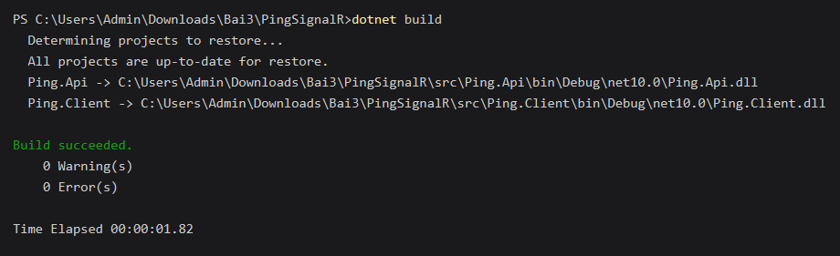
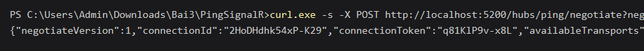
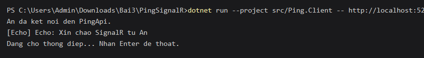
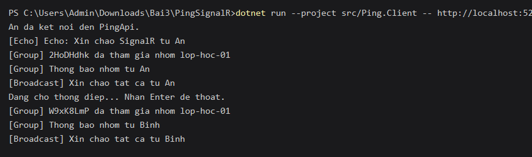
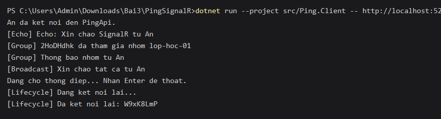
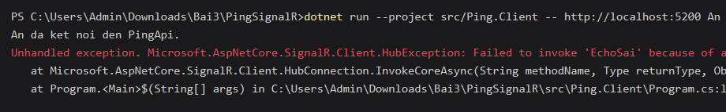
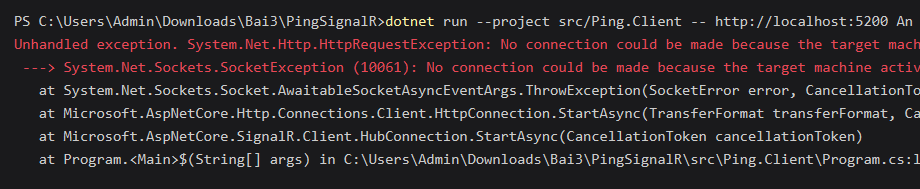
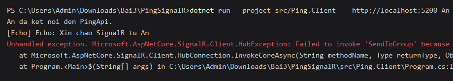

# PingSignalR

Báo cáo bài thực hành SignalR với ASP.NET Core (`Ping.Api`) và máy khách Console (`Ping.Client`).

---

## Bước 1: Build

- **Thấy:** Lệnh `dotnet build` chạy thành công trên cả hai dự án `Ping.Api` và `Ping.Client`, kết quả `Build succeeded. 0 Warning(s) 0 Error(s)`.
- **Giải thích:** Đã cấu hình đúng SDK, thư viện `Microsoft.AspNetCore.SignalR` có sẵn trong SDK Web của API và `Microsoft.AspNetCore.SignalR.Client` được tham chiếu đúng trong Client.

---

## Bước 2: Negotiate

- **Thấy:** `curl` trả về chuỗi JSON chứa `connectionId`, `connectionToken` và mảng `availableTransports` gồm WebSockets, ServerSentEvents, LongPolling.
- **Giải thích:** Quá trình đàm phán (negotiation) thành công, máy chủ cấp mã định danh kết nối tạm thời và thông báo cho máy khách các phương thức truyền tải mà máy chủ hỗ trợ để máy khách lựa chọn phương thức tối ưu nhất (mặc định ưu tiên WebSocket).

---

## Bước 3–4: Echo

- **Thấy:** Máy chủ lắng nghe tại cổng `5200`. Máy khách An kết nối thành công và in dòng `[Echo] Echo: Xin chao SignalR tu An`.
- **Giải thích:** Máy khách gọi phương thức `Echo` trên Hub thông qua `InvokeAsync("Echo", ...)`. Phía Hub nhận dữ liệu và dùng `Clients.Caller.SendAsync("EchoResponse", ...)` để phản hồi riêng cho đúng máy khách vừa gọi.

---

## Bước 5: Nhóm (Group) và Broadcast

- **Thấy:** Hai máy khách (An và Binh) cùng tham gia nhóm `lop-hoc-01`. Cả hai đều thấy thông điệp chào mừng gia nhập nhóm, thông báo nội bộ nhóm `[Group]` và thông báo toàn máy chủ `[Broadcast]`, nhưng không thấy thông điệp `[Echo]` riêng của nhau.
- **Giải thích:**
  - `Clients.Group("lop-hoc-01")`: Chỉ gửi tới các kết nối đã đăng ký vào nhóm qua `Groups.AddToGroupAsync`.
  - `Clients.All`: Gửi broadcast tới toàn bộ client đang online.
  - `Clients.Caller`: Chỉ gửi riêng cho người gọi, bảo đảm tính riêng tư.

---

## Bước 6: Tự kết nối lại (Automatic Reconnect)

- **Thấy:** Khi tạm ngắt kết nối máy chủ, máy khách kích hoạt sự kiện `Reconnecting` và in `[Lifecycle] Dang ket noi lai...`. Khi máy chủ hoạt động lại, máy khách tự động kết nối lại thành công, kích hoạt `Reconnected` và in `[Lifecycle] Da ket noi lai: W9xK8LmP`.
- **Giải thích:** Nhờ cấu hình `.WithAutomaticReconnect()` trên `HubConnectionBuilder` cùng với việc bắt hai sự kiện vòng đời `connection.Reconnecting` và `connection.Reconnected`.

---

## Bước 7: Ba lỗi cố ý

### Lỗi 1: Gọi sai tên phương thức trên Hub

- **Thấy:** Máy khách ném ngoại lệ `HubException: Failed to invoke 'EchoSai' because of an error on the server. HubException: Method does not exist.`
- **Giải thích:** Gọi một phương thức không được định nghĩa công khai trên lớp `PingHub`, máy chủ từ chối và gửi trả lỗi về cho client.

### Lỗi 2: Máy chủ chưa chạy (Connection Refused)

- **Thấy:** Ngoại lệ `HttpRequestException: No connection could be made because the target machine actively refused it. (localhost:5200)`.
- **Giải thích:** Máy khách cố gắng kết nối tới cổng `5200` nhưng máy chủ API chưa khởi động hoặc sai địa chỉ/cổng.

### Lỗi 3: Truyền sai số lượng tham số

- **Thấy:** Ngoại lệ `HubException: Failed to invoke 'SendToGroup' because of an error on the server. HubException: Invocation provides 1 argument(s) but target expects 2.`
- **Giải thích:** Phương thức `SendToGroup(string groupName, string message)` trên Hub đòi hỏi 2 tham số, nhưng client chỉ truyền 1 tham số.

---

> **Ghi chú về Git:** Toàn bộ thư mục `bin/` và `obj/` đã được loại trừ qua `.gitignore`, không lưu các tệp nhị phân tạm vào kho mã nguồn.
