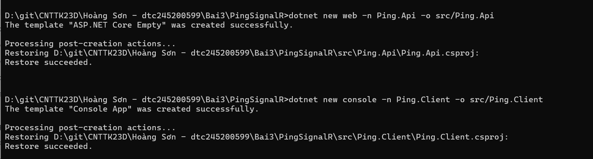
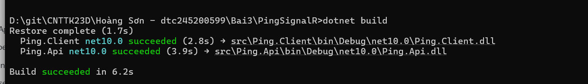
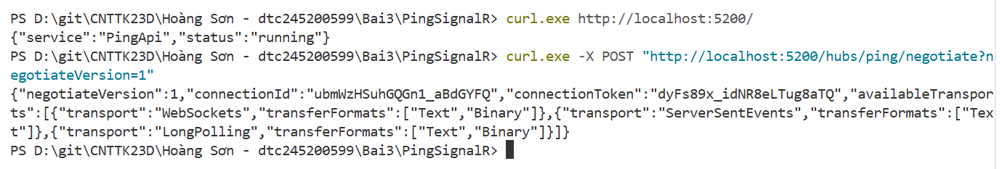

# Bài 3 – SignalR

## Bước 1.1 – Tạo solution và hai project

Tạo solution PingSignalR, project ASP.NET Core Ping.Api và project console Ping.Client.

## Bước 1.2 – Thêm hai project vào solution và build

Cả hai project có trong solution. Máy khách dùng Microsoft.AspNetCore.SignalR.Client 10.0.15. File .gitignore bỏ qua thư mục bin và obj.

    dotnet build

Kết quả kiểm tra: build thành công, 0 cảnh báo, 0 lỗi.

## Bước 2 – Chạy Ping.Api và kiểm tra negotiate

Chạy máy chủ từ thư mục PingSignalR rồi giữ cửa sổ đó mở.

    dotnet run --project src/Ping.Api --urls http://localhost:5200

Trong cửa sổ terminal thứ hai, kiểm tra ba phản hồi sau.

    curl.exe http://localhost:5200/
    curl.exe -X POST "http://localhost:5200/hubs/ping/negotiate?negotiateVersion=1"
    curl.exe -i http://localhost:5200/hubs/ping

GET / xác nhận PingApi đang chạy. POST negotiate trả connectionId và các kiểu truyền tải WebSockets, ServerSentEvents, LongPolling. GET trực tiếp vào hub thiếu ID kết nối nên trả 400 với thông báo Connection ID required.

## Bước 3 – Thêm phương thức Echo

Máy khách gọi Echo với nội dung tin nhắn. Hub dùng Clients.Caller để gửi sự kiện EchoResponse về đúng kết nối vừa gọi, với nội dung có tiền tố `Echo:`.

    dotnet build
    dotnet run --project src/Ping.Api --urls http://localhost:5200

Sau khi sửa Program.cs, dừng máy chủ cũ bằng Ctrl+C rồi khởi động lại. Bước 4 sẽ dùng máy khách SignalR để gọi Echo và chụp kết quả cho cả hai bước.

## Bước 4.1 – Kết nối máy khách SignalR

Ping.Client mặc định dùng http://localhost:5200 và nhận địa chỉ máy chủ, tên máy khách qua tham số dòng lệnh. Client đăng ký hàm in EchoResponse trước khi mở kết nối tới /hubs/ping và bật tự kết nối lại.

Kết quả kiểm tra: build thành công, 0 cảnh báo, 0 lỗi.

## Bước 4.2 – Gọi Echo và nhận phản hồi

Từ thư mục PingSignalR, chạy máy chủ trong terminal thứ nhất.

    dotnet run --project src/Ping.Api --urls http://localhost:5200

Chạy máy khách trong terminal thứ hai.

    dotnet run --project src/Ping.Client -- http://localhost:5200 An

Máy khách gọi Echo qua InvokeAsync. Khi nhận EchoResponse, nó in phản hồi rồi chờ Enter để thoát.

Kết quả chạy thử trên cổng tạm 49351 vì cổng 5200 đang được máy chủ khác sử dụng.

    An da ket noi den PingApi.
    [Echo] Echo: Xin chao SignalR tu An
    Dang cho thong diep... Nhan Enter de thoat.

## Bước 5 – Phát rộng và gửi tin theo nhóm

### Bước 5.1 – Thêm phương thức cho PingHub

Broadcast dùng Clients.All để gửi cho mọi kết nối đang mở, kể cả người gửi. JoinGroup thêm kết nối hiện tại vào nhóm và thông báo cho nhóm. SendToGroup dùng Clients.Group để gửi tin cho các kết nối thuộc nhóm. Echo vẫn dùng Clients.Caller để trả lời riêng người gọi.

### Bước 5.2 – Đăng ký sự kiện và gọi phương thức từ máy khách

Máy khách đăng ký BroadcastMessage và GroupMessage trước StartAsync. Sau khi kết nối và gọi Echo, máy khách vào nhóm lop-hoc-01, gửi tin nhóm, rồi phát rộng. Build cả hai project thành công với 0 cảnh báo và 0 lỗi.

### Bước 5.3 – Chạy An và Bình, đối chiếu trang 35

Từ thư mục PingSignalR, khởi động lại máy chủ trong terminal thứ nhất.

    dotnet run --project src/Ping.Api --urls http://localhost:5200

Chạy An trong terminal thứ hai và giữ kết nối mở.

    dotnet run --project src/Ping.Client -- http://localhost:5200 An

Sau khi An vào nhóm, chạy Bình trong terminal thứ ba.

    dotnet run --project src/Ping.Client -- http://localhost:5200 Binh

Kết quả chạy thử trên cổng tạm 64414 vì cổng 5200 đang có máy chủ khác chạy. Các dòng chính trong terminal của An gồm:

    [Echo] Echo: Xin chao SignalR tu An
    [Group] Thong bao nhom tu Binh
    [Broadcast] Xin chao tat ca tu Binh

Terminal của Bình in:

    [Echo] Echo: Xin chao SignalR tu Binh
    [Group] Thong bao nhom tu Binh
    [Broadcast] Xin chao tat ca tu Binh

An không nhận Echo của Bình. Bình tham gia sau nên không thấy các tin An đã gửi trước đó. Dòng [System] trong hình minh họa sẽ được thêm ở bước 6.

## Bước 6 – Vòng đời kết nối và tự kết nối lại

PingHub ghi nhật ký [Hub] khi có kết nối mở hoặc đóng và gửi SystemMessage cho các máy khách đang kết nối. Ping.Client đăng ký SystemMessage, Reconnecting, Reconnected và Closed trước StartAsync.

Từ thư mục PingSignalR, chạy máy chủ và máy khách An trong hai terminal.

    dotnet run --project src/Ping.Api --urls http://localhost:5200
    dotnet run --project src/Ping.Client -- http://localhost:5200 An

Giữ An mở, dùng Ctrl+C để dừng máy chủ rồi khởi động lại ở cùng địa chỉ. Với lịch mặc định, máy khách chờ lần lượt 0, 2, 10 và 30 giây trước mỗi lần thử. Nếu cả bốn lần đều thất bại, sự kiện Closed được gọi.

Kiểm tra trang 39 trên cổng tạm 59242 vì cổng 5200 đang có máy chủ khác chạy. Các dòng sau xuất hiện trong terminal của An.

    An da ket noi den PingApi. ConnectionId: LeFcO19M
    [Lifecycle] Dang ket noi lai...
    [Lifecycle] Da ket noi lai: RV4t3yxt
    [System] Client RV4t3yxt da ket noi.

Sau khi An kết nối lại, Bình vào nhóm và gửi tin. An nhận Broadcast và thông báo Bình ngắt kết nối. Tin Group của Bình chỉ hiện ở Bình vì An đã có ConnectionId mới và chưa gọi JoinGroup lại. Máy chủ in các dòng [Hub] tương ứng, và máy khách in Closed khi kết thúc.
