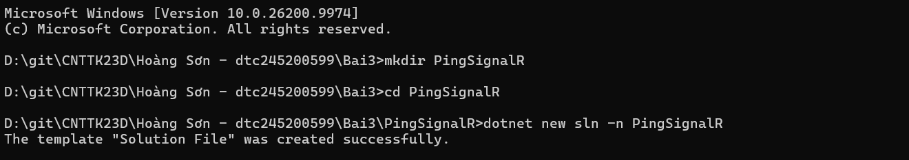

# Bài 3 – SignalR

## Bước 1.1 – Tạo solution và hai project

Tạo solution PingSignalR, project ASP.NET Core Ping.Api và project console Ping.Client.

## Bước 1.2 – Thêm hai project vào solution và build

Cả hai project có trong solution. Máy khách dùng Microsoft.AspNetCore.SignalR.Client 10.0.15. File .gitignore bỏ qua thư mục bin và obj.

    dotnet build

Kết quả kiểm tra: build thành công, 0 cảnh báo, 0 lỗi.

