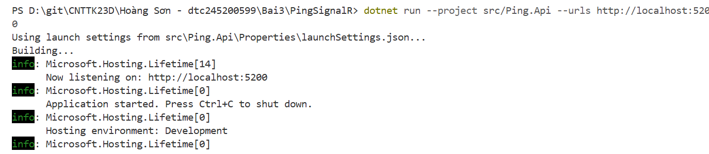
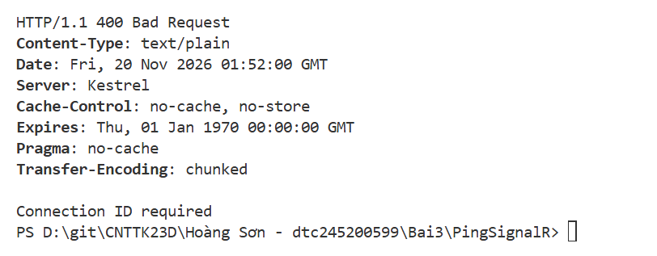

# Bài 3 – SignalR

## Bước 1.1 – Tạo solution và hai project

Tạo solution PingSignalR, project ASP.NET Core Ping.Api và project console Ping.Client.

## Bước 1.2 – Thêm hai project vào solution và build

Cả hai project có trong solution. Máy khách dùng Microsoft.AspNetCore.SignalR.Client 10.0.15. File .gitignore bỏ qua thư mục bin và obj.

    dotnet build

Kết quả kiểm tra: build thành công, 0 cảnh báo, 0 lỗi.

## Bước 2 – Chạy Ping.Api và kiểm tra negotiate

Chạy máy chủ từ thư mục PingSignalR rồi giữ cửa sổ đó mở.

    dotnet run --project src/Ping.Api --urls http://localhost:5200

Trong cửa sổ terminal thứ hai, kiểm tra ba phản hồi sau.

    curl.exe http://localhost:5200/
    curl.exe -X POST "http://localhost:5200/hubs/ping/negotiate?negotiateVersion=1"
    curl.exe -i http://localhost:5200/hubs/ping

GET / xác nhận PingApi đang chạy. POST negotiate trả connectionId và các kiểu truyền tải WebSockets, ServerSentEvents, LongPolling. GET trực tiếp vào hub thiếu ID kết nối nên trả 400 với thông báo Connection ID required.

## Bước 3 – Thêm phương thức Echo

Máy khách gọi Echo với nội dung tin nhắn. Hub dùng Clients.Caller để gửi sự kiện EchoResponse về đúng kết nối vừa gọi, với nội dung có tiền tố `Echo:`.

    dotnet build
    dotnet run --project src/Ping.Api --urls http://localhost:5200

Sau khi sửa Program.cs, dừng máy chủ cũ bằng Ctrl+C rồi khởi động lại. Bước 4 sẽ dùng máy khách SignalR để gọi Echo và chụp kết quả cho cả hai bước.

## Bước 4.1 – Kết nối máy khách SignalR

Ping.Client mặc định dùng http://localhost:5200 và nhận địa chỉ máy chủ, tên máy khách qua tham số dòng lệnh. Client đăng ký hàm in EchoResponse trước khi mở kết nối tới /hubs/ping và bật tự kết nối lại.

Kết quả kiểm tra: build thành công, 0 cảnh báo, 0 lỗi.
