# Bài 3 – Giao tiếp thời gian thực với SignalR
Họ tên: Hoàng Đức Hiếu            MSSV: dtc245200528           Lớp: CNTT K23D

## Cấu trúc thư mục

```
Bai3/
├── README.md
├── anh/                          (ảnh chụp kết quả từng bước)
├── PingSignalR/                  (Phần 2 – hub Ping, cổng 5200)
│   ├── PingSignalR.slnx
│   └── src/Ping.Api, Ping.Client
└── RealtimeSubmissionSystem/     (Phần 3 – EduSubmit realtime, cổng 5000)
    ├── RealtimeSubmissionSystem.slnx
    ├── requests.http
    └── src/Submission.RealtimeApi, Submission.RealtimeClient
```

---

## 1. PingSignalR (Phần 2)

### Hợp đồng hub `http://localhost:5200/hubs/ping`

| Máy khách gọi (InvokeAsync) | Máy chủ gửi về (On) | Phạm vi nhận |
|---|---|---|
| `Echo(message)` | `EchoResponse` | `Clients.Caller` |
| `Broadcast(message)` | `BroadcastMessage` | `Clients.All` |
| `JoinGroup(groupName)` | `GroupMessage` | `Clients.Group` |
| `SendToGroup(group, msg)` | `GroupMessage` | `Clients.Group` |
| (tự động khi nối / ngắt) | `SystemMessage` | `Clients.All` |

### Bước 1: tạo solution, 2 project, thêm gói SignalR.Client

```powershell
mkdir PingSignalR; cd PingSignalR
dotnet new sln -n PingSignalR
dotnet new web -n Ping.Api -o src/Ping.Api
dotnet new console -n Ping.Client -o src/Ping.Client
dotnet sln add src/Ping.Api/Ping.Api.csproj
dotnet sln add src/Ping.Client/Ping.Client.csproj
dotnet add src/Ping.Client package Microsoft.AspNetCore.SignalR.Client --version 10.0.15
dotnet new gitignore
dotnet build
```

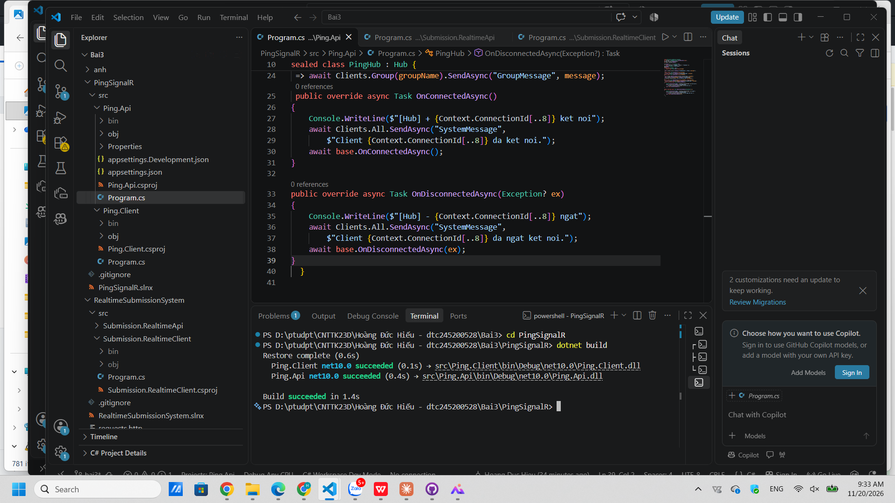

Thấy: `Build succeeded, 0 Error(s)`.
Giải thích: máy chủ dùng template web nên có sẵn SignalR; máy khách là console nên phải thêm gói `Microsoft.AspNetCore.SignalR.Client`.

### Bước 2: AddSignalR + MapHub, kiểm tra negotiate

```powershell
# Terminal 1
dotnet run --project src/Ping.Api --urls http://localhost:5200
# Terminal 2
curl.exe -i -X POST "http://localhost:5200/hubs/ping/negotiate?negotiateVersion=1"
```

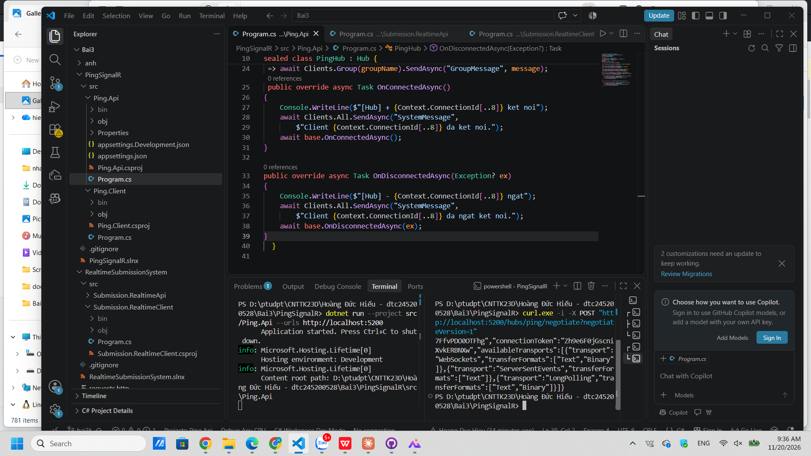

Thấy: `200 OK`, JSON có `connectionId`, `connectionToken` và `availableTransports` (WebSockets, ServerSentEvents, LongPolling).
Giải thích: negotiate là bước bắt tay đầu tiên; máy chủ cấp mã kết nối và báo các cách truyền tải nó hỗ trợ để máy khách chọn (ưu tiên WebSocket).

### Bước 3–4: phương thức Echo, máy khách Build → On → Start → Invoke

```powershell
dotnet run --project src/Ping.Client -- http://localhost:5200 An
```

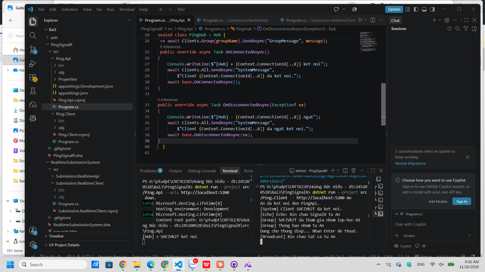

Thấy: `An da ket noi den PingApi.` rồi `[Echo] Echo: Xin chao SignalR tu An`.
Giải thích: máy khách gọi `Echo` (chiều lên), hub trả `EchoResponse` chỉ cho người gọi qua `Clients.Caller` (chiều xuống); hàm `On("EchoResponse")` đăng ký trước `StartAsync` nên in được dòng `[Echo]`.

### Bước 5: Broadcast (All) và nhóm (Group)

Chạy 2 máy khách `An` và `Binh` cùng lúc.

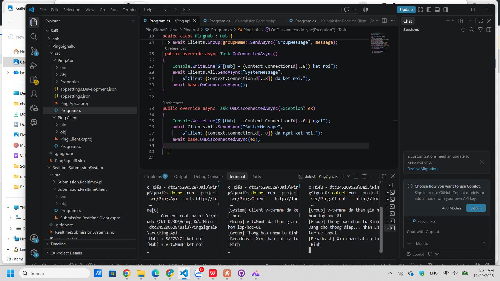

Thấy: mỗi máy khách thấy `[Broadcast]` và `[Group]` của người kia, nhưng KHÔNG thấy `[Echo]` của người kia.
Giải thích: `Clients.All` gửi cho mọi kết nối, `Clients.Group("lop-hoc-01")` gửi cho thành viên nhóm, còn `Clients.Caller` chỉ gửi cho người gọi.

### Bước 6: vòng đời và kết nối lại

Để máy khách chạy, tắt máy chủ (Ctrl+C) rồi bật lại trong vài giây.

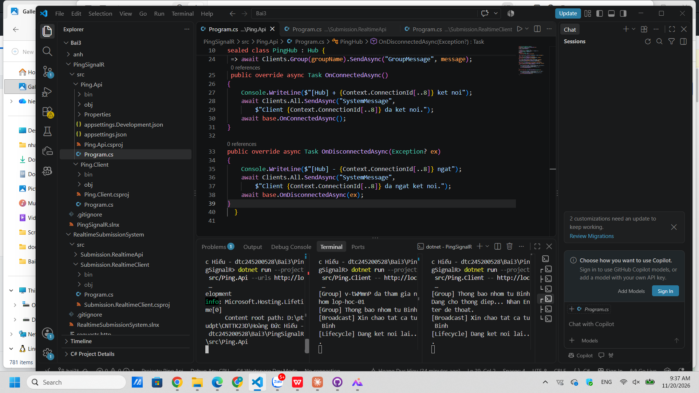
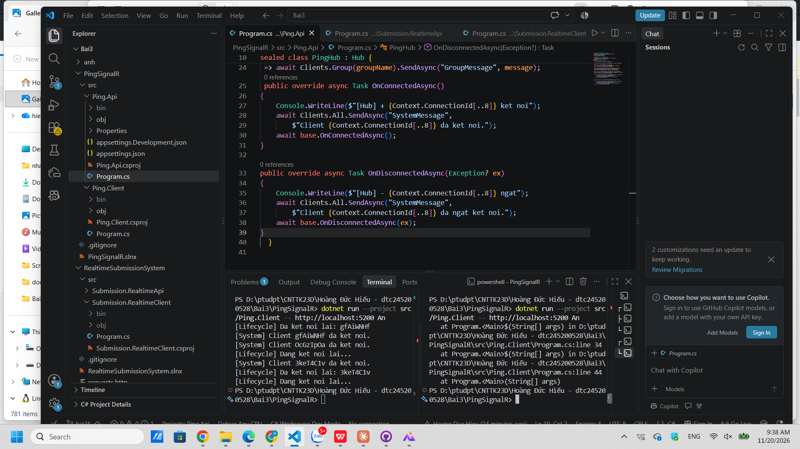

Thấy: máy chủ in `[Hub] + ... ket noi`; máy khách in `[Lifecycle] Dang ket noi lai...` rồi `[Lifecycle] Da ket noi lai: ...`.
Giải thích: `OnConnectedAsync`/`OnDisconnectedAsync` cho máy chủ biết ai nối/ngắt; `WithAutomaticReconnect` tự nối lại khi rớt, và sau khi nối lại máy khách có `ConnectionId` MỚI.

### Bước 7: ba thí nghiệm lỗi

| # | Làm gì | Thấy gì | Giải thích |
|---|---|---|---|
| 1 | Chạy máy khách khi máy chủ đã tắt | `HttpRequestException: ... Connection refused (localhost:5200)` | `StartAsync` ném lỗi ngay; `WithAutomaticReconnect` chỉ cứu kết nối ĐÃ mở, không thử lại lần nối đầu. |
| 2 | Sửa `WithUrl` thành `/hub/ping` (thiếu s) | `HttpRequestException: ... 404 (Not Found)` | Lỗi xảy ra ở bước negotiate; đường dẫn phải khớp `MapHub`. |
| 3 | Sửa `On("EchoResponse")` thành `On("EchoRespone")` | Không có lỗi nào, chỉ không có dòng `[Echo]` | Sai tên chiều xuống thì im lặng; khi "không nhận được gì" phải so tên hai phía trước tiên. |

**Lỗi 1 – máy chủ chưa chạy.** Ảnh: terminal bên phải của ảnh Bước 6 ở trên (lỗi ở `StartAsync`, `Program.cs` dòng 34). Dòng lỗi đầu tiên:

```
$ dotnet run --project src/Ping.Client -- http://localhost:5200 An
Unhandled exception. System.Net.Http.HttpRequestException: No connection could be made because the target machine actively refused it. (localhost:5200)
 ---> System.Net.Sockets.SocketException (10061): No connection could be made because the target machine actively refused it.
```

**Lỗi 2 – sai đường dẫn `/hub/ping`.** Dòng lỗi đầu tiên (lỗi nằm trong `NegotiateAsync`, tức là ở bước bắt tay):

```
$ dotnet run --project src/Ping.Client -- http://localhost:5200 An
Unhandled exception. System.Net.Http.HttpRequestException: Response status code does not indicate success: 404 (Not Found).
   at System.Net.Http.HttpResponseMessage.EnsureSuccessStatusCode()
   at Microsoft.AspNetCore.Http.Connections.Client.HttpConnection.NegotiateAsync(...)
```

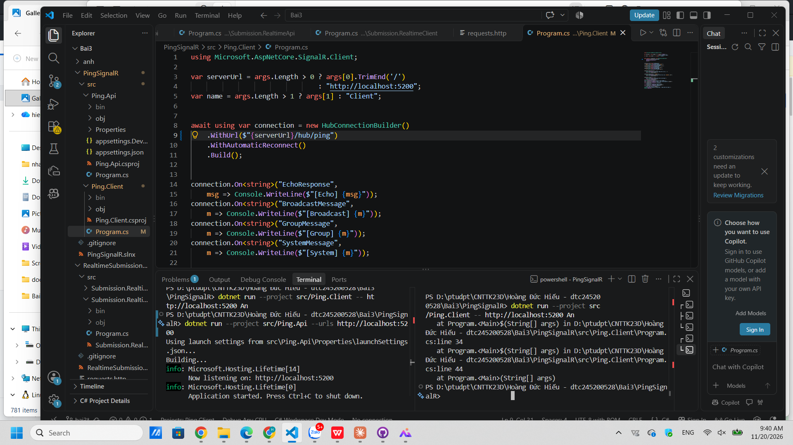

**Lỗi 3 – sai tên `EchoRespone`:** không có lỗi, chỉ thiếu dòng `[Echo]`.
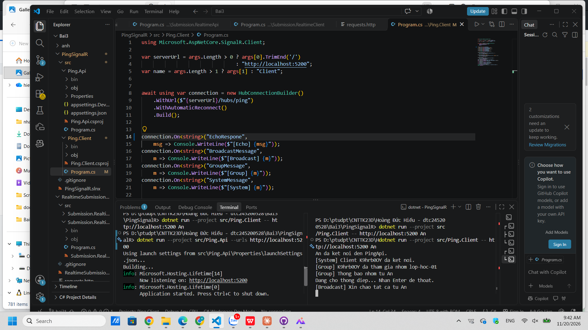

---

## 2. EduSubmit realtime (Phần 3)

### Thiết kế kênh thời gian thực (4 câu hỏi)

| Câu hỏi | Trả lời | Code |
|---|---|---|
| ① Sự kiện nào kích hoạt? | Mỗi lần trạng thái lượt nộp đổi: received → processing → graded | `UpdateStatusAsync(id, status, ...)` |
| ② Gửi cho ai? | Chỉ máy khách đang theo dõi đúng lượt nộp đó | `Clients.Group("submission:{id}")` |
| ③ Gửi kèm dữ liệu gì? | Mã lượt nộp, trạng thái mới, thời điểm đổi | `record SubmissionStatusMessage(Guid SubmissionId, string Status, DateTimeOffset UpdatedAt)` |
| ④ Mất kết nối thì sao? | Gọi lại REST để lấy trạng thái đúng | `GET /api/submissions/{id}` |

### Cách chạy

```powershell
cd RealtimeSubmissionSystem
# Terminal 1 – máy chủ
dotnet run --project src/Submission.RealtimeApi --urls http://localhost:5000
# Terminal 2 – máy khách
dotnet run --project src/Submission.RealtimeClient -- http://localhost:5000 SV001
```

### Kết quả máy khách (8 dòng) và máy chủ

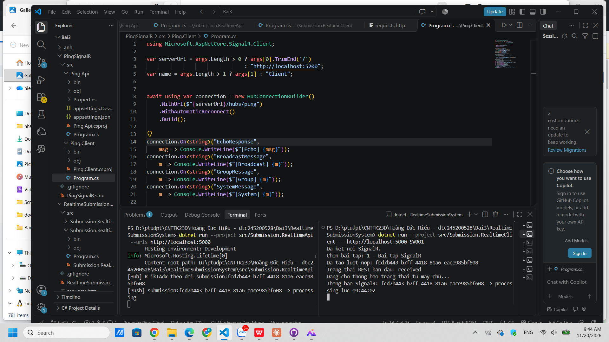
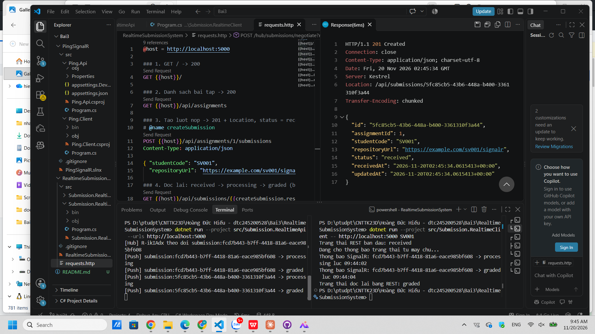

Máy khách (Terminal 2):
```
Da ket noi SignalR.
Chon bai tap: 1 - Bai tap SignalR
Da tao luot nop: fcd7b443-b7ff-4418-81a6-eace985bf608
Trang thai REST ban dau: received
Dang cho thong bao trang thai tu may chu...
Thong bao SignalR: fcd7b443-b7ff-4418-81a6-eace985bf608 -> processing luc 09:44:02
Thong bao SignalR: fcd7b443-b7ff-4418-81a6-eace985bf608 -> graded luc 09:44:04
Trang thai doc lai bang REST: graded
```

Máy chủ (Terminal 1):
```
[Hub] R-ikIAdx theo doi submission:fcd7b443-b7ff-4418-81a6-eace985bf608
[Push] submission:fcd7b443-b7ff-4418-81a6-eace985bf608 -> processing
[Push] submission:fcd7b443-b7ff-4418-81a6-eace985bf608 -> graded
```

Hai thông báo SignalR cách nhau đúng 2 giây (09:44:02 → 09:44:04); máy khách tự thoát sau khi nhận `graded`.
Giải thích: REST tạo lượt nộp (201, `received`); tác vụ nền đổi trạng thái rồi đẩy tin qua `IHubContext` tới nhóm `submission:{id}`; cuối cùng máy khách đọc lại bằng REST để chốt `graded`.

### requests.http (9 ca)

| Ca | Yêu cầu | Mong đợi |
|---|---|---|
| 1 | `GET /` | 200 |
| 2 | `GET /api/assignments` | 200 |
| 3 | `POST /api/assignments/1/submissions` hợp lệ | 201 + Location, `received` |
| 4 | `GET /api/submissions/{id}` (bấm nhiều lần) | 200, received → processing → graded |
| 5 | POST thiếu `studentCode`, `repositoryUrl` | 400 `INVALID_SUBMISSION` |
| 6 | `POST /api/assignments/99/submissions` | 404 `ASSIGNMENT_NOT_FOUND` |
| 7 | `GET /api/submissions/0000...` | 404 `SUBMISSION_NOT_FOUND` |
| 8 | `POST /hubs/submissions/negotiate` | 200 + `connectionId` |
| 9 | `POST /hub/submissions/negotiate` | 404 |

- Ca 3 → `201 Created`, có `Location`, `"status": "received"`, `updatedAt`: ảnh *EduSubmit máy khách phần 2* ở trên.
- Ca 5 → `400 Bad Request`, `INVALID_SUBMISSION`:

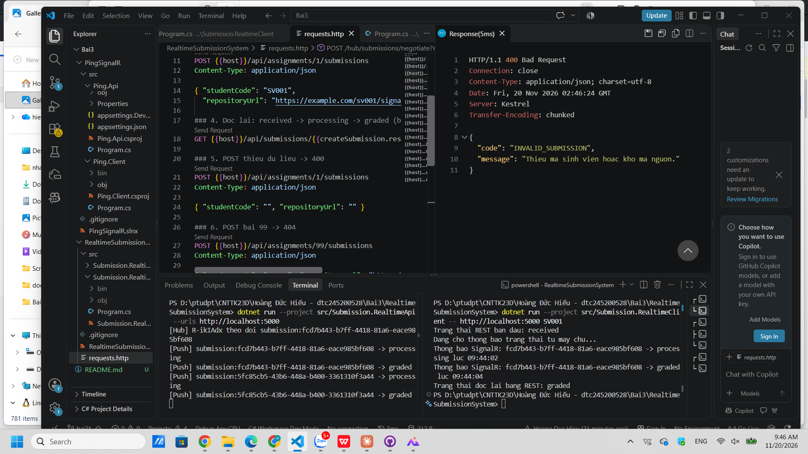

- Ca 7 → `404 Not Found`, `SUBMISSION_NOT_FOUND`:

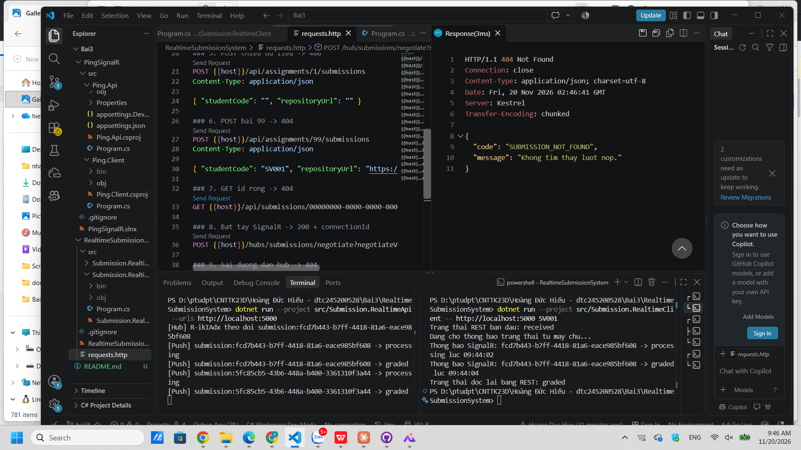

- Ca 8 → `200 OK`, có `connectionId`, `connectionToken`, `availableTransports`:

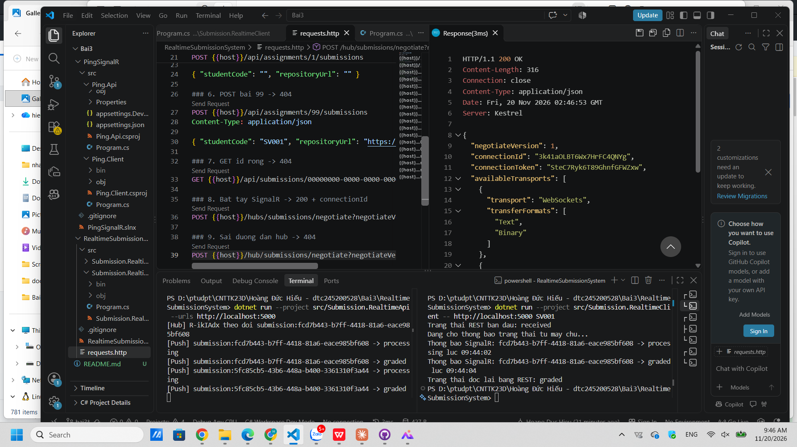

- Ca 6 → `404 Not Found`, `ASSIGNMENT_NOT_FOUND`: ảnh *Thí nghiệm 1* bên dưới (khung Response).
- Ca 9 → `404 Not Found` (sai đường dẫn hub):

```
$ curl.exe -i -X POST "http://localhost:5000/hub/submissions/negotiate?negotiateVersion=1"
HTTP/1.1 404 Not Found
Content-Length: 0
```

### Bước 7: năm thí nghiệm phân tán

| # | Thí nghiệm | Dự đoán (ghi trước khi chạy) | Kết quả thật | Giải thích |
|---|---|---|---|---|
| 1 | Chạy 2 máy khách SV001 và SV002 cùng lúc | Mỗi máy khách chỉ nhận thông báo của lượt nộp mình tạo, không thấy của người kia | Đúng: SV001 chỉ nhận `6d2273ba...`, SV002 chỉ nhận `69a3671d...`, dù máy chủ đẩy xen kẽ cả hai | Nhóm `submission:{id}` tách người nhận; máy khách không thấy dữ liệu của người khác. |
| 2 | Chạy máy khách khi máy chủ chưa chạy | Báo lỗi không kết nối được, chương trình dừng | `HttpRequestException: No connection could be made because the target machine actively refused it. (localhost:5000)` tại `StartAsync` | Lần nối đầu không được tự thử lại; `WithAutomaticReconnect` chỉ cứu kết nối đã mở. |
| 3 | Sửa `WithUrl` thành `/hub/submissions` | Báo lỗi 404 vì sai đường dẫn | `HttpRequestException: ... 404 (Not Found)` trong `NegotiateAsync`; máy chủ không có dòng `[Hub]` nào | Lỗi ở bước negotiate; đường dẫn phải khớp `MapHub`. |
| 4 | Sửa `On("SubmissionStatusChanged")` thành `On("SubmissionStatusChange")` | Không có lỗi nhưng không in thông báo SignalR nào | Không lỗi; máy chủ vẫn `[Push] processing`/`graded`, máy khách không in `Thong bao SignalR`, sau 10 giây in `Qua thoi gian cho thong bao graded.`, REST đọc lại `graded` | Sai tên chiều xuống thì im lặng: máy chủ gửi, máy khách không có hàm nào nghe đúng tên. |
| 5 | Chờ 4 giây rồi mới gọi `WatchSubmission` | Lỡ hết thông báo, nhưng REST vẫn đọc ra `graded` | Máy chủ in `[Push] ... graded` TRƯỚC `[Hub] ... theo doi`; máy khách không nhận thông báo nào, hết 10 giây, REST đọc lại `graded` | Vào nhóm muộn là lỡ tin (SignalR không lưu tin); REST là nguồn sự thật. |

> Cột *Dự đoán* ghi lại suy luận trước khi chạy dựa trên lý thuyết bài học; cột *Kết quả thật* lấy từ lần chạy trên máy (ảnh và đoạn log bên dưới).

**Thí nghiệm 1** – SV001 và SV002 chạy cùng lúc:
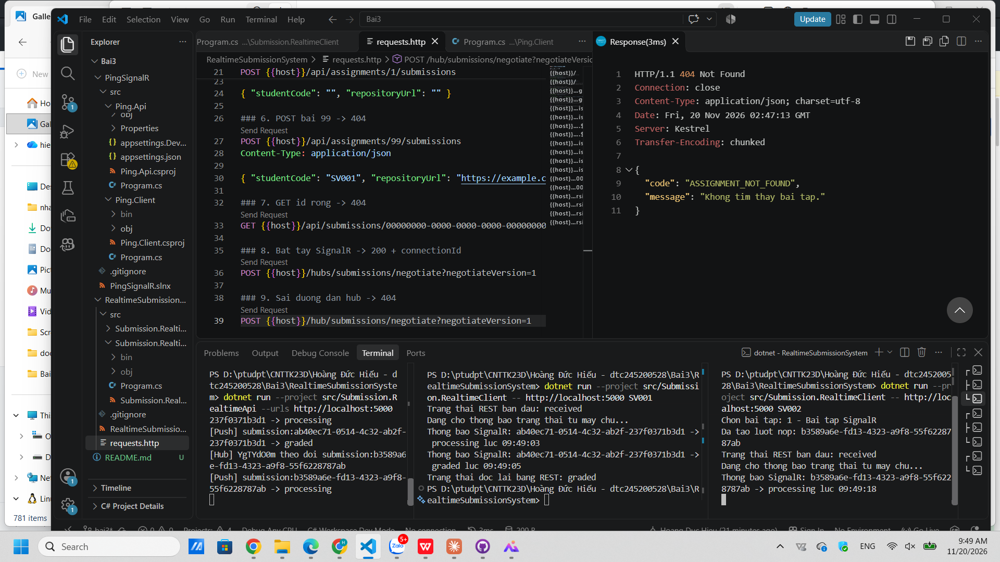

Log chạy song song (hai máy khách khởi động cách nhau 0,5 giây):
```
-- SV001
Da tao luot nop: 6d2273ba-959e-4d64-b8a0-0b85c9b0d6ef
Thong bao SignalR: 6d2273ba-959e-4d64-b8a0-0b85c9b0d6ef -> processing luc 10:05:52
Thong bao SignalR: 6d2273ba-959e-4d64-b8a0-0b85c9b0d6ef -> graded luc 10:05:54
Trang thai doc lai bang REST: graded
-- SV002
Da tao luot nop: 69a3671d-0e12-4af6-bc7b-5e448f41d72d
Thong bao SignalR: 69a3671d-0e12-4af6-bc7b-5e448f41d72d -> processing luc 10:05:52
Thong bao SignalR: 69a3671d-0e12-4af6-bc7b-5e448f41d72d -> graded luc 10:05:54
Trang thai doc lai bang REST: graded
-- máy chủ
[Hub] uNgn7-Ya theo doi submission:6d2273ba-959e-4d64-b8a0-0b85c9b0d6ef
[Hub] OztNwu9V theo doi submission:69a3671d-0e12-4af6-bc7b-5e448f41d72d
[Push] submission:6d2273ba-959e-4d64-b8a0-0b85c9b0d6ef -> processing
[Push] submission:69a3671d-0e12-4af6-bc7b-5e448f41d72d -> processing
[Push] submission:6d2273ba-959e-4d64-b8a0-0b85c9b0d6ef -> graded
[Push] submission:69a3671d-0e12-4af6-bc7b-5e448f41d72d -> graded
```

**Thí nghiệm 2** – máy chủ đã tắt:
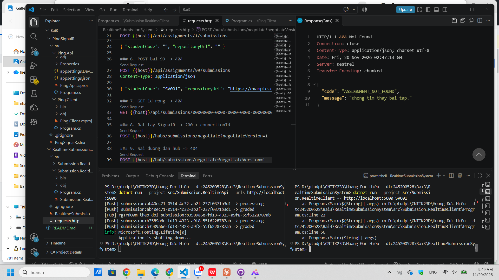

Dòng lỗi đầu tiên:
```
$ dotnet run --project src/Submission.RealtimeClient -- http://localhost:5000 SV001
Unhandled exception. System.Net.Http.HttpRequestException: No connection could be made because the target machine actively refused it. (localhost:5000)
 ---> System.Net.Sockets.SocketException (10061): No connection could be made because the target machine actively refused it.
```

**Thí nghiệm 3** – `WithUrl` sai `/hub/submissions`:
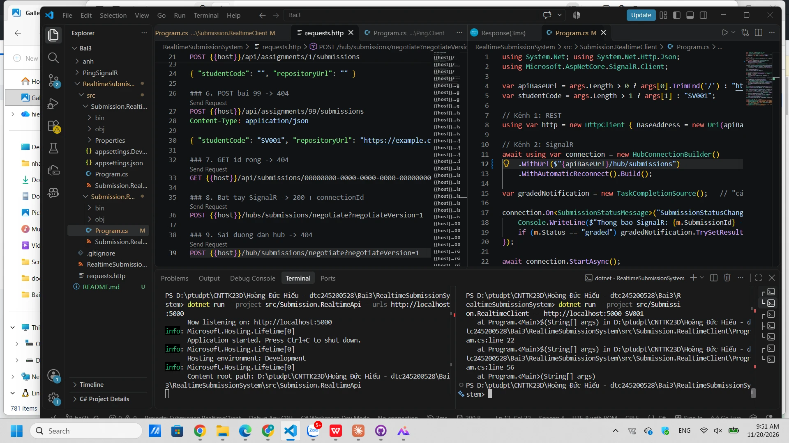

Dòng lỗi đầu tiên (máy chủ đang chạy nhưng negotiate trả 404):
```
$ dotnet run --project src/Submission.RealtimeClient -- http://localhost:5000 SV001
Unhandled exception. System.Net.Http.HttpRequestException: Response status code does not indicate success: 404 (Not Found).
   at System.Net.Http.HttpResponseMessage.EnsureSuccessStatusCode()
   at Microsoft.AspNetCore.Http.Connections.Client.HttpConnection.NegotiateAsync(...)
```

**Thí nghiệm 4** – sai tên `SubmissionStatusChange`:
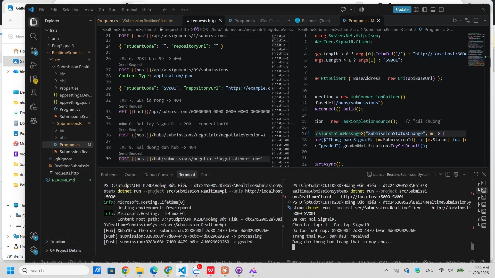

Log chạy đến hết (máy khách):
```
Da ket noi SignalR.
Chon bai tap: 1 - Bai tap SignalR
Da tao luot nop: 42689bd9-1f3d-4927-940c-df1e293d0f44
Trang thai REST ban dau: received
Dang cho thong bao trang thai tu may chu...
Qua thoi gian cho thong bao graded.
Trang thai doc lai bang REST: graded
```
Máy chủ vẫn gửi: `[Push] submission:42689bd9-... -> processing`, `[Push] submission:42689bd9-... -> graded`.

**Thí nghiệm 5** – `Task.Delay(4000)` trước `WatchSubmission`:
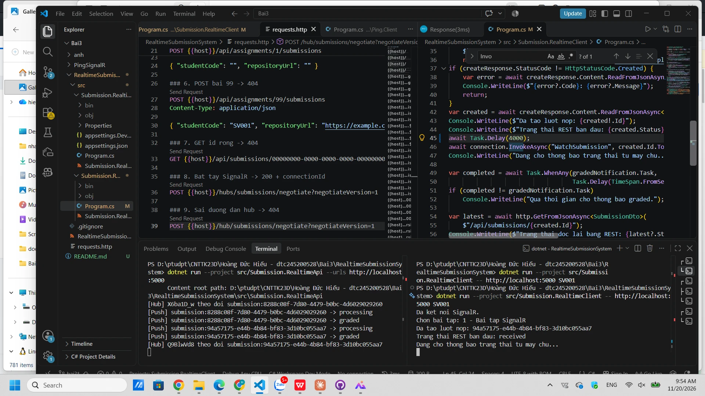

Log chạy đến hết:
```
-- máy khách
Da tao luot nop: 87c03167-06fc-4ca8-a6ee-04d505da0bfa
Trang thai REST ban dau: received
Dang cho thong bao trang thai tu may chu...
Qua thoi gian cho thong bao graded.
Trang thai doc lai bang REST: graded
-- máy chủ
[Push] submission:87c03167-06fc-4ca8-a6ee-04d505da0bfa -> processing
[Push] submission:87c03167-06fc-4ca8-a6ee-04d505da0bfa -> graded
[Hub] BdxCDIow theo doi submission:87c03167-06fc-4ca8-a6ee-04d505da0bfa
```

Kết luận: thông điệp thời gian thực có thể bị lỡ. Thiết kế đúng là **push để nhanh + REST để chắc**. Thứ tự đúng ở máy khách: nghe (`On`) → nối (`StartAsync`) → tạo (POST) → theo dõi (`WatchSubmission`) → đọc lại (GET).

---

## 3. Trả lời 3 câu hỏi đầu giờ

**Câu 1. Máy chủ có thể chủ động báo cho máy khách mà không cần máy khách hỏi không?**
Có, với điều kiện máy khách mở sẵn một kết nối lâu dài (WebSocket qua SignalR). Khi đó máy chủ gửi bằng `Clients.Group(...).SendAsync(...)`; nếu đang ở ngoài hub (như tác vụ chấm bài nền) thì dùng `IHubContext<SubmissionHub>`.

**Câu 2. Đã có REST rồi, vì sao còn cần SignalR? Hai thứ chia việc thế nào?**
REST dùng để tạo và đọc tài nguyên, có mã trạng thái rõ ràng (201, 400, 404). SignalR dùng để đẩy những thay đổi xảy ra SAU yêu cầu ban đầu (processing, graded) mà máy khách không phải hỏi liên tục. SignalR không thay thế REST.

**Câu 3. Nếu đứt mạng đúng lúc máy chủ báo "đã chấm xong" thì sao?**
Tin đó bị mất vì SignalR không lưu tin. `WithAutomaticReconnect` nối lại với `ConnectionId` mới; máy khách phải gọi `WatchSubmission` lại và gọi `GET /api/submissions/{id}` để lấy trạng thái cuối cùng.

## 4. Câu hỏi thảo luận

**Hàng trăm sinh viên cùng theo dõi: nhóm theo id hay phát tất cả rồi tự lọc?**
Nhóm theo id. Mỗi thay đổi chỉ gửi tới đúng người theo dõi lượt nộp đó, còn phát tất cả thì mỗi thay đổi nhân lên theo số kết nối (tốn băng thông) và lộ trạng thái bài của người khác.

**Hai tình huống polling hợp lý hơn SignalR:**
1. Dữ liệu đổi chậm và không cần biết ngay (ví dụ bảng điểm cập nhật vài giờ một lần).
2. Máy khách chạy ngắn hoặc môi trường không giữ được kết nối lâu dài (script, cron job, mạng chặn WebSocket).

**Chạy nhiều bản sao API (scale-out) thì nhóm trong bộ nhớ gặp vấn đề gì? Sửa thế nào?**
Nhóm chỉ nằm trong bộ nhớ của từng máy chủ, nên máy chủ A đẩy tin thì máy khách đang nối vào máy chủ B không nhận được. Cách sửa: dùng backplane chung (ví dụ Redis) hoặc Azure SignalR Service để các bản sao chia sẻ thông điệp.
