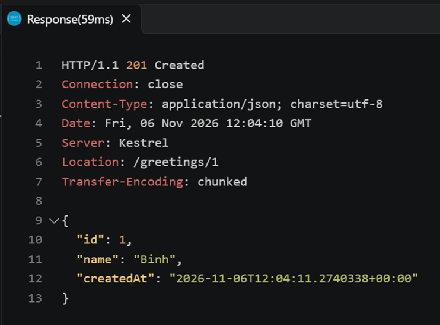
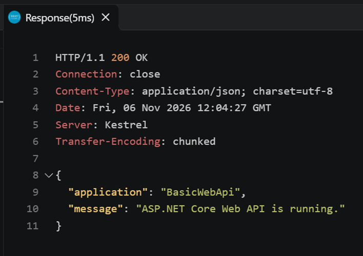
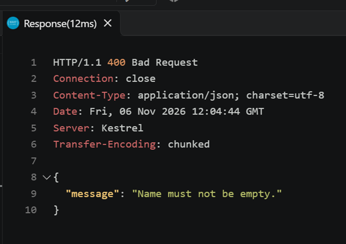
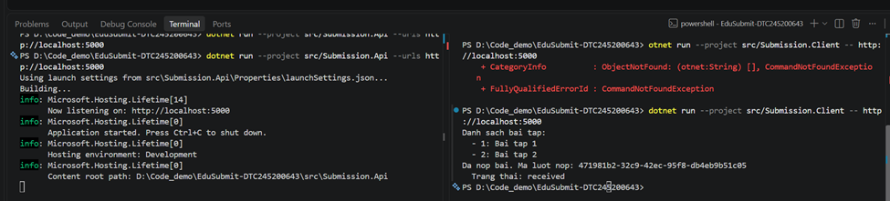

# Bài 1 – Tổng quan hệ thống và MEP
Họ tên: Hà Yến Giang            MSSV: DTC245200643           Lớp: CNTT K23D

## 1. Cài đặt
[buoc 4](cai-dat.png)
 
## 2. MepDemo (Bước 7)
1. Ở MEP 3, mỗi bài nộp sub-x chỉ do một worker xử lý (các worker chia nhau việc).
2. Ở MEP 4, một sự kiện được gửi tới cả 3 dịch vụ.
3. Mô tả 5 MEP:
- MEP 1, request–response: bên gửi yêu cầu rồi chờ phản hồi.
- MEP 2, one-way: chỉ gửi đi, không chờ phản hồi.
- MEP 3, queue-based: thông điệp vào hàng đợi, mỗi thông điệp chỉ một worker xử lý.
- MEP 4, publish–subscribe: một sự kiện được phát, mọi bên đăng ký đều nhận.
- MEP 5, streaming: dữ liệu gửi liên tục thành dòng, bên nhận xử lý dần.
 
## 3. BasicWebApi (Bước 8)
- 
- 
- 
- builder.Services.AddSingleton… phải đứng trước var app = builder.Build();, vì sau khi Build() danh sách dịch vụ (DI container) đã được chốt, không đăng ký thêm được nữa.
Trong /hello/{name}?language=en, name lấy từ route (phần đường dẫn), language lấy từ query string (sau dấu ?).
POST hợp lệ tạo ra một tài nguyên mới nên trả Results.Created (201) kèm header Location trỏ tới tài nguyên đó, thay vì Results.Ok (200) chỉ báo thành công chung chung.
 
## 4. MiniDistributedSystem (Bước 9)
- [Ảnh chụp 2 terminal API + Client](minidistributedsystem.png)
- Trả lời 3 câu hỏi
1. Client gọi 2 endpoint:
GET /api/assignments → trả 200 OK kèm danh sách bài tập.
POST /api/submissions → trả 201 Created kèm lượt nộp (Id, status received).
2. Client không tham chiếu code của API client tự khai báo lại các record. Hai bên thống nhất với nhau bằng hợp đồng giao tiếp: URL, phương thức HTTP, cấu trúc JSON và mã trạng thái.
3. Địa chỉ API truyền qua tham số để đổi được mà không phải sửa và biên dịch lại code (đổi cổng, đổi máy chủ, môi trường test/thật).

## 5. Thí nghiệm lỗi (Bước 10)
| # | Dự đoán | Thực tế | Đúng/Sai | Giải thích |
| a | Client không cần sửa code, vẫn in 3 bài tập | Client in 2 bài tập (1 và 2) | Sai | Client đọc danh sách từ API lúc chạy, nên số bài hiển thị phụ thuộc vào bản API đang chạy. Dù đã thêm bài 3 vào code, kết quả vẫn là 2 bài vì API đang trả lời chưa phải bản vừa sửa (chưa được khởi động lại bằng code mới). Client thì không cần sửa gì.
| b | Client báo HttpRequestException (connection refused) | HttpRequestException: No connection could be made because the target machine actively refused it. (localhost:5000), SocketException (10061) | Đúng | Gọi qua mạng phụ thuộc máy chủ có chạy, đúng cổng và mạng thông, nên có thể thất bại. Gọi hàm trong cùng chương trình thì không đi qua mạng nên không gặp các rủi ro đó |

## 6. Dự án EduSubmit tự làm (Bước 11-12)
- ; phần nào phải xem code mẫu
- Luồng thông điệp:
  Client --(HTTP GET /api/assignments)--> Api   : request-response
  Client --(HTTP POST /api/submissions)--> Api  : ...
 
## 7. Khó khăn gặp phải và cách giải quyết
