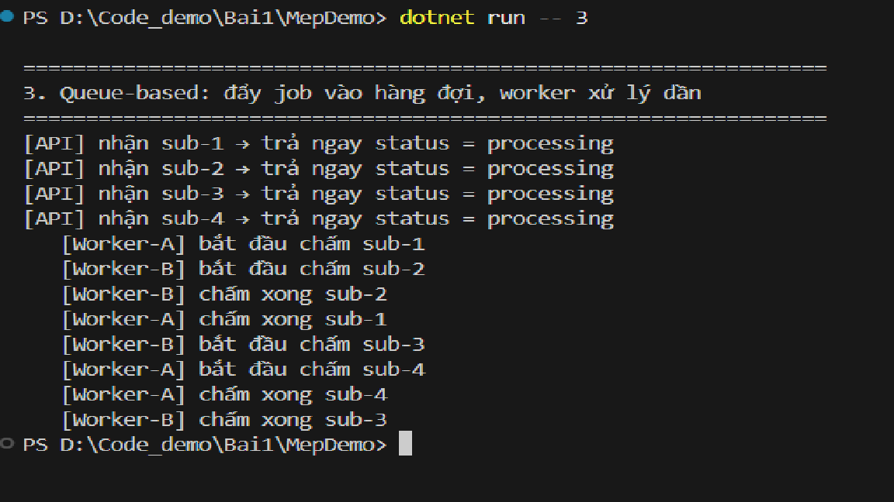
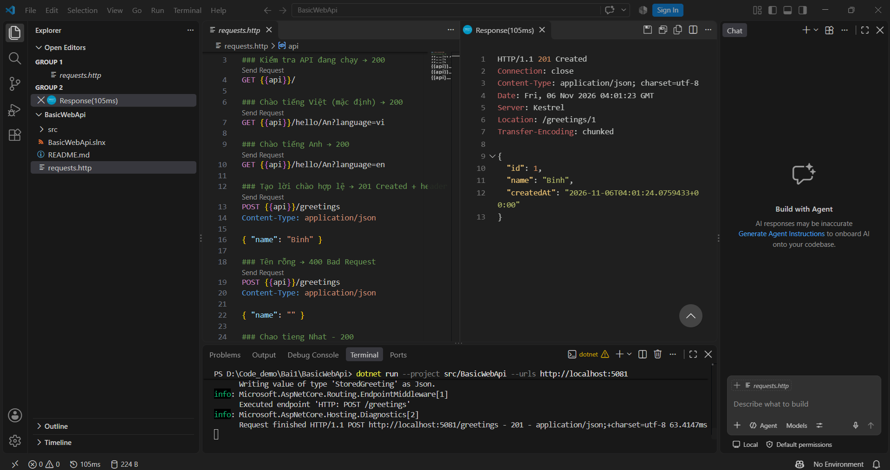
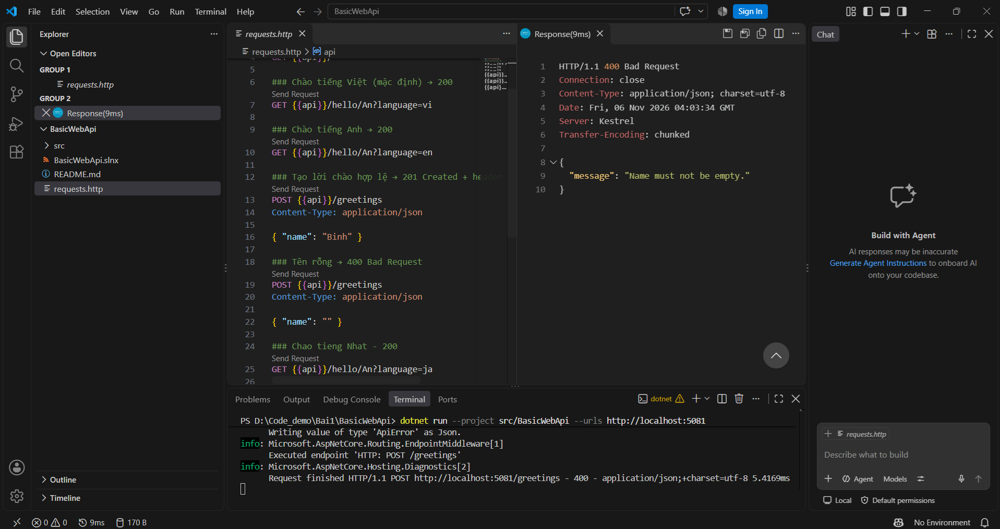
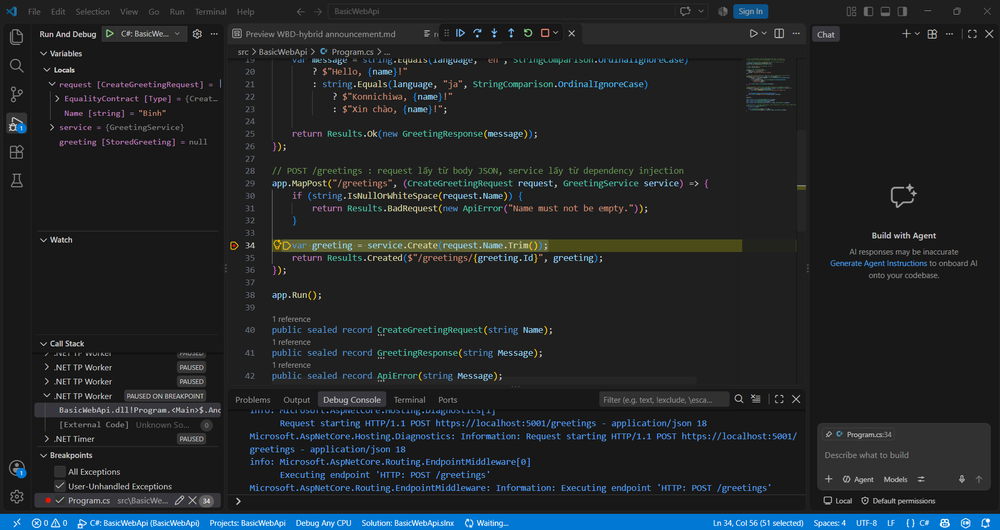
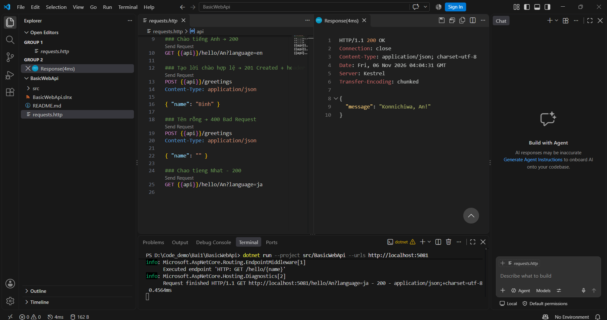
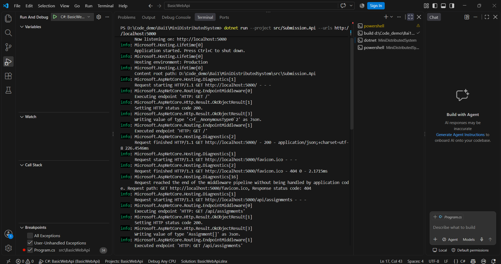
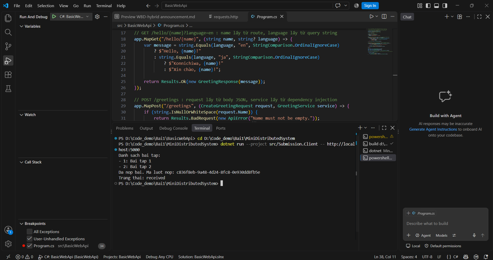
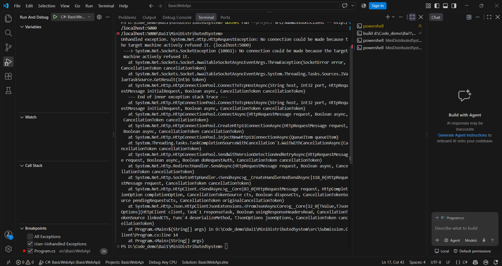
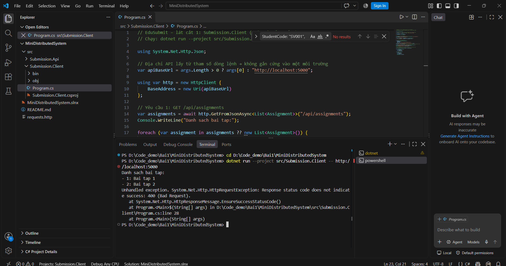
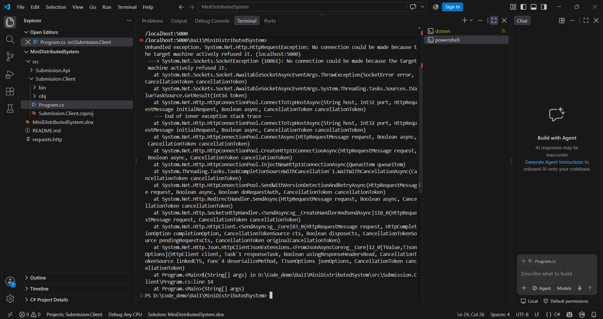

# Bài 1 — Tổng quan hệ thống và MEP

Họ tên: Lễ Nguyễn Ngọc Ánh  
MSSV: DTC245200405  
Lớp: CNTT K23D

## 1. Cài đặt

Môi trường: .NET 10 SDK, VS Code, Git, REST Client. Mã nguồn được đặt trong D:\Code_demo.

Ảnh cần bổ sung: kết quả `dotnet --version`, `git --version` và chạy Hello World. Không dùng kết quả dự kiến thay ảnh thực tế.

## 2. MepDemo — Bước 7

Lệnh chạy: `dotnet run -- 3`.



Trong ảnh: Worker-A xử lý sub-1, sub-4; Worker-B xử lý sub-2, sub-3. Mỗi bài chỉ do một worker xử lý. Hai worker chia nhau công việc; việc phân công có thể thay đổi giữa các lần chạy.

Ở MEP 4, theo code mẫu, một sự kiện được gửi tới ba subscriber: ScoreService, NotificationService và StatsService.

- Request–response: bên gửi yêu cầu chờ phản hồi, có thể gặp timeout.
- One-way: gửi thông điệp mà không chờ kết quả nghiệp vụ.
- Queue: đưa công việc vào hàng đợi để các worker chia nhau xử lý.
- Publish–subscribe: phát một sự kiện cho nhiều subscriber độc lập.
- Streaming: nhận chuỗi cập nhật theo thời gian mà không gửi yêu cầu mới cho từng bản cập nhật.

MepDemo mô phỏng các mô hình trong một tiến trình bằng Channel và event bus trong bộ nhớ; chưa sử dụng RabbitMQ hoặc HTTP thật.

## 3. BasicWebApi — Bước 8

Mẫu của giảng viên nằm tại D:\Code_demo\Bai1\BasicWebApi. Chạy từ thư mục này:

```powershell
dotnet build
dotnet run --project src/BasicWebApi --urls http://localhost:5081
```

Đã bổ sung nhánh `language=ja` trả `Konnichiwa, An!` và request thử trong requests.http.

Kiểm thử tự động do trợ lý thực hiện trên cổng 15081 để tránh xung đột với API người dùng đang chạy; kết quả lưu tại [logs/basicwebapi.txt](logs/basicwebapi.txt):

| Request | Kết quả thực tế |
|---|---|
| GET / | 200, application là BasicWebApi |
| GET /hello/An?language=vi | 200, Xin chào, An! |
| GET /hello/An?language=en | 200, Hello, An! |
| GET /hello/An?language=ja | 200, Konnichiwa, An! |
| POST /greetings với name=Binh | 201, Location=/greetings/1 |
| POST /greetings với tên rỗng | 400, Name must not be empty. |

### Trả lời mục 8.4

1. AddSingleton phải đặt trước builder.Build để đăng ký GreetingService trước khi ứng dụng được xây dựng. Route handler nhận service qua dependency injection.
2. name lấy từ route `/hello/{name}`; language lấy từ query string `?language=en`; CreateGreetingRequest được đọc từ JSON body.
3. POST hợp lệ tạo tài nguyên mới nên trả 201 Created và Location; 200 OK chỉ thể hiện yêu cầu thành công nói chung.

### Phần cần sinh viên trực tiếp thực hành

Đã thực hành REST Client, đặt breakpoint ở dòng tạo greeting và quan sát request.Name = Binh. Đã chạy từng bước và tiếp tục để nhận 201 Created. Các ảnh minh chứng bên dưới.

## 4. MiniDistributedSystem — Bước 9

Mẫu nằm tại D:\Code_demo\Bai1\MiniDistributedSystem. Chạy API và Client ở hai terminal:

```powershell
dotnet run --project src/Submission.Api --urls http://localhost:5000
dotnet run --project src/Submission.Client -- http://localhost:5000
```

Trợ lý đã chạy mẫu trên cổng kiểm thử 15000: client in hai bài tập, mã GUID và trạng thái received. Log: [mini-baseline.txt](logs/mini-baseline.txt). Sinh viên đã tự chạy API và Client, nhận danh sách hai bài tập và trạng thái received. Ảnh hai terminal bên dưới; cần đối chiếu thêm các request trong requests.http.

1. Client gửi GET /api/assignments, nhận 200 và mảng JSON; gửi POST /api/submissions, nhận 201 và dữ liệu lượt nộp. Mỗi lần gọi là một cặp request–response HTTP.
2. Client không tham chiếu project API. Hai bên thống nhất method, đường dẫn, cấu trúc JSON và mã trạng thái.
3. URL lấy từ tham số để thay máy chủ hoặc cổng mà không sửa và biên dịch lại code.

## 5. Bốn thí nghiệm lỗi — Bước 10

Trợ lý thực hiện trên đúng mẫu MiniDistributedSystem; dự đoán được lưu vào [du-doan.txt](logs/du-doan.txt) trước khi chạy. Các cổng 15000 và 15050 thay cho 5000 và 5050 để tránh ảnh hưởng API đang chạy. Nội dung thay đổi trong code mẫu được hoàn tác sau khi thử.

| Thí nghiệm | Dự đoán trước | Kết quả thực tế | Đối chiếu | Giải thích |
|---|---|---|---|---|
| a. Thêm bài tập thứ ba vào API | Client hiện thêm bài 3, không sửa client | Client in `3: Bai tap 3` | Đúng | Client duyệt danh sách JSON nên số phần tử không bị gắn cứng |
| b. Tắt API rồi chạy client | Kết nối thất bại | HttpRequestException, client kết thúc lỗi | Đúng | Không có server nhận kết nối; gọi mạng còn chịu lỗi server/mạng. Gọi hàm nội bộ cũng có thể ném lỗi, nhưng không có ranh giới kết nối mạng này |
| c. Đổi StudentCode thành chuỗi rỗng | API trả 400, client ném ngoại lệ | HttpRequestException: 400 Bad Request tại EnsureSuccessStatusCode | Đúng | EnsureSuccessStatusCode từ chối phản hồi ngoài nhóm 2xx; server phải tự kiểm tra vì client có thể gửi dữ liệu sai |
| d. API chạy cổng khác, client gọi cổng cũ | Gọi sai cổng lỗi, sửa tham số URL thì thành công | Client gọi 15000 lỗi; truyền http://localhost:15050 thì in hai bài và trạng thái received | Đúng | URL client phải khớp cổng API; sửa tham số dòng lệnh, không cần sửa code |

Log: [a](logs/thi-nghiem-a.txt), [b](logs/thi-nghiem-b.txt), [c](logs/thi-nghiem-c.txt). Log [d](logs/thi-nghiem-d.txt) xác nhận sửa tham số URL thành công. Đây là kết quả trợ lý thực hiện, không phải các thao tác sinh viên tự chạy trong buổi học.

## 6. EduSubmit tự tạo và mở rộng — Bước 11–12

Dự án gồm Submission.Api và Submission.Client, target net10.0; không tham chiếu lẫn nhau.

API có GET /, GET /api/assignments, POST /api/submissions, GET /api/submissions/{id:guid}. Dữ liệu vào kiểm tra assignmentId > 0 và các chuỗi không rỗng. POST hợp lệ sinh GUID, thời gian UTC, trạng thái received và trả 201 kèm Location. ID không tồn tại trả 404.

Lượt nộp lưu trong ConcurrentDictionary để hỗ trợ nhiều request đồng thời. Dữ liệu chỉ nằm trong bộ nhớ, mất khi restart API. Client tạo bài nộp rồi GET đọc lại cùng ID.

Đã kiểm thử HTTP trước đó trên cổng 5097, ghi tại [kiem-thu.txt](kiem-thu.txt): GET 200, POST 201, dữ liệu sai 400, đọc lại 200 và ID không tồn tại 404. Client tạo và đọc lại cùng ID, trạng thái received. Link repository trong client và requests.http đã đổi sang https://github.com/stickman006/CNTTK23D.

Luồng thông điệp:

- Client → GET /api/assignments → API → 200 JSON.
- Client → POST /api/submissions → API → 201 JSON và Location.
- Client → GET /api/submissions/{id} → API → 200 JSON.

Cả ba lần gọi thuộc mô hình request–response.

Phần tham khảo: dùng trợ lý AI hướng dẫn, viết và hoàn thiện code, thực hiện kiểm thử. Cần tự đọc hiểu, thực hành và chụp ảnh minh chứng. Không khẳng định đã tự viết toàn bộ hoặc chỉ xem mẫu sau 10 phút.

## 7. Khó khăn và cách giải quyết

- Phân biệt kho gốc PTUDPTK23 và bản fork stickman006 trước khi tải bài.
- Đã gặp đường dẫn GitHub lặp Bai1/docs/Bai1/docs; đã sửa trên bản fork thành Bai1/docs.
- API phải chạy trước client, URL phải khớp cổng.
- Nhật ký dùng ảnh tương đối `anh/mep3.png`; phải upload cả ảnh và file Markdown.
- Đã bổ sung ảnh REST Client, debug và hai tiến trình mẫu. Ảnh cài đặt và EduSubmit cá nhân vẫn cần bổ sung nếu chưa có.

## 8. Nộp bài — Bước 13

Đưa bài vào đúng `Lễ Nguyễn Ngọc Ánh - dtc245200405/Bai1` trong fork stickman006/CNTTK23D. Giữ code trong src, requests.http và docs; bỏ bin, obj và .git khi upload.

Tiêu đề PR: `Bai1 - DTC245200405 - Lễ Nguyễn Ngọc Ánh`.

Theo hướng dẫn Word cần tag bai1. Khi bổ sung bài vào fork, PR đã có sẽ tự cập nhật; không tạo PR mới. Chưa xác nhận đã nộp hoặc tạo PR trong nhật ký này.


## 9. Ảnh thực hành đã lưu

### basic-200


### basic-201



### basic-400



### basic-debug



### basic-ja



### mini-api



### mini-client



### thi-nghiem-b



### thi-nghiem-c



### thi-nghiem-d-sai




## Nguồn ảnh và kết quả tham khảo
Ảnh và log được dùng lại từ bài của Tô Văn Thịnh (DTC245200374), không xác nhận người mang tên trong bản sao đã tự thực hiện. Cần tự chạy và thay ảnh cá nhân trước khi nộp. Link stickman006 là fork nguồn, cần đổi sang fork người nộp.

