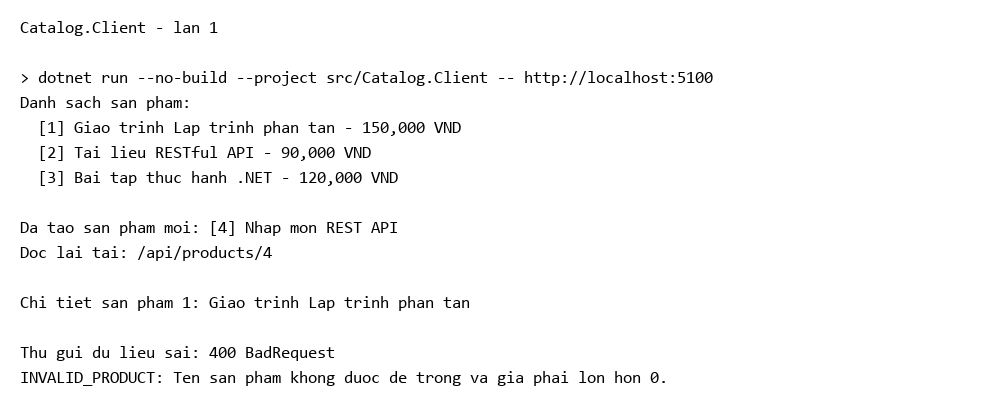
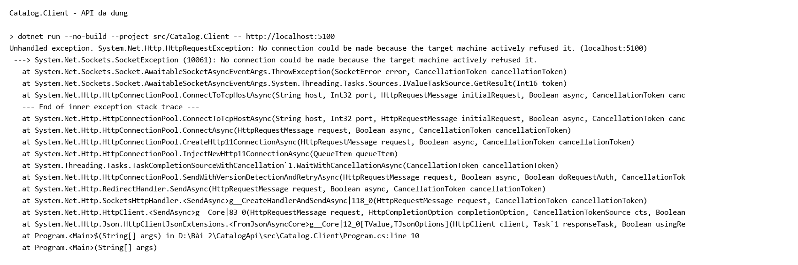

# Catalog API

## Chạy

```powershell
dotnet build -m:1 -nr:false -p:UseSharedCompilation=false
dotnet run --no-build --project src/Catalog.Api --urls http://localhost:5100
```

Mở terminal thứ hai trong cùng thư mục:

```powershell
dotnet run --no-build --project src/Catalog.Client -- http://localhost:5100
```

Mở `requests.http` bằng REST Client để gửi từng yêu cầu.

## Tự kiểm tra bước 10

| Yêu cầu | Kết quả |
| --- | --- |
| GET / | 200 |
| GET /api/products | 200, 3 sản phẩm sau khởi động |
| GET /api/products/1 | 200 |
| GET /api/products/999 | 404, PRODUCT_NOT_FOUND |
| GET /api/products/abc | 404, body rỗng |
| POST hợp lệ | 201, có Location |
| POST giá âm | 400, INVALID_PRODUCT |
| POST thiếu Content-Type | 415 |
| Client | In đủ 4 bước |
| Dừng API, chạy Client | HttpRequestException |

## Thí nghiệm bước 9

| Thao tác | Quan sát |
| --- | --- |
| Chạy Client lần đầu | Danh sách 3 sản phẩm, tạo id 4 |
| Chạy Client lần hai, giữ API | Danh sách 4 sản phẩm, tạo id 5 |
| Dừng API rồi chạy Client | Lỗi kết nối, không có phản hồi HTTP |
| Khởi động lại API | Danh sách trở về 3 sản phẩm |
| Đổi URL Client sang cổng 5999 | Lỗi kết nối |

Dữ liệu nằm trong List của API. Chạy lại Client vẫn dùng dữ liệu trên API; khởi động lại API thì List được tạo lại. URL sai hoặc API dừng làm Client không kết nối được, khác lỗi 400 có phản hồi từ API.

## Kết quả





Ảnh lấy từ log chạy.

POST trước khi thêm MapPost ở bước 4 trả 405. Sau bước 5, POST đã được hỗ trợ nên ca này không còn trả 405.
