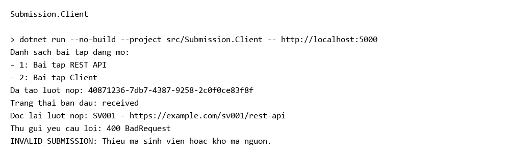
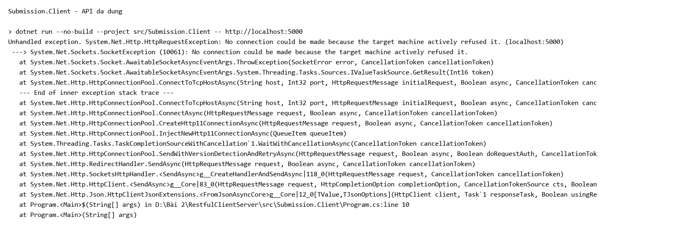

# EduSubmit

## Chạy

```powershell
dotnet build -m:1 -nr:false -p:UseSharedCompilation=false
dotnet run --no-build --project src/Submission.Api --urls http://localhost:5000
```

Mở terminal thứ hai trong cùng thư mục:

```powershell
dotnet run --no-build --project src/Submission.Client -- http://localhost:5000
```

Client lấy danh sách bài tập, nộp bài, đọc lại theo Location rồi gửi dữ liệu rỗng để xem lỗi 400. `requests.http` có 7 yêu cầu; gửi POST trước yêu cầu đọc lại lượt nộp.

## Bảng phá thử

| Ca | Dữ liệu / thao tác | Kết quả |
| --- | --- | --- |
| 4a | GET bài tập 1 | 200 |
| 4b | GET bài tập 999 | 404, ASSIGNMENT_NOT_FOUND |
| 4c | GET bài tập abc | 404, body rỗng |
| 5a | POST bài 1 với sv001.json | 201, có Location |
| 5b | POST với rong.json | 400, INVALID_SUBMISSION |
| 5c | POST bài 999 | 404, ASSIGNMENT_NOT_FOUND |
| 5d | Bỏ Content-Type | 415 |
| 5e | JSON hỏng | 400, lỗi đọc JSON |
| 5f | Thiếu repositoryUrl | 400, INVALID_SUBMISSION |
| 5g | PUT bài tập 1 | 405, Allow: GET |
| 5h | Tạm đặt bài 2 IsOpen=false rồi POST | 400, ASSIGNMENT_CLOSED |
| 6a | GET Location vừa tạo | 200, đúng lượt nộp |
| 6b | GET Guid chưa tồn tại | 404, SUBMISSION_NOT_FOUND |
| 6c | Khởi động lại API rồi GET id cũ | 404, SUBMISSION_NOT_FOUND |
| 7a | Dừng API rồi chạy Client | HttpRequestException |
| 7b | Client gọi cổng 5999 | Lỗi kết nối |
| 7c | Tạm thêm bài tập 3, không sửa Client | Client in thêm bài tập 3 |
| Slide 85 | Tạm dùng GetFromJsonAsync gọi bài 999 | Ném HttpRequestException với status 404 |

Sau các ca thử, bài tập 2 đã được đặt lại IsOpen=true, bỏ bài tập 3 và khôi phục Client. Bản cuối có đúng hai bài tập mẫu như slide. API chỉ dùng List trong bộ nhớ nên khởi động lại sẽ mất các lượt nộp.

## Ba câu hỏi

1. URI dùng danh từ để chỉ tài nguyên, ví dụ `/api/assignments`. GET dùng để đọc, POST dùng để tạo, nên không cần đưa hành động vào URI.
2. Mỗi yêu cầu tự mang đủ thông tin: assignmentId nằm trên URL, studentCode và repositoryUrl nằm trong body. API không dựa vào phiên làm việc hoặc yêu cầu trước đó của Client. List lưu dữ liệu không làm mất tính stateless.
3. Hai bên khai báo DTO riêng nhưng cùng tên trường và kiểu dữ liệu JSON nên đọc được dữ liệu của nhau. Ví dụ StudentCode trong C# tương ứng studentCode trong JSON. Nếu đặt sai tên trường, dữ liệu nhận về có thể bị thiếu dù vẫn biên dịch được.

## Kết quả chạy





Ảnh lấy từ log chạy.
