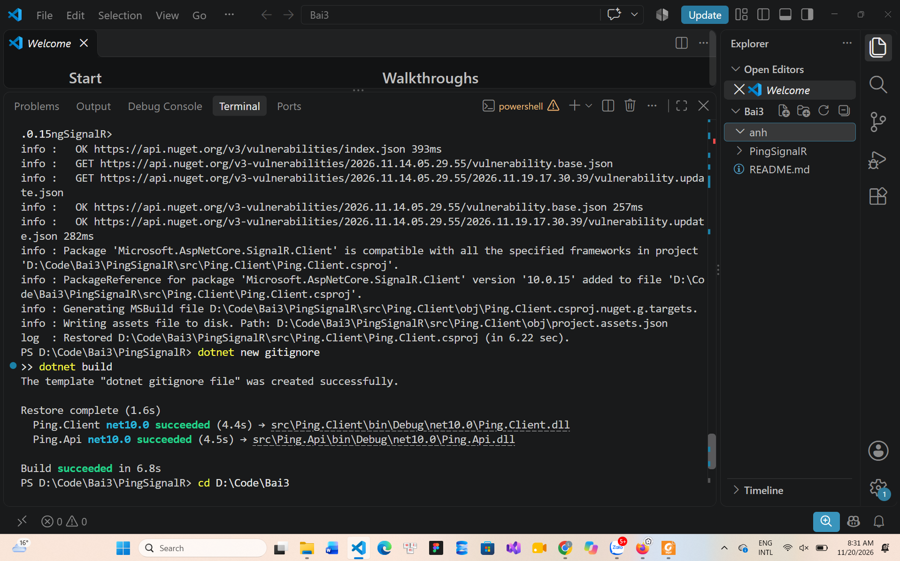
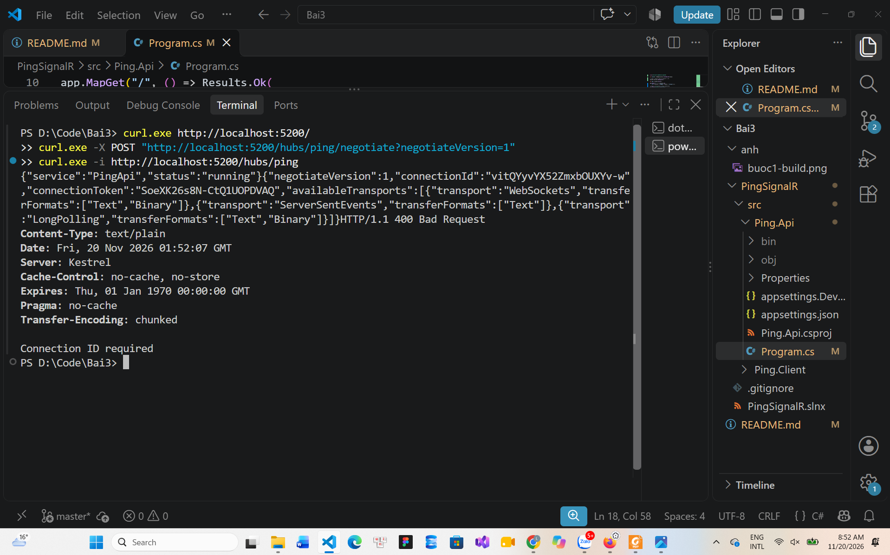
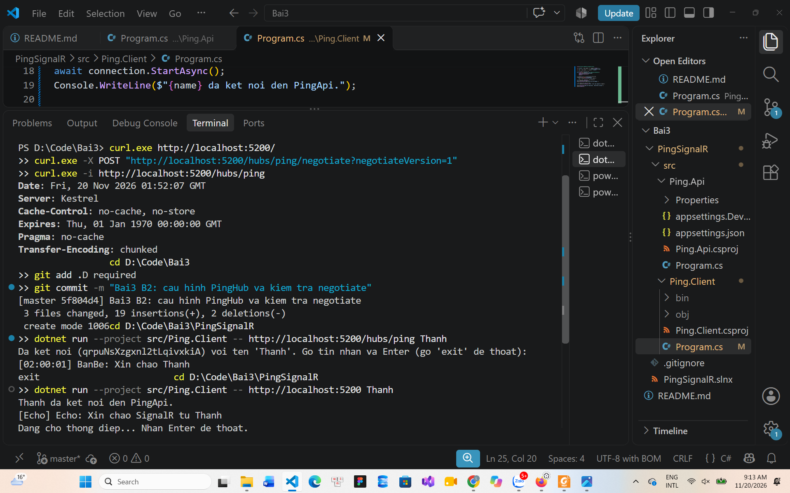
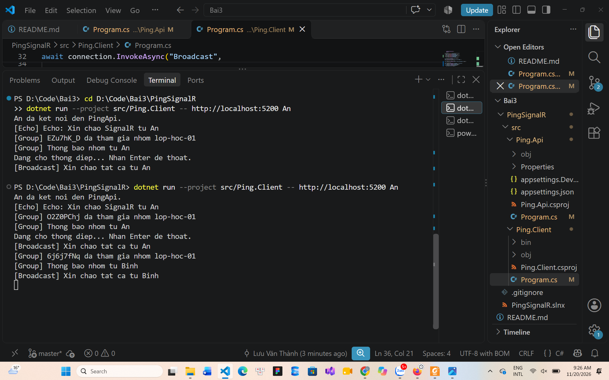
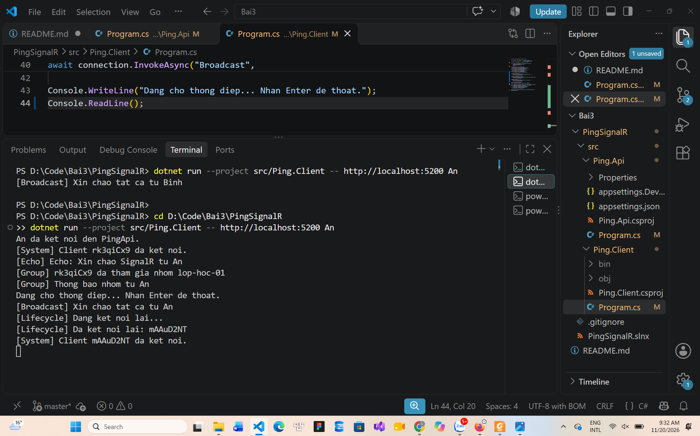
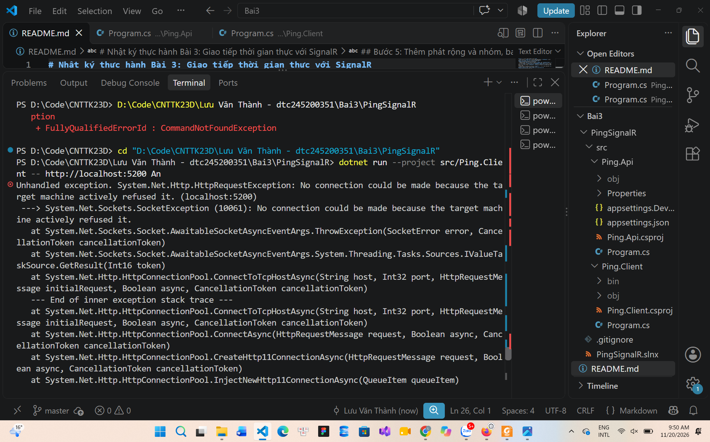

# Nhật ký thực hành Bài 3: Giao tiếp thời gian thực với SignalR

## Bước 1: Tạo solution và 2 project PingSignalR

- **Thấy:** `dotnet build` báo `Build succeeded` cho cả `Ping.Api` và `Ping.Client`.
- **Giải thích:** Đã tạo solution chứa 2 project và thêm gói `Microsoft.AspNetCore.SignalR.Client` phiên bản 10.0.15 cho phía máy khách.
cd D:\Code\Bai3
git add .
git commit -m "Bai3 B2: cau hinh PingHub va kiem tra negotiate"
## Bước 2: Cấu hình Hub phía máy chủ và kiểm tra negotiate

- **Thấy:** `POST /hubs/ping/negotiate` trả về JSON chứa `connectionId` và danh sách `availableTransports` (`WebSockets`, `ServerSentEvents`, `LongPolling`). `GET /hubs/ping` trả về mã lỗi `400 Connection ID required`.
- **Giải thích:** Hub SignalR đã được ánh xạ thành công tại `/hubs/ping` và yêu cầu bắt tay (negotiate) lấy `connectionId` trước khi thiết lập kết nối. 
## Bước 3: Phương thức Echo, máy chủ trả lời riêng người vừa gọi

- **Thấy:** Đã thêm phương thức `Echo(string message)` vào `PingHub` sử dụng `Clients.Caller.SendAsync("EchoResponse", ...)`. Lệnh `dotnet build` báo `Build succeeded` (`0 Error(s)`) và máy chủ chạy ổn định tại cổng `5200`.
- **Giải thích:** `Clients.Caller` chỉ gửi thông điệp phản hồi `"EchoResponse"` về duy nhất kết nối vừa gọi `Echo`, các client khác không nhận được.
## Bước 4: Máy khách kết nối Hub và gọi phương thức Echo

- **Thấy:** Client `Thanh` kết nối thành công tới `PingApi`, gọi `InvokeAsync("Echo", ...)` và nhận ngay phản hồi `[Echo] Echo: Xin chao SignalR tu Thanh`. Khi thử sửa sai tên ở chiều lên (`"Ech0"`), chương trình báo lỗi `HubException: Method does not exist` và dừng; khi sửa sai ở chiều xuống (`"EchoRespone"`), chương trình không báo lỗi nhưng không nhận được dữ liệu.
- **Giải thích:** Tên phương thức khi gọi (`InvokeAsync`) và tên sự kiện lắng nghe (`On`) phải khớp chính xác từng ký tự giữa Client và Hub.
## Bước 5: Thêm phát rộng và nhóm, ba phạm vi gửi trong cùng một Hub

- **Thấy:** Khi chạy `An` trước và `Bình` sau, cửa sổ `An` nhận được thông báo nhóm (`[Group]`) và phát rộng (`[Broadcast]`) của `Bình`, nhưng không nhận được phản hồi `[Echo]` của `Bình`.
- **Giải thích:** `Clients.Caller` chỉ gửi riêng cho người gọi; `Clients.Group` gửi cho các thành viên đang ở trong nhóm (kể cả khi người gửi không thuộc nhóm đó); `Clients.All` gửi tới toàn bộ kết nối đang mở.

### Đáp án thử thách 3 máy khách (An, Bình thuộc `lop-hoc-01`; Chi không thuộc nhóm nào):
| Lời gọi | An | Bình | Chi | Phạm vi |
|---|---|---|---|---|
| 1. An gọi `Echo("hi")` | Nhận | Không | Không | `Clients.Caller` |
| 2. Chi gọi `SendToGroup("lop-hoc-01", "x")` | Nhận | Nhận | Không (vì Chi không ở trong nhóm) | `Clients.Group` |
| 3. Bình gọi `Broadcast("y")` | Nhận | Nhận | Nhận | `Clients.All` |
## Bước 6: Vòng đời kết nối và tự động kết nối lại

- **Thấy:** Máy chủ in `[Hub] + ... ket noi` khi client mở và `[Hub] - ... ngat` khi đóng. Khi tắt máy chủ rồi bật lại, client `An` tự động kích hoạt sự kiện `Reconnecting` (`Dang ket noi lai...`) và `Reconnected` (`Da ket noi lai: ...`) với một `ConnectionId` mới.
- **Giải thích:** `WithAutomaticReconnect()` mặc định thử kết nối lại tại các mốc `0s, 2s, 10s, 30s` (hết 4 lần sẽ chuyển sang `Closed`). Sau khi nối lại thành công, server cấp `ConnectionId` mới nên client cần tự đăng ký lại vào các nhóm cũ nếu cần.

## Bước 7: Ba thí nghiệm lỗi kết nối phân tán

1. **Máy chủ chưa chạy:** Chạy client khi server đã tắt $\rightarrow$ Gặp lỗi `HttpRequestException: Connection refused (localhost:5200)` ngay tại `StartAsync()` vì cơ chế tự nối lại chỉ áp dụng cho kết nối đã thiết lập thành công trước đó.
2. **Sai đường dẫn Hub (`/hub/ping`):** Gặp lỗi `404 (Not Found)` trong pha `negotiate` do URL không khớp tuyến đã khai báo ở `MapHub<PingHub>("/hubs/ping")`.
3. **Sai tên thông điệp (`On("EchoRespone")`):** Không báo lỗi biên dịch hay runtime nhưng không nhận được phản hồi `[Echo]` do tên sự kiện lắng nghe không khớp với tên gửi từ Hub.

## Tổng hợp 4 phạm vi gửi thông điệp trong SignalR
| Phạm vi | Người nhận | Ví dụ ứng dụng (EduSubmit) |
|---|---|---|
| `Clients.All` | Mọi kết nối đang mở (bao gồm cả người gửi) | Thông báo máy chủ bảo trì; bài tập mới được đăng |
| `Clients.Caller` | Chỉ kết nối vừa gọi phương thức trên Hub | Xác nhận đã đăng ký theo dõi lượt nộp |
| `Clients.Group(ten)` | Toàn bộ thành viên đang ở trong nhóm | Cập nhật trạng thái chấm bài của nhóm `submission:{id}` |
| `Clients.Client(id)` | Duy nhất một `ConnectionId` cụ thể | Gửi thông báo riêng cho một phiên làm việc |