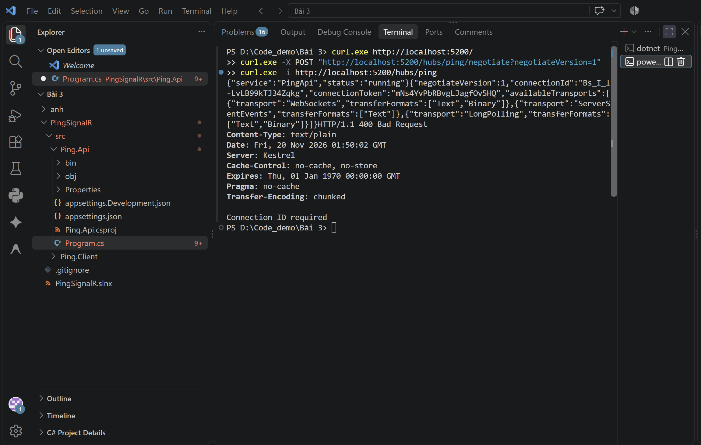
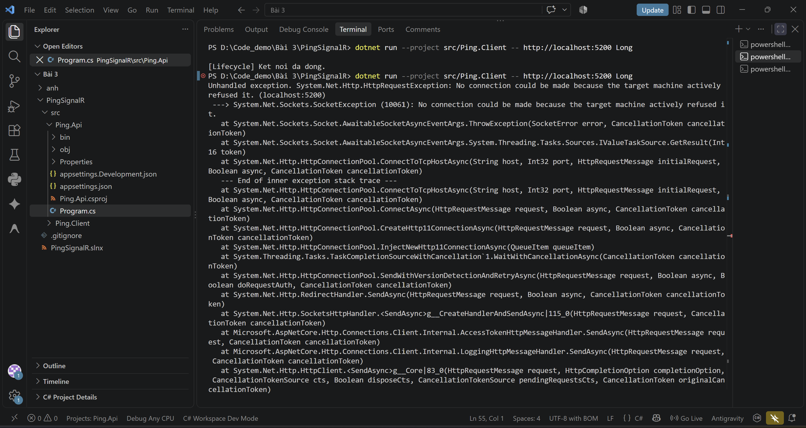
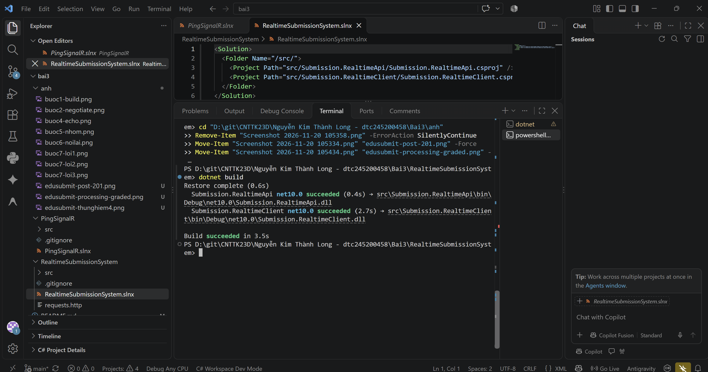
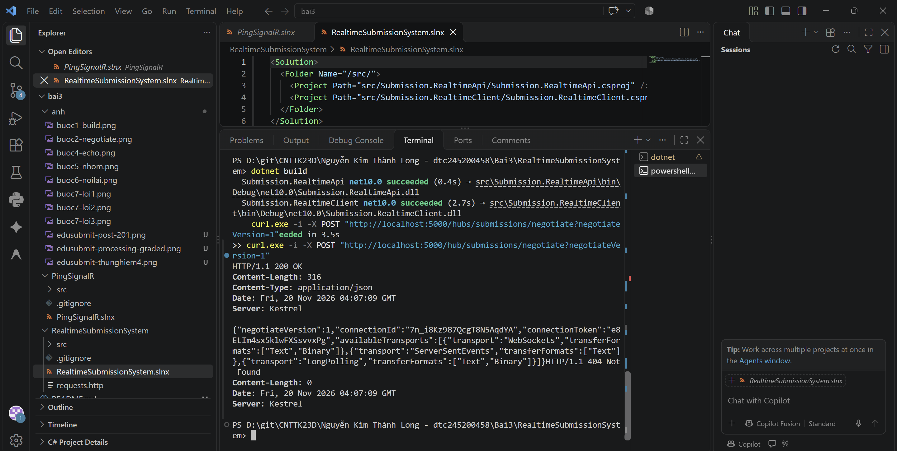
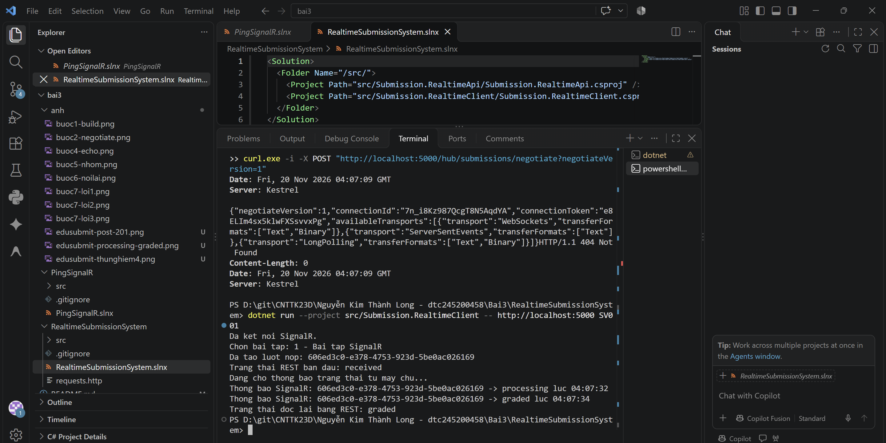
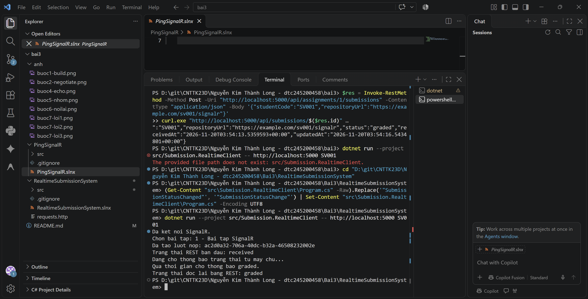
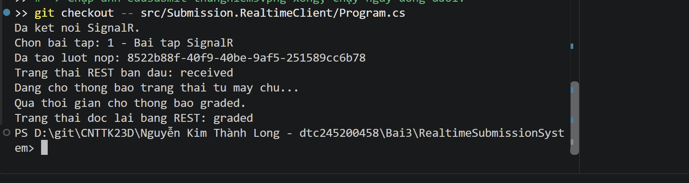

# BĂ¡o CĂ¡o Thá»±c HĂ nh BĂ i 3: Giao Tiếp Thời Gian Thá»±c Vá»›i SignalR
**MĂ´n học:** PhĂ¡t triển ứng dụng phĂ¢n tĂ¡n  
**Giảng viĂªn:** TS. DÆ°Æ¡ng Thu MĂ¢y  
**Sinh viĂªn thá»±c hiện:** [Họ tĂªn - MSSV]  
**MĂ£ lá»›p / NgĂ nh:** CĂ´ng nghệ ThĂ´ng tin  

---

## MỤC LỤC
1. [Trả lời 3 cĂ¢u hỏi đầu giờ](#phần-0-trả-lời-3-cĂ¢u-hỏi-đầu-giờ)
2. [Phần 2: Kỹ thuật lập trình cÆ¡ bản - PingSignalR](#phần-2-kỹ-thuật-lập-trình-cÆ¡-bản-vá»›i-signalr-pingsignalr)
3. [Phần 3: EduSubmit nhận thĂ´ng bĂ¡o trạng thĂ¡i thời gian thá»±c](#phần-3-edusubmit-nhận-thĂ´ng-bĂ¡o-trạng-thĂ¡i-thời-gian-thá»±c)
   - [Bản thiết kế kĂªnh thời gian thá»±c](#1-bản-thiết-kế-kĂªnh-thời-gian-thá»±c-4-cĂ¢u-hỏi-khung)
   - [BÆ°á»›c 1: Tạo solution vĂ  hai project](#bÆ°á»›c-1-tạo-solution-realtimesubmissionsystem-vĂ -cĂ i-gĂ³i-signalr-client)
   - [BÆ°á»›c 2: XĂ¢y dá»±ng REST API, UpdatedAt vĂ  khĂ³a đồng bá»™](#bÆ°á»›c-2-xĂ¢y-dá»±ng-rest-api-updatedat-vĂ -khoĂ¡-dữ-liệu-bảo-vệ)
   - [BÆ°á»›c 3: Triển khai SubmissionHub vĂ  nhĂ³m](#bÆ°á»›c-3-triển-khai-submissionhub-vĂ -quản-lĂ½-nhĂ³m-theosubmissionid)
   - [BÆ°á»›c 4: TĂ¡c vụ chấm nền vĂ  IHubContext](#bÆ°á»›c-4-tĂ¡c-vụ-chấm-nền-vá»›i-ihubcontext-vĂ -simulategradingasync)
   - [BÆ°á»›c 5: MĂ¡y khĂ¡ch SignalR vĂ  chuĂ´ng TaskCompletionSource](#bÆ°á»›c-5-mĂ¡y-khĂ¡ch-signalr-vĂ -chuĂ´ng-taskcompletionsource)
   - [BÆ°á»›c 6: Luồng ná»™p bĂ i vĂ  nhận kết quả thời gian thá»±c](#bÆ°á»›c-6-luồng-hoĂ n-chỉnh-post--watch--chờ-graded--get-lại)
   - [BÆ°á»›c 7: 5 thĂ­ nghiệm phĂ¢n tĂ¡n vĂ  phĂ¢n tĂ­ch](#bÆ°á»›c-7-5-thĂ­-nghiệm-phĂ¢n-tĂ¡n-vĂ -bĂ i-học-kết-nối)
   - [Bước 8: Kiểm thử với requests.http (9 ca)](#bước-8-kiểm-thử-hệ-thống-với-requestshttp-đủ-9-ca)
4. [Danh sĂ¡ch commit gợi Ă½](#danh-sĂ¡ch-commit-gợi-Ă½-tối-thiểu-8-commits)
5. [Checklist trước khi mở Pull Request](#checklist-trước-khi-mở-pull-request)
6. [Hướng dẫn chụp ảnh minh chứng](#hướng-dẫn-chụp-ảnh-minh-chứng-chuẩn-quy-định)

---

## PHẦN 0: TRẢ LỜI 3 CĂ‚U HỎI ĐẦU GIỜ

### CĂ¢u 1: MĂ¡y chủ cĂ³ thể chủ Ä‘á»™ng bĂ¡o cho mĂ¡y khĂ¡ch mĂ  khĂ´ng cần mĂ¡y khĂ¡ch hỏi khĂ´ng?
> **Trả lời:**  
> **CĂ³ thể được**, nếu mĂ¡y khĂ¡ch chủ Ä‘á»™ng mở vĂ  duy trì sẵn má»™t kết nối hai chiều lĂ¢u dĂ i (persistent connection) lĂªn mĂ¡y chủ thĂ´ng qua giao thức **WebSocket** (được Ä‘Ă³ng gĂ³i vĂ  quản lĂ½ cấp cao bởi thÆ° viện **SignalR**).  
> Khi cĂ³ sá»± kiện phĂ¡t sinh (vĂ­ dụ: trạng thĂ¡i bĂ i ná»™p thay đổi), mĂ¡y chủ cĂ³ thể chủ Ä‘á»™ng đẩy dữ liệu (push) về mĂ¡y khĂ¡ch thĂ´ng qua `Clients.Group(...).SendAsync(...)`. Trường hợp phĂ¡t sinh sá»± kiện từ bĂªn ngoĂ i Hub (nhÆ° tĂ¡c vụ nền Background Task hoặc Controller/Endpoint Minimal API), mĂ¡y chủ sá»­ dụng **`IHubContext<THub>`** được tiĂªm phụ thuá»™c (Dependency Injection) để phĂ¡t loa thĂ´ng bĂ¡o.

### CĂ¢u 2: ÄĂ£ cĂ³ REST rồi, vì sao cĂ²n cần thĂªm SignalR? Hai thứ chia việc thế nĂ o?
> **Trả lời:**  
> **REST** vĂ  **SignalR** khĂ´ng thay thế nhau mĂ  phối hợp bổ trợ nhau theo nguyĂªn tắc:  
> - **REST (YĂªu cầu - Phản hồi / Request-Response):** ÄĂ³ng vai trĂ² lĂ  **nguồn sá»± thật duy nhất (Single Source of Truth)**. PhĂ¹ hợp nhất cho việc tạo tĂ i nguyĂªn má»›i (`POST` trả về mĂ£ trạng thĂ¡i rõ rĂ ng `201 Created` kèm `Location`), đọc dữ liệu danh mục tÄ©nh (`GET`), vĂ  đọc trạng thĂ¡i bền vững được lÆ°u trữ trong cÆ¡ sở dữ liệu/bá»™ nhá»›.
> - **SignalR (Đẩy dữ liệu / Push notification):** ÄĂ³ng vai trĂ² lĂ  **kĂªnh thĂ´ng bĂ¡o tức thời (Event-driven Notification)**. GiĂºp mĂ¡y chủ chủ Ä‘á»™ng bĂ¡o tin cho mĂ¡y khĂ¡ch ngay khi trạng thĂ¡i tĂ i nguyĂªn thay đổi (`processing`, `graded`) mĂ  khĂ´ng bắt mĂ¡y khĂ¡ch phải liĂªn tục gá»­i request thăm dĂ² định kỳ (**polling** lĂ m lĂ£ng phĂ­ băng thĂ´ng vĂ  tĂ i nguyĂªn CPU mạng).  
> **Quy tắc phĂ¢n chia:** DĂ¹ng REST để tạo vĂ  đọc tĂ i nguyĂªn; dĂ¹ng SignalR để đẩy thĂ´ng bĂ¡o trạng thĂ¡i tức thì.

### CĂ¢u 3: Nếu đứt mạng Ä‘Ăºng lĂºc mĂ¡y chủ bĂ¡o "Ä‘Ă£ chấm xong" (graded) thì sao?
> **Trả lời:**  
> ThĂ´ng Ä‘iệp SignalR phĂ¡t Ä‘i qua mạng trong lĂºc mĂ¡y khĂ¡ch mất kết nối sẽ **bị mất vÄ©nh viá»…n** do SignalR khĂ´ng mặc định lÆ°u trữ bá»™ đệm tin nhắn hĂ ng đợi (message queue/replay) cho cĂ¡c client bị ngắt kết nối.  
> Tuy nhiĂªn, nhờ kiến trĂºc phĂ¢n tầng Ä‘Ăºng đắn:  
> 1. Khi cĂ³ mạng trở lại, tĂ­nh năng `WithAutomaticReconnect()` của SignalR Client sẽ tá»± Ä‘á»™ng nối lại vá»›i má»™t `ConnectionId` má»›i.  
> 2. MĂ¡y khĂ¡ch sẽ gia nhập lại nhĂ³m vĂ  **gọi lại REST API (`GET /api/submissions/{id}`)** để đọc trạng thĂ¡i hiện thời của bĂ i ná»™p từ "nguồn sá»± thật".  
> **Khẩu hiệu cốt lõi:** *"Push để nhanh, REST để chắc"*.

---

## PHẦN 2: KỸ THUẬT LẬP TRĂŒNH CÆ  BẢN VỚI SIGNALR (PingSignalR)

### BÆ°á»›c 1: Tạo solution vĂ  cĂ i gĂ³i SignalR Client

- **Thấy:** ThĂªm gĂ³i `Microsoft.AspNetCore.SignalR.Client` vĂ o `Ping.Client.csproj` vĂ  `dotnet build` bĂ¡o `Build succeeded, 0 Error(s)`.
- **Giải thĂ­ch:** Thiết lập cấu trĂºc solution gồm mĂ¡y chủ Minimal API `Ping.Api` vĂ  mĂ¡y khĂ¡ch console `Ping.Client`.

### Bước 2: Bắt tay kết nối (Negotiate)

- **Thấy:** Gọi `POST /hubs/ping/negotiate?negotiateVersion=1` trả về `connectionId`, `connectionToken` vĂ  3 cÆ¡ chế truyền tải dá»± phĂ²ng (`WebSockets`, `ServerSentEvents`, `LongPolling`). Gọi `GET /hubs/ping` khĂ´ng cĂ³ tham số trả về `400 Bad Request (Connection ID required)`.
- **Giải thĂ­ch:** SignalR luĂ´n thá»±c hiện bÆ°á»›c bắt tay HTTP negotiate trÆ°á»›c khi quyết định nĂ¢ng cấp lĂªn giao thức kết nối tối Æ°u nhất mĂ  client/server cĂ¹ng há»— trợ.

### Bước 3–4: Phương thức Echo

- **Thấy:** MĂ¡y chủ chạy, mĂ¡y khĂ¡ch gọi `connection.InvokeAsync("Echo", ...)` vĂ  in kết quả `[Echo] Echo: Xin chao SignalR tu An`.
- **Giải thĂ­ch:** Hai chiều trĂªn cĂ¹ng má»™t kết nối: mĂ¡y khĂ¡ch gá»­i lệnh qua `InvokeAsync`, mĂ¡y chủ xá»­ lĂ½ vĂ  phản hồi riĂªng cho kết nối Ä‘Ă³ bằng `Clients.Caller.SendAsync("EchoResponse", ...)`.

### BÆ°á»›c 5: PhĂ¡t rá»™ng (Broadcast) vĂ  NhĂ³m (Group)

- **Thấy:** Hai mĂ¡y khĂ¡ch An vĂ  Bình cĂ¹ng tham gia nhĂ³m `lop-hoc-01`. Cá»­a sổ An nhận được tin `[Group]` vĂ  `[Broadcast]` của Bình gá»­i sang, nhÆ°ng hoĂ n toĂ n khĂ´ng nhận được tin `[Echo]` của Bình.
- **Giải thĂ­ch:** `Clients.Caller` chỉ gá»­i cho người gọi, `Clients.Group` gá»­i cho cĂ¡c thĂ nh viĂªn trong nhĂ³m, cĂ²n `Clients.All` phĂ¡t rá»™ng cho mọi kết nối Ä‘ang mở.

### BÆ°á»›c 6: VĂ²ng đời kết nối vĂ  tá»± Ä‘á»™ng kết nối lại

- **Thấy:** Khi tắt mĂ¡y chủ, mĂ¡y khĂ¡ch in `[Lifecycle] Dang ket noi lai...`. Khi mĂ¡y chủ bật lại, mĂ¡y khĂ¡ch in `[Lifecycle] Da ket noi lai` vá»›i má»™t `ConnectionId` hoĂ n toĂ n má»›i.
- **Giải thĂ­ch:** `WithAutomaticReconnect()` quản lĂ½ lịch trình thá»­ lại (0s, 2s, 10s, 30s). Khi nối lại thĂ nh cĂ´ng, mĂ¡y chủ cấp mĂ£ kết nối má»›i, do Ä‘Ă³ cĂ¡c nhĂ³m cÅ© gắn vá»›i mĂ£ kết nối trÆ°á»›c Ä‘Ă³ sẽ bị huá»·.

### BÆ°á»›c 7: Ba thĂ­ nghiệm lá»—i cố Ă½ (PingSignalR)
- **ThĂ­ nghiệm 1 (MĂ¡y chủ chÆ°a chạy):**   
  *Thấy:* `HttpRequestException: Connection refused (localhost:5200)`.  
  *Giải thĂ­ch:* `WithAutomaticReconnect` chỉ kĂ­ch hoạt khi Ä‘Ă£ mở kết nối thĂ nh cĂ´ng trÆ°á»›c Ä‘Ă³; nếu lần bắt tay đầu tiĂªn thất bại, `StartAsync` nĂ©m ngoại lệ ngay lập tức.
- **ThĂ­ nghiệm 2 (Sai đường dẫn /hub/ping):**   
  *Thấy:* MĂ¡y khĂ¡ch nhận lá»—i HTTP `404 Not Found`.  
  *Giải thĂ­ch:* Đường dẫn phĂ­a client truyền vĂ o `WithUrl` phải khá»›p tuyệt đối vá»›i endpoint Ä‘Ă£ cấu hình tại `MapHub`.
- **ThĂ­ nghiệm 3 (Sai tĂªn thĂ´ng Ä‘iệp EchoRespone):**   
  *Thấy:* ChÆ°Æ¡ng trình chạy im lặng, khĂ´ng cĂ³ lá»—i runtime nhÆ°ng khĂ´ng bao giờ in ra kết quả Echo.  
  *Giải thĂ­ch:* Chiều đẩy thĂ´ng Ä‘iệp từ server xuống client định tuyến theo tĂªn string; lệch tĂªn sá»± kiện khiến client Ă¢m thầm bỏ qua.

---

## PHẦN 3: EDUSUBMIT NHẬN THĂ”NG BÁO TRẠNG THÁI THỜI GIAN THá»°C

### 1. Bản thiết kế kĂªnh thời gian thá»±c (4 cĂ¢u hỏi khung)
TrÆ°á»›c khi lập trình, hệ thống được thiết kế theo khung 4 cĂ¢u hỏi thời gian thá»±c:
1. **Sá»± kiện nĂ o kĂ­ch hoạt thĂ´ng Ä‘iệp?**  
   Má»—i khi trạng thĂ¡i lượt ná»™p bĂ i thay đổi trong tiến trình chấm: `received` $\rightarrow$ `processing` $\rightarrow$ `graded`.
2. **Gá»­i cho ai?**  
   Chỉ gá»­i cho mĂ¡y khĂ¡ch Ä‘ang theo dõi Ä‘Ăºng lượt ná»™p Ä‘Ă³ thĂ´ng qua nhĂ³m `Clients.Group("submission:{id}")`. Tuyệt đối khĂ´ng dĂ¹ng `Clients.All` để đảm bảo tĂ­nh riĂªng tÆ° của sinh viĂªn vĂ  tiết kiệm băng thĂ´ng mạng.
3. **Gá»­i kèm dữ liệu gì (tối thiểu)?**  
   Dữ liệu tối thiểu cần thiết để cập nhật giao diện mĂ¡y khĂ¡ch:
   ```csharp
   record SubmissionStatusMessage(Guid SubmissionId, string Status, DateTimeOffset UpdatedAt);
   ```
4. **Mất kết nối thì lấy lại trạng thĂ¡i thế nĂ o?**  
   Khi mất kết nối hoặc nối lại, mĂ¡y khĂ¡ch gọi lại REST API: `GET /api/submissions/{id}` để đọc trạng thĂ¡i chĂ­nh xĂ¡c nhất được lÆ°u trữ tại mĂ¡y chủ (REST lĂ  nguồn sá»± thật).

---

### BÆ°á»›c 1: Tạo solution RealtimeSubmissionSystem vĂ  cĂ i gĂ³i SignalR Client

- **Thấy:** Solution `RealtimeSubmissionSystem` được tạo cĂ¹ng 2 dá»± Ă¡n `Submission.RealtimeApi` (Web Minimal API) vĂ  `Submission.RealtimeClient` (Console). CĂ i đặt gĂ³i `Microsoft.AspNetCore.SignalR.Client` phiĂªn bản `10.0.15` cho client. Lệnh `dotnet build` trả về: `Build succeeded. 0 Warning(s), 0 Error(s)`.
- **Giải thĂ­ch:** Khởi tạo cấu trĂºc dá»± Ă¡n phĂ¢n tĂ¡n chuẩn gồm mĂ¡y chủ API vĂ  mĂ¡y khĂ¡ch. SignalR phĂ­a mĂ¡y chủ Ä‘Ă£ cĂ³ sẵn trong `Microsoft.AspNetCore.App`, cĂ²n phĂ­a console client cần cĂ i thĂªm thÆ° viện mĂ¡y khĂ¡ch Ä‘á»™c lập.

---

### BÆ°á»›c 2: XĂ¢y dá»±ng REST API, UpdatedAt vĂ  khoĂ¡ dữ liệu bảo vệ

- **Thấy:** Gá»­i yĂªu cầu `POST /api/assignments/1/submissions` vá»›i payload ná»™p bĂ i hợp lệ. MĂ¡y chủ trả về mĂ£ HTTP `201 Created` kèm header `Location: /api/submissions/{id}`, thĂ¢n phản hồi chứa trạng thĂ¡i ban đầu `"status": "received"` vĂ  trường thời gian `"updatedAt"`.
- **Giải thĂ­ch:** REST đảm nhận việc tạo tĂ i nguyĂªn má»›i an toĂ n vĂ  cĂ³ tĂ­nh idempotent. Danh sĂ¡ch bĂ i ná»™p trong bá»™ nhá»› mĂ¡y chủ được bảo vệ bằng cÆ¡ chế đồng bá»™ `lock (submissionsLock)` để đảm bảo thread-safe khi nhiều request HTTP vĂ  tĂ¡c vụ nền chấm bĂ i cĂ¹ng lĂºc truy xuất vĂ  cập nhật.

---

### BÆ°á»›c 3: Triển khai SubmissionHub vĂ  quản lĂ½ nhĂ³m theo submission:{id}

- **Thấy:** Gá»­i `POST http://localhost:5000/hubs/submissions/negotiate?negotiateVersion=1` trả về mĂ£ HTTP `200 OK` kèm `connectionId` vĂ  danh sĂ¡ch giao thức há»— trợ (`WebSockets`, `ServerSentEvents`, `LongPolling`). Trong khi Ä‘Ă³, nếu gọi sai tuyến `/hub/submissions/...` sẽ lập tức nhận `404 Not Found`.
- **Giải thĂ­ch:** MĂ¡y chủ đăng kĂ½ dịch vụ `builder.Services.AddSignalR()` vĂ  Ă¡nh xạ tuyến `app.MapHub<SubmissionHub>("/hubs/submissions")`. Hub mỏng cung cấp phÆ°Æ¡ng thức `WatchSubmission(submissionId)` để Ä‘Æ°a kết nối của client vĂ o nhĂ³m riĂªng `submission:{id}` thĂ´ng qua lá»›p dĂ¹ng chung `SubmissionGroups`.

---

### BÆ°á»›c 4: TĂ¡c vụ chấm nền vá»›i IHubContext vĂ  SimulateGradingAsync

- **Thấy:** Sau khi `POST` trả về `201 Created`, gọi `GET /api/submissions/{id}` ngay lập tức thấy `status: received`; sau ~1,5 giĂ¢y gọi lại thấy `status: processing`; sau ~4 giĂ¢y gọi lại thấy `status: graded` vĂ  `updatedAt` được cập nhật tăng dần.
- **Giải thĂ­ch:** Endpoint `POST` tiĂªm `IHubContext<SubmissionHub>` từ DI container vĂ  khởi chạy tĂ¡c vụ chấm bĂ i bất đồng bá»™ ở nền khĂ´ng chờ đợi (`_ = SimulateGradingAsync(...)`). HĂ m `UpdateStatusAsync` thá»±c hiện Ä‘Ăºng nguyĂªn tắc: Cập nhật dữ liệu vĂ o danh sĂ¡ch trÆ°á»›c (LÆ°u trÆ°á»›c) $\rightarrow$ tạo `SubmissionStatusMessage` $\rightarrow$ đẩy sá»± kiện `SubmissionStatusChanged` tá»›i Ä‘Ăºng nhĂ³m qua `hubContext.Clients.Group(...)`.

---

### BÆ°á»›c 5: MĂ¡y khĂ¡ch SignalR vĂ  chuĂ´ng TaskCompletionSource

- **Thấy:** MĂ¡y khĂ¡ch khởi Ä‘á»™ng, kết nối tá»›i hub SignalR vĂ  in ra mĂ n hình dĂ²ng chữ: `Da ket noi SignalR.`.
- **Giải thĂ­ch:** MĂ¡y khĂ¡ch khởi tạo đồng thời hai kĂªnh: kĂªnh 1 lĂ  `HttpClient` cho REST API vĂ  kĂªnh 2 lĂ  `HubConnection` cho SignalR. Đối tượng `TaskCompletionSource` được khởi tạo nhÆ° má»™t "cĂ¡i chuĂ´ng bĂ¡o", sẽ kĂ­ch hoạt `TrySetResult()` khi sá»± kiện `SubmissionStatusChanged` cĂ³ trạng thĂ¡i `"graded"`.

---

### BÆ°á»›c 6: Luồng hoĂ n chỉnh: POST $\rightarrow$ Watch $\rightarrow$ Chờ graded $\rightarrow$ GET lại

- **Thấy:** MĂ n hình console của mĂ¡y khĂ¡ch in chĂ­nh xĂ¡c đủ 8 dĂ²ng theo Ä‘Ăºng trình tá»±:
  ```text
  Da ket noi SignalR.
  Chon bai tap: 1 - Bai tap SignalR
  Da tao luot nop: 977c86bf-98e2-45d1-8a59-e2ec1a320223
  Trang thai REST ban dau: received
  Dang cho thong bao trang thai tu may chu...
  Thong bao SignalR: 977c86bf-98e2-45d1-8a59-e2ec1a320223 -> processing luc 10:25:20
  Thong bao SignalR: 977c86bf-98e2-45d1-8a59-e2ec1a320223 -> graded luc 10:25:22
  Trang thai doc lai bang REST: graded
  ```
  PhĂ­a terminal mĂ¡y chủ in log:
  ```text
  [Hub] n-8YllIH theo doi submission:977c86bf-98e2-45d1-8a59-e2ec1a320223
  [Push] submission:977c86bf-98e2-45d1-8a59-e2ec1a320223 -> processing
  [Push] submission:977c86bf-98e2-45d1-8a59-e2ec1a320223 -> graded
  ```
- **Giải thĂ­ch:** Luồng hoạt Ä‘á»™ng chuẩn xĂ¡c: Đăng kĂ½ nghe `On` $\rightarrow$ mở kết nối `StartAsync` $\rightarrow$ gọi REST `POST` tạo bĂ i ná»™p $\rightarrow$ gọi `WatchSubmission` gia nhập nhĂ³m $\rightarrow$ mĂ¡y chủ chấm xong đẩy `processing` vĂ  `graded` cĂ¡ch nhau 2 giĂ¢y $\rightarrow$ chuĂ´ng `TaskCompletionSource` reo $\rightarrow$ gọi lại REST `GET` xĂ¡c nhận trạng thĂ¡i cuối cĂ¹ng vĂ  chÆ°Æ¡ng trình tá»± Ä‘á»™ng thoĂ¡t.

---

### BÆ°á»›c 7: 5 ThĂ­ nghiệm phĂ¢n tĂ¡n vĂ  bĂ i học kết nối

#### Ảnh minh chứng từng thĂ­ nghiệm:
- **Thí nghiệm 1:** 
- **Thí nghiệm 2:** 
- **Thí nghiệm 3:** 
- **ThĂ­ nghiệm 4:** 
- **ThĂ­ nghiệm 5:** 

#### Bảng tổng hợp chi tiết 5 thĂ­ nghiệm:

| STT | ThĂ­ nghiệm | Dá»± Ä‘oĂ¡n | Kết quả thá»±c tế | Giải thĂ­ch chi tiết |
|:---:|:---|:---|:---|:---|
| **1** | **Chạy 2 mĂ¡y khĂ¡ch SV001 vĂ  SV002 cĂ¹ng lĂºc** | Hai mĂ¡y khĂ¡ch chạy song song Ä‘á»™c lập, má»—i mĂ¡y chỉ nhận thĂ´ng bĂ¡o về bĂ i ná»™p của chĂ­nh mình, khĂ´ng thấy tin bĂ i của sinh viĂªn khĂ¡c. | Má»—i mĂ¡y khĂ¡ch tạo mĂ£ bĂ i ná»™p riĂªng vĂ  chỉ nhận Ä‘Ăºng 2 thĂ´ng bĂ¡o `processing` & `graded` tÆ°Æ¡ng ứng vá»›i ID của mình. | NhĂ³m `submission:{id}` do mĂ¡y chủ quản lĂ½ cĂ´ lập kĂªnh gá»­i nhận. Client chỉ gia nhập nhĂ³m bĂ i của mình nĂªn luồng thĂ´ng bĂ¡o hoĂ n toĂ n riĂªng tÆ° vĂ  tiết kiệm băng thĂ´ng. |
| **2** | **Chạy mĂ¡y khĂ¡ch khi mĂ¡y chủ chÆ°a chạy** | MĂ¡y khĂ¡ch khĂ´ng thể bắt tay kết nối vĂ  phĂ¡t sinh lá»—i ngoại lệ ngay khi khởi Ä‘á»™ng. | NĂ©m ngoại lệ `HttpRequestException: Connection refused (localhost:5000)` ngay tại cĂ¢u lệnh `await connection.StartAsync()`. | `WithAutomaticReconnect` chỉ phĂ¡t huy tĂ¡c dụng khĂ´i phục cĂ¡c kết nối **Ä‘Ă£ từng thĂ nh cĂ´ng** trÆ°á»›c Ä‘Ă³. Nếu lần bắt tay (negotiate) đầu tiĂªn thất bại, client nĂ©m ngoại lệ dừng ngay. |
| **3** | **Sá»­a WithUrl thĂ nh `/hub/submissions` (thiếu 's')** | MĂ¡y chủ khĂ´ng tìm thấy endpoint tÆ°Æ¡ng ứng vĂ  trả về mĂ£ lá»—i HTTP 404. | NĂ©m ngoại lệ `HttpRequestException: Response status code does not indicate success: 404 (Not Found)`. | Lá»—i phĂ¡t sinh ngay tại bÆ°á»›c gá»­i HTTP POST negotiate ban đầu. Đường dẫn cấu hình ở client bắt buá»™c phải khá»›p chĂ­nh xĂ¡c từng kĂ½ tá»± vá»›i `MapHub` phĂ­a mĂ¡y chủ. |
| **4** | **Sá»­a sá»± kiện thĂ nh `On("SubmissionStatusChange")` (thiếu 'd')** | MĂ¡y khĂ¡ch khĂ´ng nhận được thĂ´ng bĂ¡o trạng thĂ¡i nĂ o từ SignalR, chờ hết 10 giĂ¢y timeout rồi má»›i đọc REST. | KhĂ´ng cĂ³ lá»—i runtime nĂ o; mĂ¡y khĂ¡ch khĂ´ng in được 2 dĂ²ng `Thong bao SignalR`; sau 10 giĂ¢y in `Qua thoi gian cho thong bao graded.`; cuối cĂ¹ng đọc REST vẫn ra `graded`. | Sai tĂªn sá»± kiện ở chiều đẩy xuống (Hub $\rightarrow$ Client) sẽ bị client im lặng bỏ qua. Tuy nhiĂªn REST vẫn đọc Ä‘Ăºng trạng thĂ¡i vì REST lĂ  nguồn sá»± thật ("push để nhanh, REST để chắc"). |
| **5** | **Chờ 4 giĂ¢y rồi má»›i gọi `WatchSubmission`** | TĂ¡c vụ chấm nền Ä‘Ă£ hoĂ n tất trÆ°á»›c khi client kịp vĂ o nhĂ³m theo dõi, dẫn tá»›i lỡ mất toĂ n bá»™ sá»± kiện SignalR. | MĂ¡y khĂ¡ch khĂ´ng nhận được thĂ´ng Ä‘iệp SignalR nĂ o; in `Qua thoi gian cho thong bao graded.`; nhÆ°ng lệnh `GET` REST sau Ä‘Ă³ vẫn đọc về `graded`. | SignalR khĂ´ng lÆ°u trữ bá»™ đệm sá»± kiện quĂ¡ khứ cho kết nối má»›i vĂ o nhĂ³m. Gia nhập nhĂ³m muá»™n đồng nghÄ©a vá»›i việc lỡ tin, nhÆ°ng REST luĂ´n trả về trạng thĂ¡i chĂ­nh xĂ¡c nhất tại thời Ä‘iểm truy vấn. |

---

### Bước 8: Kiểm thử hệ thống với requests.http (Đủ 9 ca)
File `RealtimeSubmissionSystem/requests.http` kiểm thá»­ đầy đủ 9 ca theo Ä‘Ăºng yĂªu cầu đề bĂ i:

| Ca | PhÆ°Æ¡ng thức & Tuyến | Mục Ä‘Ă­ch | MĂ£ mong đợi | Kết quả kiểm tra |
|:---:|:---|:---|:---:|:---:|
| **1** | `GET /` | Kiểm tra trạng thĂ¡i mĂ¡y chủ Ä‘ang hoạt Ä‘á»™ng | `200 OK` | Đạt |
| **2** | `GET /api/assignments` | Lấy danh sĂ¡ch bĂ i tập khả dụng | `200 OK` | Đạt |
| **3** | `POST /api/assignments/1/submissions` | Tạo lượt ná»™p bĂ i hợp lệ | `201 Created` | Đạt (Kèm Location header) |
| **4** | `GET /api/submissions/{id}` | Đọc lại trạng thĂ¡i bĂ i ná»™p (thấy đổi dần) | `200 OK` | Đạt (`received` $\rightarrow$ `processing` $\rightarrow$ `graded`) |
| **5** | `POST /api/assignments/1/submissions` | Gửi payload thiếu dữ liệu (rỗng) | `400 Bad Request` | Đạt (`INVALID_SUBMISSION`) |
| **6** | `POST /api/assignments/999/submissions` | Ná»™p bĂ i cho mĂ£ bĂ i tập khĂ´ng tồn tại | `404 Not Found` | Đạt (`ASSIGNMENT_NOT_FOUND`) |
| **7** | `GET /api/submissions/{guid-khong-ton-tai}` | Đọc lượt ná»™p vá»›i GUID khĂ´ng cĂ³ trong hệ thống | `404 Not Found` | Đạt (`SUBMISSION_NOT_FOUND`) |
| **8** | `POST /hubs/submissions/negotiate?negotiateVersion=1` | Bắt tay kết nối SignalR hợp lệ | `200 OK` | Đạt (Trả về `connectionId`) |
| **9** | `POST /hub/submissions/negotiate?negotiateVersion=1` | Bắt tay sai đường dẫn Hub | `404 Not Found` | Đạt |

---

## DANH SÁCH COMMIT GỢI Ý (Tối thiểu 8 commits)
Để đạt Ä‘iểm tối Ä‘a tiĂªu chĂ­ Git & Pull Request, thá»±c hiện commit theo từng mốc tiến Ä‘á»™:
1. `git commit -m "Bai3 B1: tao solution RealtimeSubmissionSystem"`
2. `git commit -m "Bai3 B2: trien khai REST API voi submissionsLock va UpdatedAt"`
3. `git commit -m "Bai3 B3: them SubmissionHub va quan ly nhom submission:{id}"`
4. `git commit -m "Bai3 B4: tich hop IHubContext va SimulateGradingAsync"`
5. `git commit -m "Bai3 B5: xay dung Submission.RealtimeClient voi TaskCompletionSource"`
6. `git commit -m "Bai3 B6: hoan thien luong full-flow nhan ket qua graded va doc lai REST"`
7. `git commit -m "Bai3 B7: thuc hien 5 thi nghiem phan tan va phan tich ket qua"`
8. `git commit -m "Bai3 B8: bo sung requests.http du 9 ca va cap nhat README.md hoan chinh"`

---

## CHECKLIST TRƯỚC KHI MỞ PULL REQUEST
- [x] Lệnh `dotnet build` cả 2 solution (`PingSignalR` vĂ  `RealtimeSubmissionSystem`) thĂ nh cĂ´ng vá»›i `0 Error(s), 0 Warning(s)`.
- [x] ÄĂ£ cấu hình `.gitignore` đầy đủ, tuyệt đối khĂ´ng Ä‘Æ°a cĂ¡c thÆ° mục `bin/` vĂ  `obj/` vĂ o Git.
- [x] File `requests.http` cĂ³ đầy đủ 9 ca kiểm thá»­ vĂ  đều trả về Ä‘Ăºng mĂ£ trạng thĂ¡i HTTP mong đợi.
- [x] Console mĂ¡y khĂ¡ch in đầy đủ 8 dĂ²ng kết quả, nhận được trạng thĂ¡i `graded` vĂ  tá»± Ä‘á»™ng kết thĂºc chÆ°Æ¡ng trình.
- [x] README.md trả lời đầy đủ 3 cĂ¢u hỏi đầu giờ vĂ  cĂ³ bảng phĂ¢n tĂ­ch 5 thĂ­ nghiệm chi tiết (Dá»± Ä‘oĂ¡n, Thá»±c tế, Giải thĂ­ch).
- [x] Lịch sá»­ Git cĂ³ tối thiểu 8 commit tÆ°Æ¡ng ứng vá»›i từng bÆ°á»›c thá»±c hiện.
- [x] TiĂªu đề Pull Request đặt Ä‘Ăºng chuẩn quy định: `Bai3 - MSSV - Họ tĂªn`.

---

## HƯỚNG DẪN CHỤP ẢNH MINH CHỨNG CHUẨN QUY ĐỊNH
Khi chụp ảnh lÆ°u vĂ o thÆ° mục `anh/`, sinh viĂªn cần lÆ°u Ă½ cĂ¡c quy tắc của giảng viĂªn:
- **NguyĂªn tắc ảnh hợp lệ:** Chụp bằng `Win + Shift + S`, thấy rõ cả dĂ²ng lệnh Ä‘Ă£ gõ vĂ  kết quả in ra trong cĂ¹ng má»™t ảnh, nhìn rõ đường dẫn thÆ° mục bĂ i lĂ m của sinh viĂªn trĂªn terminal nhắc lệnh.
- **Danh sĂ¡ch tĂªn tệp ảnh bắt buá»™c:**
  1. `buoc1-build.png`: MĂ n hình `dotnet build` cả solution bĂ¡o `0 Error(s)`.
  2. `edusubmit-post-201.png`: Chạy curl gá»­i POST tạo bĂ i ná»™p nhận `201 Created`.
  3. `edusubmit-negotiate.png`: Chạy curl POST gọi `negotiate` nhận `connectionId`.
  4. `edusubmit-processing-graded.png`: Chạy curl GET liĂªn tiếp thấy trạng thĂ¡i đổi từ `received` $\rightarrow$ `processing` $\rightarrow$ `graded`.
  5. `edusubmit-signalr-connected.png`: Chạy mĂ¡y khĂ¡ch thấy dĂ²ng `Da ket noi SignalR.`.
  6. `edusubmit-full-flow.png`: Chạy luồng đầy đủ thấy đủ 8 dĂ²ng in của mĂ¡y khĂ¡ch vĂ  log của mĂ¡y chủ.
  7. `edusubmit-thunghiem1.png` đến `edusubmit-thunghiem5.png`: Kết quả mĂ n hình tÆ°Æ¡ng ứng vá»›i 5 thĂ­ nghiệm ở BÆ°á»›c 7.


