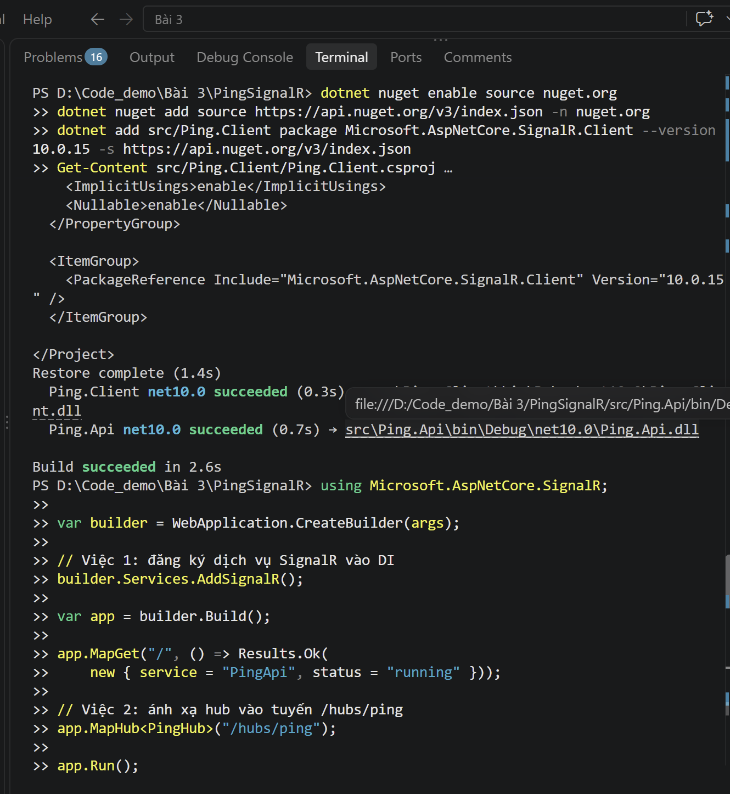
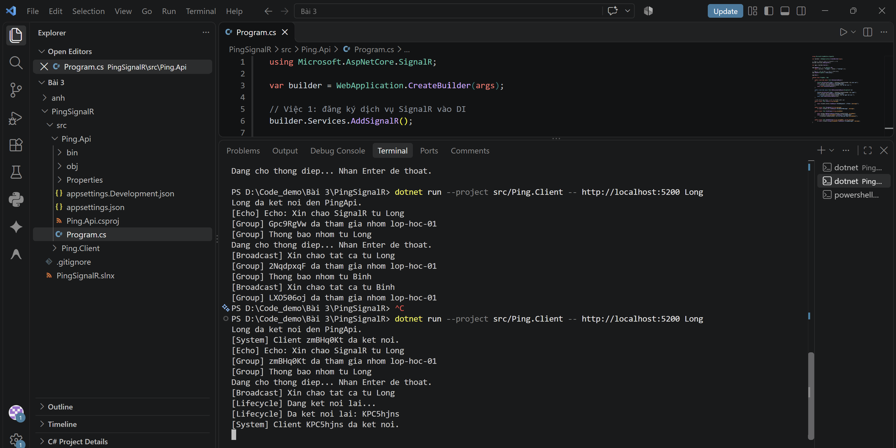
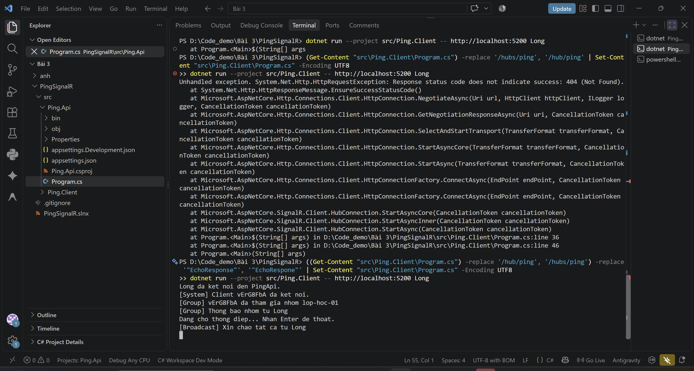

# Bài thực hành SignalR - PingSignalR

## Bước 1: Tạo solution và cài gói SignalR Client

Thấy: thêm gói `Microsoft.AspNetCore.SignalR.Client` vào `Ping.Client.csproj` và `dotnet build` thành công với 0 lỗi.
Giải thích: thiết lập cấu trúc solution gồm máy chủ `Ping.Api` và máy khách console `Ping.Client`.

## Bước 2: Bắt tay kết nối (Negotiate)

Thấy: gọi `POST /hubs/ping/negotiate` trả về `connectionId`, `connectionToken` cùng 3 cơ chế truyền tải (`WebSockets`, `ServerSentEvents`, `LongPolling`); gọi trực tiếp `/hubs/ping` thiếu mã kết nối trả về `400 Bad Request`.
Giải thích: SignalR thực hiện bước thương lượng HTTP trước khi nâng cấp lên WebSocket.

## Bước 3-4: Echo

Thấy: máy chủ chạy, máy khách in `[Echo] Echo: Xin chao SignalR tu An`.
Giải thích: máy khách gọi `InvokeAsync("Echo")` và nhận phản hồi riêng qua `On<string>("EchoResponse")` thông qua `Clients.Caller`.

## Bước 5: Phát rộng (Broadcast) và Nhóm (Group)

Thấy: máy khách `Long` nhận được thông điệp `[Group]` và `[Broadcast]` từ `Binh` gửi sang, nhưng không thấy `[Echo]` của `Binh`.
Giải thích: `Clients.Caller` chỉ trả riêng cho người gọi, `Clients.Group` gửi cho thành viên trong nhóm, còn `Clients.All` phát rộng tới mọi kết nối.

## Bước 6: Vòng đời kết nối và tự động kết nối lại

Thấy: khi máy chủ tạm tắt, máy khách `Long` báo `[Lifecycle] Dang ket noi lai...`; khi máy chủ bật lại, máy khách tự phục hồi với dòng `[Lifecycle] Da ket noi lai` kèm `ConnectionId` mới.
Giải thích: `WithAutomaticReconnect()` tự động thử kết nối lại theo chu kỳ mặc định khi kết nối đang mở bị gián đoạn.

## Bước 7: Ba thí nghiệm lỗi cố ý

### Thí nghiệm 1: Máy chủ chưa chạy

Thấy: `StartAsync()` ném ngoại lệ `HttpRequestException` (từ chối kết nối tới `localhost:5200`).
Giải thích: `WithAutomaticReconnect()` chỉ khôi phục kết nối đã mở thành công trước đó, không tự thử lại nếu lần kết nối đầu tiên thất bại.

### Thí nghiệm 2: Sai đường dẫn hub (`/hub/ping`)

Thấy: máy khách báo lỗi `404 (Not Found)` ngay ở bước `NegotiateAsync`.
Giải thích: đường dẫn cấu hình ở `WithUrl` phía client phải khớp chính xác từng ký tự với `MapHub` phía server.

### Thí nghiệm 3: Sai tên thông điệp (`"EchoRespone"`)

Thấy: chương trình kết nối và nhận `[Group]`, `[Broadcast]` bình thường, không báo lỗi nhưng hoàn toàn thiếu dòng `[Echo]`.
Giải thích: SignalR định tuyến thông điệp theo chuỗi tên sự kiện; nếu lệch tên ở client, thông điệp chiều xuống sẽ bị bỏ qua trong im lặng.
