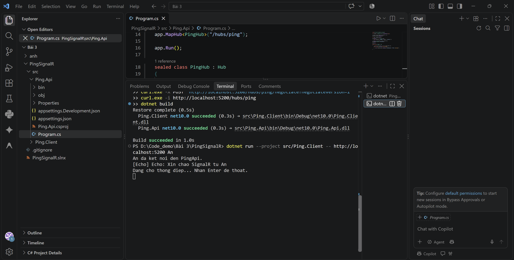
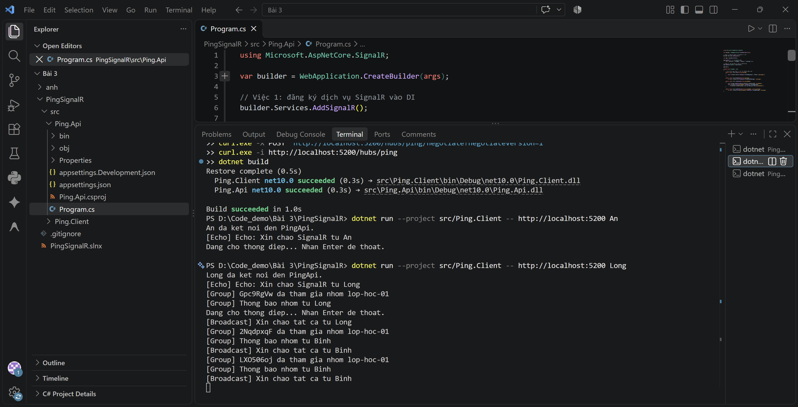
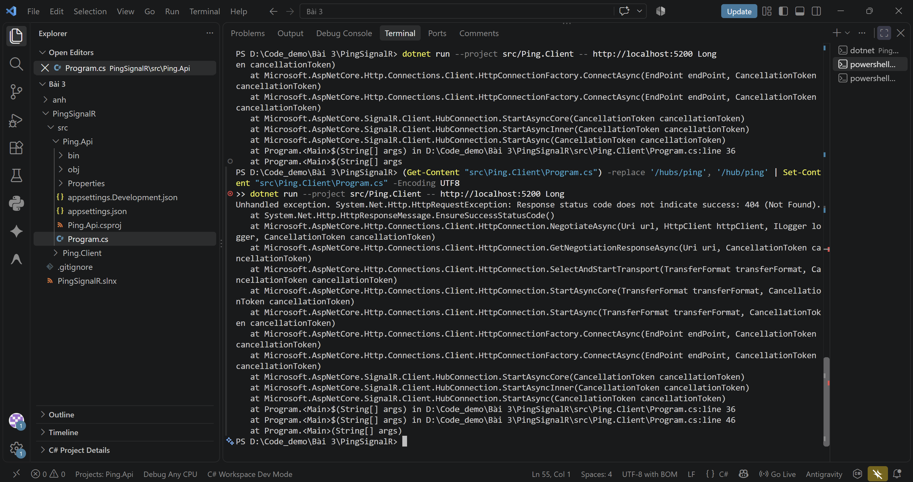
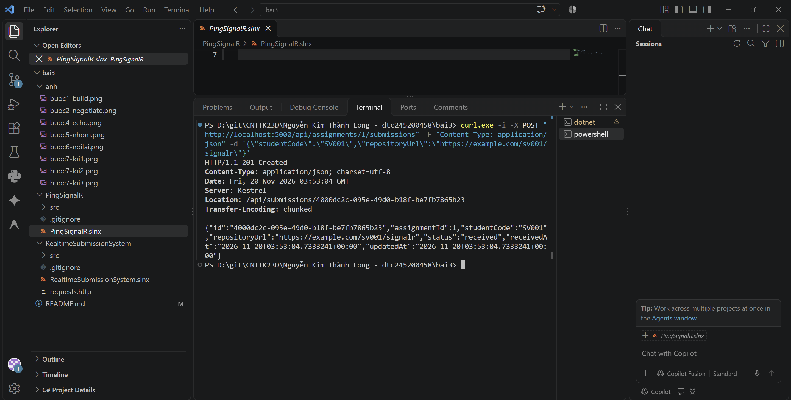
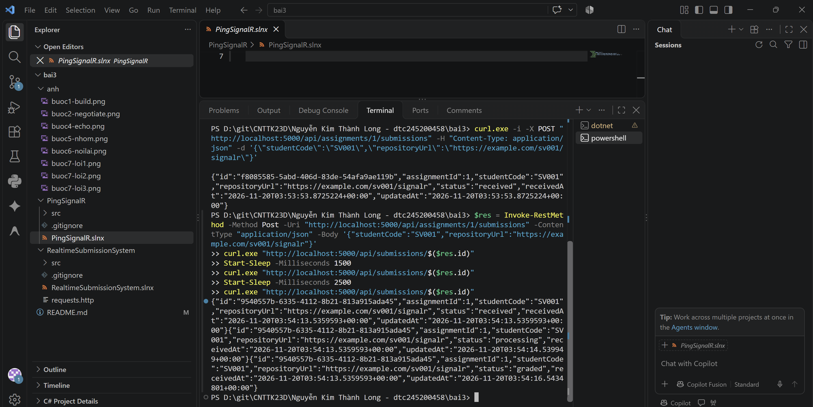
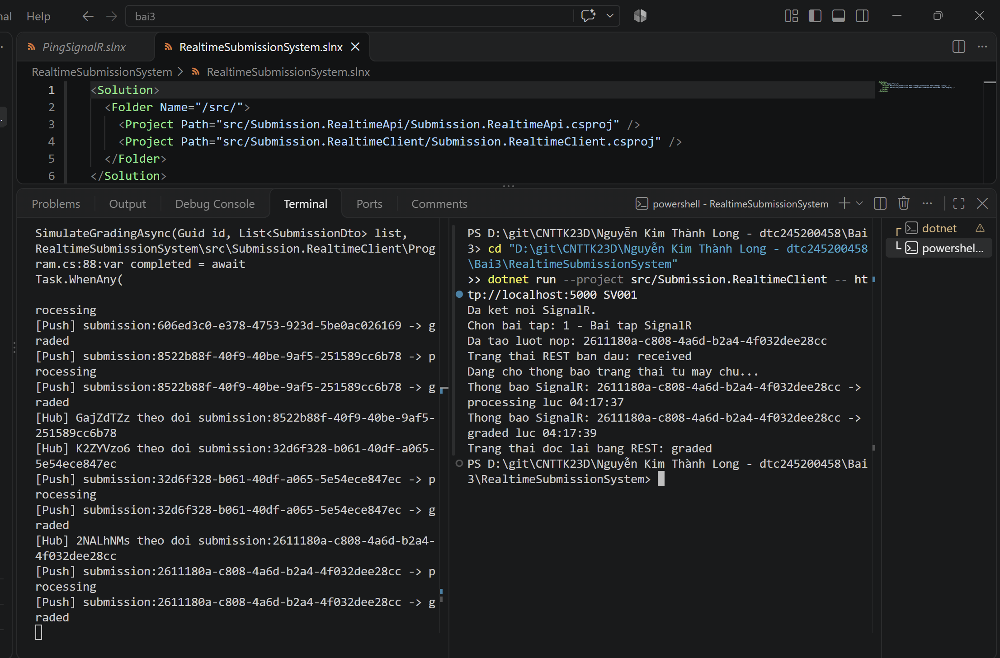
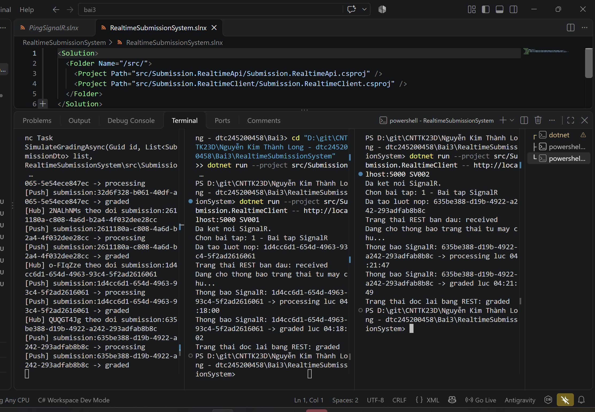
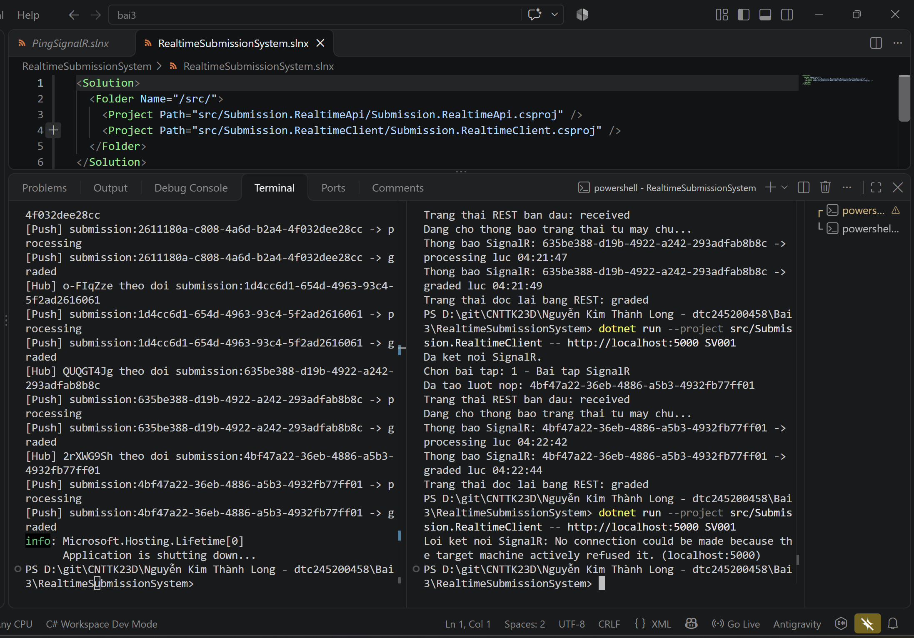
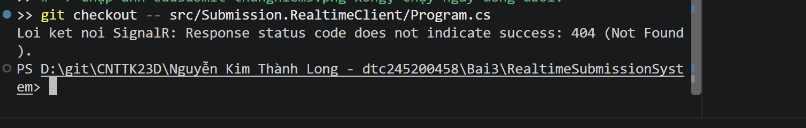

# Báo Cáo Thực Hành Bài 3: Giao Tiếp Thời Gian Thực Với SignalR
**Môn học:** Phát triển ứng dụng phân tán  
**Giảng viên:** TS. Dương Thu Mây  
**Sinh viên thực hiện:** [Họ tên - MSSV]  
**Mã lớp / Ngành:** Công nghệ Thông tin  

---

## MỤC LỤC
1. [Trả lời 3 câu hỏi đầu giờ](#phần-0-trả-lời-3-câu-hỏi-đầu-giờ)
2. [Phần 2: Kỹ thuật lập trình cơ bản - PingSignalR](#phần-2-kỹ-thuật-lập-trình-cơ-bản-với-signalr-pingsignalr)
3. [Phần 3: EduSubmit nhận thông báo trạng thái thời gian thực](#phần-3-edusubmit-nhận-thông-báo-trạng-thái-thời-gian-thực)
   - [Bản thiết kế kênh thời gian thực](#1-bản-thiết-kế-kênh-thời-gian-thực-4-câu-hỏi-khung)
   - [Bước 1: Tạo solution và hai project](#bước-1-tạo-solution-realtimesubmissionsystem-và-cài-gói-signalr-client)
   - [Bước 2: Xây dựng REST API, UpdatedAt và khóa đồng bộ](#bước-2-xây-dựng-rest-api-updatedat-và-khoá-dữ-liệu-bảo-vệ)
   - [Bước 3: Triển khai SubmissionHub và nhóm](#bước-3-triển-khai-submissionhub-và-quản-lý-nhóm-theosubmissionid)
   - [Bước 4: Tác vụ chấm nền và IHubContext](#bước-4-tác-vụ-chấm-nền-với-ihubcontext-và-simulategradingasync)
   - [Bước 5: Máy khách SignalR và chuông TaskCompletionSource](#bước-5-máy-khách-signalr-và-chuông-taskcompletionsource)
   - [Bước 6: Luồng nộp bài và nhận kết quả thời gian thực](#bước-6-luồng-hoàn-chỉnh-post--watch--chờ-graded--get-lại)
   - [Bước 7: 5 thí nghiệm phân tán và phân tích](#bước-7-5-thí-nghiệm-phân-tán-và-bài-học-kết-nối)
   - [Bước 8: Kiểm thử với requests.http (9 ca)](#bước-8-kiểm-thử-hệ-thống-với-requestshttp-đủ-9-ca)
4. [Danh sách commit gợi ý](#danh-sách-commit-gợi-ý-tối-thiểu-8-commits)
5. [Checklist trước khi mở Pull Request](#checklist-trước-khi-mở-pull-request)
6. [Hướng dẫn chụp ảnh minh chứng](#hướng-dẫn-chụp-ảnh-minh-chứng-chuẩn-quy-định)

---

## PHẦN 0: TRẢ LỜI 3 CÂU HỎI ĐẦU GIỜ

### Câu 1: Máy chủ có thể chủ động báo cho máy khách mà không cần máy khách hỏi không?
> **Trả lời:**  
> **Có thể được**, nếu máy khách chủ động mở và duy trì sẵn một kết nối hai chiều lâu dài (persistent connection) lên máy chủ thông qua giao thức **WebSocket** (được đóng gói và quản lý cấp cao bởi thư viện **SignalR**).  
> Khi có sự kiện phát sinh (ví dụ: trạng thái bài nộp thay đổi), máy chủ có thể chủ động đẩy dữ liệu (push) về máy khách thông qua `Clients.Group(...).SendAsync(...)`. Trường hợp phát sinh sự kiện từ bên ngoài Hub (như tác vụ nền Background Task hoặc Controller/Endpoint Minimal API), máy chủ sử dụng **`IHubContext<THub>`** được tiêm phụ thuộc (Dependency Injection) để phát loa thông báo.

### Câu 2: Đã có REST rồi, vì sao còn cần thêm SignalR? Hai thứ chia việc thế nào?
> **Trả lời:**  
> **REST** và **SignalR** không thay thế nhau mà phối hợp bổ trợ nhau theo nguyên tắc:  
> - **REST (Yêu cầu - Phản hồi / Request-Response):** Đóng vai trò là **nguồn sự thật duy nhất (Single Source of Truth)**. Phù hợp nhất cho việc tạo tài nguyên mới (`POST` trả về mã trạng thái rõ ràng `201 Created` kèm `Location`), đọc dữ liệu danh mục tĩnh (`GET`), và đọc trạng thái bền vững được lưu trữ trong cơ sở dữ liệu/bộ nhớ.
> - **SignalR (Đẩy dữ liệu / Push notification):** Đóng vai trò là **kênh thông báo tức thời (Event-driven Notification)**. Giúp máy chủ chủ động báo tin cho máy khách ngay khi trạng thái tài nguyên thay đổi (`processing`, `graded`) mà không bắt máy khách phải liên tục gửi request thăm dò định kỳ (**polling** làm lãng phí băng thông và tài nguyên CPU mạng).  
> **Quy tắc phân chia:** Dùng REST để tạo và đọc tài nguyên; dùng SignalR để đẩy thông báo trạng thái tức thì.

### Câu 3: Nếu đứt mạng đúng lúc máy chủ báo "đã chấm xong" (graded) thì sao?
> **Trả lời:**  
> Thông điệp SignalR phát đi qua mạng trong lúc máy khách mất kết nối sẽ **bị mất vĩnh viễn** do SignalR không mặc định lưu trữ bộ đệm tin nhắn hàng đợi (message queue/replay) cho các client bị ngắt kết nối.  
> Tuy nhiên, nhờ kiến trúc phân tầng đúng đắn:  
> 1. Khi có mạng trở lại, tính năng `WithAutomaticReconnect()` của SignalR Client sẽ tự động nối lại với một `ConnectionId` mới.  
> 2. Máy khách sẽ gia nhập lại nhóm và **gọi lại REST API (`GET /api/submissions/{id}`)** để đọc trạng thái hiện thời của bài nộp từ "nguồn sự thật".  
> **Khẩu hiệu cốt lõi:** *"Push để nhanh, REST để chắc"*.

---

## PHẦN 2: KỸ THUẬT LẬP TRÌNH CƠ BẢN VỚI SIGNALR (PingSignalR)

### Bước 1: Tạo solution và cài gói SignalR Client

- **Thấy:** Thêm gói `Microsoft.AspNetCore.SignalR.Client` vào `Ping.Client.csproj` và `dotnet build` báo `Build succeeded, 0 Error(s)`.
- **Giải thích:** Thiết lập cấu trúc solution gồm máy chủ Minimal API `Ping.Api` và máy khách console `Ping.Client`.

### Bước 2: Bắt tay kết nối (Negotiate)

- **Thấy:** Gọi `POST /hubs/ping/negotiate?negotiateVersion=1` trả về `connectionId`, `connectionToken` và 3 cơ chế truyền tải dự phòng (`WebSockets`, `ServerSentEvents`, `LongPolling`). Gọi `GET /hubs/ping` không có tham số trả về `400 Bad Request (Connection ID required)`.
- **Giải thích:** SignalR luôn thực hiện bước bắt tay HTTP negotiate trước khi quyết định nâng cấp lên giao thức kết nối tối ưu nhất mà client/server cùng hỗ trợ.

### Bước 3–4: Phương thức Echo

- **Thấy:** Máy chủ chạy, máy khách gọi `connection.InvokeAsync("Echo", ...)` và in kết quả `[Echo] Echo: Xin chao SignalR tu An`.
- **Giải thích:** Hai chiều trên cùng một kết nối: máy khách gửi lệnh qua `InvokeAsync`, máy chủ xử lý và phản hồi riêng cho kết nối đó bằng `Clients.Caller.SendAsync("EchoResponse", ...)`.

### Bước 5: Phát rộng (Broadcast) và Nhóm (Group)

- **Thấy:** Hai máy khách An và Bình cùng tham gia nhóm `lop-hoc-01`. Cửa sổ An nhận được tin `[Group]` và `[Broadcast]` của Bình gửi sang, nhưng hoàn toàn không nhận được tin `[Echo]` của Bình.
- **Giải thích:** `Clients.Caller` chỉ gửi cho người gọi, `Clients.Group` gửi cho các thành viên trong nhóm, còn `Clients.All` phát rộng cho mọi kết nối đang mở.

### Bước 6: Vòng đời kết nối và tự động kết nối lại

- **Thấy:** Khi tắt máy chủ, máy khách in `[Lifecycle] Dang ket noi lai...`. Khi máy chủ bật lại, máy khách in `[Lifecycle] Da ket noi lai` với một `ConnectionId` hoàn toàn mới.
- **Giải thích:** `WithAutomaticReconnect()` quản lý lịch trình thử lại (0s, 2s, 10s, 30s). Khi nối lại thành công, máy chủ cấp mã kết nối mới, do đó các nhóm cũ gắn với mã kết nối trước đó sẽ bị huỷ.

### Bước 7: Ba thí nghiệm lỗi cố ý (PingSignalR)
- **Thí nghiệm 1 (Máy chủ chưa chạy):**   
  *Thấy:* `HttpRequestException: Connection refused (localhost:5200)`.  
  *Giải thích:* `WithAutomaticReconnect` chỉ kích hoạt khi đã mở kết nối thành công trước đó; nếu lần bắt tay đầu tiên thất bại, `StartAsync` ném ngoại lệ ngay lập tức.
- **Thí nghiệm 2 (Sai đường dẫn /hub/ping):**   
  *Thấy:* Máy khách nhận lỗi HTTP `404 Not Found`.  
  *Giải thích:* Đường dẫn phía client truyền vào `WithUrl` phải khớp tuyệt đối với endpoint đã cấu hình tại `MapHub`.
- **Thí nghiệm 3 (Sai tên thông điệp EchoRespone):**   
  *Thấy:* Chương trình chạy im lặng, không có lỗi runtime nhưng không bao giờ in ra kết quả Echo.  
  *Giải thích:* Chiều đẩy thông điệp từ server xuống client định tuyến theo tên string; lệch tên sự kiện khiến client âm thầm bỏ qua.

---

## PHẦN 3: EDUSUBMIT NHẬN THÔNG BÁO TRẠNG THÁI THỜI GIAN THỰC

### 1. Bản thiết kế kênh thời gian thực (4 câu hỏi khung)
Trước khi lập trình, hệ thống được thiết kế theo khung 4 câu hỏi thời gian thực:
1. **Sự kiện nào kích hoạt thông điệp?**  
   Mỗi khi trạng thái lượt nộp bài thay đổi trong tiến trình chấm: `received` $\rightarrow$ `processing` $\rightarrow$ `graded`.
2. **Gửi cho ai?**  
   Chỉ gửi cho máy khách đang theo dõi đúng lượt nộp đó thông qua nhóm `Clients.Group("submission:{id}")`. Tuyệt đối không dùng `Clients.All` để đảm bảo tính riêng tư của sinh viên và tiết kiệm băng thông mạng.
3. **Gửi kèm dữ liệu gì (tối thiểu)?**  
   Dữ liệu tối thiểu cần thiết để cập nhật giao diện máy khách:
   ```csharp
   record SubmissionStatusMessage(Guid SubmissionId, string Status, DateTimeOffset UpdatedAt);
   ```
4. **Mất kết nối thì lấy lại trạng thái thế nào?**  
   Khi mất kết nối hoặc nối lại, máy khách gọi lại REST API: `GET /api/submissions/{id}` để đọc trạng thái chính xác nhất được lưu trữ tại máy chủ (REST là nguồn sự thật).

---

### Bước 1: Tạo solution RealtimeSubmissionSystem và cài gói SignalR Client

- **Thấy:** Solution `RealtimeSubmissionSystem` được tạo cùng 2 dự án `Submission.RealtimeApi` (Web Minimal API) và `Submission.RealtimeClient` (Console). Cài đặt gói `Microsoft.AspNetCore.SignalR.Client` phiên bản `10.0.15` cho client. Lệnh `dotnet build` trả về: `Build succeeded. 0 Warning(s), 0 Error(s)`.
- **Giải thích:** Khởi tạo cấu trúc dự án phân tán chuẩn gồm máy chủ API và máy khách. SignalR phía máy chủ đã có sẵn trong `Microsoft.AspNetCore.App`, còn phía console client cần cài thêm thư viện máy khách độc lập.

---

### Bước 2: Xây dựng REST API, UpdatedAt và khoá dữ liệu bảo vệ

- **Thấy:** Gửi yêu cầu `POST /api/assignments/1/submissions` với payload nộp bài hợp lệ. Máy chủ trả về mã HTTP `201 Created` kèm header `Location: /api/submissions/{id}`, thân phản hồi chứa trạng thái ban đầu `"status": "received"` và trường thời gian `"updatedAt"`.
- **Giải thích:** REST đảm nhận việc tạo tài nguyên mới an toàn và có tính idempotent. Danh sách bài nộp trong bộ nhớ máy chủ được bảo vệ bằng cơ chế đồng bộ `lock (submissionsLock)` để đảm bảo thread-safe khi nhiều request HTTP và tác vụ nền chấm bài cùng lúc truy xuất và cập nhật.

---

### Bước 3: Triển khai SubmissionHub và quản lý nhóm theo submission:{id}

- **Thấy:** Gửi `POST http://localhost:5000/hubs/submissions/negotiate?negotiateVersion=1` trả về mã HTTP `200 OK` kèm `connectionId` và danh sách giao thức hỗ trợ (`WebSockets`, `ServerSentEvents`, `LongPolling`). Trong khi đó, nếu gọi sai tuyến `/hub/submissions/...` sẽ lập tức nhận `404 Not Found`.
- **Giải thích:** Máy chủ đăng ký dịch vụ `builder.Services.AddSignalR()` và ánh xạ tuyến `app.MapHub<SubmissionHub>("/hubs/submissions")`. Hub mỏng cung cấp phương thức `WatchSubmission(submissionId)` để đưa kết nối của client vào nhóm riêng `submission:{id}` thông qua lớp dùng chung `SubmissionGroups`.

---

### Bước 4: Tác vụ chấm nền với IHubContext và SimulateGradingAsync

- **Thấy:** Sau khi `POST` trả về `201 Created`, gọi `GET /api/submissions/{id}` ngay lập tức thấy `status: received`; sau ~1,5 giây gọi lại thấy `status: processing`; sau ~4 giây gọi lại thấy `status: graded` và `updatedAt` được cập nhật tăng dần.
- **Giải thích:** Endpoint `POST` tiêm `IHubContext<SubmissionHub>` từ DI container và khởi chạy tác vụ chấm bài bất đồng bộ ở nền không chờ đợi (`_ = SimulateGradingAsync(...)`). Hàm `UpdateStatusAsync` thực hiện đúng nguyên tắc: Cập nhật dữ liệu vào danh sách trước (Lưu trước) $\rightarrow$ tạo `SubmissionStatusMessage` $\rightarrow$ đẩy sự kiện `SubmissionStatusChanged` tới đúng nhóm qua `hubContext.Clients.Group(...)`.

---

### Bước 5: Máy khách SignalR và chuông TaskCompletionSource

- **Thấy:** Máy khách khởi động, kết nối tới hub SignalR và in ra màn hình dòng chữ: `Da ket noi SignalR.`.
- **Giải thích:** Máy khách khởi tạo đồng thời hai kênh: kênh 1 là `HttpClient` cho REST API và kênh 2 là `HubConnection` cho SignalR. Đối tượng `TaskCompletionSource` được khởi tạo như một "cái chuông báo", sẽ kích hoạt `TrySetResult()` khi sự kiện `SubmissionStatusChanged` có trạng thái `"graded"`.

---

### Bước 6: Luồng hoàn chỉnh: POST $\rightarrow$ Watch $\rightarrow$ Chờ graded $\rightarrow$ GET lại

- **Thấy:** Màn hình console của máy khách in chính xác đủ 8 dòng theo đúng trình tự:
  ```text
  Da ket noi SignalR.
  Chon bai tap: 1 - Bai tap SignalR
  Da tao luot nop: 977c86bf-98e2-45d1-8a59-e2ec1a320223
  Trang thai REST ban dau: received
  Dang cho thong bao trang thai tu may chu...
  Thong bao SignalR: 977c86bf-98e2-45d1-8a59-e2ec1a320223 -> processing luc 10:25:20
  Thong bao SignalR: 977c86bf-98e2-45d1-8a59-e2ec1a320223 -> graded luc 10:25:22
  Trang thai doc lai bang REST: graded
  ```
  Phía terminal máy chủ in log:
  ```text
  [Hub] n-8YllIH theo doi submission:977c86bf-98e2-45d1-8a59-e2ec1a320223
  [Push] submission:977c86bf-98e2-45d1-8a59-e2ec1a320223 -> processing
  [Push] submission:977c86bf-98e2-45d1-8a59-e2ec1a320223 -> graded
  ```
- **Giải thích:** Luồng hoạt động chuẩn xác: Đăng ký nghe `On` $\rightarrow$ mở kết nối `StartAsync` $\rightarrow$ gọi REST `POST` tạo bài nộp $\rightarrow$ gọi `WatchSubmission` gia nhập nhóm $\rightarrow$ máy chủ chấm xong đẩy `processing` và `graded` cách nhau 2 giây $\rightarrow$ chuông `TaskCompletionSource` reo $\rightarrow$ gọi lại REST `GET` xác nhận trạng thái cuối cùng và chương trình tự động thoát.

---

### Bước 7: 5 Thí nghiệm phân tán và bài học kết nối

#### Ảnh minh chứng từng thí nghiệm:
- **Thí nghiệm 1:** 
- **Thí nghiệm 2:** 
- **Thí nghiệm 3:** 
- **Thí nghiệm 4:** 
- **Thí nghiệm 5:** 

#### Bảng tổng hợp chi tiết 5 thí nghiệm:

| STT | Thí nghiệm | Dự đoán | Kết quả thực tế | Giải thích chi tiết |
|:---:|:---|:---|:---|:---|
| **1** | **Chạy 2 máy khách SV001 và SV002 cùng lúc** | Hai máy khách chạy song song độc lập, mỗi máy chỉ nhận thông báo về bài nộp của chính mình, không thấy tin bài của sinh viên khác. | Mỗi máy khách tạo mã bài nộp riêng và chỉ nhận đúng 2 thông báo `processing` & `graded` tương ứng với ID của mình. | Nhóm `submission:{id}` do máy chủ quản lý cô lập kênh gửi nhận. Client chỉ gia nhập nhóm bài của mình nên luồng thông báo hoàn toàn riêng tư và tiết kiệm băng thông. |
| **2** | **Chạy máy khách khi máy chủ chưa chạy** | Máy khách không thể bắt tay kết nối và phát sinh lỗi ngoại lệ ngay khi khởi động. | Ném ngoại lệ `HttpRequestException: Connection refused (localhost:5000)` ngay tại câu lệnh `await connection.StartAsync()`. | `WithAutomaticReconnect` chỉ phát huy tác dụng khôi phục các kết nối **đã từng thành công** trước đó. Nếu lần bắt tay (negotiate) đầu tiên thất bại, client ném ngoại lệ dừng ngay. |
| **3** | **Sửa WithUrl thành `/hub/submissions` (thiếu 's')** | Máy chủ không tìm thấy endpoint tương ứng và trả về mã lỗi HTTP 404. | Ném ngoại lệ `HttpRequestException: Response status code does not indicate success: 404 (Not Found)`. | Lỗi phát sinh ngay tại bước gửi HTTP POST negotiate ban đầu. Đường dẫn cấu hình ở client bắt buộc phải khớp chính xác từng ký tự với `MapHub` phía máy chủ. |
| **4** | **Sửa sự kiện thành `On("SubmissionStatusChange")` (thiếu 'd')** | Máy khách không nhận được thông báo trạng thái nào từ SignalR, chờ hết 10 giây timeout rồi mới đọc REST. | Không có lỗi runtime nào; máy khách không in được 2 dòng `Thong bao SignalR`; sau 10 giây in `Qua thoi gian cho thong bao graded.`; cuối cùng đọc REST vẫn ra `graded`. | Sai tên sự kiện ở chiều đẩy xuống (Hub $\rightarrow$ Client) sẽ bị client im lặng bỏ qua. Tuy nhiên REST vẫn đọc đúng trạng thái vì REST là nguồn sự thật ("push để nhanh, REST để chắc"). |
| **5** | **Chờ 4 giây rồi mới gọi `WatchSubmission`** | Tác vụ chấm nền đã hoàn tất trước khi client kịp vào nhóm theo dõi, dẫn tới lỡ mất toàn bộ sự kiện SignalR. | Máy khách không nhận được thông điệp SignalR nào; in `Qua thoi gian cho thong bao graded.`; nhưng lệnh `GET` REST sau đó vẫn đọc về `graded`. | SignalR không lưu trữ bộ đệm sự kiện quá khứ cho kết nối mới vào nhóm. Gia nhập nhóm muộn đồng nghĩa với việc lỡ tin, nhưng REST luôn trả về trạng thái chính xác nhất tại thời điểm truy vấn. |

---

### Bước 8: Kiểm thử hệ thống với requests.http (Đủ 9 ca)
File `RealtimeSubmissionSystem/requests.http` kiểm thử đầy đủ 9 ca theo đúng yêu cầu đề bài:

| Ca | Phương thức & Tuyến | Mục đích | Mã mong đợi | Kết quả kiểm tra |
|:---:|:---|:---|:---:|:---:|
| **1** | `GET /` | Kiểm tra trạng thái máy chủ đang hoạt động | `200 OK` | Đạt |
| **2** | `GET /api/assignments` | Lấy danh sách bài tập khả dụng | `200 OK` | Đạt |
| **3** | `POST /api/assignments/1/submissions` | Tạo lượt nộp bài hợp lệ | `201 Created` | Đạt (Kèm Location header) |
| **4** | `GET /api/submissions/{id}` | Đọc lại trạng thái bài nộp (thấy đổi dần) | `200 OK` | Đạt (`received` $\rightarrow$ `processing` $\rightarrow$ `graded`) |
| **5** | `POST /api/assignments/1/submissions` | Gửi payload thiếu dữ liệu (rỗng) | `400 Bad Request` | Đạt (`INVALID_SUBMISSION`) |
| **6** | `POST /api/assignments/999/submissions` | Nộp bài cho mã bài tập không tồn tại | `404 Not Found` | Đạt (`ASSIGNMENT_NOT_FOUND`) |
| **7** | `GET /api/submissions/{guid-khong-ton-tai}` | Đọc lượt nộp với GUID không có trong hệ thống | `404 Not Found` | Đạt (`SUBMISSION_NOT_FOUND`) |
| **8** | `POST /hubs/submissions/negotiate?negotiateVersion=1` | Bắt tay kết nối SignalR hợp lệ | `200 OK` | Đạt (Trả về `connectionId`) |
| **9** | `POST /hub/submissions/negotiate?negotiateVersion=1` | Bắt tay sai đường dẫn Hub | `404 Not Found` | Đạt |

---

## DANH SÁCH COMMIT GỢI Ý (Tối thiểu 8 commits)
Để đạt điểm tối đa tiêu chí Git & Pull Request, thực hiện commit theo từng mốc tiến độ:
1. `git commit -m "Bai3 B1: tao solution RealtimeSubmissionSystem"`
2. `git commit -m "Bai3 B2: trien khai REST API voi submissionsLock va UpdatedAt"`
3. `git commit -m "Bai3 B3: them SubmissionHub va quan ly nhom submission:{id}"`
4. `git commit -m "Bai3 B4: tich hop IHubContext va SimulateGradingAsync"`
5. `git commit -m "Bai3 B5: xay dung Submission.RealtimeClient voi TaskCompletionSource"`
6. `git commit -m "Bai3 B6: hoan thien luong full-flow nhan ket qua graded va doc lai REST"`
7. `git commit -m "Bai3 B7: thuc hien 5 thi nghiem phan tan va phan tich ket qua"`
8. `git commit -m "Bai3 B8: bo sung requests.http du 9 ca va cap nhat README.md hoan chinh"`

---

## CHECKLIST TRƯỚC KHI MỞ PULL REQUEST
- [x] Lệnh `dotnet build` cả 2 solution (`PingSignalR` và `RealtimeSubmissionSystem`) thành công với `0 Error(s), 0 Warning(s)`.
- [x] Đã cấu hình `.gitignore` đầy đủ, tuyệt đối không đưa các thư mục `bin/` và `obj/` vào Git.
- [x] File `requests.http` có đầy đủ 9 ca kiểm thử và đều trả về đúng mã trạng thái HTTP mong đợi.
- [x] Console máy khách in đầy đủ 8 dòng kết quả, nhận được trạng thái `graded` và tự động kết thúc chương trình.
- [x] README.md trả lời đầy đủ 3 câu hỏi đầu giờ và có bảng phân tích 5 thí nghiệm chi tiết (Dự đoán, Thực tế, Giải thích).
- [x] Lịch sử Git có tối thiểu 8 commit tương ứng với từng bước thực hiện.
- [x] Tiêu đề Pull Request đặt đúng chuẩn quy định: `Bai3 - MSSV - Họ tên`.

---

## HƯỚNG DẪN CHỤP ẢNH MINH CHỨNG CHUẨN QUY ĐỊNH
Khi chụp ảnh lưu vào thư mục `anh/`, sinh viên cần lưu ý các quy tắc của giảng viên:
- **Nguyên tắc ảnh hợp lệ:** Chụp bằng `Win + Shift + S`, thấy rõ cả dòng lệnh đã gõ và kết quả in ra trong cùng một ảnh, nhìn rõ đường dẫn thư mục bài làm của sinh viên trên terminal nhắc lệnh.
- **Danh sách tên tệp ảnh bắt buộc:**
  1. `buoc1-build.png`: Màn hình `dotnet build` cả solution báo `0 Error(s)`.
  2. `edusubmit-post-201.png`: Chạy curl gửi POST tạo bài nộp nhận `201 Created`.
  3. `edusubmit-negotiate.png`: Chạy curl POST gọi `negotiate` nhận `connectionId`.
  4. `edusubmit-processing-graded.png`: Chạy curl GET liên tiếp thấy trạng thái đổi từ `received` $\rightarrow$ `processing` $\rightarrow$ `graded`.
  5. `edusubmit-signalr-connected.png`: Chạy máy khách thấy dòng `Da ket noi SignalR.`.
  6. `edusubmit-full-flow.png`: Chạy luồng đầy đủ thấy đủ 8 dòng in của máy khách và log của máy chủ.
  7. `edusubmit-thunghiem1.png` đến `edusubmit-thunghiem5.png`: Kết quả màn hình tương ứng với 5 thí nghiệm ở Bước 7.
