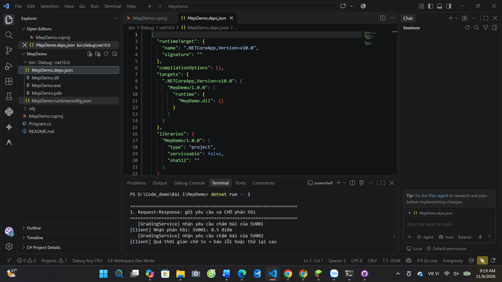
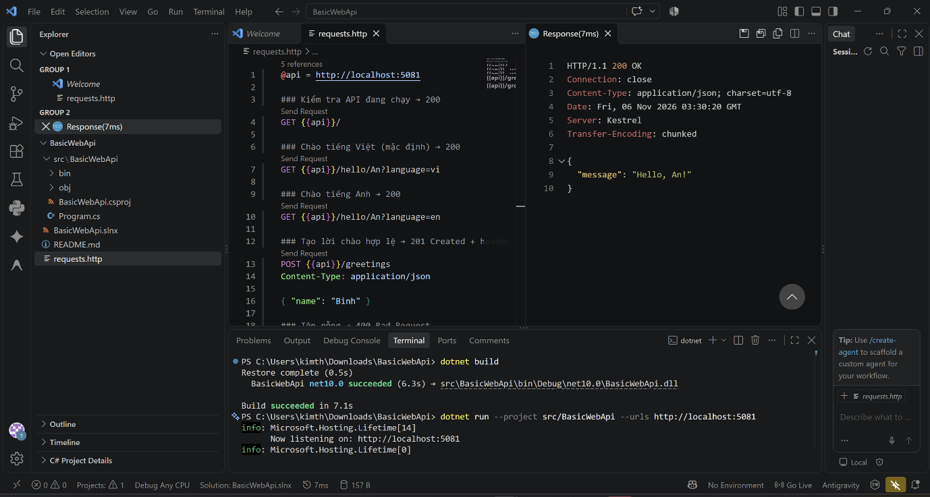
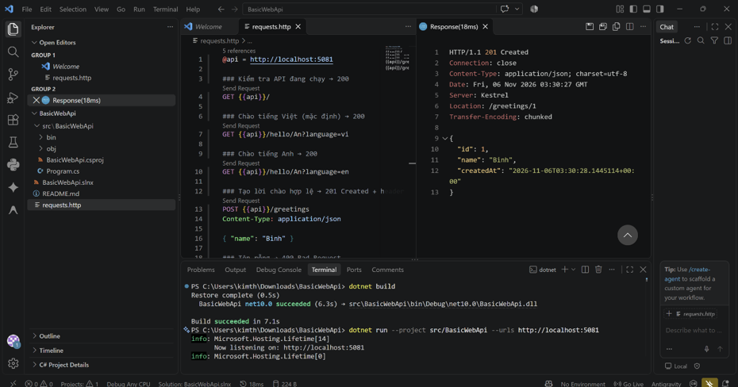
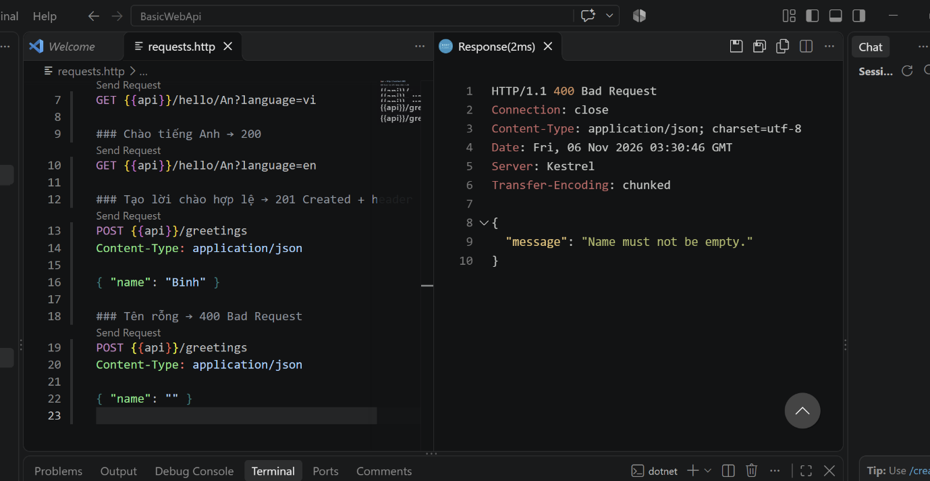
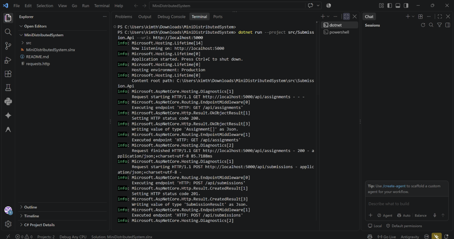
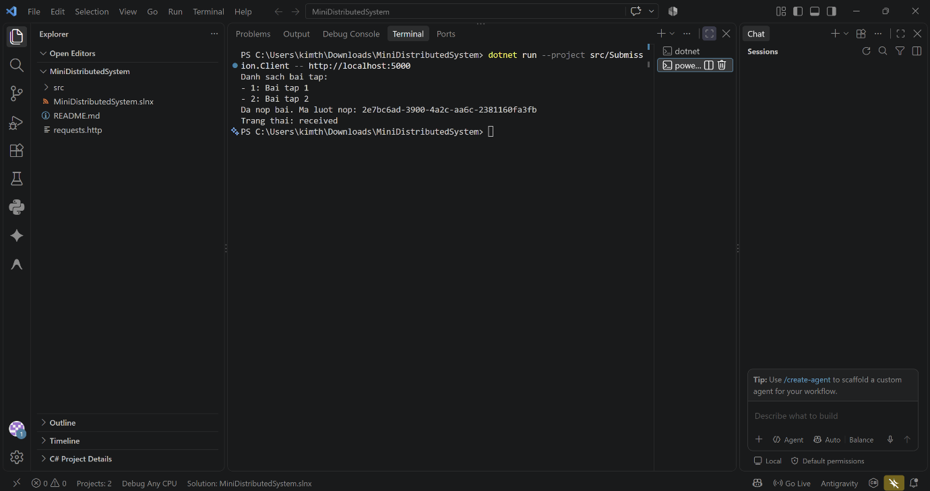
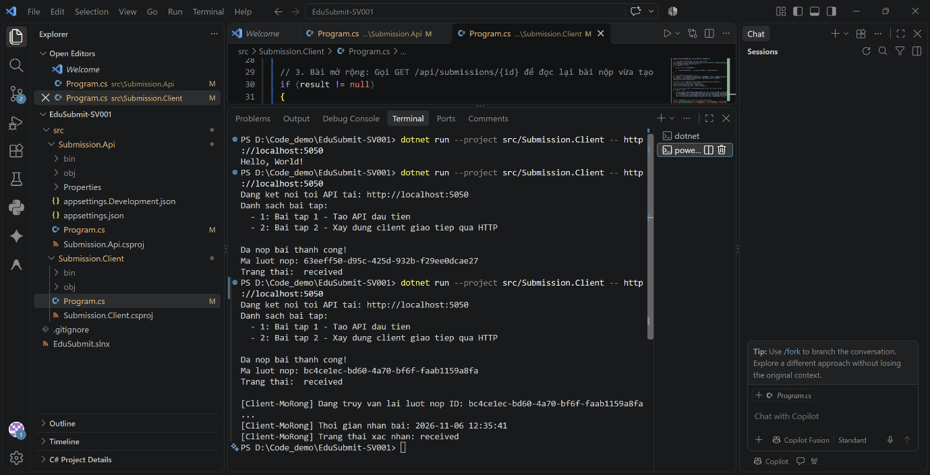

# Bài 1 – Tổng quan hệ thống và MEP
Họ tên: Nguyễn Kim Thành Long          MSSV: dtc245200458          Lớp: CNTT K23D
 
## 1. Cài đặt

 
## 2. MepDemo (Bước 7)
- **Request-Response (Yêu cầu - Phản hồi):** Client gửi một yêu cầu (request) đến Server, sau đó đợi Server xử lý và trả về kết quả (response). Quá trình này diễn ra đồng bộ.
- **One-Way / Fire-and-Forget (Một chiều):** Client gửi thông điệp đến Server nhưng không yêu cầu hoặc không cần chờ Server trả lời lại.
- **Publish-Subscribe (Xuất bản - Đăng ký):** Một hệ thống (Publisher) phát ra thông điệp, và tất cả các client (Subscribers) đã đăng ký theo dõi kênh đó sẽ nhận được thông điệp cùng lúc.
 
## 3. BasicWebApi (Bước 8)

**Trả lời 3 câu hỏi mục 8.4:**
1. **Mã trạng thái 200 OK:** Ý nghĩa là request (thường là GET) đã được Server tiếp nhận, xử lý thành công và đã trả về dữ liệu mà Client yêu cầu.
2. **Mã trạng thái 201 Created:** Ý nghĩa là request (thường là POST) đã thành công và dẫn đến việc tạo ra một tài nguyên mới trên Server (ví dụ: tạo mới một bài nộp).
3. **Mã trạng thái 400 Bad Request:** Ý nghĩa là Server không thể xử lý request vì lỗi từ phía Client (ví dụ: gửi dữ liệu sai định dạng JSON, thiếu các trường dữ liệu bắt buộc).
 
## 4. MiniDistributedSystem (Bước 9)

**Trả lời 3 câu hỏi:**
1. **Hai component (Client và API) giao tiếp qua đâu?** Chúng giao tiếp với nhau thông qua mạng (cụ thể là Localhost) sử dụng giao thức HTTP/REST.
2. **Định dạng dữ liệu được trao đổi là gì?** Dữ liệu được mã hóa và trao đổi dưới dạng chuẩn JSON.
3. **Client làm sao biết gọi đến đâu?** Client được cấu hình sẵn địa chỉ Base URL và Cổng (Port) của API (ví dụ: `http://localhost:5050`) để gửi các HTTP Request đến đúng đích.
 
## 5. Thí nghiệm lỗi (Bước 10)
| # | Tình huống | Dự đoán | Thực tế | Đúng/Sai | Giải thích |
|---|---|---|---|---|---|
| 1 | Tắt API nhưng vẫn chạy Client gọi dữ liệu | Báo lỗi không thể kết nối tới máy chủ | Báo lỗi `Connection Refused` | Đúng | Client gửi request đến cổng của API nhưng không có tiến trình nào đang lắng nghe để phản hồi. |
| 2 | Gửi sai định dạng dữ liệu (ví dụ POST chuỗi thay vì số) | API báo lỗi dữ liệu không hợp lệ | Trả về lỗi `400 Bad Request` | Đúng | Trình phân tích (Model Binding) của ASP.NET Core không thể map dữ liệu gửi lên vào object C#, nên tự động từ chối. |
 
## 6. Dự án EduSubmit tự làm (Bước 11-12)

- **Phần nào phải xem code mẫu?** 
  Phần khởi tạo `HttpClient` ở project Client để gọi API, và cách cấu trúc các hàm `GetFromJsonAsync` / `PostAsJsonAsync` để gửi và nhận dữ liệu JSON.
- **Luồng thông điệp:**
  Client --(HTTP GET /api/assignments)--> Api   : request-response (Client yêu cầu lấy danh sách bài tập, API truy vấn dữ liệu và trả về danh sách dạng JSON).
  Client --(HTTP POST /api/submissions)--> Api  : request-response (Client gửi thông tin nộp bài dạng JSON, API tiếp nhận, lưu trữ và trả về thông báo thành công kèm mã 201).
 
## 7. Khó khăn gặp phải và cách giải quyết
- **Khó khăn:** Quên chưa chạy (hoặc tắt nhầm) project API nhưng lại chạy project Client, dẫn đến việc terminal của Client văng lỗi đỏ "Connection Refused". 
- **Cách giải quyết:** Mở song song 2 terminal. Luôn chạy lệnh `dotnet run` ở thư mục chứa API trước, quan sát dòng chữ "Application started" xuất hiện và ghi nhớ số Port. Sau đó mới sang terminal thứ 2 để chạy project Client. Kiểm tra kỹ địa chỉ URL trong Client để đảm bảo khớp với Port API đang chạy.