# Bài 3 – SignalR (PingSignalR)
Họ tên: Nguyễn Ngọc Anh | MSSV: Dtc245200932 | Lớp: CNttK23D

## Bước 1.1
Lệnh ls src cho ra đúng 2 thư mục: Ping.Api và Ping.Client.
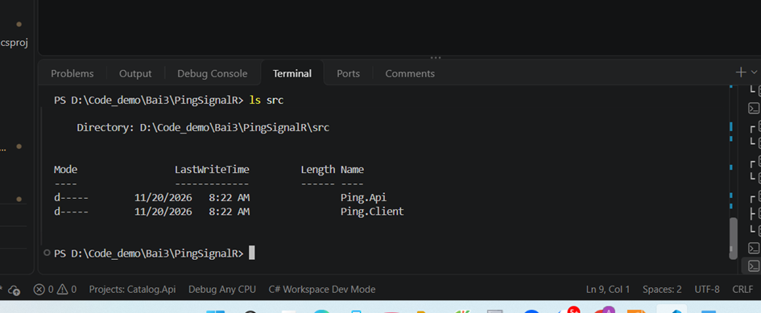
## Bước 1.2
dotnet build báo Build succeeded, 0 Error(s); Ping.Client.csproj có dòng PackageReference.[cite: 11]
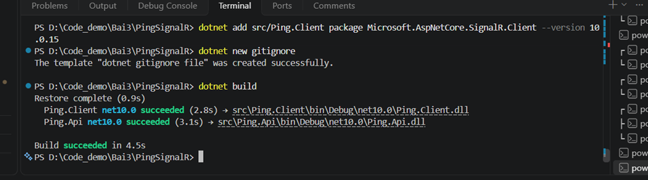
## Bước 2
dotnet build báo 0 Error(s).
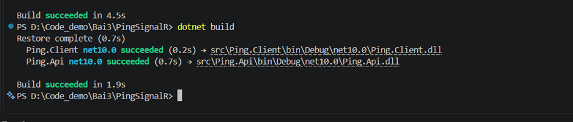
## Bước 2 kiểm tra
negotiate trả về connectionId và availableTransports có đủ WebSockets, ServerSentEvents, LongPolling.
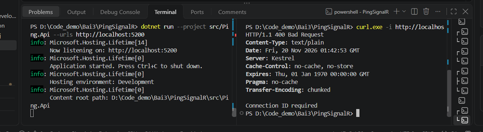
## Bước 3
Build 0 Error(s); máy chủ chạy lại ở cổng 5200.
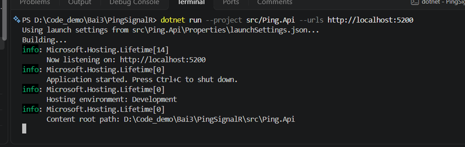
## Bước 4
Terminal 2 in đúng dòng [Echo] Echo: Xin chao SignalR tu An.
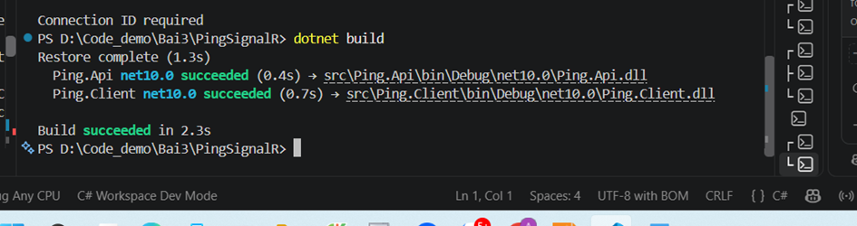
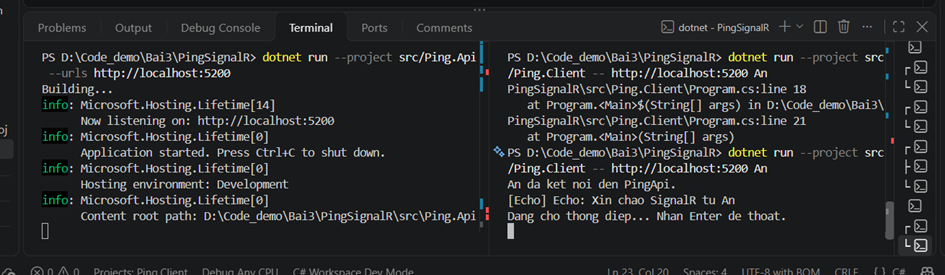
## Bước 5
Cửa sổ An có [Broadcast] Xin chao tat ca tu Binh nhưng không có [Echo] của Bình.
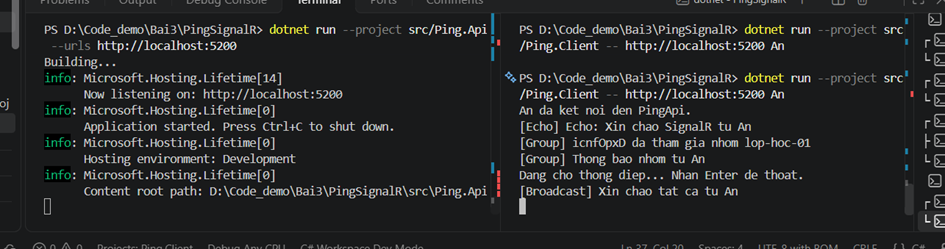
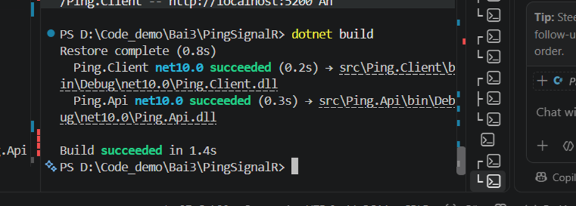
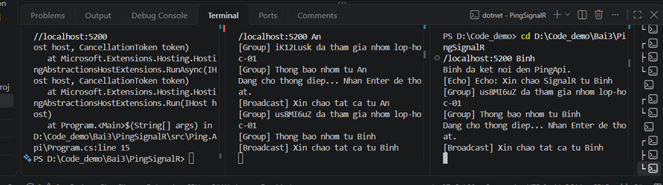
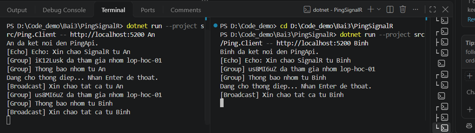
## Bước 6
Terminal 1 in [Hub] + ... ket noi mỗi khi một máy khách mở; tắt máy chủ thì máy khách thử lại sau 0, 2, 10, 30 giây (hết 4 lần -> Closed)
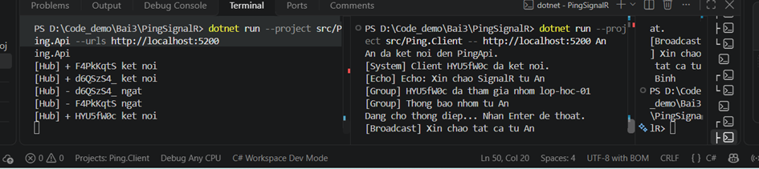
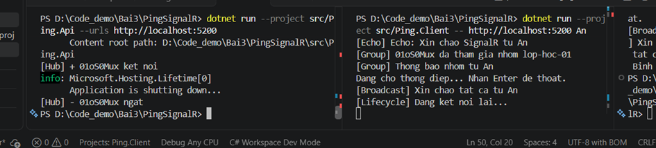
## Bước 7

### 1. Máy chủ chưa chạy
- **Làm gì:** Chạy máy khách khi Terminal 1 đã tắt.
- **Thấy gì:** HttpRequestException: Connection refused (localhost:5200)
- **Giải thích vì sao:** StartAsync ném lỗi ngay; WithAutomaticReconnect chỉ cứu kết nối ĐÃ mở.
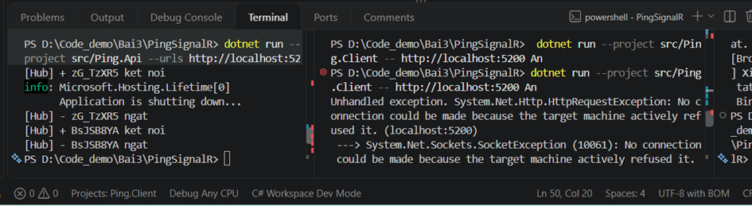

### 2. Sai đường dẫn hub
- **Làm gì:** Sửa WithUrl thành /hub/ping (thiếu s)
- **Thấy gì:** HttpRequestException: Response status code does not indicate success: 404 (Not Found).[cite: 17]
- **Giải thích vì sao:** Lỗi xảy ra ở bước negotiate; đường dẫn phải khớp MapHub.
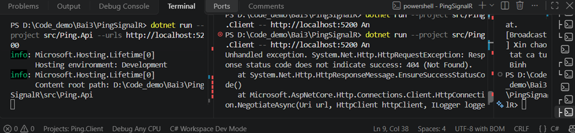

### 3. Sai tên thông điệp
- **Làm gì:** Sửa On("EchoResponse") thành On("EchoRespone")
- **Thấy gì:** (không có lỗi nào), (không có dòng [Echo])
- **Giải thích vì sao:** Im lặng; so tên hai phía là việc đầu tiên khi "không nhận được gì"
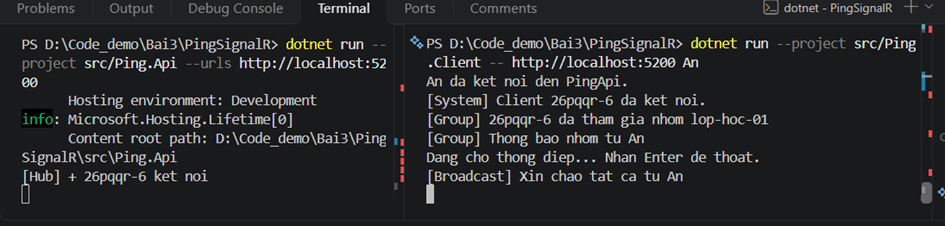
