# Bài 3 -RealtimeSubmissionSystem 
Họ tên: Nguyễn Ngọc Anh             MSSV:     Dtc245200932         Lớp:CNttK23D
## Bước 1 
– Tạo solution mới với hai project như Bài 2, thêm gói cho máy khách dotnet build báo Build succeeded, 0 Error(s)
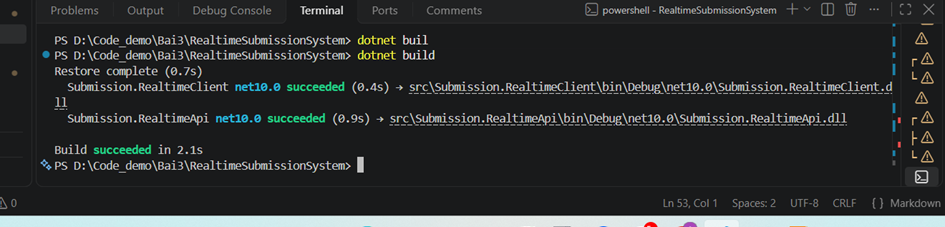
## Bước 2 
– Dán phần REST của Bài 2, thêm UpdatedAt và một khóa dữ liệu curl POST trả 201 Created, body có "status":"received" và "updatedAt".
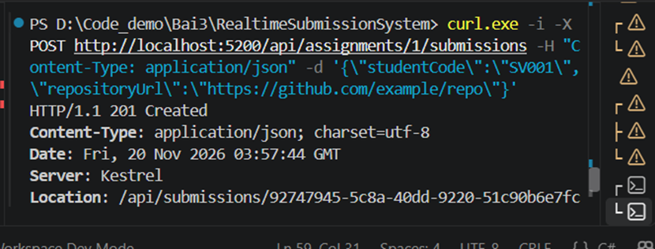
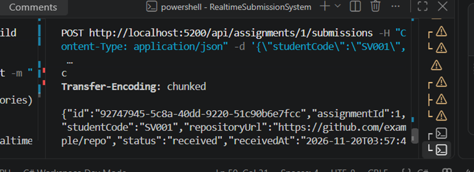
## Bước 3
 – Hub mỏng chỉ làm một việc, đưa kết nối vào nhóm của lượt nộp negotiate ở /hubs/submissions trả connectionId; /hub/submissions trả 404.
 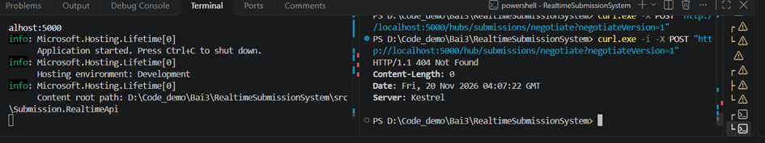
 ## Bước 4.1
  – POST nhận thêm IHubContext và khởi động chấm bài ở nền Build 0 Error(s) (sau khi thêm SimulateGradingAsync ở bước 4.2).
  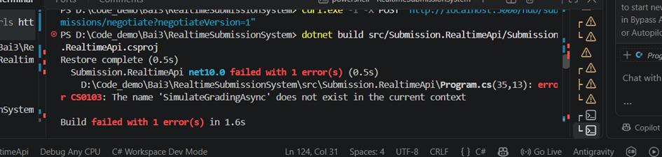
  ## Bước 4.2
   – Cập nhật dữ liệu trước, rồi mới đẩy thông báo tới đúng nhóm Build 0 Error(s); Terminal 1 in [Push] ... khi có lượt nộp mới (nếu thêm Console.WriteLine).
   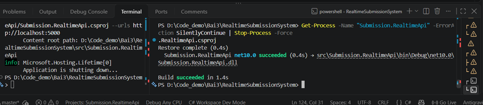
   ## Bước 4 
   kiểm tra – Chưa cần máy khách, REST đã thấy trạng thái đổi dần Ba lần GET cho đúng thứ tự received -> processing -> graded.
   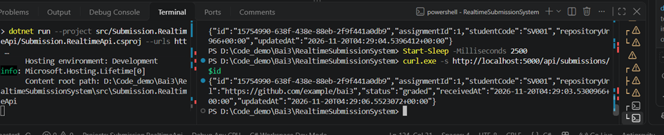
   ## Bước 5 
   – Máy khách mở hai kênh và gắn "chuông" chờ trạng thái graded Chạy thử (máy chủ đang chạy): in Da ket noi SignalR
   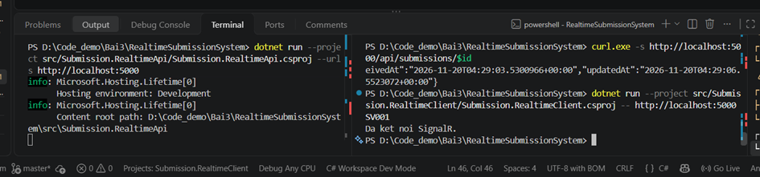
   ## Bước 6 
   – Tạo lượt nộp bằng REST, theo dõi bằng SignalR, chốt lại bằng REST Build 0 Error(s), chạy máy khách nhận đủ trạng thái received -> processing -> graded qua SignalR và đọc lại graded bằng REST.
   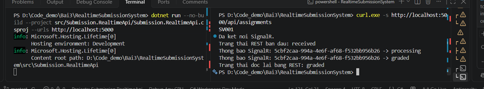
   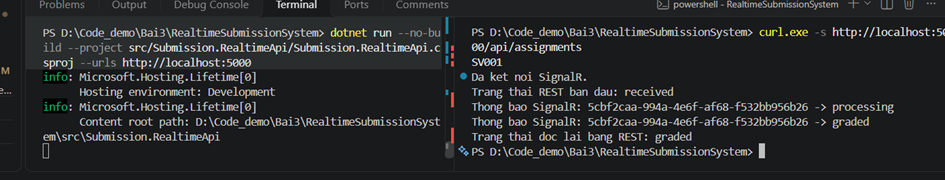
   ## Bước 7
    – Kết quả chạy thật và bài học phân tán của từng thí nghiệm 1. Hai máy khách cùng lúc: dự đoán ... | kết quả thật: Mỗi máy khách chỉ thấy lượt nộp vừa tạo | giải thích: Nhóm submission:{id} tách người nhận. 2. Máy chủ chưa chạy: dự đoán ... | kết quả thật: HttpRequestException: Connection refused (localhost:5000) | giải thích: Lần nối đầu không được tự thử lại. 3. Sai /hub/submissions: dự đoán ... | kết quả thật: HttpRequestException: ... 404 (Not Found) | giải thích: Lỗi ở negotiate; khớp MapHub. 4. Sai tên sự kiện: dự đoán ... | kết quả thật: Không lỗi; 10 giây sau: Qua thoi gian cho thong bao graded. | giải thích: Sai tên chiều xuống = im lặng. 5. Watch muộn 4 giây: dự đoán ... | kết quả thật: Không nhận tin nào; REST đọc lại: graded | giải thích: Vào nhóm muộn là lỡ tin; REST là nguồn sự thật. 
## Bước 8 
– requests.http gom các ca REST và bước bắt tay của hub Cả 9 ca cho đúng mã mong đợi; ca 4 bấm nhiều lần thấy trạng thái đổi
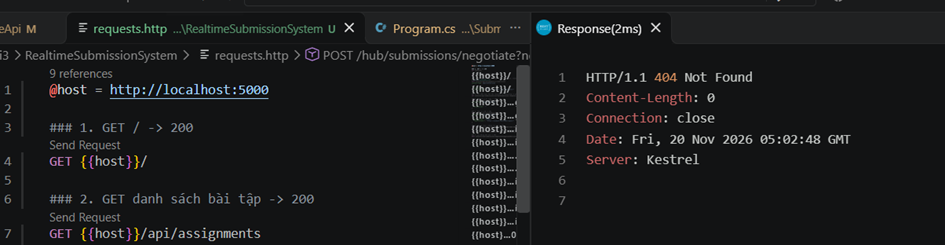
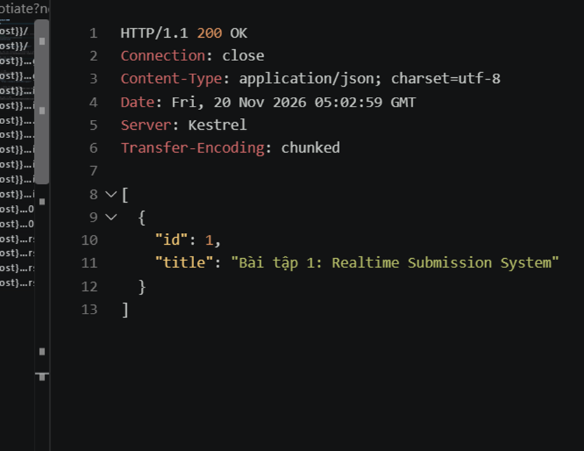
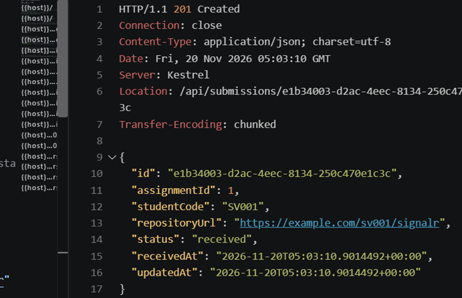
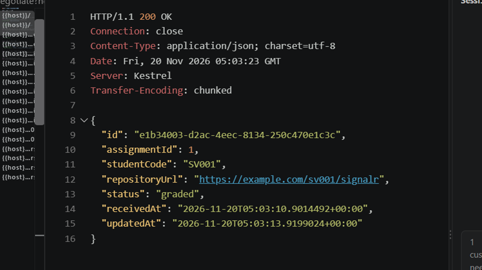
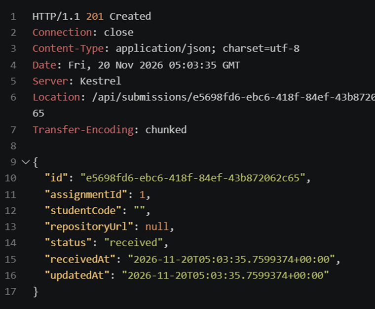
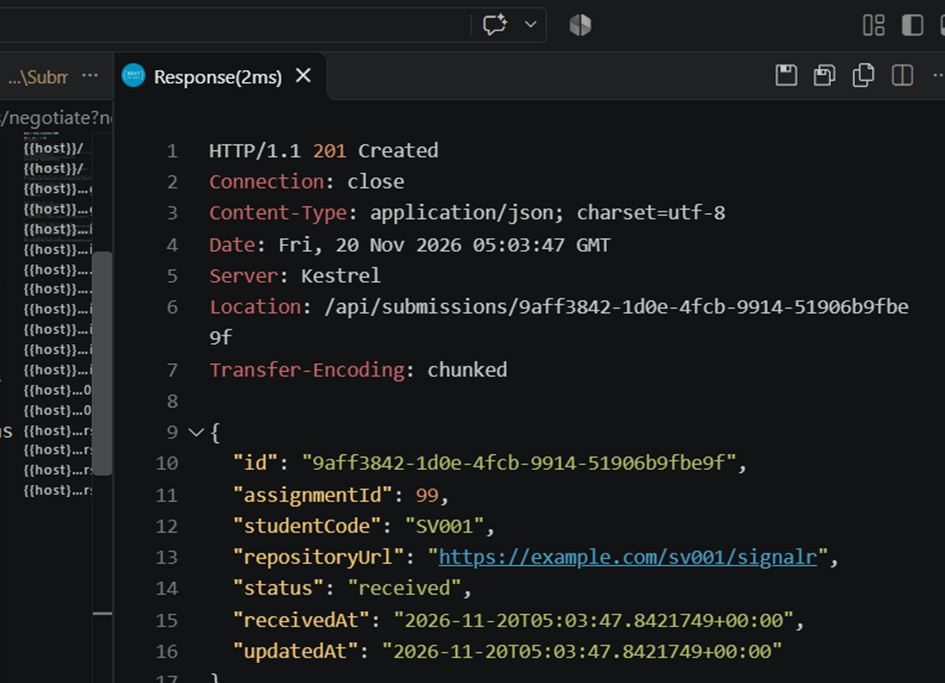
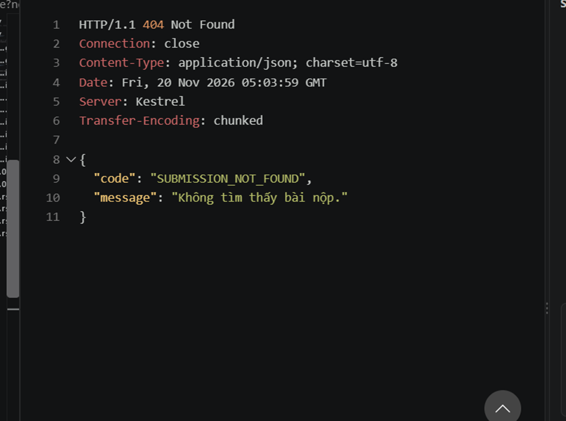