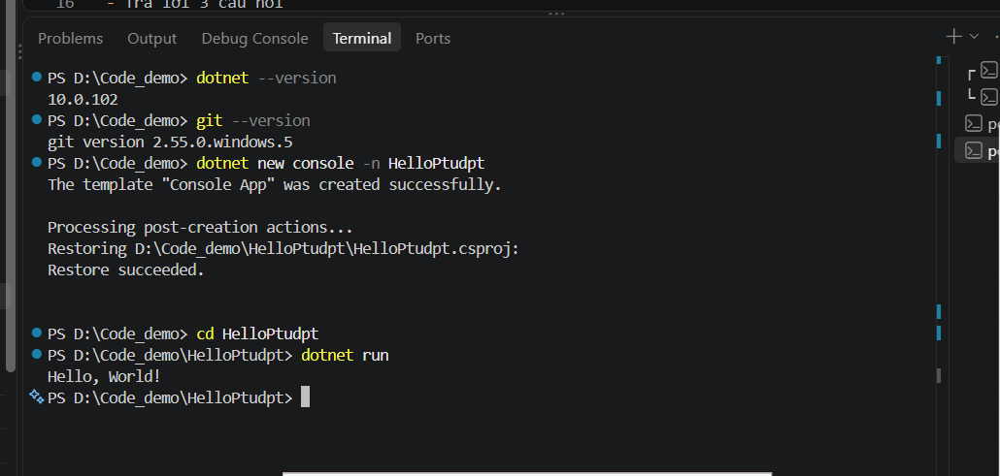
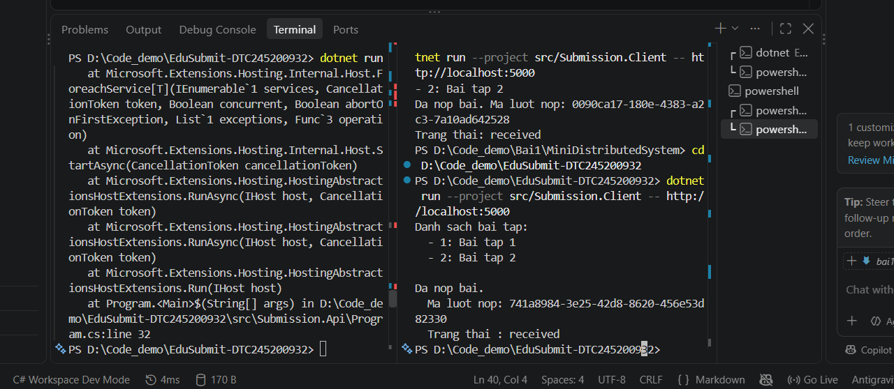

# Bài 1 – Tổng quan hệ thống và MEP
Họ tên: Nguyễn Ngọc Anh             MSSV:     Dtc245200932         Lớp:CNttK23D
 
## 1. Cài đặt
(ảnh chụp kết quả Bước 4)
 

## 2. MepDemo (Bước 7)
- ## 2. MepDemo (Bước 7)
- Câu 1: Ở MEP 3, mỗi bài nộp sub-x chỉ do 1 worker xử lý (Worker-A và Worker-B chia nhau từng job trong hàng đợi).
- Câu 2: Ở MEP 4, một sự kiện được gửi tới 3 dịch vụ cùng lúc (ScoreService, NotificationService, và StatsService).
- Câu 3: Mô tả 1 câu cho mỗi MEP:
  + Request-Response: Dịch vụ gửi yêu cầu và tạm dừng để chờ phản hồi trực tiếp từ bên nhận.
  + One-Way: Dịch vụ gửi thông điệp đi và tiếp tục công việc ngay lập tức mà không chờ phản hồi.
  + Queue-Based: Thông điệp được đưa vào hàng đợi trung gian và chỉ duy nhất 1 worker nhặt ra xử lý.
  + Publish-Subscribe: Một sự kiện phát ra theo chủ đề sẽ được phân phối đồng loạt tới tất cả dịch vụ đã đăng ký.
  + Streaming: Dữ liệu được truyền liên tục dạng dòng chảy theo thời gian thực từ nguồn phát đến nơi nhận.
 
## 3. BasicWebApi (Bước 8)
- Ảnh chụp REST Client: 200, 201, 400

- Trả lời 3 câu hỏi mục 8.4
1. `builder.Services.AddSingleton...` bắt buộc đứng trước `var app = builder.Build();` vì mọi dịch vụ phải đăng ký vào DI Container trước khi ứng dụng được Build.
  2. Tham số `name` lấy từ Route parameter (`/hello/{name}`), `language` lấy từ Query string (`?language=en`).
  3. POST hợp lệ trả về `201 Created` vì chuẩn REST API quy định 201 dùng cho hành vi khởi tạo tài nguyên mới trên server (kèm theo URL vị trí trong header Location), thay vì 200 OK chung chung.
 
## 4. MiniDistributedSystem (Bước 9)
- Ảnh chụp 2 terminal API + Client

- Trả lời 3 câu hỏi
 1. Client gọi 2 endpoint:
     + GET /api/assignments -> 200 OK
     + POST /api/submissions -> 201 Created
  2. Client không tham chiếu code API. Hai bên thống nhất với nhau bằng Hợp đồng giao tiếp (Contract) qua chuẩn HTTP và định dạng dữ liệu JSON.
  3. Truyền địa chỉ API qua tham số `-- http://localhost:5000` giúp ứng dụng linh hoạt thay đổi địa chỉ môi trường triển khai (Dev/Staging/Prod) mà không phải sửa lại code.
## 5. Thí nghiệm lỗi (Bước 10)
| # | Dự đoán | Thực tế | Đúng/Sai | Giải thích |
 | a | Client không cần sửa code, vẫn in 3 bài tập | Client in 2 bài tập (1 và 2) | Sai | Client đọc danh sách từ API lúc chạy, nên số bài hiển thị phụ thuộc vào bản API đang chạy. Dù đã thêm bài 3 vào code, kết quả vẫn là 2 bài vì API đang trả lời chưa phải bản vừa sửa (chưa được lưu/khởi động lại bằng code mới). Client thì không cần sửa gì. |
| b | Client báo HttpRequestException (connection refused) | HttpRequestException: No connection could be made because the target machine actively refused it. (localhost:5000), SocketException (10061) | Đúng | Gọi qua mạng phụ thuộc máy chủ có chạy, đúng cổng và mạng thông, nên có thể thất bại. Gọi hàm trong cùng chương trình thì không đi qua mạng nên không gặp các rủi ro đó |
| c | API trả lỗi 400 Bad Request, Client văng ngoại lệ | API trả 400 Bad Request, Client quăng ngoại lệ tại EnsureSuccessStatusCode() | Đúng | EnsureSuccessStatusCode() kiểm tra nếu status code không nằm trong khoảng 200-299 sẽ quăng exception. Server phải tự kiểm tra dữ liệu đầu vào để ngăn dữ liệu xấu hoặc gian lận từ phía client. |
| d| Client báo lỗi kết nối cổng 5000, sửa bằng cách truyền URL mới ở terminal | Bị lỗi kết nối cổng 5000. Truyền tham số URL 5050 ở terminal thì Client chạy lại bình thường | Đúng | Sửa bằng cách truyền địa chỉ API mới qua tham số dòng lệnh: `dotnet run --project src/Submission.Client -- http://localhost:5050` mà không cần sửa dòng code nào. |
## 6. Dự án EduSubmit tự làm (Bước 11-12)
- Ảnh chụp kết quả; 

phần nào phải xem code mẫu:Xem phần "Gợi ý khung code" trong giáo trình/file hướng dẫn để tham khảo cách khai báo các record (Assignment, CreateSubmissionRequest, SubmissionResult) và cấu trúc khởi tạo WebApplication/cách gọi MapPost.
- Luồng thông điệp:
 Client --(HTTP GET /api/assignments)--> Api  : request-response
  Client --(HTTP POST /api/submissions)--> Api : request-response
 
## 7. Khó khăn gặp phải và cách giải quyết
