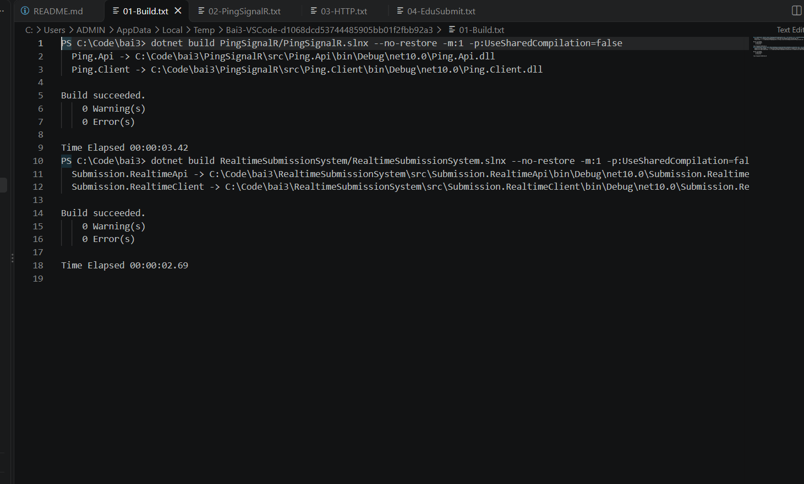
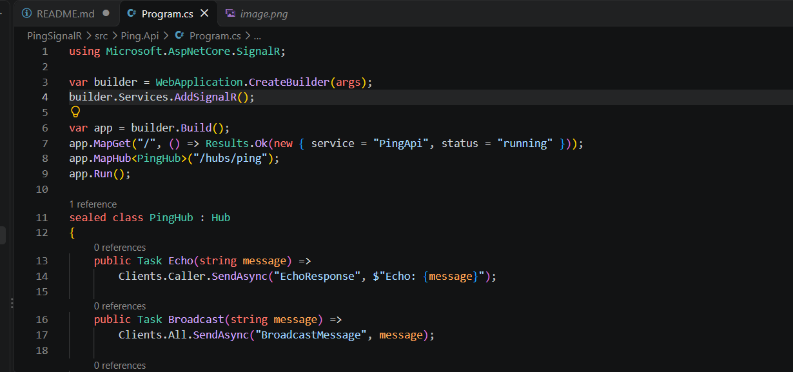
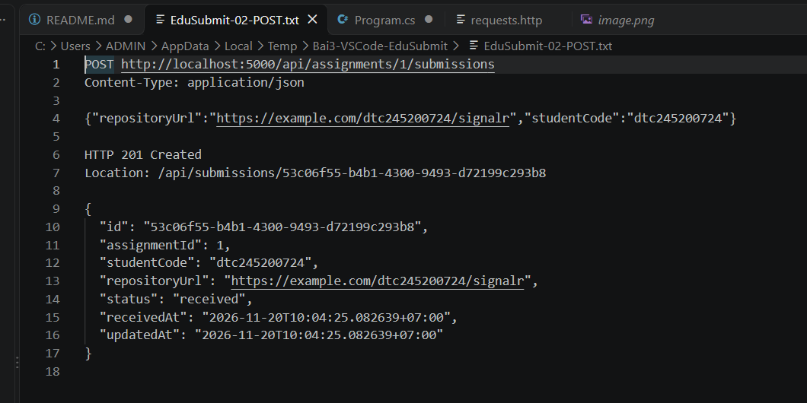
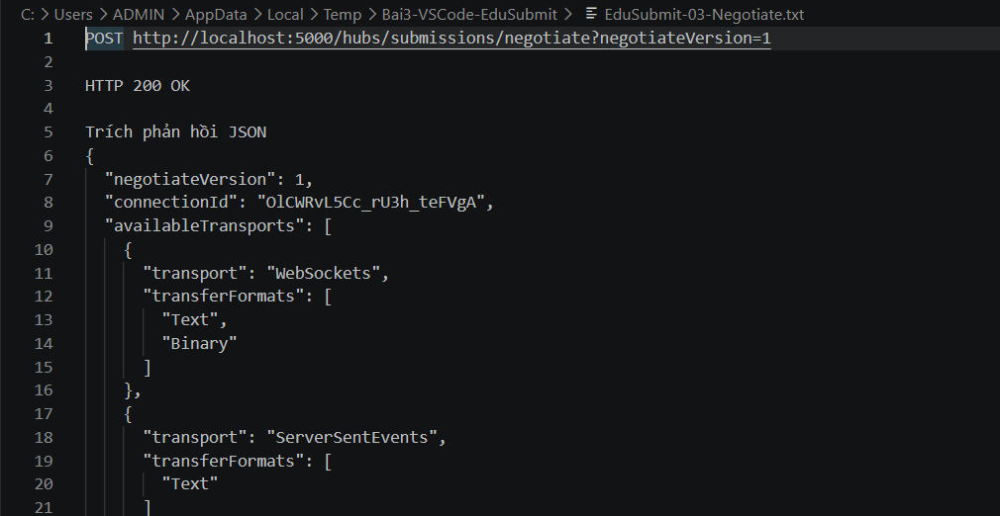
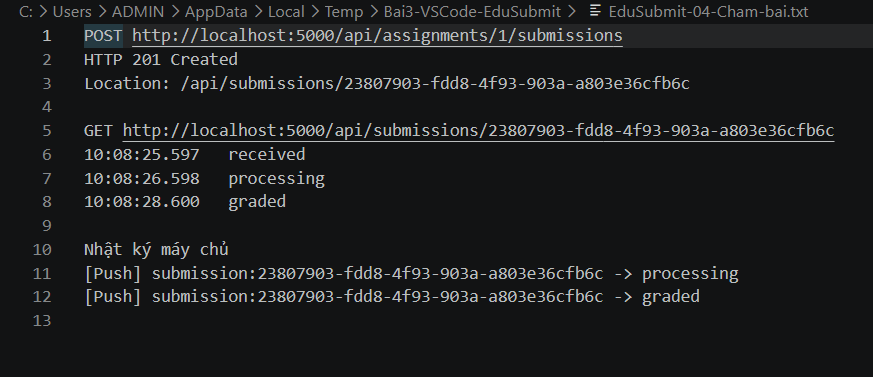
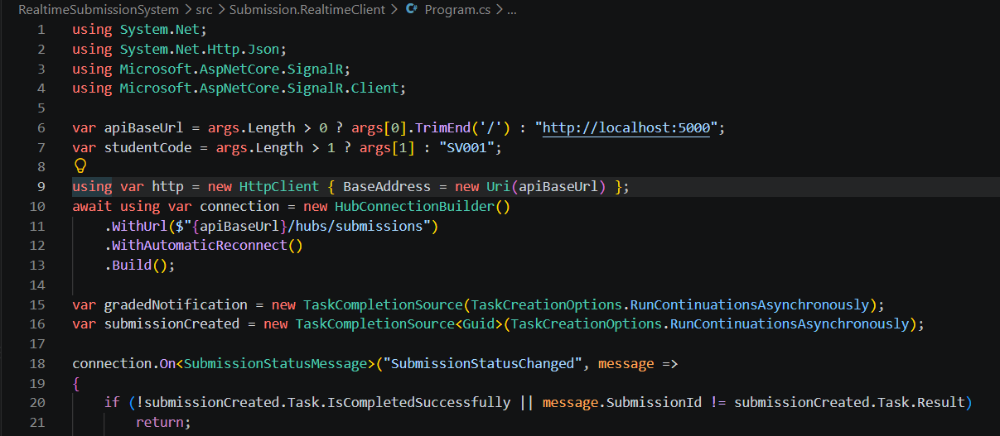
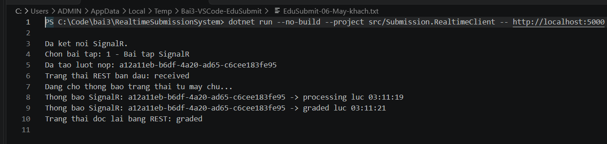
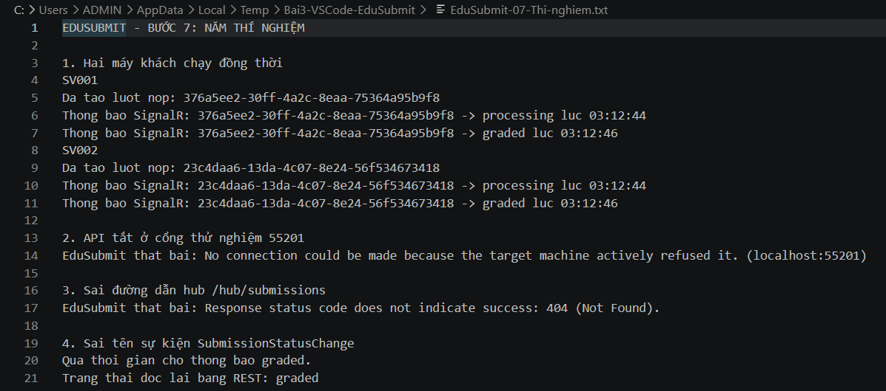
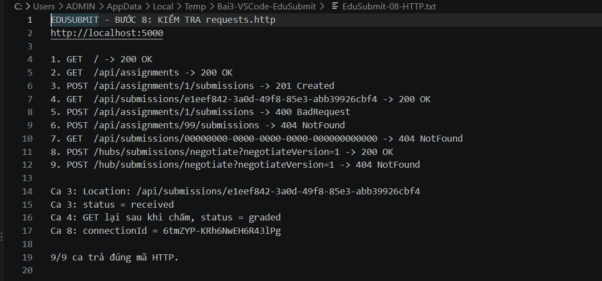

# Bài 3 — PingSignalR và EduSubmit

**Nguyễn Thành Đạt — dtc245200724**

## Ảnh minh chứng

Để bổ sung ảnh, lưu ảnh vào thư mục `images` cạnh README. Tại bước tương ứng, bỏ `<!--` và `-->` quanh dòng mẫu rồi dùng tên tệp đã lưu. Mở bản xem trước Markdown bằng **Ctrl+Shift+V** để kiểm tra.

### Ảnh 1 · Build hai solution

Chụp một ảnh thấy cả PingSignalR và EduSubmit có `Build succeeded` và `0 Error(s)`. Dùng ảnh này cho bước 1 của cả hai phần.



## PingSignalR

### Các bước làm PingSignalR

1. **Tạo solution và hai project.** Trong thư mục `PingSignalR`, tạo solution `PingSignalR.slnx`, project ASP.NET Core Empty `src/Ping.Api` và project console `src/Ping.Client`. Thêm cả hai project vào solution, rồi cài `Microsoft.AspNetCore.SignalR.Client` phiên bản `10.0.15` cho project console. Chạy `dotnet build` để kiểm tra.

   Xem [Ảnh 1 · Build hai solution](#ảnh-1--build-hai-solution).

2. **Đăng ký và ánh xạ hub.** Trong [Program.cs của Ping.Api](PingSignalR/src/Ping.Api/Program.cs), gọi `builder.Services.AddSignalR()` trước `builder.Build()`. Dùng `app.MapHub<PingHub>("/hubs/ping")` và chạy API trên cổng `5200`. Gửi POST đến `/hubs/ping/negotiate?negotiateVersion=1` và kiểm tra phản hồi có `connectionId`.

   

3. **Viết Echo.** Trong `PingHub`, tạo phương thức `Echo(message)` và gửi `EchoResponse` qua `Clients.Caller` để trả lời đúng kết nối vừa gọi.

   [Xem ảnh phương thức Echo và Clients.Caller](image-1.png).

4. **Kết nối máy khách và gọi Echo.** Trong [Program.cs của Ping.Client](PingSignalR/src/Ping.Client/Program.cs), tạo `HubConnection` với URL máy chủ nhận từ dòng lệnh. Đăng ký `On<string>("EchoResponse", ...)` trước `StartAsync()`, rồi gọi `InvokeAsync("Echo", ...)`. Kiểm tra terminal máy khách in dòng `[Echo]`.

   <!--  -->

5. **Gửi tin chung và tin nhóm.** Thêm `Broadcast` dùng `Clients.All`, `JoinGroup` dùng `Groups.AddToGroupAsync` và `SendToGroup` dùng `Clients.Group`. Đăng ký `BroadcastMessage` và `GroupMessage` ở máy khách, rồi thử với An và Bình trong nhóm `lop-hoc-01`. Khi Bình kết nối, cửa sổ An nhận tin phát rộng và tin nhóm của Bình.

   <!--  -->

6. **Xử lý vòng đời kết nối.** Phát `SystemMessage` từ `OnConnectedAsync` và `OnDisconnectedAsync`. Bật `WithAutomaticReconnect()` ở máy khách và gọi lại `JoinGroup` trong sự kiện `Reconnected`. Giữ An đang chạy, khởi động lại API và kiểm tra An nhận mã kết nối mới rồi vào lại nhóm.

   <!--  -->

7. **Chạy ba thí nghiệm lỗi.** Thử tắt API, dùng sai đường dẫn hub và đổi tên sự kiện Echo. Đối chiếu kết quả với bảng thí nghiệm ở cuối phần PingSignalR.

   <!--  -->


### Cách chạy

Cần .NET SDK 10. Máy khách dùng gói `Microsoft.AspNetCore.SignalR.Client` phiên bản `10.0.15`.

Từ thư mục `PingSignalR`, build cả hai project:

```powershell
dotnet build
```

Chạy mỗi lệnh sau trong một terminal riêng, theo thứ tự từ trên xuống. Để An kết nối xong trước khi chạy Binh. Nhấn Enter ở từng máy khách để thoát.

```powershell
dotnet run --project src/Ping.Api --urls http://localhost:5200
dotnet run --project src/Ping.Client -- http://localhost:5200 An
dotnet run --project src/Ping.Client -- http://localhost:5200 Binh
```

Kiểm tra bước bắt tay:

```powershell
curl.exe -X POST "http://localhost:5200/hubs/ping/negotiate?negotiateVersion=1"
```

### Kết quả chạy

Build thành công với 0 cảnh báo và 0 lỗi. `GET /` trả 200. Bắt tay trả 200, có `connectionId` và ba cơ chế truyền tải WebSockets, ServerSentEvents, LongPolling. Gọi `GET /hubs/ping` trực tiếp khi thiếu mã kết nối trả 400.

Trích đầu ra của An khi hai máy khách cùng kết nối, sau đó khởi động lại máy chủ:

```text
[Echo] Echo: Xin chao SignalR tu An
[Group] Thong bao nhom tu An
[Broadcast] Xin chao tat ca tu An
[Group] Thong bao nhom tu Binh
[Broadcast] Xin chao tat ca tu Binh
[Lifecycle] Dang ket noi lai...
[Lifecycle] Da ket noi lai: ek8Sw5YTIrnGHhXCPM_Syg
[Group] ek8Sw5YT da tham gia nhom lop-hoc-01
```

Echo của Binh chỉ xuất hiện ở terminal Binh (`Clients.Caller`). Tin nhóm xuất hiện ở các kết nối thuộc `lop-hoc-01` (`Clients.Group`). Tin phát rộng đến mọi kết nối đang mở (`Clients.All`). Sau khi máy chủ khởi động lại, An nhận mã kết nối mới và tự gia nhập lại nhóm.

### Thí nghiệm lỗi

| Thao tác | Dự đoán | Kết quả thực tế | Giải thích |
| --- | --- | --- | --- |
| Chạy máy khách khi API đã tắt | Mở kết nối thất bại | `HttpRequestException`, localhost:5200 từ chối kết nối | `WithAutomaticReconnect` áp dụng sau khi kết nối ban đầu đã mở thành công. |
| Gửi POST negotiate tới `/hub/ping` | Trả 404 | HTTP 404 | Đường dẫn đã ánh xạ là `/hubs/ping`. |
| Tạm đổi tên đăng ký từ `EchoResponse` thành `EchoRespone` rồi chạy máy khách | Echo biến mất, các sự kiện khác vẫn đến | Group và Broadcast vẫn in, chương trình thoát bình thường, không có dòng Echo | Tên sự kiện bên gửi và bên nghe phải khớp. Tên đúng đã được khôi phục sau khi thử. |

## EduSubmit realtime

[RealtimeSubmissionSystem](RealtimeSubmissionSystem/RealtimeSubmissionSystem.slnx) gồm một API ASP.NET Core và một máy khách console. API lưu bài tập mẫu và lượt nộp trong bộ nhớ. Khởi động lại API sẽ xóa các lượt nộp đã tạo.

### Các bước làm EduSubmit

1. **Tạo solution và hai project.** Tạo `RealtimeSubmissionSystem.slnx`, project ASP.NET Core Empty `src/Submission.RealtimeApi` và project console `src/Submission.RealtimeClient`. Thêm cả hai project vào solution và cài gói SignalR Client `10.0.15` cho project console.

   Xem [Ảnh 1 · Build hai solution](#ảnh-1--build-hai-solution).

2. **Xây API quản lý lượt nộp.** Trong [Program.cs của máy chủ](RealtimeSubmissionSystem/src/Submission.RealtimeApi/Program.cs), thêm GET danh sách bài tập, POST tạo lượt nộp và GET đọc lượt nộp theo mã. Kiểm tra bài tập tồn tại, còn mở và dữ liệu nộp đầy đủ. Lưu lượt nộp ở trạng thái `received` kèm `ReceivedAt`, `UpdatedAt` và bảo vệ phần đọc, ghi bằng khóa. POST thành công trả `201 Created` kèm `Location`.

   

3. **Tạo hub theo dõi từng lượt nộp.** Đăng ký SignalR và ánh xạ `SubmissionHub` tại `/hubs/submissions` trên cổng `5000`. Trong `WatchSubmission(id)`, kiểm tra mã GUID rồi thêm kết nối vào nhóm `submission:{id}`. Kiểm tra POST negotiate trả `200` và có `connectionId`.

   

4. **Mô phỏng chấm bài trong nền.** Sau khi tạo lượt nộp, chạy `SimulateGradingAsync`. Hàm chuyển sang `processing` sau khoảng một giây và `graded` sau hai giây nữa. Mỗi lần đổi trạng thái, cập nhật dữ liệu trước rồi dùng `IHubContext<SubmissionHub>` gửi `SubmissionStatusChanged` đến đúng nhóm. Dùng GET theo `Location` để kiểm tra trạng thái được lưu.

   

5. **Mở hai kênh ở máy khách.** Trong [Program.cs của máy khách](RealtimeSubmissionSystem/src/Submission.RealtimeClient/Program.cs), tạo `HttpClient` cho REST và `HubConnection` cho SignalR. Đăng ký nhận `SubmissionStatusChanged` trước khi kết nối. Dùng `TaskCompletionSource` để báo khi lượt nộp đang theo dõi chuyển sang `graded`.

   

6. **Nối luồng nộp và theo dõi.** Tải danh sách bài tập, chọn bài đang mở, POST tạo lượt nộp rồi gọi `WatchSubmission` bằng mã vừa nhận. Đợi sự kiện `graded` tối đa 10 giây, sau đó GET lại trạng thái trước khi thoát. Nếu SignalR kết nối lại, đăng ký theo dõi lại và đọc trạng thái qua REST để xử lý tin đã lỡ.

   

7. **Chạy năm thí nghiệm.** Thử hai máy khách đồng thời, API tắt, sai URL hub, sai tên sự kiện và đăng ký theo dõi muộn. Ghi lại dự đoán, kết quả và nguyên nhân theo bảng bên dưới.

   

   <!--  -->

8. **Kiểm tra các yêu cầu HTTP.** Chạy chín ca trong [requests.http](RealtimeSubmissionSystem/requests.http) và đối chiếu các mã `200`, `201`, `400`, `404`. Chạy lại `dotnet build` cho cả hai solution và kiểm tra nhật ký máy khách.

   


### Cách chạy

Từ thư mục `RealtimeSubmissionSystem`, chạy các lệnh sau trong hai terminal:

```powershell
# Terminal 1
dotnet run --project src/Submission.RealtimeApi --urls http://localhost:5000

# Terminal 2
dotnet run --project src/Submission.RealtimeClient -- http://localhost:5000 dtc245200724
```

Máy khách tải danh sách bài tập, tạo lượt nộp và dùng mã lượt nộp để gọi `WatchSubmission`. API trả `201 Created` ở trạng thái `received` rồi mô phỏng chấm bài trong nền. Mỗi lần đổi trạng thái, API cập nhật dữ liệu trước rồi dùng `IHubContext` gửi `SubmissionStatusChanged` đến nhóm `submission:{id}`. Máy khách đọc lại trạng thái qua REST trước khi tự thoát.

[requests.http](RealtimeSubmissionSystem/requests.http) có 9 ca kiểm tra. Chạy ca 3 trước ca 4 để trình gửi HTTP lấy mã lượt nộp từ phản hồi. Gửi lại ca 4 sau khoảng ba giây để đọc trạng thái cuối.

### Kết quả chạy

Cả hai solution build với 0 cảnh báo và 0 lỗi. EduSubmit trả đúng mã HTTP cho cả 9 ca, và trả `400 ASSIGNMENT_CLOSED` khi nộp bài tập đã đóng.

Nhật ký thực tế của máy khách SV001:

```text
Da ket noi SignalR.
Chon bai tap: 1 - Bai tap SignalR
Da tao luot nop: 99d8382e-1423-48aa-a47f-cab453f94b87
Trang thai REST ban dau: received
Dang cho thong bao trang thai tu may chu...
Thong bao SignalR: 99d8382e-1423-48aa-a47f-cab453f94b87 -> processing luc 02:24:20
Thong bao SignalR: 99d8382e-1423-48aa-a47f-cab453f94b87 -> graded luc 02:24:22
Trang thai doc lai bang REST: graded
```

### Năm thí nghiệm EduSubmit

Các ca cần đổi mã được chạy trên bản sao tạm của máy khách.

| Thao tác | Dự đoán | Kết quả thực tế | Giải thích |
| --- | --- | --- | --- |
| Chạy đồng thời SV001 và SV002 | Mỗi máy khách nhận tin của lượt nộp riêng | Cả hai nhận `processing` và `graded` theo mã riêng, rồi tự thoát | Mỗi lượt nộp có nhóm `submission:{id}` riêng. |
| Chạy máy khách khi API tắt | Kết nối thất bại | Cổng từ chối kết nối, máy khách thoát với mã 1 | Lần gọi `StartAsync` đầu tiên cần API đang lắng nghe. |
| Đổi URL hub của máy khách thành `/hub/submissions` | Bắt tay trả 404 | Máy khách in `404 (Not Found)` | API ánh xạ hub tại `/hubs/submissions`. |
| Đổi tên đăng ký thành `SubmissionStatusChange` | Không nhận thông báo, REST vẫn đọc được | Máy khách báo quá thời gian sau 10 giây và đọc được `graded` qua REST | Hàm xử lý chỉ chạy khi tên đăng ký khớp tên máy chủ gửi. |
| Đợi 4 giây trước khi gọi `WatchSubmission` | Bỏ lỡ hai thông báo đã phát | Máy khách báo quá thời gian, rồi REST trả `graded` | Tác vụ chấm hoàn tất trước lúc máy khách vào nhóm. SignalR không phát lại các thông báo cũ. |

### Câu hỏi đầu giờ

1. Máy chủ có thể chủ động gửi thông báo qua kết nối SignalR đang mở. Với EduSubmit, mỗi lần trạng thái thay đổi, máy chủ gửi mã lượt nộp, trạng thái mới và thời điểm cập nhật đến nhóm theo dõi.
2. REST tạo lượt nộp và cung cấp trạng thái hiện tại theo yêu cầu. SignalR báo ngay khi trạng thái thay đổi.
3. Nếu mất mạng lúc máy chủ báo `graded`, máy khách có thể bỏ lỡ tin. Khi kết nối lại, máy khách gọi lại `WatchSubmission` và dùng `GET /api/submissions/{id}` để đọc trạng thái đã lưu.
