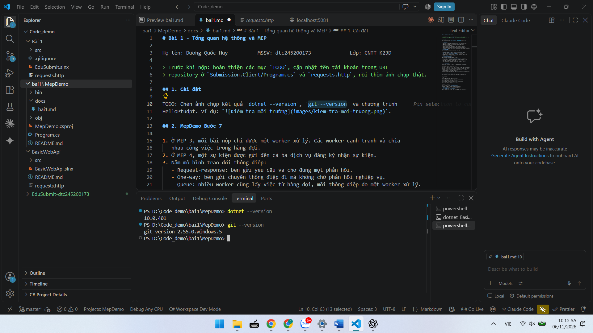
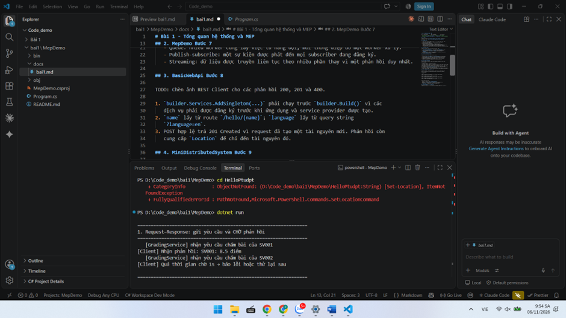
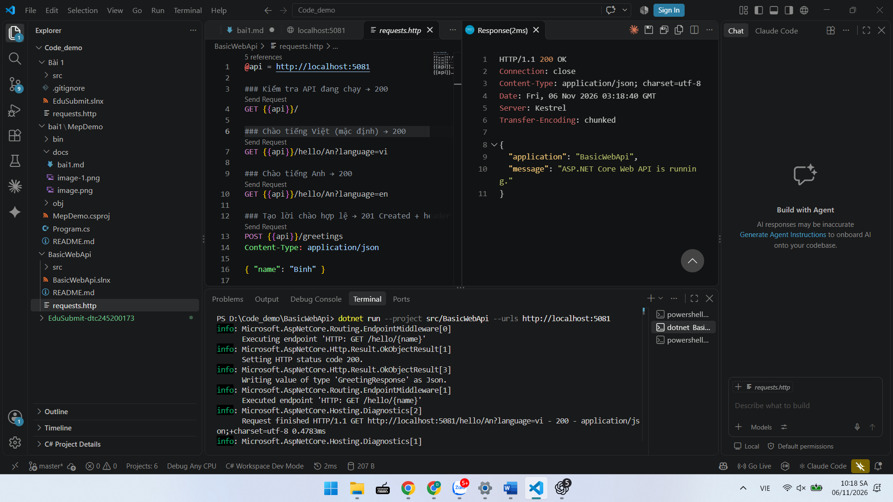
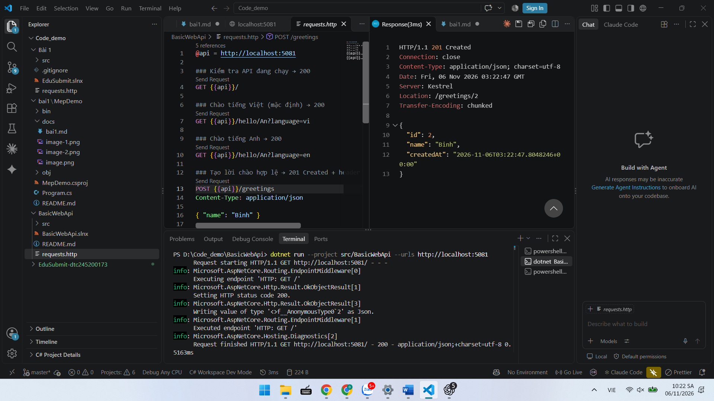
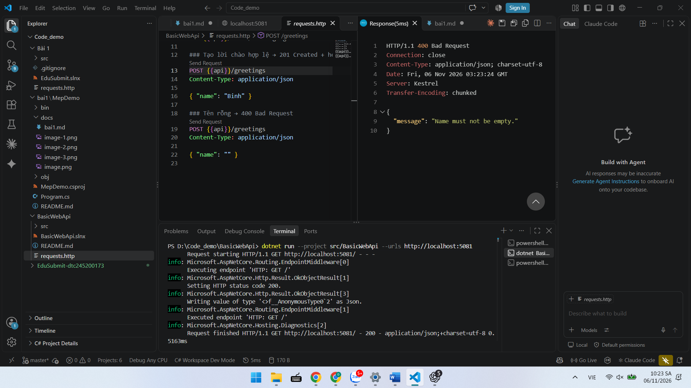
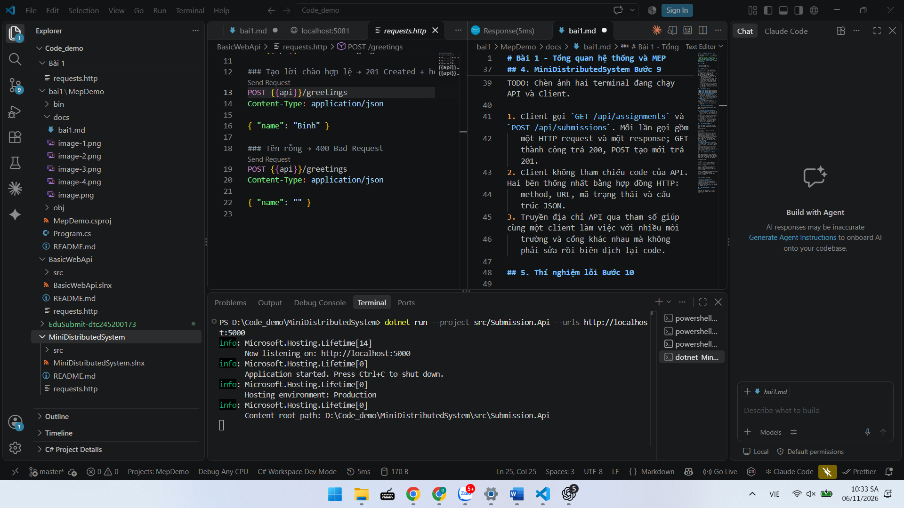
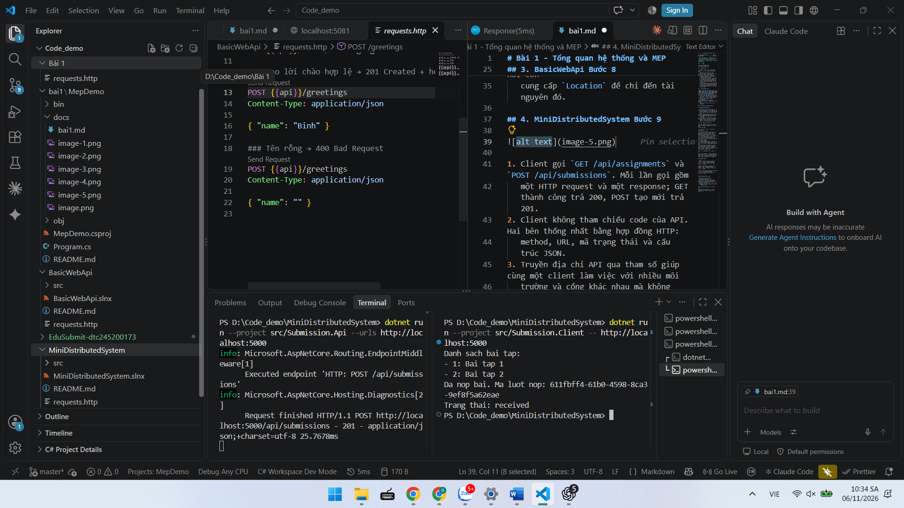

# Bài 1 - Tổng quan hệ thống và MEP

Họ tên: Dương Quốc Huy          MSSV: dtc245200173             Lớp: CNTT K23D

> Trước khi đẩy GitHub: cập nhật tên tài khoản trong URL repository ở
> `Submission.Client/Program.cs` và `requests.http`.

## 1. Cài đặt


*Hình 1. Kết quả kiểm tra môi trường lập trình với .NET 10 SDK và Git.*

## 2. MepDemo Bước 7


*Hình 2. Kết quả chạy mô hình request-response trong MepDemo.*

1. Ở MEP 3, mỗi bài nộp chỉ được một worker xử lý. Các worker cạnh tranh và chia
   nhau công việc trong hàng đợi.
2. Ở MEP 4, một sự kiện được gửi đến cả ba dịch vụ đăng ký nhận sự kiện.
3. Năm mô hình trao đổi thông điệp:
   - Request-response: bên gửi yêu cầu và chờ đúng một phản hồi.
   - One-way: bên gửi chuyển thông điệp đi mà không chờ phản hồi nghiệp vụ.
   - Queue: nhiều worker cùng lấy việc từ hàng đợi, mỗi thông điệp do một worker xử lý.
   - Publish-subscribe: một sự kiện được phát đến mọi subscriber đang đăng ký.
   - Streaming: dữ liệu được truyền liên tục theo nhiều phần thay vì một phản hồi duy nhất.

## 3. BasicWebApi Bước 8


*Hình 3. REST Client gửi request hợp lệ và nhận phản hồi 200 OK.*


*Hình 4. REST Client tạo lời chào và nhận phản hồi 201 Created.*


*Hình 5. REST Client gửi tên rỗng và nhận phản hồi 400 Bad Request.*

1. `builder.Services.AddSingleton(...)` phải chạy trước `builder.Build()` vì các
   dịch vụ phải được đăng ký trước khi ứng dụng và service provider được tạo.
2. `name` lấy từ route `/hello/{name}`; `language` lấy từ query string
   `?language=en`.
3. POST hợp lệ trả 201 Created vì request đã tạo một tài nguyên mới. Phản hồi còn
   cung cấp `Location` để chỉ đến tài nguyên đó.

## 4. MiniDistributedSystem Bước 9


*Hình 6. Submission.Api của MiniDistributedSystem lắng nghe tại cổng 5000.*


*Hình 7. Submission.Api và Submission.Client chạy ở hai terminal độc lập.*

1. Client gọi `GET /api/assignments` và `POST /api/submissions`. Mỗi lần gọi gồm
   một HTTP request và một response; GET thành công trả 200, POST tạo mới trả 201.
2. Client không tham chiếu code của API. Hai bên thống nhất bằng hợp đồng HTTP:
   method, URL, mã trạng thái và cấu trúc JSON.
3. Truyền địa chỉ API qua tham số giúp cùng một client làm việc với nhiều môi
   trường và cổng khác nhau mà không phải sửa rồi biên dịch lại code.

## 5. Thí nghiệm lỗi Bước 10

Đã ghi dự đoán trước, sau đó chạy từng thí nghiệm trên MiniDistributedSystem và
đối chiếu với kết quả thực tế.

| # | Dự đoán | Thực tế | Đúng Sai | Giải thích |
|---|---|---|---|---|
| a | Client sẽ thấy bài tập thứ ba mà không cần sửa code. | Client in đủ `Bai tap 1`, `Bai tap 2`, `Bai tap 3`, sau đó vẫn nộp bài thành công và nhận trạng thái `received`. | Đúng | Client đọc mảng JSON do API trả về nên không phụ thuộc số phần tử cố định. |
| b | Client báo lỗi kết nối vì không có tiến trình lắng nghe ở cổng API. | Xuất hiện `HttpRequestException` và `SocketException (10061)`: `No connection could be made because the target machine actively refused it (localhost:5000)`. | Đúng | Khi API đã tắt, không còn tiến trình lắng nghe ở cổng 5000. Gọi qua mạng phụ thuộc tiến trình và kết nối bên ngoài, còn gọi hàm nội bộ thì không. |
| c | API trả 400; `EnsureSuccessStatusCode()` ném ngoại lệ. | API ghi nhận POST trả `400 Bad Request`; Client ném `HttpRequestException: Response status code does not indicate success: 400` tại `EnsureSuccessStatusCode()`. | Đúng | `StudentCode` rỗng là dữ liệu không hợp lệ. Máy chủ phải tự kiểm tra vì dữ liệu do Client gửi lên không đáng tin cậy. |
| d | Client gọi cổng 5000 sẽ lỗi khi API chạy ở 5050; truyền URL 5050 khi chạy client sẽ sửa được mà không đổi code. | Khi Client gọi 5000, kết nối bị từ chối với lỗi 10061. Chạy lại Client với tham số `http://localhost:5050` thì lấy được danh sách bài tập, nộp bài thành công và nhận `received`. | Đúng | Địa chỉ API được cấu hình qua đối số dòng lệnh nên chỉ cần truyền đúng cổng 5050, không phải sửa hoặc biên dịch lại code. |

## 6. Dự án EduSubmit tự làm Bước 11 và 12

Kết quả kiểm thử: solution build thành công với 0 warning và 0 error. Client lấy
được hai bài tập, tạo lượt nộp mới, nhận trạng thái `received` và đọc lại đúng
lượt nộp vừa tạo. Request thiếu dữ liệu trả 400; ID không tồn tại trả 404.

Phần đã xem code mẫu: khi tự viết, dự án được làm theo đặc tả Bước 11. Sau khi
hoàn thành, có đối chiếu với MiniDistributedSystem về ba record dữ liệu và luồng
gọi `GET /api/assignments`, `POST /api/submissions`.

Ảnh API và Client của EduSubmit: cần chụp bổ sung sau khi chạy hai terminal trong
thư mục `EduSubmit-dtc245200173`.

Luồng thông điệp:

```text
Client --(HTTP GET /api/assignments)----------> API : request-response
Client <--(200 + danh sách bài tập)------------ API

Client --(HTTP POST /api/submissions + JSON)--> API : request-response
Client <--(201 + Location + lượt nộp)---------- API

Client --(HTTP GET /api/submissions/{id})-----> API : request-response
Client <--(200 + lượt nộp hoặc 404)------------ API
```

Phần mở rộng đã thực hiện:

- API lưu các lượt nộp trong `List<SubmissionResult>`.
- API hỗ trợ `GET /api/submissions/{id:guid}` với phản hồi 200 hoặc 404.
- Client đọc lại lượt nộp vừa tạo và in thông tin ra terminal.
- `requests.http` có request đọc ID thật và ID không tồn tại.

## 7. Khó khăn gặp phải và cách giải quyết

- Nhật ký ban đầu được đặt nhầm trong thư mục mẫu `MepDemo/docs`. Đã chuyển
  `docs/bai1.md` và các ảnh vào đúng thư mục dự án `EduSubmit-dtc245200173/docs`.
- Khi Client gọi sai cổng hoặc API chưa chạy, chương trình báo
  `HttpRequestException` và lỗi kết nối 10061. Đã kiểm tra dòng `Now listening on`
  của API và truyền đúng URL qua tham số khi chạy Client.
- VS Code từng giữ một tab nhật ký chưa lưu nên không hiện thay đổi mới trên ổ
  đĩa. Đã mở lại đúng file trong thư mục EduSubmit và lưu trước khi cập nhật.
- Các thư mục `bin` và `obj` được sinh ra khi build nhưng đã được `.gitignore`
  loại khỏi nội dung commit và bài nộp.
