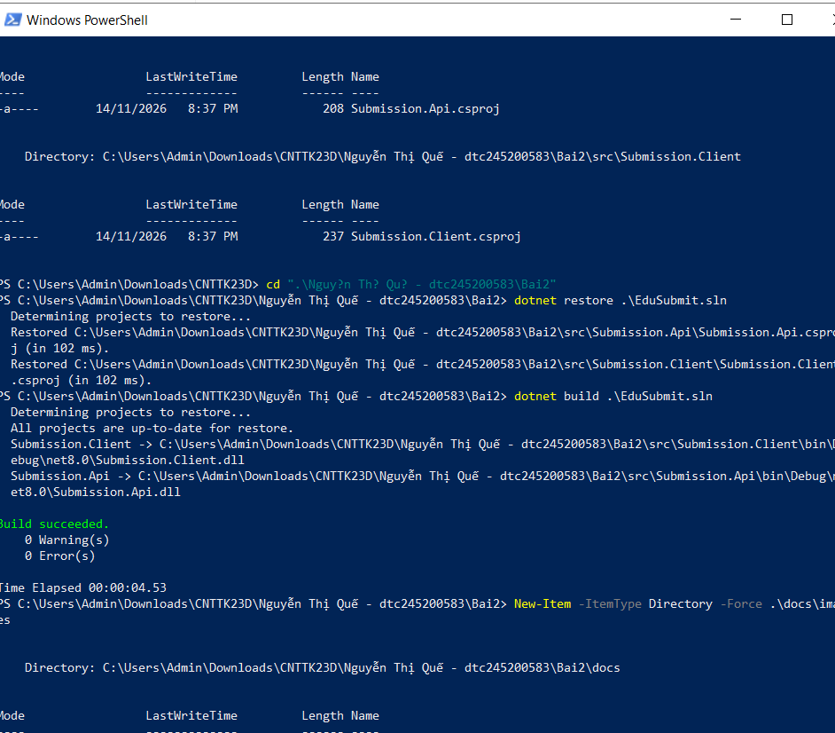
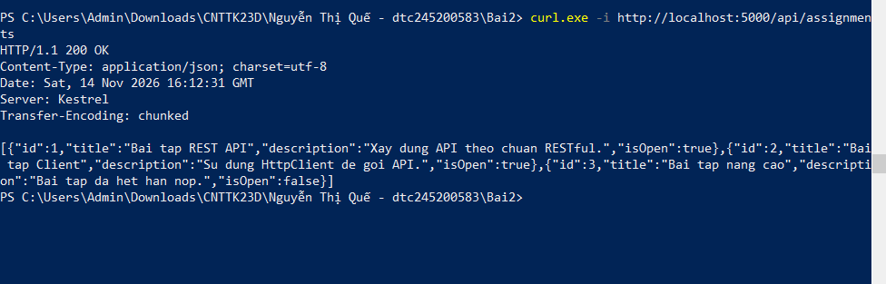
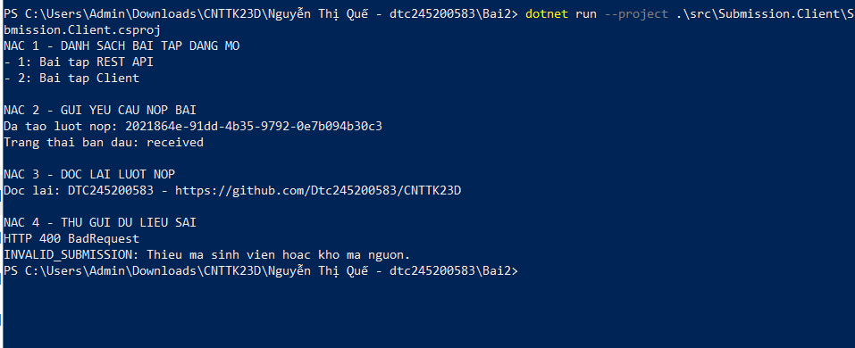
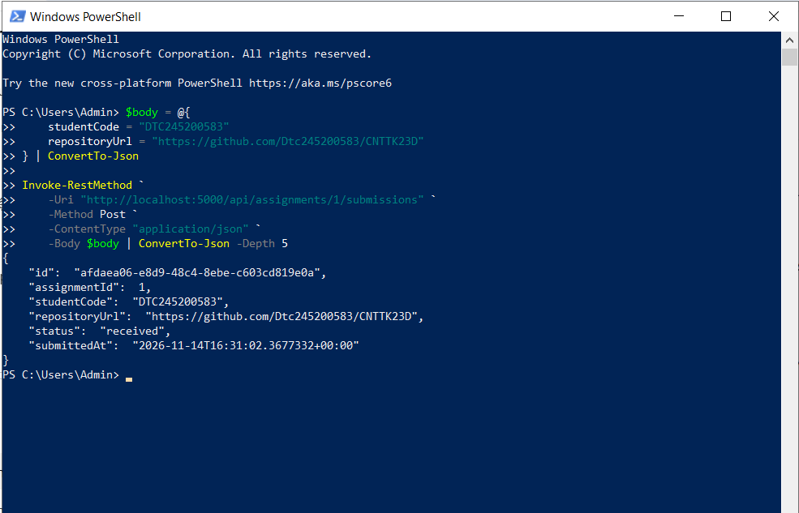

# EduSubmit - Bai 2: RESTful API

**Sinh vien:** Nguyen Thi Que
**MSSV:** DTC245200583
**Cong nghe:** .NET 8, ASP.NET Core Minimal API, HttpClient

## 1. Cau truc thu muc

```text
Bai2/
├── CatalogApi/
├── docs/
│   └── images/
│       ├── 01-build-succeeded.png
│       ├── 02-api-assignments.png
│       ├── 03-client-four-steps.png
│       └── 04-post-created.png
├── src/
│   ├── Submission.Api/
│   │   ├── Submission.Api.csproj
│   │   └── Program.cs
│   └── Submission.Client/
│       ├── Submission.Client.csproj
│       └── Program.cs
├── EduSubmit.sln
├── global.json
├── README.md
└── requests.http
```

## 2. Yeu cau

- Cai dat .NET SDK 8.0 tro len.
- Mo PowerShell tai thu muc chua file `EduSubmit.sln`.

Kiem tra SDK:

```powershell
dotnet --list-sdks
```

## 3. Khoi phuc va Build

Chay cac lenh sau tai thu muc goc Bai2:

```powershell
dotnet restore .\EduSubmit.sln
dotnet build .\EduSubmit.sln
```

Ket qua mong doi: `Build succeeded`, khong co loi.

Anh minh chung:



## 4. Chay Submission.Api

Mo Terminal 1 tai thu muc goc Bai2:

```powershell
dotnet run --project .\src\Submission.Api\Submission.Api.csproj --urls http://localhost:5000
```

Giu Terminal 1 dang chay.

Mo Terminal 2 va kiem tra API:

```powershell
curl.exe -i http://localhost:5000/
curl.exe -i http://localhost:5000/api/assignments
```

Ket qua mong doi: API phan hoi thanh cong va tra ve danh sach bai tap.

Anh minh chung:



Luu y: API luu du lieu luot nop trong bo nho RAM. Khi khoi dong lai API, du lieu luot nop truoc do se mat.

## 5. Chay Submission.Client

Giu API dang chay. Mo mot Terminal khac tai thu muc goc Bai2:

```powershell
dotnet run --project .\src\Submission.Client\Submission.Client.csproj
```

Client thuc hien 4 buoc:

1. Lay danh sach bai tap dang mo.
2. Gui POST de tao luot nop bai.
3. Doc lai luot nop bang URI nhan duoc tu header `Location`.
4. Gui du lieu khong hop le va kiem tra phan hoi HTTP 400.

Co the truyen dia chi API qua tham so dong lenh:

```powershell
dotnet run --project .\src\Submission.Client\Submission.Client.csproj -- http://localhost:5000
```

Anh minh chung:



## 6. Danh sach API

| Phuong thuc | URI | Ket qua thanh cong | Ket qua loi |
|---|---|---|---|
| GET | `/api/assignments` | 200 OK | - |
| GET | `/api/assignments/{id}` | 200 OK | 404 Not Found |
| POST | `/api/assignments/{id}/submissions` | 201 Created | 400 Bad Request, 404 Not Found |
| GET | `/api/submissions/{submissionId}` | 200 OK | 404 Not Found |

Vi du phan hoi loi:

```json
{
  "code": "INVALID_SUBMISSION",
  "message": "Thieu ma sinh vien hoac kho ma nguon."
}
```

## 7. Huong dan kiem thu bang requests.http

Mo file `requests.http` bang Visual Studio Code co cai dat extension REST Client.

Khoi dong API truoc, sau do bam `Send Request` theo thu tu tu Request 1 den Request 7.

Request 5 su dung ID luot nop nhan duoc tu phan hoi cua Request 4.

## 8. Bang pha thu

Bang duoi day trinh bay 8 ca thu theo tai lieu huong dan Bai 2.

| Ca thu | Noi dung kiem thu | Ket qua mong doi | Ket qua thuc te |
|---|---|---|---|
| 5a | POST bai 1 voi body hop le | 201 Created va co header Location | 201 Created |
| 5b | POST bai 1 voi body rong | 400 INVALID_SUBMISSION | 400 Bad Request |
| 5c | POST bai tap ID 999 | 404 ASSIGNMENT_NOT_FOUND | 404 Not Found |
| 5d | Gui JSON khong co Content-Type | 415 Unsupported Media Type | 415 Unsupported Media Type |
| 5e | Gui JSON co repositoryUrl khong hop le | 400 Bad Request | 400 Bad Request |
| 5f | Body thieu studentCode | 400 INVALID_SUBMISSION | 400 Bad Request |
| 5g | Gui GET den `/api/assignments/1/submissions` | 405 Method Not Allowed | 405 Method Not Allowed |
| 5h | POST vao bai tap da dong ID 3 | 400 ASSIGNMENT_CLOSED | 400 Bad Request - ASSIGNMENT_CLOSED |
Anh minh chung POST hop le:



## 9. Tra loi 3 cau hoi

### Cau 1. Vi sao URI dung danh tu, con hanh dong do phuong thuc HTTP dam nhan?

URI dung de dinh danh tai nguyen can thao tac, vi du `/api/assignments/1/submissions`. Cac phuong thuc HTTP the hien hanh dong tren tai nguyen: GET de lay du lieu, POST de tao du lieu, PUT de cap nhat va DELETE de xoa du lieu.

Vi du: `POST /api/assignments/1/submissions` co nghia la tao mot luot nop bai thuoc bai tap co ID 1.

### Cau 2. Stateless the hien o dau trong code da viet?

Stateless the hien o viec moi HTTP request tu mang day du thong tin can thiet de Server xu ly. Vi du, `assignmentId` nam tren URI, con `studentCode` va `repositoryUrl` nam trong JSON body.

Server xu ly tung request doc lap, khong phu thuoc vao trang thai phien lam viec cua request truoc do.

### Cau 3. Vi sao Client va Server khai bao DTO rieng ma van khop nhau?

Client va Server la hai chuong trinh doc lap nen moi ben co the khai bao DTO rieng. Hai ben van trao doi du lieu chinh xac vi cung tuan theo hop dong JSON da thong nhat, bao gom ten thuoc tinh, kieu du lieu va cau truc du lieu.

Vi vay, Client va Server khong bat buoc phai dung chung mot class DTO trong cung project.

## 10. Thong tin nop bai

- Repository: https://github.com/Dtc245200583/CNTTK23D
- Branch: `patch-1`
- Pull Request: https://github.com/PTUDPTK23/CNTTK23D/pull/70

Bai 2 duoc cap nhat tren Pull Request hien co, khong tao Pull Request moi.