# Bài 3 – Giao tiếp thời gian thực với SignalR

Họ tên: Nguyễn Tuấn Anh     MSSV: dtc245200502     Lớp: CNTT K23D

Thư mục gồm hai solution:

| Solution | Project | Cổng |
|----------|---------|------|
| `PingSignalR` (Phần 2) | `Ping.Api`, `Ping.Client` | 5200 |
| `RealtimeSubmissionSystem` (Phần 3) | `Submission.RealtimeApi`, `Submission.RealtimeClient` | 5000 |

Ảnh chụp màn hình nằm trong `docs/img/`, chụp từ terminal VS Code khi chạy thật.

---

## Phần 2 – PingSignalR

### Cách chạy

```bash
cd PingSignalR
dotnet run --project src/Ping.Api --urls http://localhost:5200                 # Terminal 1
dotnet run --project src/Ping.Client -- http://localhost:5200 An              # Terminal 2
dotnet run --project src/Ping.Client -- http://localhost:5200 Binh            # Terminal 3
```

### Bước 1 – Tạo solution, thêm gói SignalR Client

`dotnet build` báo Build succeeded cho `Ping.Api` và `Ping.Client`.

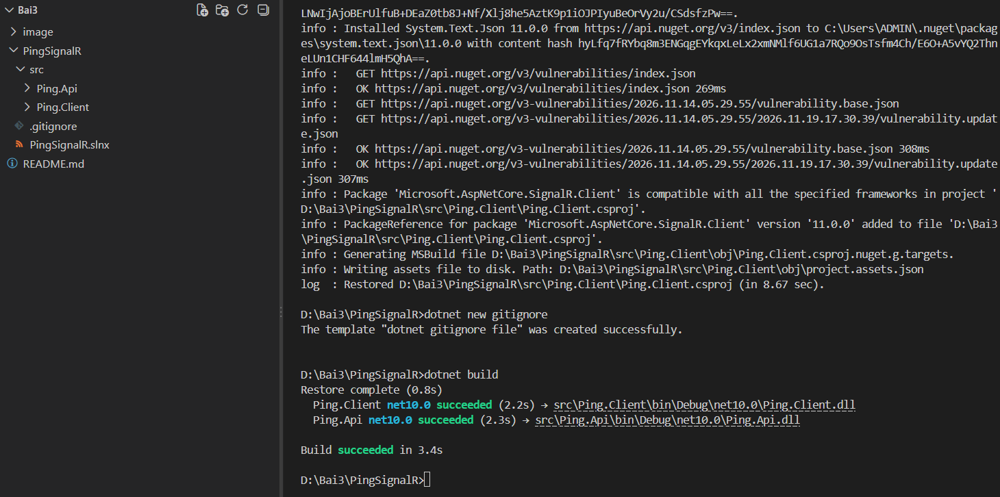

### Bước 2 – Hub SignalR, kiểm tra negotiate bằng curl

- `GET /` trả về `{"service":"PingApi","status":"running"}`.
- `POST /hubs/ping/negotiate?negotiateVersion=1` trả về `connectionId` (`5QLmtUd3e2Nqz61SbZqZ3g`) và đủ 3 transport: WebSockets, ServerSentEvents, LongPolling.
- `GET /hubs/ping` trả `400 Bad Request – Connection ID required`: hub không trả lời như REST, phải bắt tay trước.

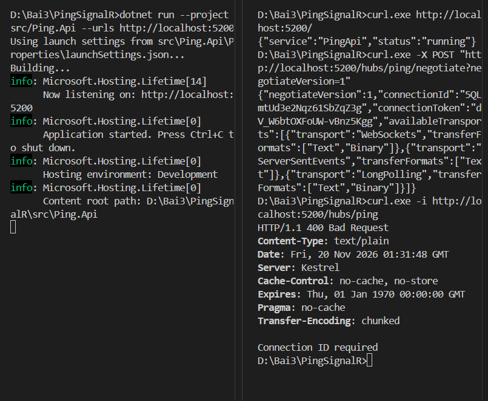

### Bước 3–4 – Phương thức Echo, máy khách gọi InvokeAsync

Máy khách An in `[Echo] Echo: Xin chao SignalR tu An`. `Clients.Caller` chỉ gửi lại cho người vừa gọi.

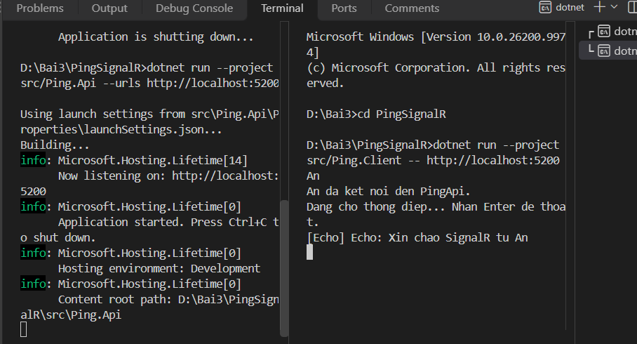

### Bước 5 – Phát rộng và nhóm

Chạy máy chủ, rồi An, rồi Bình:

- Cửa sổ An nhận tin của Bình: `[Group] 0wkc_EKQ da tham gia nhom lop-hoc-01`, `[Group] Thong bao nhom tu Binh`, `[Broadcast] Xin chao tat ca tu Binh`.
- Cửa sổ An **không** có `[Echo]` của Bình, vì Echo dùng `Clients.Caller`.
- Bình không thấy tin An gửi trước khi Bình vào.

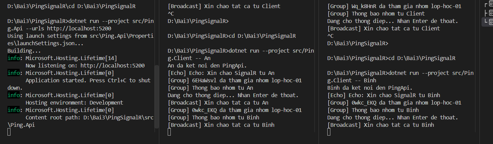

### Bước 6 – Vòng đời kết nối

- Máy chủ in `[Hub] + <id> ket noi` mỗi khi có máy khách mở kết nối (`OnConnectedAsync`).
- Thí nghiệm: tắt máy chủ khi An đang chạy, rồi chạy lại. An in `[Lifecycle] Dang ket noi lai...` rồi `[Lifecycle] Da ket noi lai: 0-Gdoqo7`. ConnectionId khác ban đầu (`AVzh1b-B`), nên máy chủ coi đây là kết nối mới, nhóm cũ bị mất.

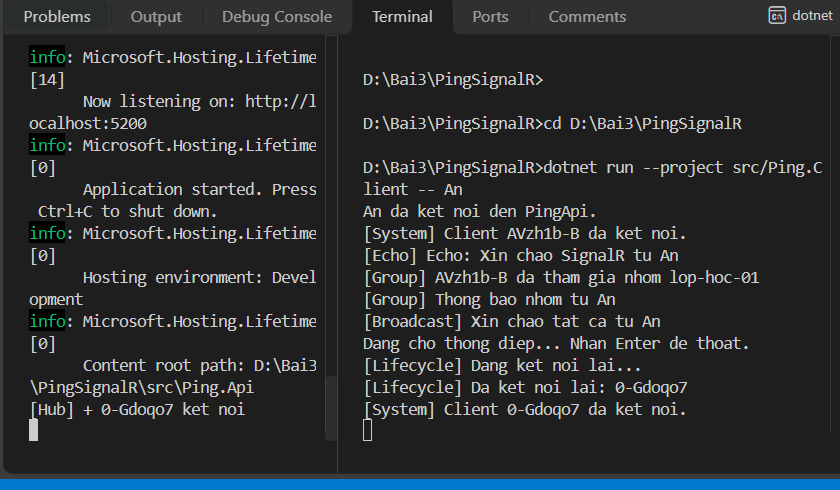

### Bước 7 – Ba thí nghiệm lỗi

| # | Làm gì | Thấy gì | Vì sao |
|---|--------|---------|--------|
| 1 | Chạy máy khách khi máy chủ đã tắt | `HttpRequestException: No connection could be made because the target machine actively refused it. (localhost:5200)` | `StartAsync` ném lỗi ngay. `WithAutomaticReconnect` chỉ cứu kết nối ĐÃ mở |
| 2 | Sửa `WithUrl` thành `/hub/ping` (thiếu s) hoặc gọi negotiate sai route | `HttpRequestException: Response status code does not indicate success: 404 (Not Found)` / `HTTP/1.1 404 Not Found` tại `NegotiateAsync` | Lỗi ở bước negotiate. Đường dẫn phải khớp `MapHub` |
| 3 | Sửa `On("EchoResponse")` thành `On("EchoRespone")` | Không có lỗi nào, chỉ mất dòng `[Echo]`, các dòng khác (`[Group]`, `[Broadcast]`) vẫn hiện bình thường | Sai tên chiều xuống thì im lặng. Việc đầu tiên khi "không nhận được gì" là so tên hai phía |

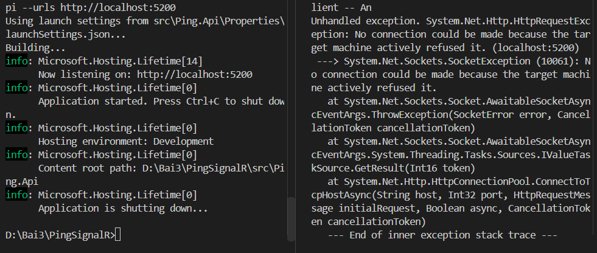
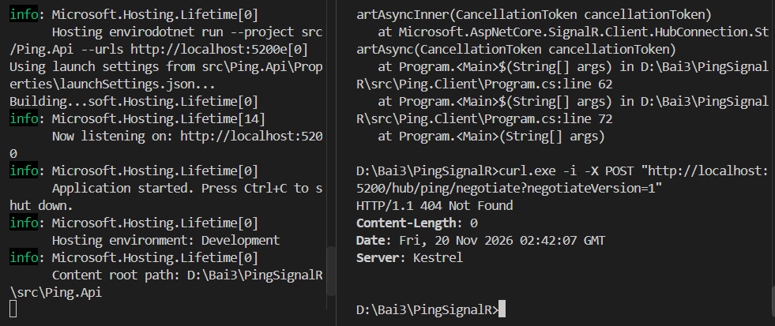
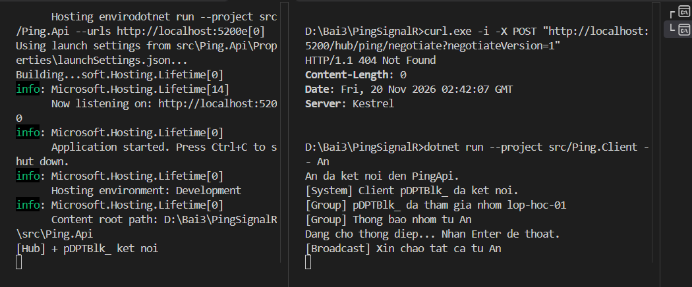

### Bốn phạm vi gửi

| Phạm vi | Ai nhận | Ví dụ trong EduSubmit |
|---------|---------|-----------------------|
| `Clients.All` | Mọi kết nối đang mở, kể cả người gửi | Máy chủ sắp bảo trì; có bài tập mới |
| `Clients.Caller` | Chỉ người vừa gọi hub | Xác nhận "đã đăng ký theo dõi lượt nộp" |
| `Clients.Group(tên)` | Các kết nối đã vào nhóm | Trạng thái lượt nộp gửi nhóm `submission:{id}` |
| `Clients.Client(id)` | Một ConnectionId cụ thể | Hiếm dùng: gửi riêng một phiên làm việc |

---

## Phần 3 – RealtimeSubmissionSystem (EduSubmit thời gian thực)

### Cách chạy

```bash
cd RealtimeSubmissionSystem
dotnet run --project src/Submission.RealtimeApi --urls http://localhost:5000                # Terminal 1
dotnet run --project src/Submission.RealtimeClient -- http://localhost:5000 SV001          # Terminal 2
```

### Bốn câu hỏi thiết kế

| Câu | Trả lời |
|-----|---------|
| ① Sự kiện nào kích hoạt thông điệp? | Mỗi lần trạng thái lượt nộp đổi: received → processing → graded (`UpdateStatusAsync`) |
| ② Gửi cho ai? | `Clients.Group("submission:{id}")` – chỉ máy khách đang theo dõi đúng lượt nộp đó |
| ③ Gửi kèm dữ liệu gì? | `SubmissionStatusMessage(SubmissionId, Status, UpdatedAt)` – mã lượt nộp, trạng thái mới, thời điểm đổi |
| ④ Mất kết nối thì lấy lại trạng thái thế nào? | Gọi lại REST `GET /api/submissions/{id}` – REST là nguồn sự thật |

Dòng "mới" so với PingSignalR: **ai kích hoạt gửi** – tác vụ chấm nền gửi qua `IHubContext<SubmissionHub>`, từ BÊN NGOÀI hub. Cần nó vì đối tượng hub chỉ sống trong một lời gọi, không truyền được vào tác vụ nền.

### Bước 1 – Tạo solution

build

### Bước 2 – REST của Bài 2 + UpdatedAt + lock

`POST /api/assignments/1/submissions` trả `201 Created` + `Location`, body có `"status":"received"` và `"updatedAt"`.

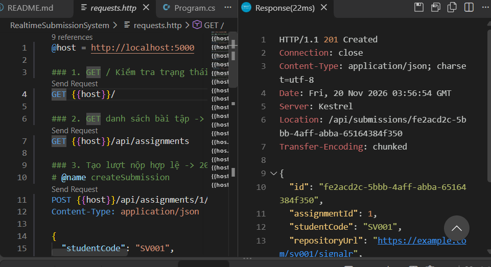

### Bước 3 – SubmissionHub và nhóm `submission:{id}`

`/hubs/submissions/negotiate` trả `connectionId`; `/hub/submissions/negotiate` trả `404 Not Found`.


### Bước 4 – IHubContext và chấm bài ở nền

Ba lần GET cho đúng thứ tự `received` (ngay lập tức) → `processing` (~1,5 giây) → `graded` (~4 giây), `updatedAt` tăng dần. Máy chủ in `[Push] submission:... -> processing` rồi `-> graded`.


### Bước 5–6 – Máy khách: REST + SignalR

Kết quả máy khách (8 dòng, 2 dòng "Thong bao SignalR" cách nhau khoảng 2 giây):

```text
Da ket noi SignalR.
Chon bai tap: 1 - Bai tap SignalR
Da tao luot nop: a27d82ee-8369-45ee-9ad5-cad7b6ec73eb
Trang thai REST ban dau: received
Dang cho thong bao trang thai tu may chu...
Thong bao SignalR: a27d82ee-8369-45ee-9ad5-cad7b6ec73eb -> processing luc 10:51:51
Thong bao SignalR: a27d82ee-8369-45ee-9ad5-cad7b6ec73eb -> graded luc 10:51:53
Trang thai doc lai bang REST: graded
```

Máy chủ:

```text
[Hub] j-HYi2N1 theo doi submission:a27d82ee-8369-45ee-9ad5-cad7b6ec73eb
[Push] submission:a27d82ee-8369-45ee-9ad5-cad7b6ec73eb -> processing
[Push] submission:a27d82ee-8369-45ee-9ad5-cad7b6ec73eb -> graded
```

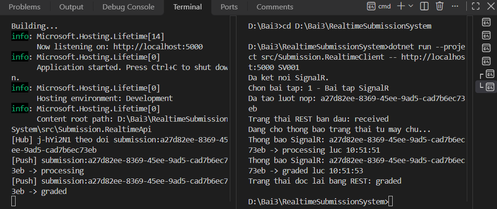

Trật tự đúng: **nghe (On) → nối (StartAsync) → tạo (POST) → theo dõi (WatchSubmission) → đọc lại (GET)**.

### Bước 7 – Năm thí nghiệm phân tán

| # | Thí nghiệm | Dự đoán | Kết quả thật | Giải thích |
|---|-----------|---------|--------------|------------|
| 1 | Chạy 2 máy khách SV001 và SV002 cùng lúc | Mỗi máy khách chỉ nhận thông báo của lượt nộp mình tạo | Đúng: mỗi máy khách chỉ in `processing`/`graded` cho id của chính nó | Nhóm `submission:{id}` tách người nhận; máy chủ quản lý nhóm, máy khách không thấy dữ liệu người khác |
| 2 | Chạy máy khách khi máy chủ chưa chạy | Lỗi không kết nối được | `HttpRequestException: ... actively refused it. (localhost:5000)` | Lần nối đầu không được tự thử lại; `WithAutomaticReconnect` chỉ áp dụng khi đã nối được |
| 3 | Sửa `WithUrl` thành `/hub/submissions` | Lỗi 404 | `HttpRequestException: Response status code does not indicate success: 404 (Not Found)` | Lỗi xảy ra ở negotiate; đường dẫn phải khớp `MapHub` |
| 4 | Sửa `On("SubmissionStatusChanged")` thành `On("SubmissionStatusChange")` | Không lỗi nhưng không nhận thông báo | Không lỗi; sau 10 giây: `Qua thoi gian cho thong bao graded.`, REST đọc lại: `graded` | Sai tên chiều xuống thì im lặng; nhờ REST vẫn biết trạng thái cuối |
| 5 | Chờ 4 giây rồi mới gọi `WatchSubmission` | Lỡ tin vì đã chấm xong trước khi vào nhóm | Không nhận tin nào; `Qua thoi gian cho thong bao graded.`, REST: `graded`. Máy chủ in `[Push] ... graded` **trước** `[Hub] ... theo doi` | Vào nhóm muộn là lỡ tin; SignalR không lưu tin; REST là nguồn sự thật |

Các thí nghiệm 3–5 sửa tạm `Submission.RealtimeClient/Program.cs`, chạy xong trả code về như cũ.
### Bước 8 – requests.http (Đủ các ca 200, 201, 400, 404)

| Ca | Request | Mong đợi | Thực tế |
|----|---------|----------|---------|
| 1 | `GET /` | 200 | 200 |
| 2 | `GET /api/assignments` | 200 | 200 |
| 3 | `POST /api/assignments/1/submissions` | 201 + Location | 201 (received) |
| 4 | `GET /api/submissions/{id}` | 200 | 200 (bấm nhiều lần thấy received → processing → graded) |
| 5 | `POST` thiếu studentCode, repositoryUrl | 400 | 400 |
| 6 | `POST /api/assignments/99/submissions` | 404 | 404 |
| 7 | `GET /api/submissions/0000...` | 404 | 404 |
| 8 | `POST /hubs/submissions/negotiate` | 200 | 200 |
| 9 | `POST /hub/submissions/negotiate` | 404 | 404 |

Ngoài `requests.http` (dùng với REST Client), script `kiem-thu-9-ca.ps1` chạy cả 9 ca bằng curl.

#### Minh chứng các mã phản hồi từ `requests.http`:

- **Ca 200 OK (GET danh sách bài tập):**  
  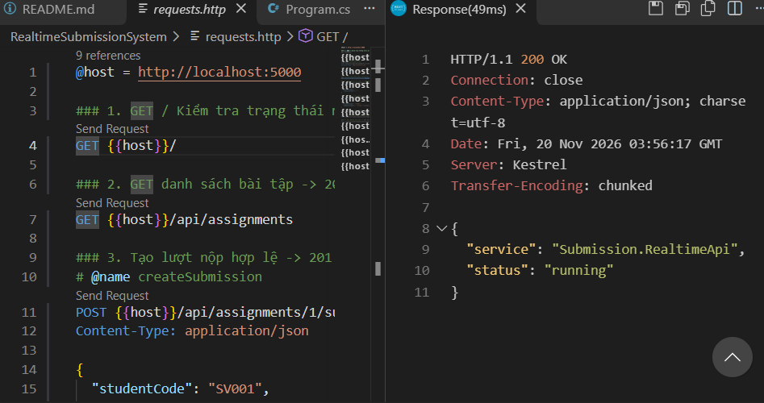

- **Ca 201 Created (POST tạo lượt nộp thành công):**  
  

- **Ca 400 Bad Request (POST thiếu dữ liệu):**  
  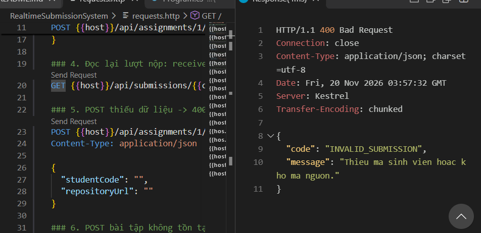

- **Ca 404 Not Found (POST bài tập không tồn tại):**  
  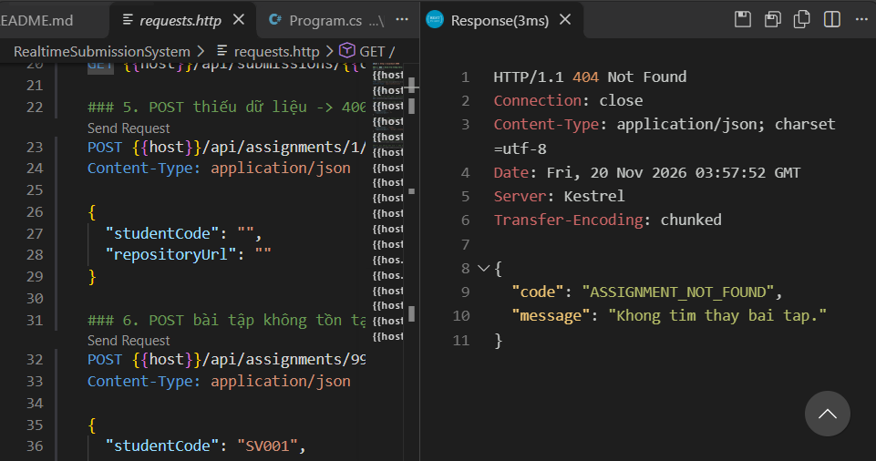

---

## Trả lời 3 câu hỏi đầu giờ

1. **Máy chủ có thể chủ động báo không?** Có, nếu máy khách mở sẵn một kết nối lâu dài (WebSocket qua SignalR). Máy chủ gửi bằng `Clients.Group(...).SendAsync`; khi ở ngoài hub (tác vụ chấm nền) thì dùng `IHubContext<SubmissionHub>`.
2. **REST và SignalR chia việc thế nào?** REST tạo và đọc tài nguyên với mã trạng thái rõ ràng (201, 400, 404). SignalR chỉ đẩy các thay đổi phát sinh sau yêu cầu ban đầu (processing, graded). SignalR không thay thế REST.
3. **Đứt mạng đúng lúc báo graded thì sao?** Tin đó mất, SignalR không lưu lại. `WithAutomaticReconnect` nối lại với ConnectionId mới (đã thấy ở Bước 6 Phần 2), nhóm cũ mất; máy khách phải `WatchSubmission` lại và gọi `GET /api/submissions/{id}` để lấy trạng thái cuối. Thí nghiệm 4 và 5 cho thấy REST vẫn đọc đúng `graded` dù không nhận được tin đẩy.

**Push để nhanh, REST để chắc.**
