# Bài 1 – Tổng quan hệ thống và MEP
Họ tên: Nguyễn Việt Đô

MSSV: DTC245200604

Lớp: CNTT K23D

Ảnh minh chứng bên dưới được giữ từ lần thực hành ngày 06/11/2026. Sau khi sắp xếp lại bài vào `Nguyễn Việt Đô - dtc245200604/Bai1/`, đã build và kiểm thử lại ngày 11/11/2026; xem [kết quả kiểm tra lại](kiem-tra-nop-lai.md). Không dùng ảnh cũ để thay cho kết quả chạy mới.

## 1. Cài đặt

- `dotnet --version`: **10.0.403**.
- `git --version`: **git version 2.53.0.windows.3**.
- VS Code có C# Dev Kit, C#, .NET Install Tool và REST Client.
- Chạy `dotnet run` tại `samples/HelloPtudpt`: in **Hello, World!**.
- Thư mục làm việc khi chụp ảnh ban đầu: `C:\Code_demo\EduSubmit-DTC245200604`. Khi lấy bài từ repository lớp, mở `Nguyễn Việt Đô - dtc245200604/Bai1/` trong VS Code.

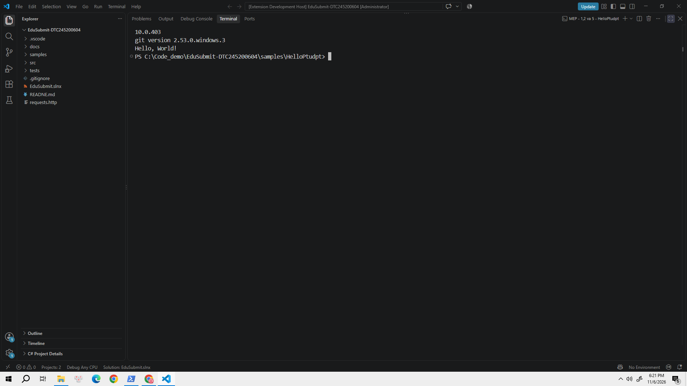

## 2. MepDemo (Bước 7)
Đã chạy `dotnet run` để quan sát đủ năm MEP và chạy riêng `dotnet run -- 1`, `dotnet run -- 3`, `dotnet run -- 4` để đối chiếu.

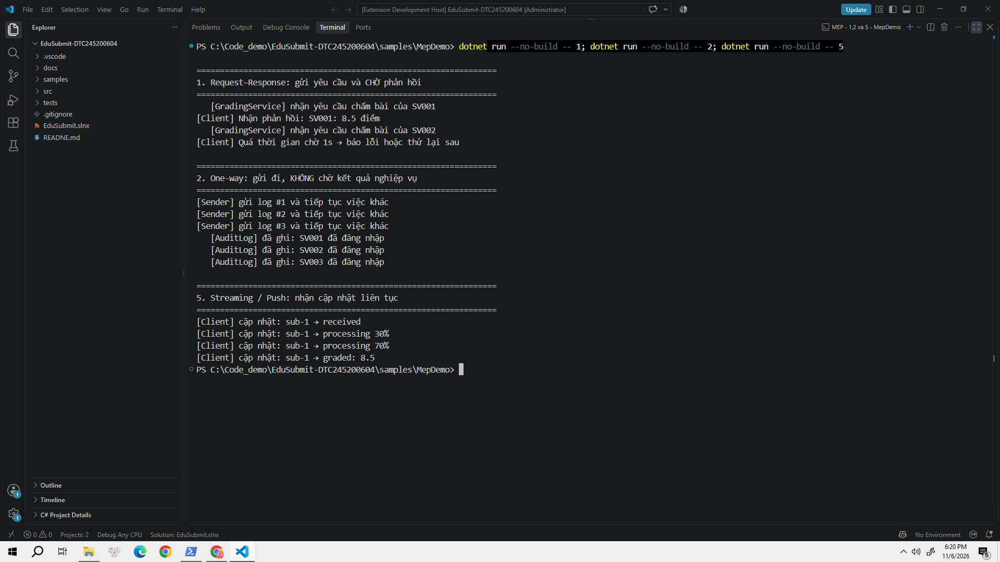

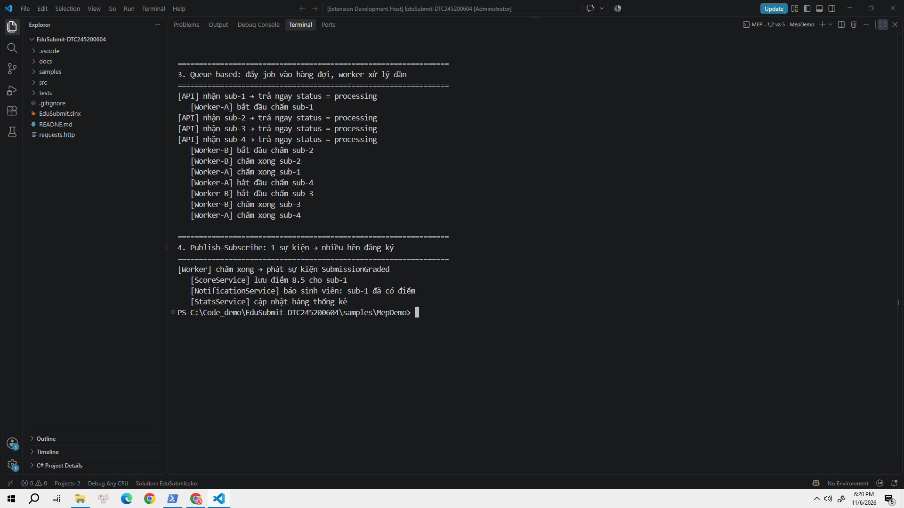

Câu 1: Ở MEP 3, mỗi bài nộp sub-x được mấy worker xử lý?

Mỗi bài nộp sub-x chỉ được một worker xử lý. Các worker chia nhau lấy công việc từ hàng đợi, giúp phân phối nhiệm vụ và tránh xử lý trùng lặp trong ví dụ.

Câu 2: Ở MEP 4, một sự kiện được gửi tới mấy dịch vụ?

Một sự kiện được gửi tới cả 3 dịch vụ đã đăng ký nhận thông báo theo mô hình Publish–Subscribe.

Trong lần chạy này, `SubmissionGraded` đến `ScoreService`, `NotificationService` và `StatsService`; các bài `sub-1` đến `sub-4` ở MEP 3 được hai worker chia nhau chấm, mỗi bài chỉ do một worker nhận.

Câu 3: Mô tả 5 mô hình MEP.
- MEP 1 – Request–Response: Client gửi yêu cầu đến Server và chờ Server xử lý, trả về kết quả.
- MEP 2 – One-way: Bên gửi truyền thông điệp đến bên nhận mà không cần chờ phản hồi xử lý.
- MEP 3 – Queue-based: Các thông điệp được đưa vào hàng đợi để nhiều worker chia nhau xử lý.
- MEP 4 – Publish–Subscribe: Một sự kiện được phát đến tất cả dịch vụ đã đăng ký nhận sự kiện đó.
- MEP 5 – Streaming: Dữ liệu được truyền liên tục theo từng phần thay vì phải gửi toàn bộ trong một lần.
 
## 3. BasicWebApi (Bước 8)

Build thành công, không có cảnh báo/lỗi. Chạy API bằng:

```powershell
cd samples/BasicWebApi
dotnet build
dotnet run --project src/BasicWebApi --urls http://localhost:5081
```

Đã gửi đủ năm request có sẵn bằng REST Client và thêm request tiếng Nhật:

| Request | Kết quả thực tế |
|---|---|
| `GET /` | **200 OK**, JSON có `application: "BasicWebApi"` |
| `GET /hello/An?language=vi` | **200 OK**, `Xin chào, An!` |
| `GET /hello/An?language=en` | **200 OK**, `Hello, An!` |
| `POST /greetings`, tên `Binh` | **201 Created**, `Location: /greetings/1`, body có `id`, `name`, `createdAt` |
| `POST /greetings`, tên rỗng | **400 Bad Request**, `{"message":"Name must not be empty."}` |
| `GET /hello/An?language=ja` | **200 OK**, `Konnichiwa, An!` |

Ảnh dưới mở cạnh nhau ba phản hồi nguyên văn đã lưu từ REST Client.

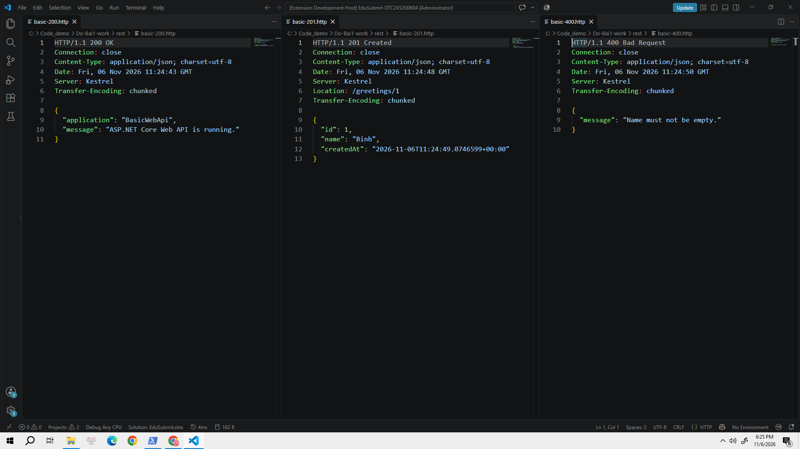

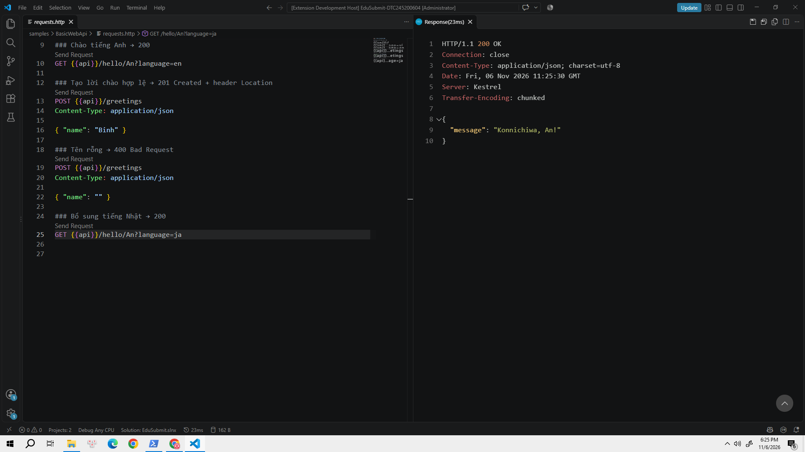

Đã bổ sung nhánh `ja` vào route `/hello/{name}`. Khi debug POST, đặt breakpoint tại `var greeting = service.Create(request.Name.Trim());`, quan sát `request.Name = "Binh"`; chạy từng dòng qua lệnh tạo lời chào thấy `greeting.Id = 1`, sau đó tiếp tục để hoàn tất request.

Câu 1: Hai dòng builder.Services.AddSingleton(...) và var app = builder.Build(); – dòng nào phải đứng trước? Vì sao?

Dòng builder.Services.AddSingleton(...) phải đứng trước var app = builder.Build(); vì cần đăng ký dịch vụ vào Dependency Injection trước khi xây dựng ứng dụng. Sau khi Build, danh sách đăng ký dịch vụ đã được hoàn tất.

Câu 2: Trong /hello/{name}?language=en, tham số name lấy từ đâu, language lấy từ đâu?

Tham số name lấy từ Route Parameter trong đường dẫn URL, còn language lấy từ Query String sau dấu ?. Ví dụ /hello/An?language=en thì name = "An" và language = "en".

Câu 3: Vì sao POST hợp lệ trả Results.Created (201) chứ không phải Results.Ok (200)?

Vì POST hợp lệ tạo ra một tài nguyên mới trên Server nên trả về 201 Created để xác nhận tài nguyên đã được tạo thành công. Trong khi đó, 200 OK chỉ thông báo yêu cầu đã xử lý thành công nói chung.
 
## 4. MiniDistributedSystem (Bước 9)

Build thành công và chạy hai tiến trình riêng tại thư mục `samples/MiniDistributedSystem`:

```powershell
# Terminal 1: API
dotnet run --project src/Submission.Api --urls http://localhost:5000

# Terminal 2: Client
dotnet run --project src/Submission.Client -- http://localhost:5000
```

Client in hai bài tập, mã lượt nộp `0e3ecf9e-0d98-4244-988e-b330b4e3152b` và trạng thái `received`. Terminal API ghi GET trả 200, POST trả 201. Đã gửi thêm bốn request trong `requests.http`: kiểm tra dịch vụ 200, danh sách 200, nộp hợp lệ 201 và mã sinh viên rỗng 400.

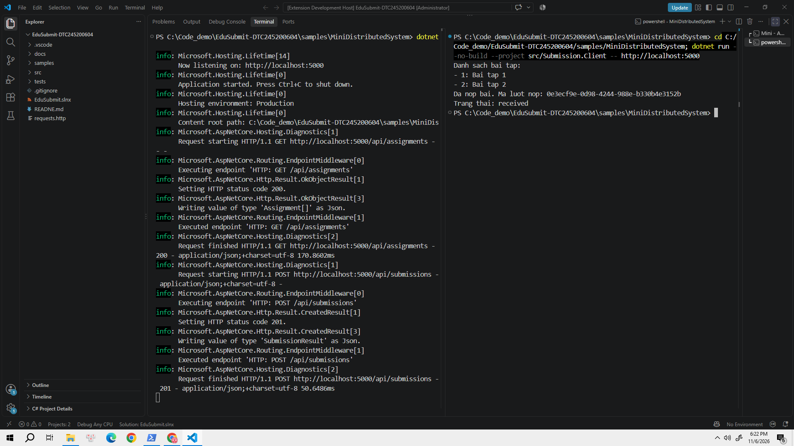

Câu 1: Client gọi những endpoint nào của API? Mỗi lần gọi là một cặp request–response gồm method, URL, mã trạng thái gì?

Client gọi 2 endpoint chính:
- GET http://localhost:5000/api/assignments → 200 OK: Lấy danh sách bài tập từ Server.
- POST http://localhost:5000/api/submissions → 201 Created: Gửi bài nộp lên Server và nhận mã GUID cùng trạng thái received.
Đã xác nhận POST trả 201 Created bằng mã nguồn và phản hồi HTTP thực tế ở Bước 10d.

Câu 2: Client có tham chiếu (dùng chung) code của API không? Hai bên "thống nhất" với nhau bằng gì?

Client không cần tham chiếu trực tiếp mã nguồn của API. Hai chương trình hoạt động độc lập và giao tiếp qua giao thức HTTP. Hai bên thống nhất thông qua API Contract, bao gồm endpoint, phương thức GET/POST, định dạng dữ liệu JSON và mã trạng thái HTTP.

Câu 3: Vì sao địa chỉ API được truyền qua tham số -- http://localhost:5000 mà không viết cứng trong code?

Để Client có thể thay đổi địa chỉ Server hoặc cổng kết nối mà không cần sửa mã nguồn và biên dịch lại, giúp chương trình linh hoạt, dễ kiểm thử và triển khai trên nhiều môi trường.
 
## 5. Thí nghiệm lỗi (Bước 10)

Đã ghi dự đoán trước khi chạy lại từng thí nghiệm; sau mỗi lần kiểm tra đều trả mã nguồn về trạng thái ban đầu.

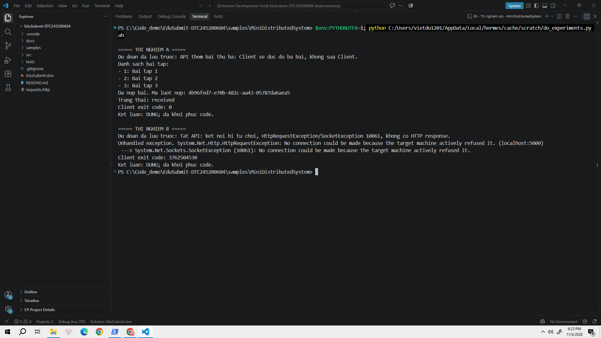

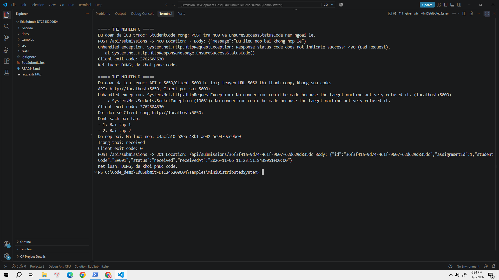

| # | Dự đoán trước khi chạy | Thực tế | Đúng/Sai | Giải thích |
|---|---|---|---|---|
| a | Thêm bài tập thứ 3 ở API thì client tự in đủ 3 bài, không cần sửa client. | GET trả **200 OK**, JSON có 3 bài; client in thêm `- 3: Bai tap 3` và nộp bài thành công. | Đúng | Client đọc `List<Assignment>` rồi `foreach` qua các phần tử. Thêm phần tử không làm thay đổi cấu trúc JSON/hợp đồng API. |
| b | Tắt API, client gọi cổng 5000 sẽ lỗi kết nối. | `System.Net.Http.HttpRequestException`; nguyên nhân bên trong là `System.Net.Sockets.SocketException (10061)` — máy đích từ chối kết nối. Client chưa lấy được danh sách; không nhận mã HTTP. | Đúng | Không còn dịch vụ lắng nghe cổng 5000. Gọi qua mạng phụ thuộc tiến trình máy chủ, địa chỉ/cổng và kết nối mạng. |
| c | Gửi `StudentCode: ""` sẽ bị API từ chối, trả 400; client phát sinh ngoại lệ. | GET vẫn thành công. POST trả **400 Bad Request**, body `{"message":"Du lieu nop bai khong hop le"}`. Client dừng tại `EnsureSuccessStatusCode()`. | Đúng | API dùng `string.IsNullOrWhiteSpace`. `EnsureSuccessStatusCode()` ném `HttpRequestException` nếu status nằm ngoài 200–299. |
| d | API chạy cổng 5050 nhưng client gọi 5000 sẽ lỗi; truyền đúng URL thì chạy được. | Gọi 5000: lỗi kết nối. Truyền `http://localhost:5050`: client in 2 bài tập, GUID và `received`; GET **200**, POST **201 Created** có `Location`. | Đúng | Địa chỉ API lấy từ `args[0]`; đổi đối số khi chạy client, không sửa code và không biên dịch lại client. |

### a. Thêm bài tập ở API

Tạm thêm `new Assignment(3, "Bai tap 3", "Thi nghiem loi he thong phan tan")` vào mảng `assignments`, khởi động lại API rồi chạy lại client. **Không cần sửa client**, vì client xử lý danh sách có số phần tử thay đổi. Sau khi kiểm tra, xóa phần tử vừa thêm và trả API về 2 bài tập.

### b. Tắt API

Khi API đã dừng, client gọi `http://localhost:5000` phát sinh lỗi kết nối bị từ chối. Đây là lỗi ở tầng kết nối nên **không có mã trạng thái HTTP**, không phải HTTP 400 hay 500. Trong phép thử này, tiến trình API được dừng từ công cụ dòng lệnh, tương đương với việc không còn API lắng nghe sau Ctrl+C.

Gọi một hàm trong cùng chương trình không cần thiết lập kết nối HTTP/TCP và không có lỗi do sai cổng hoặc mất mạng. Tuy nhiên, hàm cục bộ **vẫn có thể lỗi** do dữ liệu không hợp lệ, ngoại lệ hoặc lỗi lập trình; không nên hiểu là gọi hàm nội bộ luôn thành công.

### c. StudentCode rỗng

Đổi tạm `StudentCode: "SV001"` thành `StudentCode: ""`, chạy client khi API hoạt động bình thường. API trả **400 Bad Request**. `EnsureSuccessStatusCode()` kiểm tra status, ném ngoại lệ nếu không thuộc 200–299, vì vậy client không tiếp tục đọc body lỗi như một `SubmissionResult` thành công.

Máy chủ phải tự kiểm tra đầu vào vì mọi client có thể gửi request trực tiếp, bỏ qua giao diện hoặc bước kiểm tra phía máy khách. Kiểm tra ở client chỉ giúp người dùng thao tác thuận tiện; API vẫn chịu trách nhiệm giữ dữ liệu hợp lệ. Sau phép thử, trả `StudentCode` về `"SV001"`.

### d. Sai cổng và sửa bằng đối số

API chạy cổng 5050, client gọi cổng 5000 nên không kết nối được. Sửa bằng **tham số dòng lệnh**, không sửa `Program.cs`:

```powershell
# Terminal 1 — API
dotnet run --project src/Submission.Api --urls http://localhost:5050

# Terminal 2 — client: URL là tham số của chương trình sau dấu --
dotnet run --project src/Submission.Client -- http://localhost:5050
```

`--urls` cấu hình địa chỉ máy chủ ASP.NET Core; URL sau `--` ở lệnh client được đọc bằng `args[0]`. Kết thúc thí nghiệm, dừng API ở cổng 5050. Code và cấu hình mặc định vẫn giữ nguyên; khi thực hành tiếp, chạy lại cả API và client ở cổng 5000.

## 6. Dự án EduSubmit tự làm (Bước 11-12)

Solution `EduSubmit.slnx` gồm `src/Submission.Api` và `src/Submission.Client`. Hai project khai báo record riêng, không có `ProjectReference` và trao đổi JSON qua HTTP.

- **Kết quả chạy API:** `dotnet build EduSubmit.slnx` thành công, 0 cảnh báo và 0 lỗi; API lắng nghe `http://localhost:5000`. `GET /` trả `{"service":"Submission.Api","status":"running"}`.
- **Kết quả chạy Client:** Đọc được hai bài tập **Web API cơ bản** và **HTTP Client**; POST với MSSV `DTC245200604`, repository `https://github.com/vietdotest/EduSubmit-DTC245200604` nhận 201, mã GUID và trạng thái `received`. Client gọi lại URL trong `Location`, nhận 200 và đối chiếu dữ liệu khớp.
- **Kết quả kiểm thử `requests.http`:** Đã gửi đủ sáu request bằng REST Client; kết quả ở bảng dưới.
- **Phần tham khảo:** Khung API, các trường record và các phương thức `GetFromJsonAsync`, `PostAsJsonAsync`, `EnsureSuccessStatusCode`, `ReadFromJsonAsync` trong hướng dẫn Bài 1; đối chiếu hợp đồng HTTP/JSON với MiniDistributedSystem.
- **Kết quả bài mở rộng:** API lưu lượt nộp trong `List<SubmissionResult>`, khóa đồng bộ khi đọc/ghi; `GET /api/submissions/{id:guid}` trả 200 khi tìm thấy và 404 nếu không có. Client đọc lại lượt nộp vừa tạo. Dữ liệu trong bộ nhớ mất khi dừng API.
- **Kiểm thử tự động:** 14 ca thử tích hợp đạt, gồm địa chỉ mặc định/tùy chỉnh, dữ liệu không hợp lệ, lỗi kết nối, đọc lại và 36 lượt nộp/đọc đồng thời.
- **Đối chiếu phần chạy của bộ kiểm tra lớp:** Build, GET, POST và Client đạt `chay = 4.0`; đọc lại 200/404 và Client đọc lại đạt `mr = 1.0`. Đây là kết quả kiểm tra cục bộ các tiêu chí chạy, không phải điểm tổng hoặc xác nhận giảng viên đã chấm.

```powershell
# Từ thư mục gốc repository, vào đúng thư mục bài
cd "Nguyễn Việt Đô - dtc245200604/Bai1"
 dotnet build
 dotnet build EduSubmit.slnx

# Terminal 1
 dotnet run --project src/Submission.Api --urls http://localhost:5000

# Terminal 2
 dotnet run --project src/Submission.Client -- http://localhost:5000
```

| Request | Kết quả thực tế |
|---|---|
| `GET /` | **200 OK**, thông tin dịch vụ đang chạy |
| `GET /api/assignments` | **200 OK**, hai bài tập có `id`, `title`, `description` |
| `POST /api/submissions` hợp lệ | **201 Created**, có `Location`, GUID, MSSV, repository, `received`, `receivedAt` |
| `POST /api/submissions`, mã sinh viên rỗng | **400 Bad Request**, `{"error":"Mã sinh viên không được để trống."}` |
| `GET /api/submissions/{id}` vừa tạo | **200 OK**, dữ liệu trùng phản hồi tạo lượt nộp |
| `GET /api/submissions/00000000-0000-0000-0000-000000000000` | **404 Not Found** |

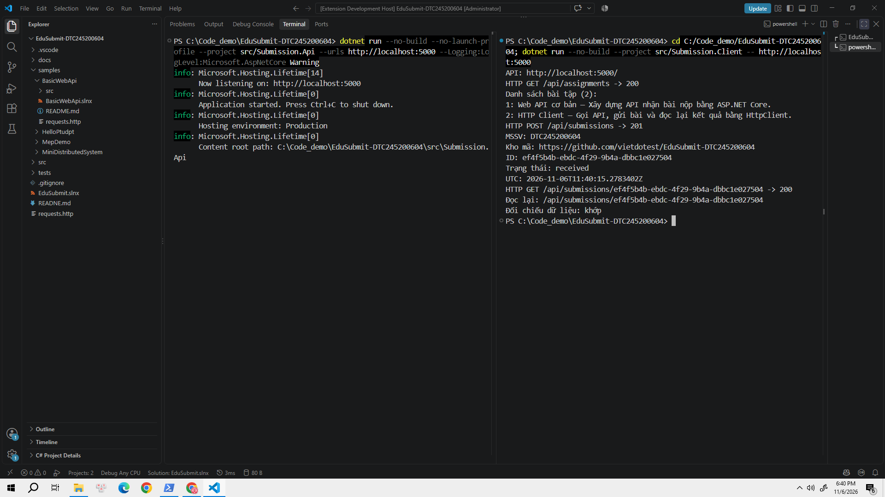

Ảnh dưới là hai phản hồi nguyên văn đã lưu từ REST Client. ID có thật đã được tạo bằng POST trong cùng phiên chạy API.

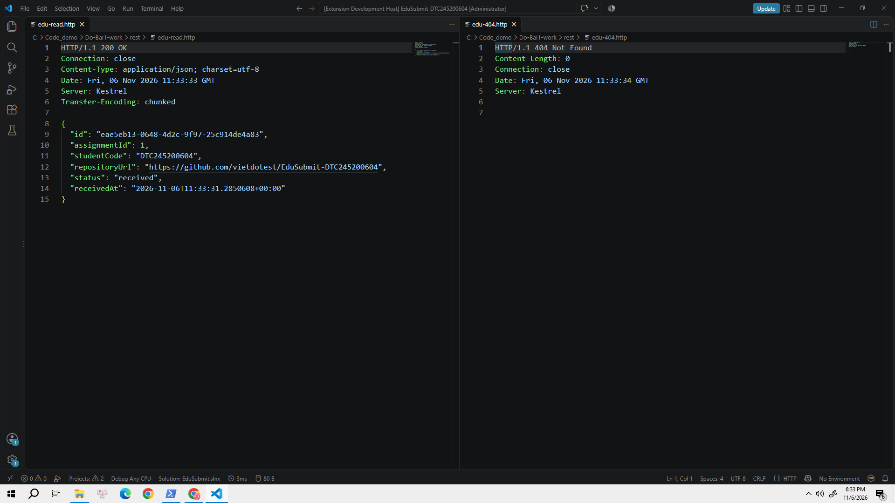

Luồng thông điệp:

Client --(HTTP GET /api/assignments)--> API: Request–Response, Client gửi yêu cầu lấy danh sách bài tập và API trả về dữ liệu.

Client --(HTTP POST /api/submissions)--> API: Request–Response, Client gửi thông tin bài nộp và API xử lý, trả về kết quả xác nhận cùng mã lượt nộp.

Client --(HTTP GET /api/submissions/{id})--> API: Request–Response, Client đọc lại lượt nộp vừa tạo; API trả 200 kèm JSON nếu tìm thấy, hoặc 404 nếu ID không tồn tại.

Nhận xét: Các luồng đều sử dụng mô hình Request–Response. Client và API giao tiếp qua HTTP, trao đổi dữ liệu dạng JSON và hoạt động như hai tiến trình độc lập.
## 7. Khó khăn gặp phải và cách giải quyết

| Khó khăn | Nguyên nhân | Cách giải quyết |
|---|---|---|
| Gọi `language=ja` ban đầu vẫn nhận lời chào tiếng Việt. | Mẫu ban đầu chỉ có nhánh `en`, các giá trị còn lại dùng tiếng Việt mặc định. | Bổ sung nhánh `ja`, build/chạy lại và kiểm tra REST Client nhận `Konnichiwa, An!`. |
| Client báo lỗi kết nối khi API đã tắt hoặc đổi cổng. | Không có dịch vụ lắng nghe địa chỉ Client đang gọi. | Kiểm tra `Now listening on`, chạy API trước và truyền đúng URL sau dấu `--`. |
| POST với mã sinh viên rỗng làm Client dừng. | API trả 400; `EnsureSuccessStatusCode()` phát sinh ngoại lệ vì phản hồi không thuộc 2xx. | Giữ kiểm tra tại API, gửi lại mã sinh viên hợp lệ; phân biệt lỗi HTTP với lỗi kết nối. |
| Cần kiểm tra giá trị biến tại bước tạo lời chào. | Chỉ nhìn response chưa biết dữ liệu ở từng bước xử lý. | Đặt breakpoint, đọc `request.Name = "Binh"`, chạy từng dòng để kiểm tra `greeting.Id = 1`. |
| Thí nghiệm có thể để lại code tạm. | Thêm bài thứ ba hoặc sửa `StudentCode` làm thay đổi trạng thái chương trình. | Khôi phục sau mỗi thí nghiệm, đối chiếu mẫu ban đầu và build/kiểm thử lại trước khi kết thúc. |
| PR chưa được nhận dù đã có mã nguồn và nhật ký. | Các file nằm ngay dưới thư mục tên sinh viên, chưa ở trong `Bai1/` theo đường dẫn nộp bài. | Chuyển toàn bộ bài vào `Bai1/`, sửa tên `READNE.md` thành `README.md`, cập nhật hướng dẫn và chạy lại build/kiểm thử. |

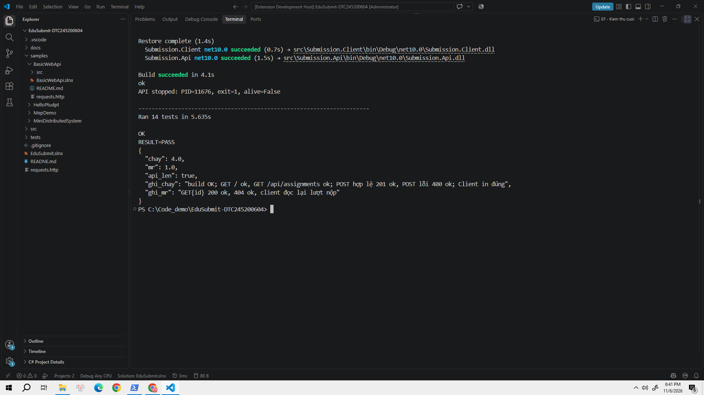
