# Bài 3 – Giao tiếp thời gian thực với SignalR

- **Họ tên:** Nguyễn Việt Đô
- **MSSV:** DTC245200604
- **Lớp:** CNTT K23D

## Cấu trúc bài

```text
Bai3/
├── README.md
├── anh/
├── PingSignalR/
│   ├── PingSignalR.slnx
│   └── src/{Ping.Api,Ping.Client}/
└── RealtimeSubmissionSystem/
    ├── RealtimeSubmissionSystem.slnx
    ├── requests.http
    └── src/{Submission.RealtimeApi,Submission.RealtimeClient}/
```

## Chạy bài

Yêu cầu .NET SDK 10. Chạy các lệnh từ thư mục `Bai3`. Với mỗi solution, giữ API ở terminal riêng rồi mới chạy client. Các ảnh terminal dưới đây ghi lại kết quả chạy qua script kiểm thử; có thể chạy lại theo các lệnh sau.

```powershell
dotnet build PingSignalR/PingSignalR.slnx
dotnet build RealtimeSubmissionSystem/RealtimeSubmissionSystem.slnx

# PingSignalR, terminal API
dotnet run --project PingSignalR/src/Ping.Api -- --urls http://localhost:5200
# PingSignalR, terminal client (Enter để thoát)
dotnet run --project PingSignalR/src/Ping.Client -- http://localhost:5200 "Nguyễn Việt Đô"
# Chạy thêm client thứ hai để kiểm tra phạm vi gửi
dotnet run --project PingSignalR/src/Ping.Client -- http://localhost:5200 Binh

# EduSubmit realtime, terminal API
dotnet run --project RealtimeSubmissionSystem/src/Submission.RealtimeApi -- --urls http://localhost:5000
# EduSubmit realtime, terminal client
dotnet run --project RealtimeSubmissionSystem/src/Submission.RealtimeClient -- http://localhost:5000 DTC245200604
```

## Ba câu hỏi đầu giờ

1. **Máy chủ có thể chủ động báo không?** Có. Máy khách mở kết nối SignalR trước. Khi trạng thái thay đổi, tác vụ chấm dùng `IHubContext` để gửi sự kiện lên kết nối đang mở, không cần máy khách hỏi lại.
2. **REST và SignalR chia việc thế nào?** `POST` tạo lượt nộp và trả `201 Created` kèm `Location`; `GET` đọc trạng thái hiện tại. SignalR báo ngay các thay đổi mới (`processing`, `graded`) cho nhóm đang theo dõi đúng lượt nộp. REST vẫn là nguồn sự thật.
3. **Mất mạng lúc máy chủ báo `graded` thì sao?** Sự kiện có thể bị lỡ, không tự phát lại. Sau khi nối lại, client đăng ký lại nhóm vì kết nối có thể có ID mới, rồi đọc lại `GET` theo `Location` để lấy trạng thái cuối.

## Hợp đồng PingSignalR

| Gọi lên hub | Sự kiện trả xuống | Phạm vi |
|---|---|---|
| `Echo` | `EchoResponse` | `Clients.Caller`: chỉ kết nối vừa gọi. |
| `Broadcast` | `BroadcastMessage` | `Clients.All`: tất cả, kể cả người gửi. |
| `JoinGroup`, `SendToGroup` | `GroupMessage` | `Clients.Group`: chỉ thành viên nhóm. |
| Nối hoặc ngắt kết nối | `SystemMessage` | `Clients.All`: các kết nối đang mở. |

`Clients.Client(id)` gửi riêng cho một `ConnectionId` chỉ định, không nhất thiết là người gọi.

## Nhật ký PingSignalR

### Bước 1: Tạo solution và build

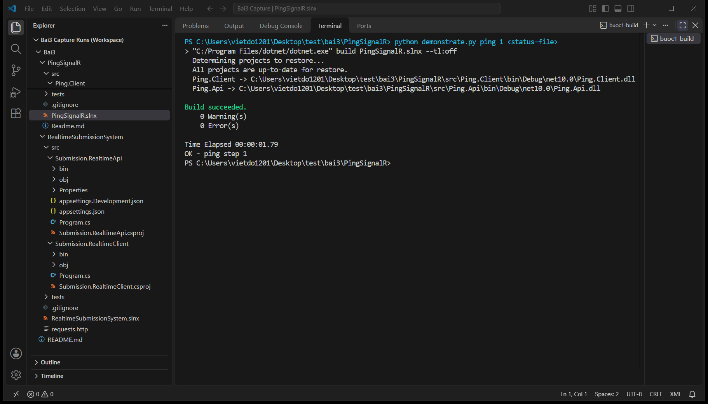

**Thấy:** `Build succeeded`, 0 cảnh báo, 0 lỗi. **Giải thích:** Solution build cả `Ping.Api` và `Ping.Client`; gói SignalR Client chỉ cần ở project console.

### Bước 2: Bắt tay negotiate

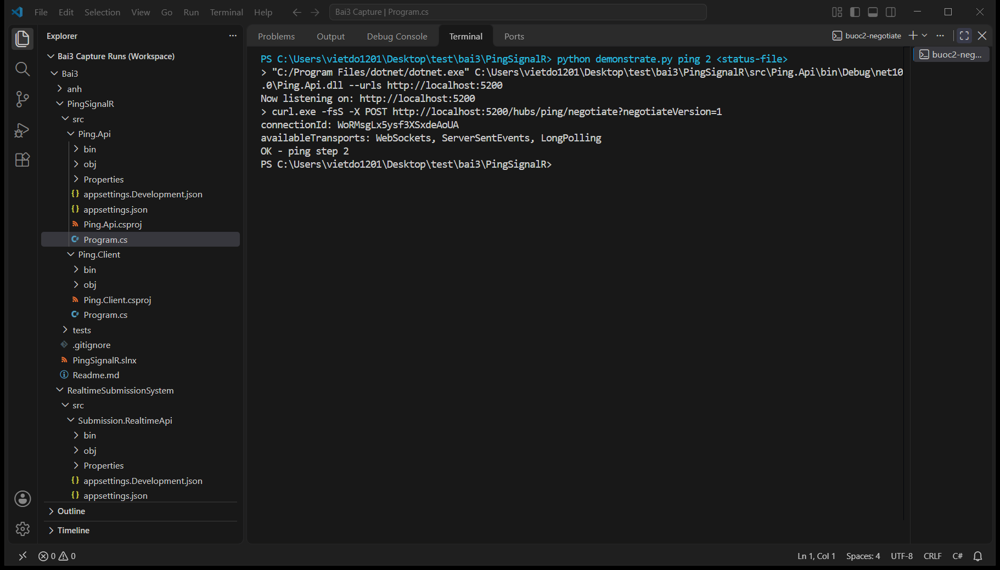

**Thấy:** `curl.exe` nhận `connectionId` và danh sách `WebSockets`, `ServerSentEvents`, `LongPolling`. **Giải thích:** Máy chủ cho biết các cơ chế truyền tải mà client có thể dùng.

### Bước 3: Hub Echo

`PingHub.Echo` dùng `Clients.Caller` để chỉ gửi phản hồi cho kết nối vừa gọi. Ảnh ở bước 4 minh họa kết quả của cả hai bước.

### Bước 4: Máy khách gọi Echo

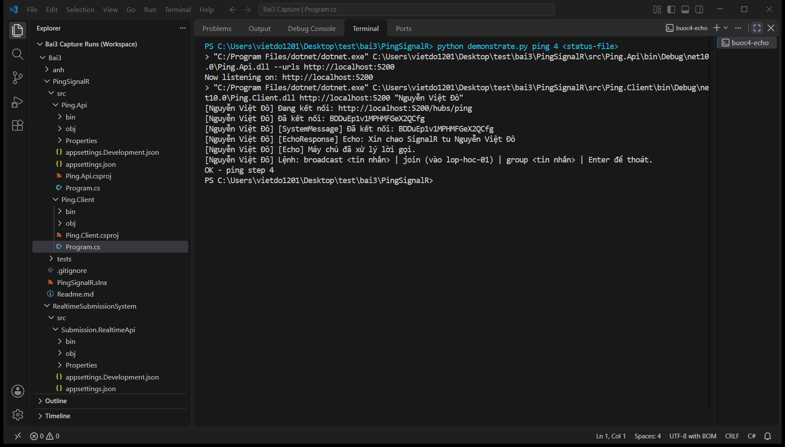

**Thấy:** Máy khách in `[EchoResponse] Echo: Xin chao SignalR tu Nguyễn Việt Đô`. **Giải thích:** Client đăng ký handler trước `StartAsync`, rồi mới gọi `InvokeAsync`.

### Bước 5: Broadcast và nhóm

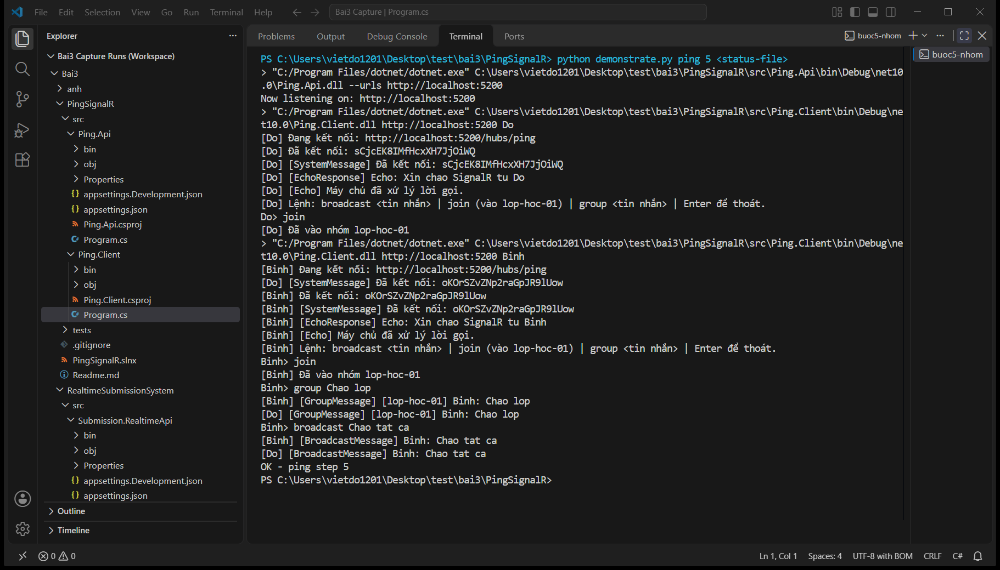

**Thấy:** Đô và Bình nhận cả `GroupMessage` lẫn `BroadcastMessage` của Bình; Đô không nhận Echo của Bình. **Giải thích:** `Clients.Group` chỉ gửi cho thành viên, `Clients.All` gửi cho cả hai, còn `Clients.Caller` chỉ trả về người gọi.

Ở cả hai terminal client, nhập `join`; sau đó nhập `group Chao lop` hoặc `broadcast Chao tat ca`. Nhấn Enter trên dòng trống để thoát.

### Bước 6: Ngắt và kết nối lại

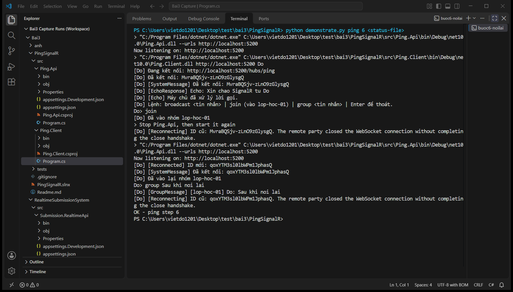

**Thấy:** Client hiện `[Reconnecting]`, `[Reconnected]` với ID mới, rồi vào lại `lop-hoc-01`. **Giải thích:** Thành viên nhóm gắn với kết nối cũ, nên client gọi `JoinGroup` lần nữa sau khi nối lại.

### Bước 7: Ba thí nghiệm lỗi

#### Lỗi 1: Không có máy chủ

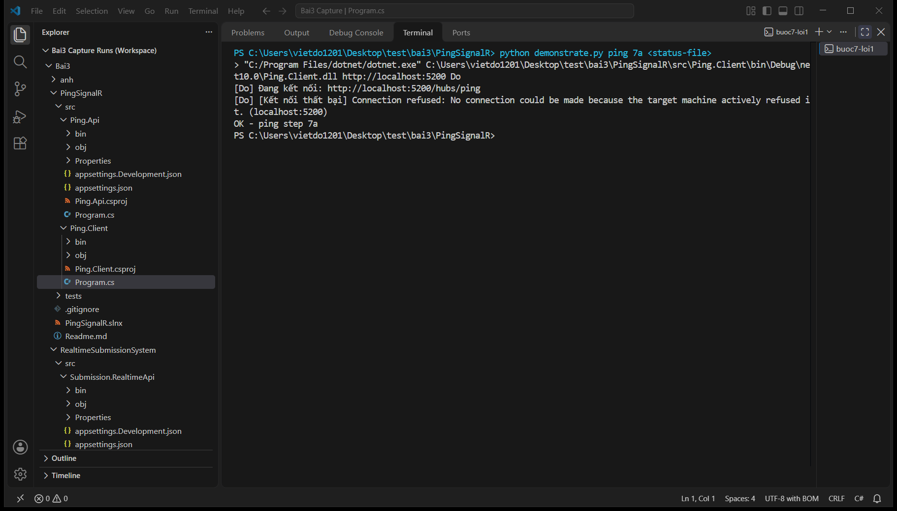

**Thấy:** `Connection refused`. **Giải thích:** `WithAutomaticReconnect` không tự thử lại khi `StartAsync()` chưa từng thành công.

#### Lỗi 2: Sai đường dẫn hub

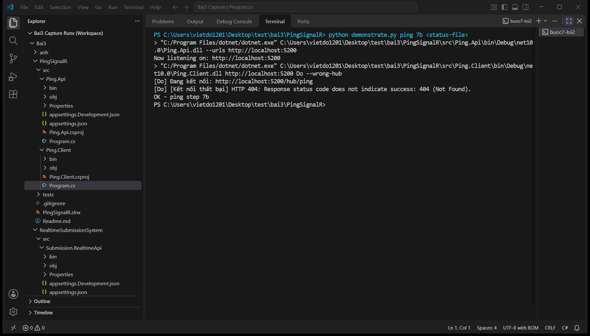

**Thấy:** `--wrong-hub` nhận HTTP 404. **Giải thích:** `/hub/ping` không khớp `/hubs/ping`, nên negotiate thất bại.

#### Lỗi 3: Sai tên sự kiện

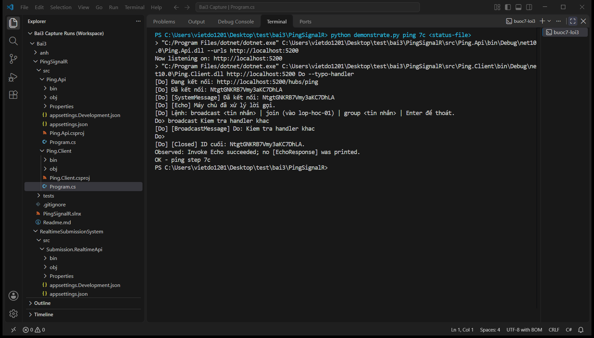

**Thấy:** `--typo-handler` gọi Echo thành công và vẫn nhận Broadcast, nhưng không in `[EchoResponse]`. **Giải thích:** Client nghe `EchoRespone` thay vì `EchoResponse`.

## Thiết kế EduSubmit realtime

- **Sự kiện:** trạng thái lượt nộp thay đổi. Máy chủ lưu trạng thái mới trước khi đẩy tin.
- **Người nhận:** các kết nối đã gọi `WatchSubmission(id)`, thuộc nhóm `submission:{id}`. Nhóm giúp phân tuyến, không thay thế xác thực và kiểm tra quyền trong ứng dụng thật.
- **Dữ liệu gửi:** `SubmissionId`, `Status`, `UpdatedAt` qua sự kiện `SubmissionStatusChanged`.
- **Khi lỡ tin:** đăng ký lại nhóm khi nối lại; đọc trạng thái mới nhất qua REST. Mô hình mẫu lưu trạng thái trong bộ nhớ, nên khởi động lại máy chủ sẽ làm mất các lượt nộp đã tạo.

## Nhật ký EduSubmit realtime

### Bước 1: Tạo solution và build

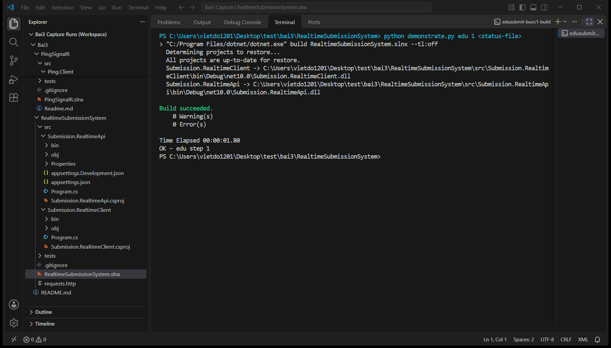

**Thấy:** `Build succeeded`, 0 cảnh báo, 0 lỗi. **Giải thích:** API và client là hai tiến trình độc lập, giao tiếp qua HTTP và SignalR.

### Bước 2: Giữ REST Bài 2, thêm UpdatedAt

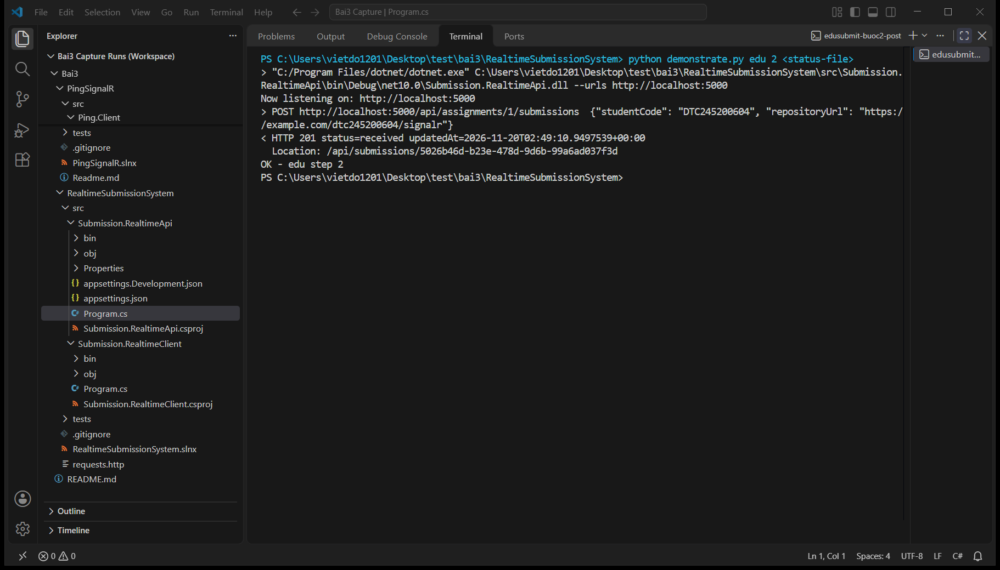

**Thấy:** POST hợp lệ trả `201`, `Location`, `received` và `updatedAt`. **Giải thích:** REST tạo lượt nộp và trả đường dẫn để đọc trạng thái hiện tại.

### Bước 3: Hub và nhóm theo lượt nộp

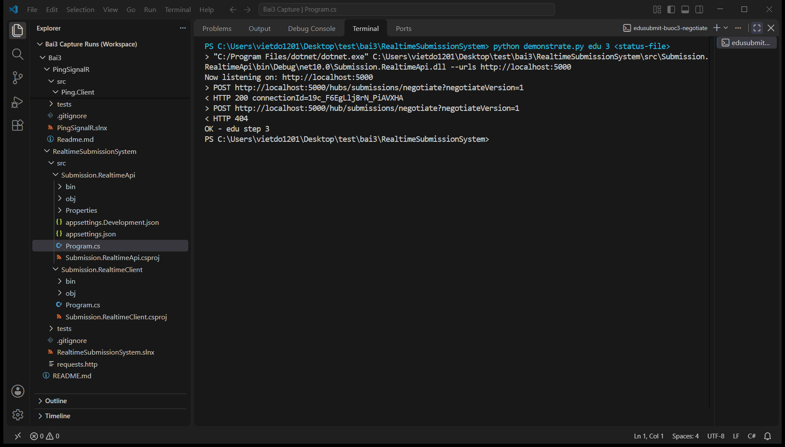

**Thấy:** `/hubs/submissions/negotiate` trả `200` và `connectionId`; `/hub/submissions/negotiate` trả `404`. **Giải thích:** Hub nhận `WatchSubmission(id)` để đưa kết nối vào nhóm `submission:{id}`.

### Bước 4: Tác vụ chấm nền và IHubContext

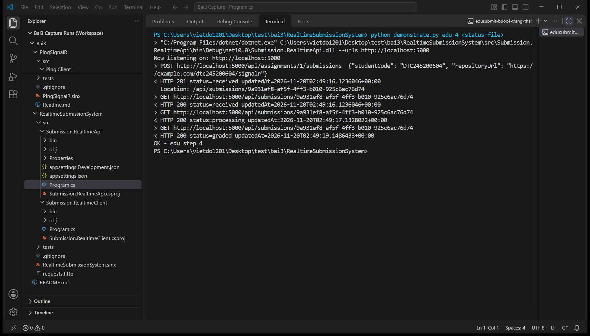

**Thấy:** GET lần lượt đọc `received → processing → graded`, với `updatedAt` tăng dần. **Giải thích:** Tác vụ nền lưu trạng thái mới trước khi đẩy tin qua `IHubContext`.

### Bước 5: Client mở hai kênh và đăng ký nhận tin

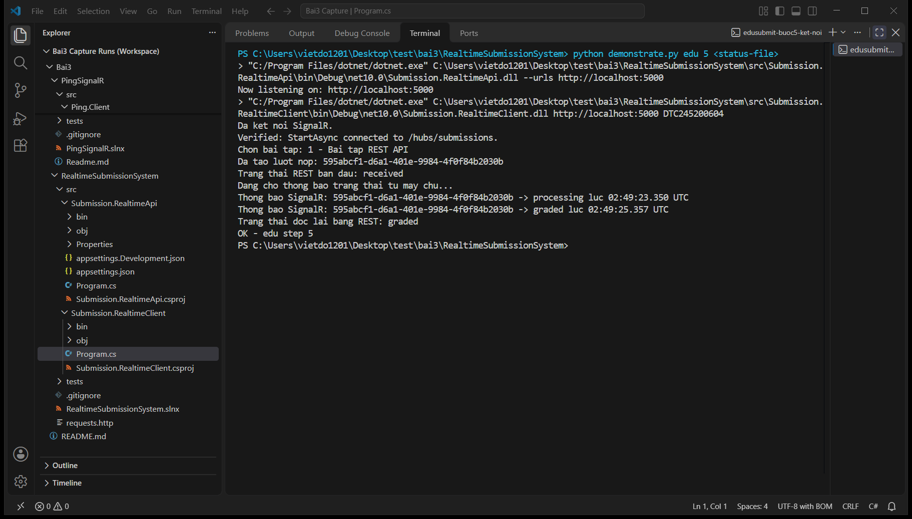

**Thấy:** Client in `Da ket noi SignalR.`. **Giải thích:** Đăng ký `On<SubmissionStatusMessage>` trước `StartAsync` để không lỡ các thông báo đến sớm.

### Bước 6: POST → Watch → nhận tin → GET

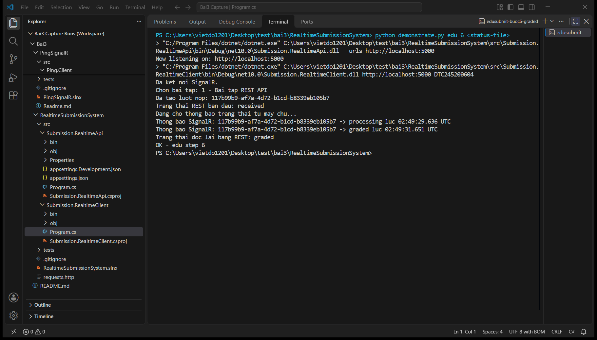

Kết quả chạy client trên cổng 5000:

```text
Da ket noi SignalR.
Chon bai tap: 1 - Bai tap REST API
Da tao luot nop: b992d57c-70a2-46d9-afbe-275059baa30e
Trang thai REST ban dau: received
Dang cho thong bao trang thai tu may chu...
Thong bao SignalR: b992d57c-70a2-46d9-afbe-275059baa30e -> processing luc 03:03:19.410 UTC
Thong bao SignalR: b992d57c-70a2-46d9-afbe-275059baa30e -> graded luc 03:03:21.417 UTC
Trang thai doc lai bang REST: graded
```

SignalR báo thay đổi mà không cần polling; GET theo `Location` xác nhận trạng thái cuối.

### Bước 7: Năm thí nghiệm phân tán

| Tình huống | Dự đoán | Kết quả thực tế | Giải thích |
|---|---|---|---|
| Chạy đồng thời `SV001`, `SV002` | Mỗi client chỉ nhận tin cho lượt nộp của mình. | Mỗi client nhận đúng `processing` và `graded` của ID do chính client tạo. | `Clients.Group` định tuyến theo lượt nộp. |
| Không chạy API | Không kết nối được. | `HttpRequestException` – connection refused. | Tự nối lại không áp dụng cho `StartAsync` lần đầu. |
| `--wrong-hub` | Negotiate thất bại. | HTTP `404`. | `/hub/submissions` không khớp route. |
| `--wrong-event` | Không thấy tin push; REST vẫn đọc được. | Timeout sau 10 giây; GET trả `graded`. | Client nghe `SubmissionStatusChange` thay vì `SubmissionStatusChanged`. |
| `--late-watch` | Bỏ lỡ các tin đến trước khi tham gia nhóm. | Watch sau 4 giây, không nhận tin; GET trả `graded`. | SignalR không phát lại tin đã gửi trước khi vào nhóm. |

#### Thí nghiệm 1: Hai máy khách đồng thời

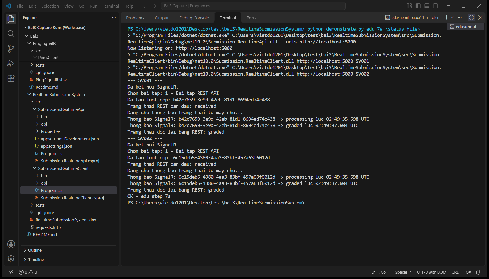

#### Thí nghiệm 2: Không chạy API

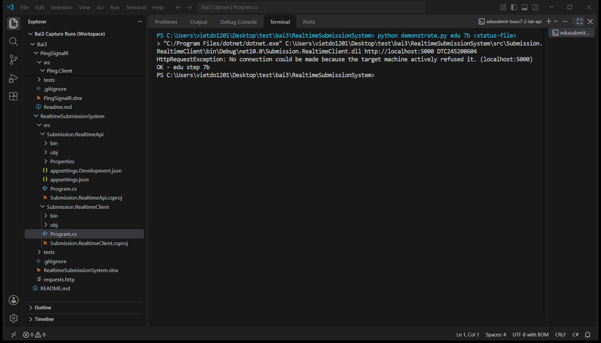

#### Thí nghiệm 3: Sai đường dẫn hub

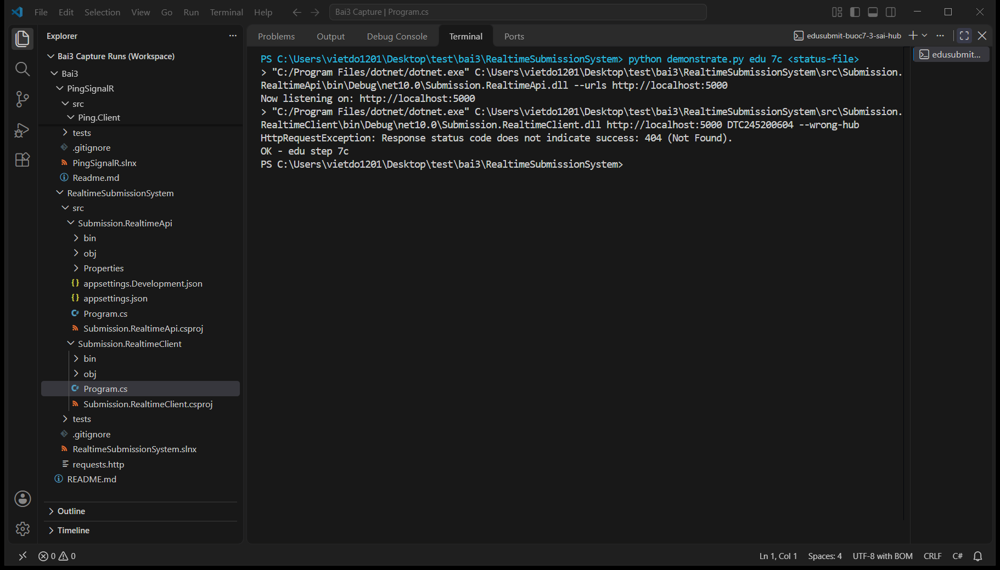

#### Thí nghiệm 4: Sai tên sự kiện

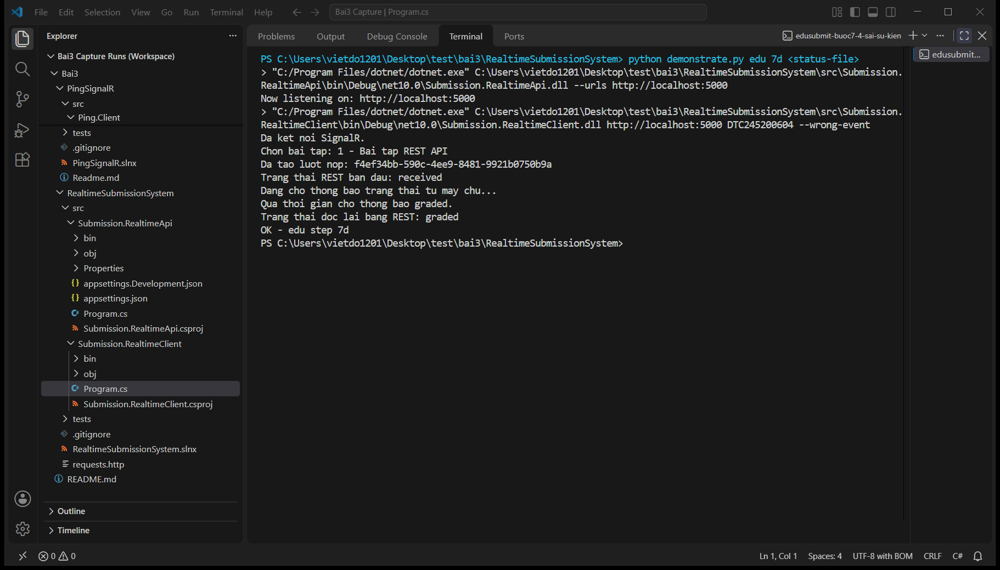

#### Thí nghiệm 5: Watch muộn

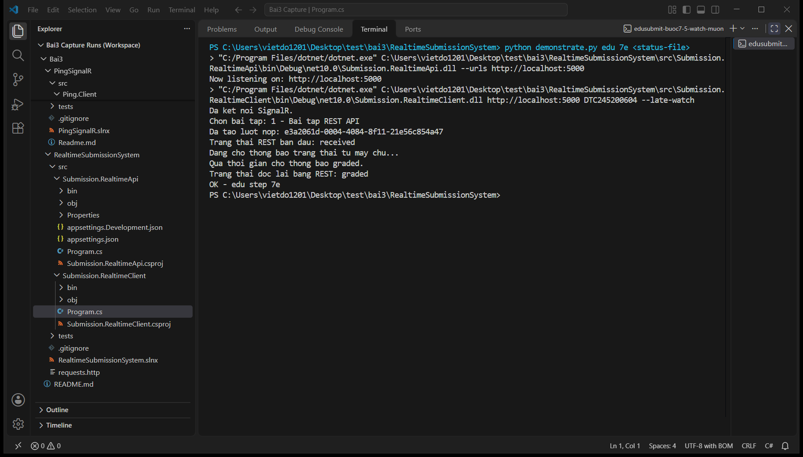

### Bước 8: Kiểm tra requests.http

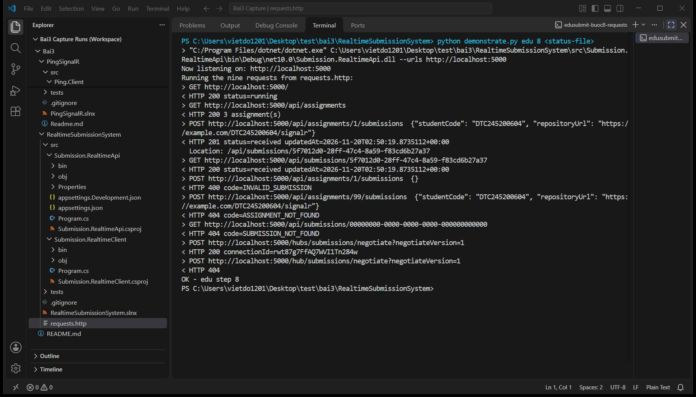

**Thấy:** Script Python đọc [requests.http](RealtimeSubmissionSystem/requests.http) và gửi 9 yêu cầu HTTP, trả lần lượt `200, 200, 201, 200, 400, 404, 404, 200, 404`. **Giải thích:** Gửi ca POST trước ca GET lượt nộp để lấy ID từ phản hồi; negotiate đúng và sai route được kiểm tra riêng.

Dùng mã sinh viên mới khi thử lại trên cùng API vì nộp trùng trả `409`. Phần mở rộng: chạy API với `-- --EnableFailed=true` và client với `-- http://localhost:5000 BONUS --bonus`; một kết nối theo dõi hai lượt, HTTPS cho `graded` và HTTP cho `failed` kèm cảnh báo.

### Kiểm thử tích hợp

Sau khi build hai solution, tại `Bai3/` chạy `python PingSignalR/tests/smoke.py` và `python RealtimeSubmissionSystem/tests/integration.py -v`. Hai bộ dùng máy chủ kiểm thử riêng. Kết quả: PingSignalR đạt 10/10 ca; EduSubmit đạt 9/9 ca, gồm kiểm tra 9 request trong `requests.http`. Bảy ca chấm trên cổng 5000 và 5200 đạt lần lượt `200, 201, 400, 404, 200, 200, 200`.

## Ôn tập và thảo luận

- **Ba mô hình:** Yêu cầu–phản hồi do máy khách khởi tạo, thường có một phản hồi; push do máy chủ gửi khi có sự kiện; streaming chuyển nhiều phần dữ liệu theo thời gian trên cùng luồng.
- **Polling và push:** Polling vẫn gửi yêu cầu khi không có thay đổi và có thể chậm đến một chu kỳ hỏi. Push chỉ báo khi có thay đổi. Polling hợp lý khi tác vụ ít thay đổi, không cần phản hồi ngay, hoặc hạ tầng không giữ được kết nối dài ổn định.
- **WebSocket và SignalR:** WebSocket là giao thức hai chiều; SignalR là thư viện quản lý kết nối, hub và nhóm. SignalR có thể dùng WebSockets, Server-Sent Events hoặc Long Polling tùy khả năng hai phía.
- **Nhóm và mở rộng:** `submission:{id}` gửi đến người theo dõi thay vì gửi cho cả lớp rồi lọc bên máy khách. Với nhiều máy chủ, cần backplane hoặc dịch vụ SignalR dùng chung để chuyển thông báo giữa các bản sao; ứng dụng thật vẫn phải xác thực quyền theo dõi.
- **`IHubContext` và `On<T>`:** Tác vụ nền dùng `IHubContext` để gửi từ ngoài hub. Client dùng `On<T>` để xử lý đúng tên sự kiện và kiểu dữ liệu; nếu thiếu handler thì không xử lý được thông báo đó.
- **REST và kết nối lại:** Giữ thao tác tạo/đọc trong REST để có mã trạng thái, `Location` và trạng thái lưu được của lượt nộp. `WithAutomaticReconnect` thử nối lại sau khi kết nối đã mở bị đứt; vào lại nhóm rồi GET theo `Location` để lấy trạng thái cuối nếu lỡ tin `graded`.

Tài liệu thực hành: Bài giảng *Bài 3 – Giao tiếp thời gian thực với SignalR*, TS. Dương Thu Mây. Phần REST kế thừa EduSubmit trong Bài 2.
