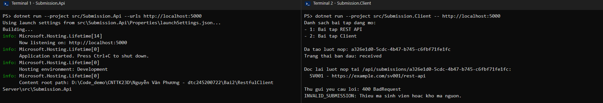
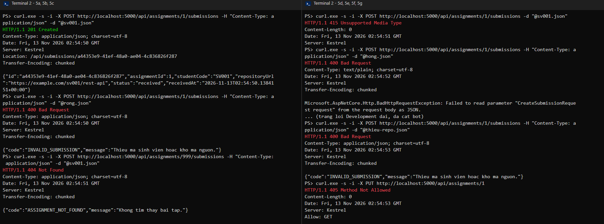
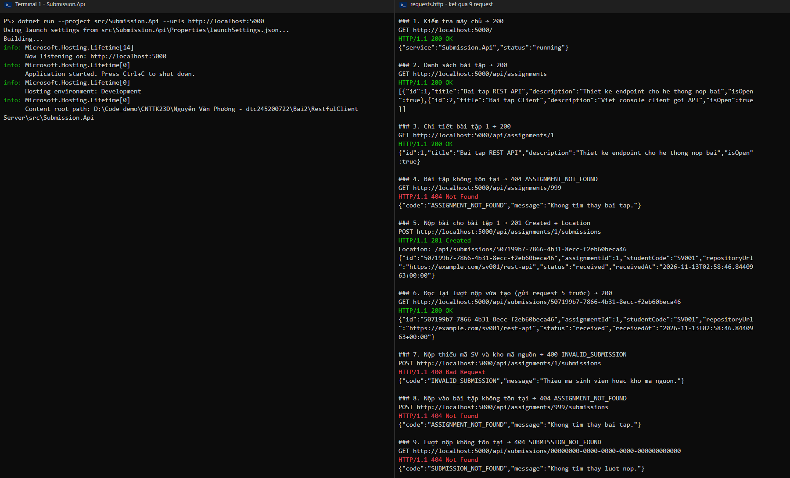
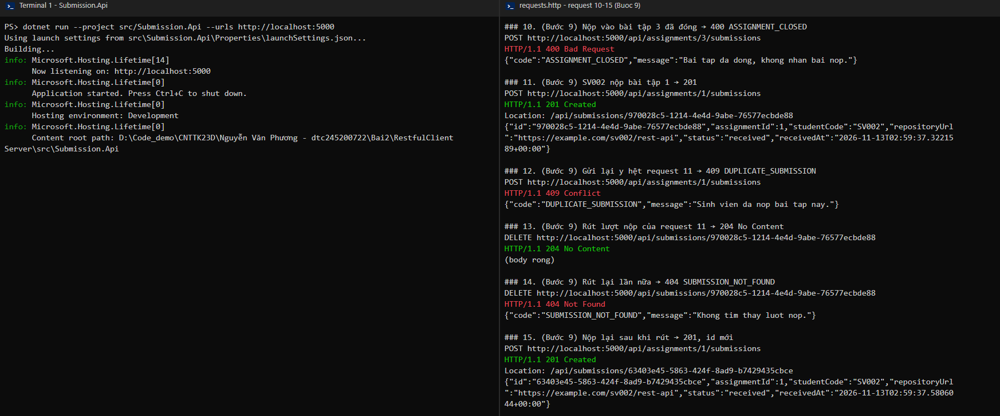

# Bài 2 – RESTful API cho tương tác client–server

Họ tên: Nguyễn Văn Phương     MSSV: DTC245200722     Lớp: CNTT K23D

- `CatalogApi/` – Phần 2: Catalog API (máy chủ cổng 5100 + máy khách), 10 bước.
- `RestfulClientServer/` – Phần 3: **EduSubmit** (máy chủ `Submission.Api` cổng 5000 + máy khách `Submission.Client`), 8 bước + bước 9 mở rộng.
- `docs/bai2.md` – nhật ký chi tiết từng bước kèm ảnh kết quả; ảnh ở `docs/img/`.

## 1. Lệnh đã chạy

Môi trường: .NET SDK `10.0.201`, Windows PowerShell, `curl.exe`.

EduSubmit (thư mục `RestfulClientServer`):

```bash
dotnet build
```

Terminal 1 – máy chủ:

```bash
dotnet run --project src/Submission.Api --urls http://localhost:5000
```

Terminal 2 – máy khách:

```bash
dotnet run --project src/Submission.Client -- http://localhost:5000
```

Kiểm thử: mở `requests.http` trong VS Code (REST Client), bấm **Send Request** lần lượt; hoặc dùng curl:

```bash
curl.exe -i -X POST http://localhost:5000/api/assignments/1/submissions -H "Content-Type: application/json" -d "@sv001.json"
```

Catalog API (thư mục `CatalogApi`): như trên với `src/Catalog.Api`, `src/Catalog.Client`, cổng 5100.

## 2. Ảnh kết quả

Máy chủ và máy khách EduSubmit chạy đủ 4 nấc (liệt kê → nộp → đọc lại theo Location → gửi sai nhận 400):



8 ca POST của bước 5:



`requests.http` – các ca 200, 201, 400, 404:



Bước 9 mở rộng – 409 và 204:



Ảnh các bước còn lại (bước 1–4, 5h, 6, 6c, 7a–7c, 9g và toàn bộ Catalog API): xem [docs/bai2.md](docs/bai2.md).

## 3. Bảng phá thử

Cột "Mong đợi" lấy theo bảng đáp án trong slide (trang 82, 87, 103, 109); cột "Thực tế" là kết quả chạy thật.

| # | Thao tác phá thử | Mong đợi (theo slide) | Thực tế | Khớp? | Giải thích |
|---|------------------|---------|---------|----------|------------|
| 4c | `GET /api/assignments/abc` | 404 rỗng | 404, `Content-Length: 0` | Khớp | `abc` không khớp ràng buộc `{assignmentId:int}`, framework trả 404, handler không chạy nên không có `ApiError`. |
| 5b | POST bài 1 với `studentCode`, `repositoryUrl` rỗng | 400 | 400 `INVALID_SUBMISSION` | Khớp | Cổng kiểm tra thứ 3 (dữ liệu hợp lệ) của handler từ chối. |
| 5c | POST vào bài tập 999 | 404 | 404 `ASSIGNMENT_NOT_FOUND` | Khớp | Cổng 1: tài nguyên cha không tồn tại. |
| 5d | POST bỏ header `Content-Type` | 415 | 415, body rỗng | Khớp | Framework không biết body là JSON nên chặn trước handler. |
| 5e | Body JSON hỏng `{"studentCode":"SV001",` | 400 | 400, body là văn bản `BadHttpRequestException` | Khớp | Framework không đọc được body; không phải `ApiError`. |
| 5f | Body thiếu `repositoryUrl` | 400 `INVALID_SUBMISSION` | 400 `INVALID_SUBMISSION` | Khớp | Trường thiếu được gán `null`, vẫn vào handler; `IsNullOrWhiteSpace` bắt được nên trả 400 có `ApiError`. |
| 5g | `PUT /api/assignments/1` | 405, `Allow: GET` | 405, `Allow: GET` | Khớp | URI có tồn tại, chỉ phương thức PUT không được hỗ trợ, nên là 405 chứ không phải 404. |
| 5h | Đặt bài tập 2 `IsOpen = false`, POST vào bài 2 | 400 | 400 `ASSIGNMENT_CLOSED` | Khớp | Cổng 2: đúng cú pháp nhưng sai quy tắc nghiệp vụ. |
| 6c | Tắt API, chạy lại, GET lượt nộp cũ | 404 | 404 `SUBMISSION_NOT_FOUND` | Khớp | `List<SubmissionDto>` nằm trong bộ nhớ tiến trình; tiến trình dừng là mất dữ liệu. |
| 7a | Tắt API rồi chạy client | Lỗi kết nối | `HttpRequestException: ... actively refused it. (localhost:5000)` | Khớp | Lỗi mạng: không có phản hồi HTTP nào, khác với lỗi 4xx. |
| 7b | Client gọi sai cổng 5999 | Lỗi kết nối | `actively refused it. (localhost:5999)` | Khớp | Địa chỉ dịch vụ là cấu hình; truyền đúng qua `args[0]` là chạy được. |
| 7c | Thêm bài tập 3 vào API, không sửa client | Client in thêm bài 3 | In `- 3: Bai tap gRPC` | Khớp | Client lặp qua mảng JSON, hợp đồng không đổi nên không cần sửa. |
| Bẫy | Client dùng `GetFromJsonAsync` gọi `/api/assignments/999` | Chương trình sập | `Unhandled exception ... 404 (Not Found)`, chương trình sập | Khớp | `GetFromJsonAsync` ném exception khi mã không phải 2xx và bỏ mất `ApiError`; vì vậy nấc 3, 4 dùng `GetAsync`/`PostAsJsonAsync` và xem mã trước. |
| 9c | Gửi lại y hệt POST SV002 vào bài 1 | 409 | 409 `DUPLICATE_SUBMISSION` | Khớp | Yêu cầu hợp lệ nhưng xung đột với dữ liệu đã có. |
| 9g | Chạy client 2 lần | Lần 2 lỗi | Lần 2: `Nop bai that bai: 409 Conflict - DUPLICATE_SUBMISSION` | Khớp | Client không sửa dòng nào vẫn in đúng lỗi vì mọi lỗi cùng dạng `ApiError`. |

Ảnh minh chứng: [5a–5g](docs/img/edu-buoc5.png), [5h](docs/img/edu-buoc5h.png), [6c](docs/img/edu-buoc6c.png), [7a–7b](docs/img/edu-7a-7b.png), [7c](docs/img/edu-7c.png), [bẫy GetFromJsonAsync](docs/img/edu-bay-getfromjson.png), [9a–9f](docs/img/edu-buoc9.png), [9g](docs/img/edu-buoc9g.png).

## 4. Trả lời 3 câu hỏi

**Câu 1. Vì sao URI dùng danh từ, còn hành động do phương thức HTTP đảm nhận?**

URI dùng để định danh **tài nguyên** (bài tập, lượt nộp), còn việc làm gì với tài nguyên đó đã có phương thức HTTP diễn đạt: `GET` là đọc, `POST` là tạo, `DELETE` là xóa. Nhờ vậy một URI dùng được cho nhiều hành động, ví dụ `/api/submissions/{id}` vừa `GET` để đọc vừa `DELETE` để rút bài. Trong code: nộp bài là `app.MapPost("/api/assignments/{assignmentId:int}/submissions", ...)` thay vì `POST /submitAssignment` hay `/doSubmit`. Client nhìn URI là biết "tạo một lượt nộp thuộc bài tập 1", và thấy 405 khi dùng sai phương thức (ca 5g `PUT /api/assignments/1`).

**Câu 2. "Stateless" thể hiện ở đâu trong code đã viết?**

Mỗi yêu cầu tự mang đủ thông tin để máy chủ xử lý; máy chủ không nhớ "phiên" của client giữa hai lần gọi. Trong `POST /api/assignments/1/submissions`: `assignmentId` nằm trên URI, `studentCode` và `repositoryUrl` nằm trong body – handler không cần biết trước đó client đã gọi gì. Khi đọc lại, client gửi đầy đủ id trong URL lấy từ header `Location` (`GET /api/submissions/{id}`), không có cookie hay session. Stateless không có nghĩa là máy chủ không lưu dữ liệu: danh sách `submissions` vẫn được lưu (ca 9g lần 2 bị 409 vì đã có bài nộp), nhưng đó là dữ liệu của tài nguyên, không phải trạng thái phiên làm việc của client.

**Câu 3. Vì sao client và server mỗi bên khai báo DTO riêng mà vẫn khớp nhau?**

DTO là **hợp đồng JSON** đi qua mạng, không phải lớp dùng chung. `Submission.Client` không tham chiếu project `Submission.Api`; mỗi bên tự khai báo `record AssignmentDto(...)`, `SubmissionDto(...)`, `ApiError(...)`. Hai bên khớp nhau nhờ **tên trường và kiểu dữ liệu trong JSON** (`id`, `studentCode`, `status`... ở dạng camelCase), `System.Text.Json` tự ánh xạ khi đọc/ghi. Lợi ích: phía client chỉ có `CreateSubmissionRequest(StudentCode, RepositoryUrl)` nên không thể gửi `Id` hay `Status` cho máy chủ; hai chương trình build, triển khai độc lập (thậm chí viết bằng ngôn ngữ khác). Ở thí nghiệm 7c, máy chủ thêm dữ liệu mà client không cần sửa vì hợp đồng không đổi.

## 5. Ghi chú

- Mỗi bước một commit (`Buoc 1`…`Buoc 7-8` cho Catalog, `EduSubmit Buoc 1`…`Buoc 9` cho EduSubmit); `.gitignore` loại bỏ `bin/`, `obj/`.
- Ảnh được tạo từ kết quả chạy thật của từng lệnh; với kết quả quá dài (stack trace, trang lỗi Development) chỉ giữ các dòng đầu và ghi rõ "đã cắt bớt".
- Có dùng trợ lý AI để hỗ trợ viết code, chạy kiểm thử và ghi nhật ký; đã đọc lại code và đối chiếu từng mã trạng thái với slide bài giảng.
