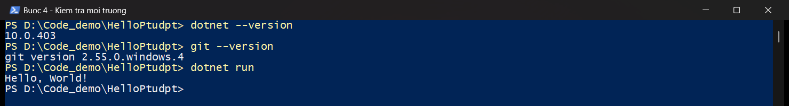
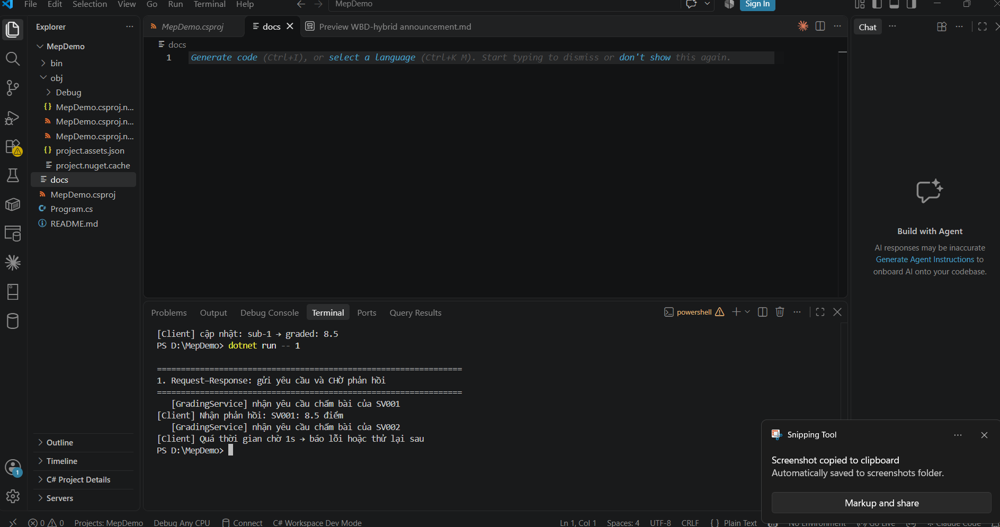

# Bài 1 – Tổng quan hệ thống và MEP
Họ tên: Nguyễn Đức Mạnh       MSSV: dtc245200152       Lớp: CNTT K23D

## 1. Cài đặt
(ảnh chụp kết quả Bước 4)

- Ảnh: [buoc4-moi-truong.png](./buoc4-moi-truong.png)



Kết quả:

```
> dotnet --version
10.0.403
> git --version
git version 2.55.0.windows.4
> cd D:\Code_demo\HelloPtudpt
> dotnet run
Hello, World!
```

## 2. MepDemo (Bước 7)
- Trả lời 3 câu hỏi; mỗi MEP 1 câu mô tả

- Ảnh: [mepdemo-mep1.png](./mepdemo-mep1.png)



Mỗi MEP 1 câu mô tả:

1. **Request–Response**: Client gửi yêu cầu chấm bài rồi CHỜ phản hồi. SV001 nhận được "8.5 điểm"; với SV002, dịch vụ chậm 2 s, vượt thời gian chờ 1 s, nên Client báo lỗi timeout.
2. **One-way**: Sender gửi 3 dòng log rồi đi tiếp ngay, không chờ AuditLog ghi xong: cả 3 dòng `[Sender]` in ra trước, các dòng `[AuditLog]` in ra sau.
3. **Queue-based**: API nhận 4 bài (`sub-1` … `sub-4`) và trả ngay `processing`; Worker-A và Worker-B lấy job từ hàng đợi, mỗi bài chỉ do MỘT worker chấm.
4. **Publish–Subscribe**: Worker phát MỘT sự kiện `SubmissionGraded` và cả 3 dịch vụ ScoreService, NotificationService, StatsService đều nhận được.
5. **Streaming / Push**: Client đăng ký theo dõi `sub-1` một lần rồi nhận liên tục `received → processing 30% → processing 70% → graded: 8.5`.

Trả lời 3 câu hỏi:

- **Câu 1. Ở MEP 3, mỗi bài nộp sub-x được mấy worker xử lý?**
  Mỗi bài nộp chỉ do **1 worker** xử lý. Hai worker chia nhau việc: khi chạy, Worker-A chấm `sub-1` và `sub-4`, Worker-B chấm `sub-2` và `sub-3`; không bài nào bị chấm hai lần (competing consumers).
- **Câu 2. Ở MEP 4, một sự kiện được gửi tới mấy dịch vụ?**
  Một sự kiện `SubmissionGraded` được gửi tới **3 dịch vụ**: ScoreService (lưu điểm), NotificationService (báo sinh viên) và StatsService (cập nhật thống kê).
- **Câu 3. Viết 1 câu mô tả cho mỗi MEP.**
  Xem 5 câu mô tả ở trên.

## 3. BasicWebApi (Bước 8)
- Ảnh chụp REST Client: 200, 201, 400
  - 200: [api-200.png](./api-200.png)
  - 201: [api-201.png](./api-201.png)
  - 400: [api-400.png](./api-400.png)
- Trả lời 3 câu hỏi mục 8.4
  - **Câu 1. `builder.Services.AddSingleton…` và `var app = builder.Build();` – dòng nào phải đứng trước? Vì sao?**
    `AddSingleton` phải đứng **trước** `Build()`. Mọi dịch vụ phải được đăng ký vào `builder.Services` trước khi build; sau khi `Build()` danh sách dịch vụ bị khoá (chỉ đọc), đăng ký thêm sẽ báo lỗi `InvalidOperationException`, và endpoint không thể nhận dịch vụ chưa đăng ký.
  - **Câu 2. Trong `/hello/{name}?language=en`, tham số `name` lấy từ đâu, `language` lấy từ đâu?**
    `name` lấy từ **route** (đoạn `{name}` trong đường dẫn, ví dụ `/hello/An` → `name = "An"`). `language` lấy từ **query string** (phần sau dấu `?`, ví dụ `?language=en` → `language = "en"`).
  - **Câu 3. Vì sao POST hợp lệ trả `Results.Created` (201) chứ không phải `Results.Ok` (200)?**
    Vì POST **tạo ra một tài nguyên mới**. Mã 201 Created nói rõ "đã tạo mới" và kèm header `Location` (ví dụ `/greetings/1`) chỉ tới địa chỉ của tài nguyên vừa tạo, để client biết đọc lại ở đâu. 200 OK chỉ có nghĩa chung là "thành công", không báo có tài nguyên mới.

## 4. MiniDistributedSystem (Bước 9)
- Ảnh chụp 2 terminal API + Client
  - Ảnh: [mini-2-terminal.png](./mini-2-terminal.png)
- Trả lời 3 câu hỏi
  - **Câu 1. Client gọi những endpoint nào của API? Mỗi lần gọi là một cặp request–response gồm method, URL, mã trạng thái gì?**
    Client gọi 2 endpoint, mỗi lần là một cặp request–response:

    | Method | URL | Mã trạng thái | Dữ liệu phản hồi |
    |---|---|---|---|
    | GET | `/api/assignments` | 200 OK | Danh sách bài tập (Bai tap 1, Bai tap 2) |
    | POST | `/api/submissions` | 201 Created | Lượt nộp: mã GUID, `status: received` |

  - **Câu 2. Client có tham chiếu (dùng chung) code của API không? Hai bên "thống nhất" với nhau bằng gì?**
    **Không.** Hai project không tham chiếu nhau; client tự khai báo lại các record của riêng nó. Hai bên thống nhất qua **hợp đồng HTTP**: cùng method + URL (`GET /api/assignments`, `POST /api/submissions`), cùng định dạng **JSON** với tên trường giống nhau (`assignmentId`, `studentCode`, `repositoryUrl`…) và cùng quy ước mã trạng thái (200/201/400).
  - **Câu 3. Vì sao địa chỉ API được truyền qua tham số `-- http://localhost:5000` mà không viết cứng trong code?**
    Vì địa chỉ máy chủ **có thể thay đổi** (đổi cổng, chạy trên máy khác, khi triển khai thật). Truyền qua tham số thì chỉ cần đổi lúc chạy, **không phải sửa code và build lại** client – ví dụ API chạy cổng 5050 thì chạy client với `-- http://localhost:5050`.

## 5. Thí nghiệm lỗi (Bước 10)
| # | Dự đoán | Thực tế | Đúng/Sai | Giải thích |
|---|---|---|---|---|
| a | Thêm bài tập 3 vào API → client in ra 3 bài tập, không cần sửa code client | Client in `- 1: Bai tap 1`, `- 2: Bai tap 2`, `- 3: Bai tap 3`, nộp bài vẫn `received` | Đúng | **Không cần sửa client** vì client không biết trước số bài tập: nó gọi `GET /api/assignments` rồi duyệt `foreach` trên danh sách JSON nhận về. Dữ liệu thuộc về máy chủ; chỉ cần hợp đồng (hình dạng JSON) không đổi thì client vẫn chạy. |
| b | Tắt API → client lỗi không kết nối được | `HttpRequestException: No connection could be made because the target machine actively refused it. (localhost:5000)` – client dừng, không in gì | Đúng | Gọi qua mạng cần **tiến trình bên kia đang chạy và đang nghe đúng cổng**; máy chủ tắt, mạng lỗi, quá tải… đều làm lời gọi thất bại. Gọi hàm trong cùng chương trình thì hàm luôn nằm sẵn trong cùng tiến trình/bộ nhớ nên không có kiểu lỗi này. |
| c | `StudentCode: ""` → API trả 400, client dừng ở `EnsureSuccessStatusCode()` | Client in danh sách bài tập, rồi `HttpRequestException: Response status code does not indicate success: 400 (Bad Request)` tại `EnsureSuccessStatusCode()` (dòng 28) | Đúng | API trả **400 Bad Request** (`Du lieu nop bai khong hop le`). `EnsureSuccessStatusCode()` **ném ngoại lệ nếu mã không phải 2xx**, để client không đọc nhầm thông báo lỗi như dữ liệu thành công. Máy chủ phải tự kiểm tra vì **không thể tin client**: bất kỳ ai cũng gọi được API (client lỗi, curl, REST Client, kẻ xấu). |
| d | API ở 5050, client gọi 5000 → lỗi *actively refused*; sửa bằng tham số dòng lệnh | Lần 1 (`-- http://localhost:5000`): `actively refused it (localhost:5000)`. Lần 2 (`-- http://localhost:5050`): in đủ bài tập, nộp bài `received` | Đúng | **Sửa bằng cách chạy client với `-- http://localhost:5050`, không sửa code.** Client lấy địa chỉ API từ `args[0]`, nên đổi cổng/máy chủ chỉ cần đổi tham số lúc chạy. |

Sau mỗi thí nghiệm, code đã được trả về như cũ (kiểm tra bằng mã băm file).

- Ảnh thí nghiệm a: [thi-nghiem-a.png](./thi-nghiem-a.png)
- Ảnh thí nghiệm b: [thi-nghiem-b.png](./thi-nghiem-b.png)
- Ảnh thí nghiệm c: [thi-nghiem-c.png](./thi-nghiem-c.png)
- Ảnh thí nghiệm d: [thi-nghiem-d.png](./thi-nghiem-d.png)

## 6. Dự án EduSubmit tự làm (Bước 11-12)
- Ảnh chụp kết quả; phần nào phải xem code mẫu?
  - Ảnh: [edusubmit-ketqua.png](./edusubmit-ketqua.png)
  - Phần phải xem code mẫu:
- Luồng thông điệp:

```
Client --(HTTP GET /api/assignments)--> Api        : request-response
Client --(HTTP POST /api/submissions)--> Api       : request-response
Client --(HTTP GET /api/submissions/{id})--> Api   : request-response
```

## 7. Khó khăn gặp phải và cách giải quyết
- Máy chỉ có .NET Runtime 10.0.10, chưa có SDK nên chưa tạo/chạy được dự án → cài .NET 10 SDK (`winget install Microsoft.DotNet.SDK.10`), kiểm tra lại bằng `dotnet --version` ra `10.0.403`.
- Tạo nhầm `docs` thành file thay vì thư mục → xoá file, tạo lại thư mục `docs` rồi tạo `docs/bai1.md` bên trong.
- Ảnh không hiện trong Preview → đặt ảnh vào thư mục `docs`, dùng đường dẫn tương đối `./ten-anh.png`, mở lại Preview bằng Ctrl + Shift + V.
