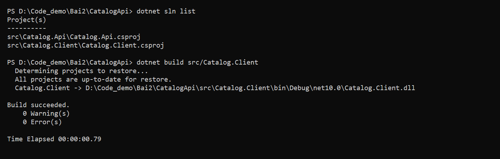
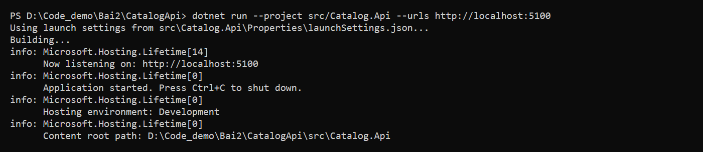
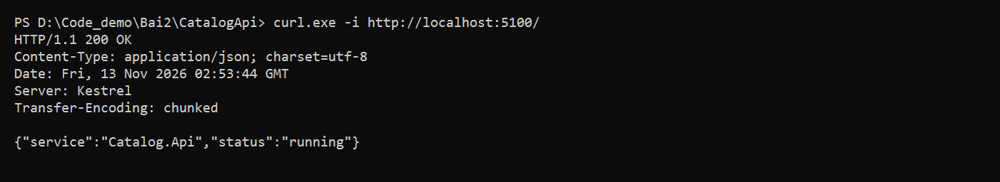
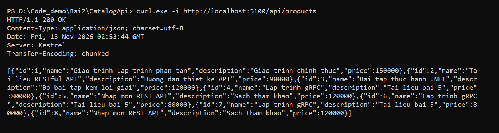
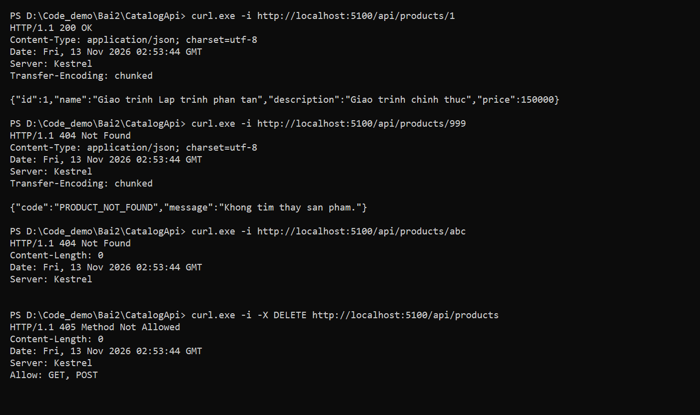
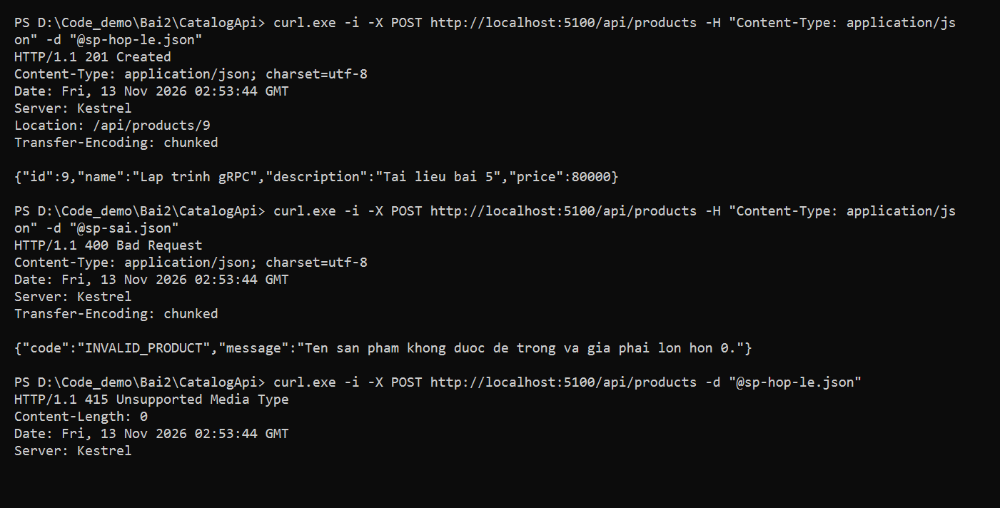
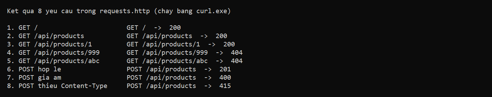
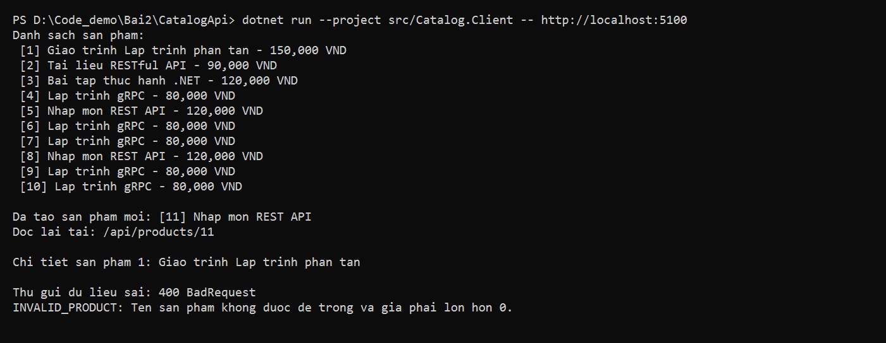
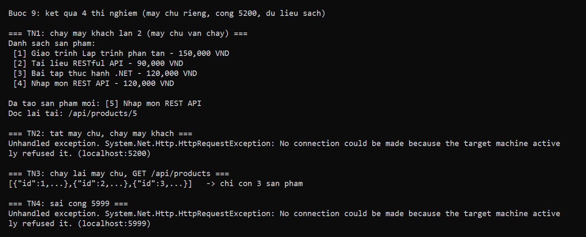

# Bài 2: Catalog API (RESTful API client–server)

- **Môn học:** Phát triển ứng dụng phân tán
- **Họ tên:** Nguyễn Đức Mạnh
- **MSSV:** DTC245200152
- **Nội dung:** viết máy chủ Catalog API bằng ASP.NET Core Minimal API và máy khách console gọi API bằng `HttpClient` (Bài 2: RESTful API cho tương tác client–server).

Môi trường: .NET SDK 10 (project nhắm `net10.0`), Windows, PowerShell, VS Code với extension REST Client (`humao.rest-client`), `curl.exe` có sẵn trong Windows.

Hệ thống gồm hai chương trình chạy ở hai tiến trình riêng:

- `src/Catalog.Api`: máy chủ web, giữ dữ liệu sản phẩm, lắng nghe ở cổng **5100**.
- `src/Catalog.Client`: máy khách console, gọi máy chủ bằng `HttpClient` (làm ở Bước 7–8).

Cấu trúc thư mục:

```
CatalogApi/
├── CatalogApi.slnx
├── requests.http        # 8 ca test (Bước 6)
├── sp-hop-le.json       # body POST hợp lệ (Bước 5)
├── sp-sai.json          # body POST sai (Bước 5)
├── README.md
└── src/
    ├── Catalog.Api/     # máy chủ, cổng 5100
    └── Catalog.Client/  # máy khách
```

Tiến độ: **Bước 1 đến Bước 10 đã xong**.

## Hợp đồng API

| Phương thức | URI | Thành công | Lỗi | Dữ liệu vào | Dữ liệu ra |
|---|---|---|---|---|---|
| GET | `/` | 200 | không | không | `{ service, status }` |
| GET | `/api/products` | 200 | không | không | mảng `ProductDto` |
| GET | `/api/products/{id:int}` | 200 | 404 `PRODUCT_NOT_FOUND` | không | `ProductDto` |
| POST | `/api/products` | 201 + `Location` | 400 `INVALID_PRODUCT`, 415 thiếu `Content-Type` | `CreateProductRequest` (không có `Id`) | `ProductDto` |

Các DTO (JSON, tên trường viết thường đầu):

- `ProductDto`: `id` (int), `name` (string), `description` (string), `price` (decimal), dùng làm dữ liệu **ra**.
- `CreateProductRequest`: `name` (string), `description` (string, tùy chọn), `price` (decimal), dùng làm dữ liệu **vào**. Không có `id` vì máy chủ tự sinh.
- `ApiError`: `code` (string, cho máy đọc), `message` (string, cho người đọc), dùng chung cho mọi lỗi do handler trả.

Quy tắc kiểm tra khi tạo sản phẩm: `name` không được rỗng hoặc chỉ toàn dấu cách, và `price` phải lớn hơn 0.

## 1. Nhật ký lệnh đã chạy

Mọi lệnh chạy bằng PowerShell trong VS Code, ở thư mục `CatalogApi`. Terminal 1 chạy máy chủ, Terminal 2 gọi thử.

Lưu ý về ảnh trong báo cáo: các ảnh trong thư mục `img/` là ảnh kết quả dựng lại từ đầu ra thật của các lệnh (không phải ảnh chụp cửa sổ VS Code). Máy chủ lúc chạy đã nhận thêm một số yêu cầu `POST` từ các bước trước, nên `Id` và `Location` trong ảnh có thể lớn hơn ví dụ trong bảng (ví dụ `/api/products/6` thay vì `/api/products/4`).

### Bước 1: tạo solution và hai project

```powershell
dotnet new sln -n CatalogApi
dotnet new web -n Catalog.Api -o src/Catalog.Api
dotnet new console -n Catalog.Client -o src/Catalog.Client
dotnet sln add src/Catalog.Api/Catalog.Api.csproj
dotnet sln add src/Catalog.Client/Catalog.Client.csproj
dotnet new gitignore
dotnet build
```

Kết quả: `dotnet sln list` có đủ 2 project, `dotnet build` báo `Build succeeded`.



### Bước 2: endpoint `/` trả JSON 200

Terminal 1:

```powershell
dotnet run --project src/Catalog.Api --urls http://localhost:5100
```

Terminal 2:

```powershell
curl.exe -i http://localhost:5100/
```

Kết quả: `200 OK`, `Content-Type: application/json`, body `{"service":"Catalog.Api","status":"running"}`.





### Bước 3: danh sách sản phẩm

```powershell
curl.exe -i http://localhost:5100/api/products
```

Kết quả: `200 OK`, mảng JSON gồm 3 sản phẩm.



### Bước 4: chi tiết một sản phẩm

```powershell
curl.exe -i http://localhost:5100/api/products/1
curl.exe -i http://localhost:5100/api/products/999
curl.exe -i http://localhost:5100/api/products/abc
curl.exe -i -X DELETE http://localhost:5100/api/products
```

| Lệnh | Kết quả | Ai trả lời |
|---|---|---|
| `GET /api/products/1` | 200 + sản phẩm số 1 | Handler: tìm thấy |
| `GET /api/products/999` | 404 + `{"code":"PRODUCT_NOT_FOUND",...}` | Handler: không tìm thấy, tự trả 404 có body |
| `GET /api/products/abc` | 404, body rỗng | Framework: `abc` không khớp `{id:int}`, handler không chạy |
| `DELETE /api/products` | 405 | Framework: URI có nhưng chưa có động từ `DELETE` |



### Bước 5: tạo sản phẩm bằng POST

```powershell
curl.exe -i -X POST http://localhost:5100/api/products -H "Content-Type: application/json" -d "@sp-hop-le.json"
curl.exe -i -X POST http://localhost:5100/api/products -H "Content-Type: application/json" -d "@sp-sai.json"
curl.exe -i -X POST http://localhost:5100/api/products -d "@sp-hop-le.json"
```

| Ca | Kết quả | Ai từ chối |
|---|---|---|
| Hợp lệ | 201 Created + `Location: /api/products/N` (N là `Id` mới, bằng 4 khi máy chủ mới khởi động) | Không ai, handler tạo sản phẩm |
| Giá âm | 400 + `{"code":"INVALID_PRODUCT",...}` | Handler (khối `if` kiểm tra) |
| Thiếu `Content-Type` | 415 Unsupported Media Type | Framework, chặn trước khi vào handler |

Sau ca hợp lệ, `GET /api/products` có 4 sản phẩm.



### Bước 6: tệp `requests.http`

Tệp `requests.http` ở thư mục gốc có 8 yêu cầu. Bấm **Send Request** (extension REST Client) để chạy từng ca.

| # | Yêu cầu | Mã mong đợi |
|---|---|---|
| 1 | `GET /` | 200 |
| 2 | `GET /api/products` | 200 |
| 3 | `GET /api/products/1` | 200 |
| 4 | `GET /api/products/999` | 404 + `PRODUCT_NOT_FOUND` |
| 5 | `GET /api/products/abc` | 404, body rỗng |
| 6 | `POST` hợp lệ | 201 + `Location` |
| 7 | `POST` giá âm | 400 + `INVALID_PRODUCT` |
| 8 | `POST` thiếu `Content-Type` | 415 |



### Bước 7: máy khách gọi GET bằng `HttpClient`

`src/Catalog.Client/Program.cs` lấy địa chỉ máy chủ từ `args[0]` (mặc định `http://localhost:5100`), tạo `HttpClient` với `BaseAddress`, gọi `GetFromJsonAsync<List<ProductDto>>("/api/products")` và in từng sản phẩm. Máy khách khai báo lại `ProductDto` vì hai chương trình không chung code, chỉ chung hợp đồng JSON.

```powershell
dotnet run --project src/Catalog.Client
```

Kết quả: máy khách in danh sách sản phẩm lấy từ máy chủ, dạng ` [1] Giao trinh Lap trinh phan tan - 150,000 VND`.

Ảnh kết quả Bước 7 (danh sách sản phẩm) nằm chung trong ảnh Bước 8 bên dưới, ở nấc 1.

### Bước 8: POST, đọc lại chi tiết và gửi sai

Máy khách chạy 4 nấc: (1) liệt kê, (2) tạo sản phẩm bằng `PostAsJsonAsync` và kiểm tra `StatusCode == Created` **trước** khi đọc body, (3) đọc lại chi tiết sản phẩm số 1, (4) cố ý gửi tên rỗng và giá âm để nhận 400 và đọc `ApiError`.

```powershell
dotnet run --project src/Catalog.Client -- http://localhost:5100
```

Kết quả (máy chủ khởi động mới, có 3 sản phẩm):

```
Danh sach san pham:
 [1] Giao trinh Lap trinh phan tan - 150,000 VND
 [2] Tai lieu RESTful API - 90,000 VND
 [3] Bai tap thuc hanh .NET - 120,000 VND

Da tao san pham moi: [4] Nhap mon REST API
Doc lai tai: /api/products/4

Chi tiet san pham 1: Giao trinh Lap trinh phan tan

Thu gui du lieu sai: 400 BadRequest
INVALID_PRODUCT: Ten san pham khong duoc de trong va gia phai lon hon 0.
```

Nếu máy chủ đã nhận POST từ trước (ví dụ ở Bước 5), số `Id` của sản phẩm mới sẽ lớn hơn.



## 2. Bảng phá thử (Bước 9)

Bốn thí nghiệm, mỗi thí nghiệm cho một bài học về hệ phân tán. Cột "Kết quả quan sát" là kết quả chạy thật.



| # | Thí nghiệm | Kết quả mong đợi | Kết quả quan sát | Bài học |
|---|---|---|---|---|
| 1 | Chạy máy khách lần 2 (máy chủ vẫn chạy) | Danh sách có thêm sản phẩm vừa tạo ở lần 1 | Danh sách có 4 sản phẩm, trong đó `[4] Nhap mon REST API` do lần chạy 1 tạo. Lần 2 tạo thêm `[5]`, đọc lại tại `/api/products/5` | Trạng thái nằm ở máy chủ, không ở máy khách |
| 2 | Tắt máy chủ (`Ctrl+C`), chạy máy khách | `HttpRequestException: Connection refused (localhost:5100)` | `Unhandled exception. HttpRequestException: No connection could be made because the target machine actively refused it.` (SocketException 10061) | Lỗi chỉ có ở hệ phân tán: bên kia có thể vắng mặt |
| 3 | Chạy lại máy chủ, rồi `GET /api/products` | Chỉ còn 3 sản phẩm | Chỉ còn 3 sản phẩm (id 1, 2, 3), hai sản phẩm đã tạo biến mất | Dữ liệu trong bộ nhớ mất khi tiến trình dừng |
| 4 | Máy khách gọi sai cổng (`http://localhost:5999`) | `Connection refused (localhost:5999)` | `HttpRequestException: No connection could be made because the target machine actively refused it. (localhost:5999)` | Hai bên phải thống nhất địa chỉ (URL) |

Ghi chú: các thí nghiệm trên chạy với một bản máy chủ riêng ở cổng 5200 (dữ liệu sạch, bắt đầu từ 3 sản phẩm), nên thí nghiệm 2 báo cổng `5200` thay vì `5100`.

## 3. Trả lời 3 câu hỏi giải thích

**Câu 1. Vì sao URI dùng danh từ, còn hành động do phương thức HTTP đảm nhận?**

URI chỉ **tài nguyên** (ví dụ `/api/products`, `/api/products/1`), không chỉ việc cần làm. Hành động do phương thức HTTP thể hiện: `GET` để đọc, `POST` để tạo. Nhờ vậy cùng một URI `/api/products` dùng được cho hai việc: `GET` lấy danh sách, `POST` thêm sản phẩm. Nếu đưa động từ vào URI như `/getProducts` hay `/createProduct`, mỗi thao tác cần một URI riêng, khó đoán và khó mở rộng. Người dùng API chỉ cần nhìn URI và phương thức là đoán được ý nghĩa.

**Câu 2. "Stateless" thể hiện ở đâu trong code đã viết?**

Mỗi yêu cầu tự mang đủ thông tin để máy chủ xử lý, và máy chủ không nhớ gì giữa hai lần gọi. Ví dụ `GET /api/products/{id}` có `id` ngay trên URI. `POST /api/products` có toàn bộ `name`, `description`, `price` trong body JSON. Handler chỉ dùng tham số của chính yêu cầu đó, không có biến "phiên" hay "lựa chọn trước đó" nào được giữ lại. Stateless không có nghĩa máy chủ không lưu dữ liệu: danh sách `products` vẫn được lưu trong bộ nhớ, chỉ là máy chủ không nhớ cuộc hội thoại với từng máy khách.

**Câu 3. Vì sao client và server mỗi bên khai báo DTO riêng mà vẫn khớp nhau?**

DTO là **hợp đồng JSON**, không phải lớp dùng chung giữa hai project. Hai bên khớp nhau nhờ **tên trường và kiểu dữ liệu trong JSON** (ví dụ `id`, `name`, `description`, `price`), không cần tham chiếu project của nhau. Vì hai chương trình là hai tiến trình riêng, không chung bộ nhớ, nên chỉ có chuỗi JSON đi qua mạng. Hợp đồng chỉ là lời hứa giữa hai bên: nếu client khai báo sai tên trường (ví dụ `Ten` thay vì `Name`) thì vẫn biên dịch được nhưng giá trị sẽ là `null`.

## 4. Phiếu tự kiểm tra (Bước 10)

| # | Yêu cầu | Mong đợi | Tự đánh giá |
|---|---|---|---|
| 1 | `GET /` | 200 | ✓ |
| 2 | `GET /api/products` | 200, danh sách sản phẩm | ✓ |
| 3 | `GET /api/products/1` | 200 | ✓ |
| 4 | `GET /api/products/999` | 404 + `ApiError` | ✓ |
| 5 | `GET /api/products/abc` | 404 rỗng | ✓ |
| 6 | `POST` hợp lệ | 201 + `Location` | ✓ |
| 7 | `POST` giá âm | 400 + `ApiError` | ✓ |
| 8 | `POST` thiếu `Content-Type` | 415 | ✓ |
| 9 | Máy khách chạy | đủ 4 nấc | ✓ |
| 10 | Tắt máy chủ, chạy máy khách | lỗi kết nối | ✓ |

Commit Git (cần ít nhất 7 commit, mỗi bước một commit): **đã làm**, xem `git log --oneline`.

## 5. Kết luận

- Hai chương trình không chung bộ nhớ nên phải thống nhất **hợp đồng**: URI, phương thức HTTP, mã trạng thái và DTO.
- Mã trạng thái thay cho exception: 200, 201 báo thành công, 400, 404, 415 báo lỗi phía máy khách, và máy khách phải xét mã trước khi đọc body.
- Trạng thái nằm ở máy chủ, nên dữ liệu trong bộ nhớ mất khi máy chủ dừng, và máy khách phải xử lý được khi bên kia vắng mặt hoặc sai địa chỉ.

## 6. Cách chạy lại

```powershell
dotnet build
```

Terminal 1 (máy chủ, giữ nguyên cho đến khi `Ctrl+C`):

```powershell
dotnet run --project src/Catalog.Api --urls http://localhost:5100
```

Terminal 2 (máy khách, hoặc gọi thử bằng `curl.exe` / `requests.http`):

```powershell
dotnet run --project src/Catalog.Client -- http://localhost:5100
```

Dữ liệu sản phẩm nằm trong bộ nhớ của máy chủ, tắt máy chủ là mất.
