# Bài 2: EduSubmit, RESTful API cho tương tác client–server

- **Môn học:** Phát triển ứng dụng phân tán
- **Họ tên:** Nguyễn Đức Mạnh
- **MSSV:** dtc245200152
- **Nội dung:** dựng máy chủ `Submission.Api` (ASP.NET Core Minimal API, cổng **5000**) và máy khách `Submission.Client` (console, `HttpClient`) cho hệ thống nộp bài. Máy khách chạy chuỗi 4 nấc: liệt kê bài tập, nộp bài, đọc lại, cố ý gửi sai.

Môi trường: .NET SDK 10 (`net10.0`), Windows, PowerShell, VS Code với extension REST Client (`humao.rest-client`), `curl.exe` có sẵn trong Windows.

> Thư mục `Catalog-luyen-tap/` là bài luyện tập Catalog API (Phần 2 trên lớp), nộp kèm để tham khảo, không phải sản phẩm chấm của Bài 2.

## Cấu trúc thư mục

```
Bai2/
├── RestfulClientServer.slnx
├── requests.http          # 7 request (Bước 8)
├── sv001.json             # body POST hợp lệ
├── rong.json              # body POST thiếu dữ liệu
├── hong.json              # body JSON hỏng
├── README.md
├── img/                   # ảnh kết quả
├── Catalog-luyen-tap/     # bài luyện tập Catalog
└── src/
    ├── Submission.Api/    # máy chủ, cổng 5000
    └── Submission.Client/ # máy khách
```

## Hợp đồng API

| Phương thức | URI | Thành công | Lỗi |
|---|---|---|---|
| GET | `/api/assignments` | 200 + mảng bài tập | không |
| GET | `/api/assignments/{assignmentId:int}` | 200 + một bài tập | 404 `ASSIGNMENT_NOT_FOUND` |
| POST | `/api/assignments/{assignmentId:int}/submissions` | 201 + `Location` + lượt nộp | 404 `ASSIGNMENT_NOT_FOUND`, 400 `ASSIGNMENT_CLOSED`, 400 `INVALID_SUBMISSION` |
| GET | `/api/submissions/{submissionId:guid}` | 200 + một lượt nộp | 404 `SUBMISSION_NOT_FOUND` |

Mọi lỗi do handler trả cùng một dạng `ApiError { code, message }`. Máy chủ còn có `GET /` trả `{"service":"Submission.Api","status":"running"}` để kiểm tra máy chủ đang chạy.

DTO (JSON, tên trường viết thường đầu), mỗi bên khai báo riêng:

- `AssignmentDto`: `id`, `title`, `description`, `isOpen`. Dữ liệu mẫu có 3 bài: bài 1 và 2 đang mở, bài 3 đã đóng (để thử `ASSIGNMENT_CLOSED`).
- `CreateSubmissionRequest` (đầu vào): `studentCode`, `repositoryUrl`. Không có `id` và `status`, vì máy khách không được tự quyết.
- `SubmissionDto` (đầu ra): `id` (Guid), `assignmentId`, `studentCode`, `repositoryUrl`, `status` (`received`), `receivedAt`. Máy chủ tự sinh `id`, `assignmentId` (lấy từ URI), `status`, `receivedAt`.
- `ApiError`: `code` (cho máy đọc), `message` (cho người đọc).

Thứ tự kiểm tra khi nộp bài: **bài tập tồn tại → còn mở → dữ liệu hợp lệ**, rồi mới tạo và trả 201 kèm `Location`.

## 1. Nhật ký lệnh đã chạy

Mọi lệnh chạy bằng PowerShell trong thư mục `Bai2`. Terminal 1 chạy máy chủ, Terminal 2 gọi thử.

> Ghi chú về ảnh: các ảnh trong `img/` được dựng lại từ đầu ra thật của các lệnh (chạy trên một bản máy chủ mới ở cổng 5000), không phải ảnh chụp cửa sổ VS Code.

### Bước 1: solution, project máy chủ và máy khách

```powershell
dotnet new sln -n RestfulClientServer
dotnet new web -n Submission.Api -o src/Submission.Api
dotnet new console -n Submission.Client -o src/Submission.Client
dotnet sln add src/Submission.Api/Submission.Api.csproj
dotnet sln add src/Submission.Client/Submission.Client.csproj
dotnet new gitignore
dotnet build
```

Kết quả: `dotnet sln list` có đủ 2 project, `dotnet build` báo `Build succeeded`, 0 lỗi.

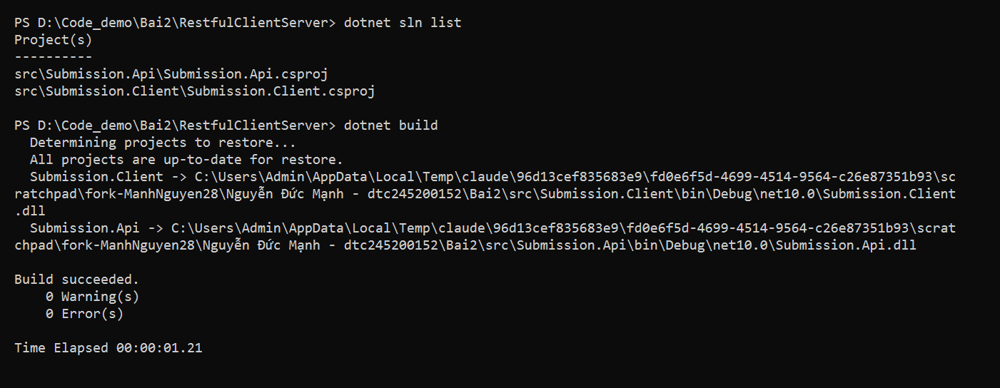

### Bước 2: chạy máy chủ ở cổng 5000

Terminal 1:

```powershell
dotnet run --project src/Submission.Api --urls http://localhost:5000
```

Terminal 2:

```powershell
curl.exe -i http://localhost:5000/
```

Kết quả: `Now listening on: http://localhost:5000`, và `curl.exe` trả `200 OK` kèm `{"service":"Submission.Api","status":"running"}`. Cổng 5000 cũng được đặt cố định trong `Properties/launchSettings.json`.

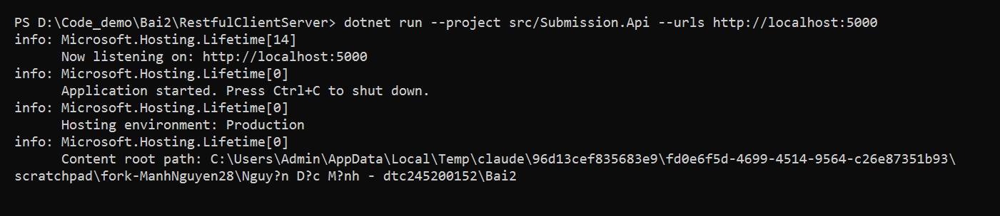

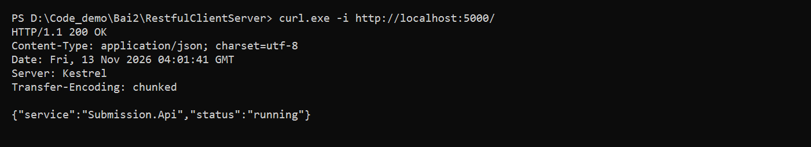

### Bước 3: danh sách bài tập

```powershell
curl.exe -i http://localhost:5000/api/assignments
```

Kết quả: `200 OK`, mảng JSON gồm 3 bài tập, trường `isOpen` viết camelCase.

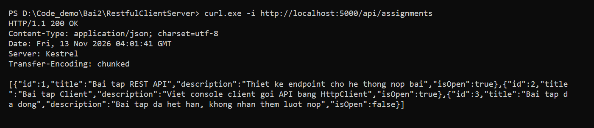

### Bước 4: chi tiết một bài tập

```powershell
curl.exe -i http://localhost:5000/api/assignments/1
curl.exe -i http://localhost:5000/api/assignments/999
curl.exe -i http://localhost:5000/api/assignments/abc
```

| Lệnh | Kết quả | Ai trả lời |
|---|---|---|
| `/api/assignments/1` | 200 + bài tập số 1 | Handler: tìm thấy |
| `/api/assignments/999` | 404 + `ASSIGNMENT_NOT_FOUND` | Handler: chạy, không tìm thấy, tự trả 404 có body |
| `/api/assignments/abc` | 404, body rỗng | Framework: `abc` không khớp `{assignmentId:int}`, handler không chạy |

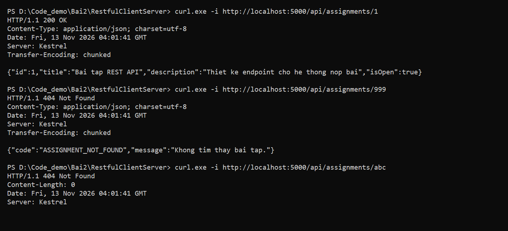

### Bước 5: nộp bài bằng POST

```powershell
curl.exe -i -X POST http://localhost:5000/api/assignments/1/submissions -H "Content-Type: application/json" -d "@sv001.json"
curl.exe -i -X POST http://localhost:5000/api/assignments/1/submissions -H "Content-Type: application/json" -d "@rong.json"
curl.exe -i -X POST http://localhost:5000/api/assignments/999/submissions -H "Content-Type: application/json" -d "@sv001.json"
curl.exe -i -X POST http://localhost:5000/api/assignments/3/submissions -H "Content-Type: application/json" -d "@sv001.json"
```

| Ca | Kết quả | Ai trả lời |
|---|---|---|
| POST bài 1, `sv001.json` | 201 Created + `Location: /api/submissions/{id}` | Handler: tạo thành công, có địa chỉ đọc lại |
| POST bài 1, `rong.json` | 400 `INVALID_SUBMISSION` | Handler: dữ liệu thiếu |
| POST bài 999 | 404 `ASSIGNMENT_NOT_FOUND` | Handler: tài nguyên cha không tồn tại |
| POST bài 3 (đã đóng) | 400 `ASSIGNMENT_CLOSED` | Handler: đúng cú pháp, sai quy tắc nghiệp vụ |

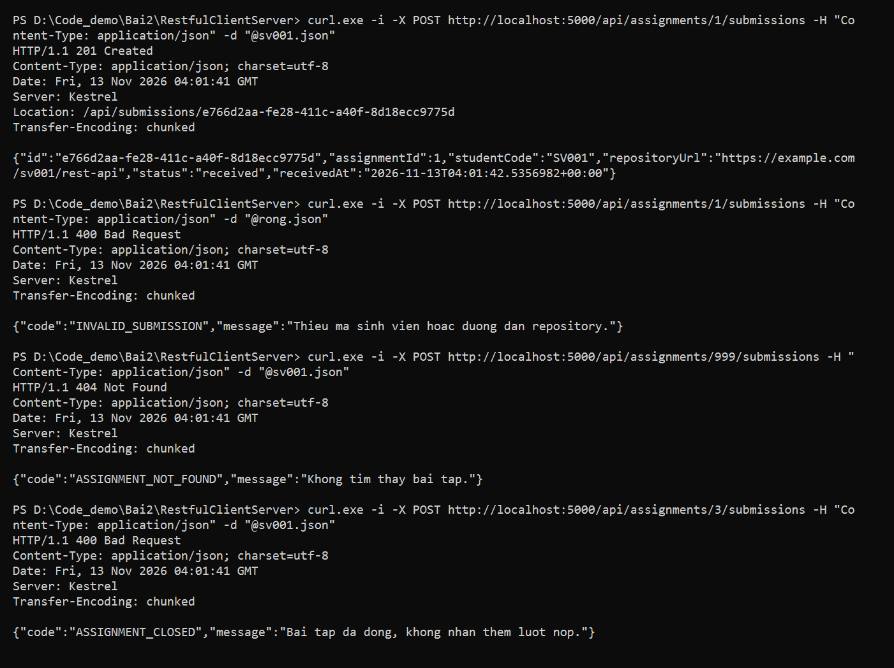

Ba ca do framework trả (không có `ApiError`, không bị tính là lỗi của handler):

```powershell
curl.exe -i -X POST http://localhost:5000/api/assignments/1/submissions -d "@sv001.json"
curl.exe -i -X POST http://localhost:5000/api/assignments/1/submissions -H "Content-Type: application/json" -d "@hong.json"
curl.exe -i -X PUT http://localhost:5000/api/assignments/1
```

| Ca | Kết quả | Ai trả lời |
|---|---|---|
| Thiếu `Content-Type` | 415, body rỗng | Framework: không biết body là JSON |
| JSON hỏng | 400, body rỗng | Framework: không đọc được body |
| `PUT /api/assignments/1` | 405, `Allow: GET` | Framework: URI có, phương thức không hỗ trợ |

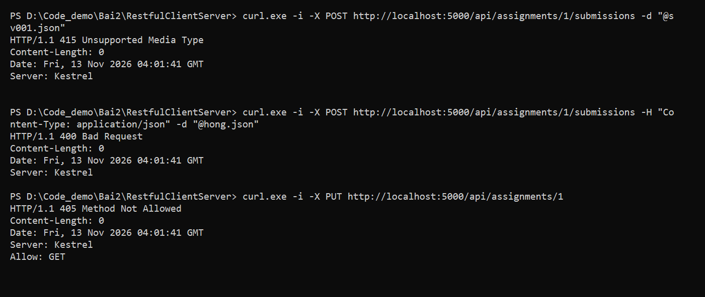

### Bước 6: đọc lại lượt nộp theo `Location`

Sau khi POST nhận 201, lấy địa chỉ trong header `Location` rồi gọi `GET`:

```powershell
curl.exe -i http://localhost:5000/api/submissions/<id lấy từ Location>
curl.exe -i http://localhost:5000/api/submissions/00000000-0000-0000-0000-000000000000
```

Kết quả: id thật trả `200 OK` với đúng lượt nộp, id giả trả `404 SUBMISSION_NOT_FOUND`.

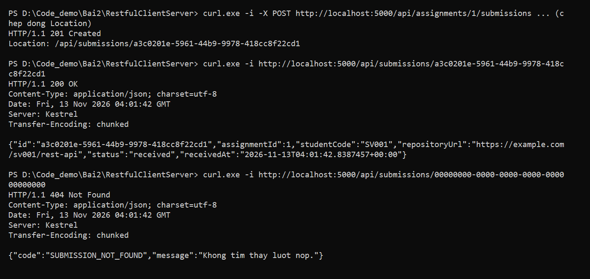

### Bước 7: máy khách `Submission.Client`

`src/Submission.Client/Program.cs` lấy địa chỉ máy chủ từ `args[0]` (mặc định `http://localhost:5000`), dùng `HttpClient` với `BaseAddress` và chạy 4 nấc:

1. `GetFromJsonAsync` lấy danh sách và in các bài tập đang mở.
2. `PostAsJsonAsync` nộp bài, **xem mã trạng thái trước** (`!= Created` thì đọc `ApiError` bằng hàm `PrintApiErrorAsync` rồi dừng), sau đó mới đọc `SubmissionDto`.
3. Đọc lại lượt nộp qua địa chỉ trong header `Location`.
4. Cố ý gửi `studentCode` rỗng, nhận 400, in `code` từ `ApiError` mà không sập.

Lỗi mạng (không có phản hồi) được bắt riêng bằng `HttpRequestException` và in thông báo "Loi mang", khác với lỗi HTTP (có phản hồi 4xx).

```powershell
dotnet run --project src/Submission.Client -- http://localhost:5000
```

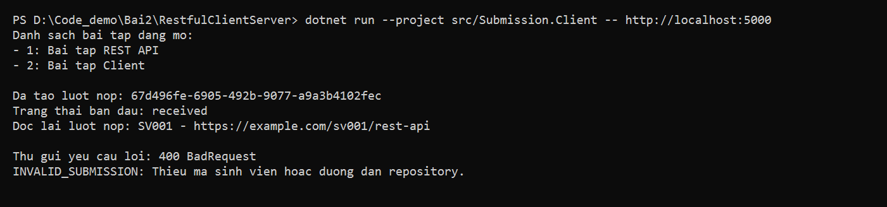

### Bước 8: `requests.http`

`requests.http` có **7 request**, mỗi request ghi mã mong đợi ở tiêu đề `###`. Bấm **Send Request** (extension REST Client) để chạy. Request 4 dùng `# @name createSubmission` để lấy `id` từ phản hồi của request 3, nên chạy request 3 trước.

| # | Yêu cầu | Mã mong đợi |
|---|---|---|
| 1 | `GET /api/assignments` | 200 |
| 2 | `GET /api/assignments/999` | 404 `ASSIGNMENT_NOT_FOUND` |
| 3 | `POST /api/assignments/1/submissions` hợp lệ | 201 + `Location` |
| 4 | `GET /api/submissions/{id vừa tạo}` | 200 |
| 5 | `POST` thiếu dữ liệu | 400 `INVALID_SUBMISSION` |
| 6 | `POST` vào bài tập đã đóng (bài 3) | 400 `ASSIGNMENT_CLOSED` |
| 7 | `GET /api/submissions/00000000-0000-0000-0000-000000000000` | 404 `SUBMISSION_NOT_FOUND` |

Bộ request bao phủ các mã 200, 201, 400 và 404.

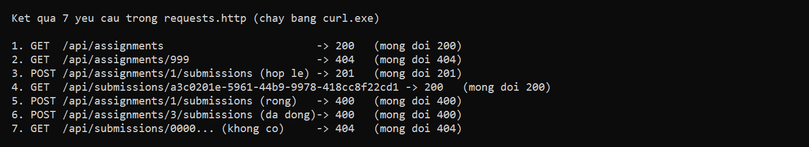

## 2. Bảng phá thử

| # | Thí nghiệm | Kết quả quan sát | Bài học |
|---|---|---|---|
| 1 | Tắt máy chủ rồi chạy máy khách | `Loi mang: khong ket noi duoc toi http://localhost:5000. No connection could be made because the target machine actively refused it.` Máy khách không sập, thoát với mã 1 | Lỗi mạng (không có phản hồi) khác lỗi HTTP (có phản hồi 4xx) |
| 2 | Chạy máy khách với cổng sai `5999` | Cùng loại lỗi, ghi đúng `localhost:5999` | Địa chỉ dịch vụ là cấu hình, hai bên phải thống nhất |
| 3 | Nộp bài, tắt máy chủ, bật lại, `GET` với id cũ | `404 SUBMISSION_NOT_FOUND` | Dữ liệu nằm trong RAM của tiến trình máy chủ, tắt là mất |
| 4 | `POST` vào bài tập 3 (đã đóng) | `400 ASSIGNMENT_CLOSED` | Đúng cú pháp nhưng sai quy tắc nghiệp vụ: lỗi do máy khách, có `ApiError` |
| 5 | `POST` thiếu `Content-Type`; `POST` JSON hỏng; `PUT /api/assignments/1` | 415, 400 và 405, đều body rỗng | Ba ca này do framework trả trước khi vào handler, nên không có `ApiError` |

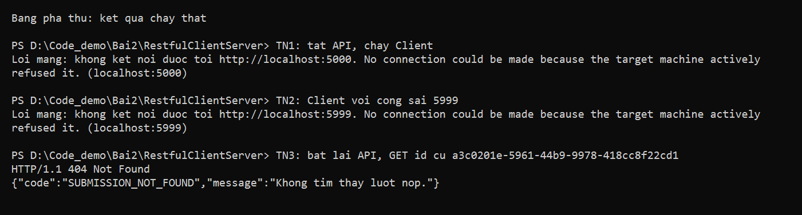

Kết quả thí nghiệm 4 xem ở ảnh Bước 5 (bài 3, `ASSIGNMENT_CLOSED`), thí nghiệm 5 xem ở ảnh "ba ca do framework trả".

## 3. Trả lời 3 câu hỏi giải thích

**Câu 1. Vì sao URI dùng danh từ, còn hành động do phương thức HTTP đảm nhận?**

URI chỉ **tài nguyên**: `assignments` (bài tập), `submissions` (lượt nộp). Hành động do phương thức HTTP thể hiện: `GET` để đọc, `POST` để tạo. Vì vậy "nộp bài" viết là `POST /api/assignments/1/submissions` (tạo một lượt nộp thuộc bài tập 1), không viết `/submitAssignment`. Cách này giúp chỉ cần nhìn URI và phương thức là đoán được ý nghĩa, và cùng một URI dùng được cho nhiều thao tác (ví dụ `/api/assignments` có thể `GET` lấy danh sách, sau này `POST` để giao bài mới). Nếu đưa động từ vào URI thì mỗi thao tác cần một URI riêng, khó đoán và khó mở rộng.

**Câu 2. "Stateless" thể hiện ở đâu trong code đã viết?**

Mỗi yêu cầu tự mang đủ thông tin để máy chủ xử lý, và máy chủ không nhớ gì giữa hai lần gọi. Khi nộp bài, `assignmentId` nằm trên URI, còn `studentCode` và `repositoryUrl` nằm trong body JSON. Handler chỉ dùng tham số của chính yêu cầu đó, không có biến "phiên" như "bài tập đang chọn". Nhờ vậy nếu có hai máy chủ chạy song song thì yêu cầu nào đến máy nào cũng xử lý được. Stateless không có nghĩa máy chủ không lưu dữ liệu: danh sách `submissions` vẫn nằm trong bộ nhớ máy chủ, chỉ là máy chủ không nhớ cuộc hội thoại với từng máy khách.

**Câu 3. Vì sao client và server mỗi bên khai báo DTO riêng mà vẫn khớp nhau?**

DTO là **hợp đồng JSON**, không phải lớp dùng chung giữa hai project. `Submission.Api` và `Submission.Client` là hai chương trình, hai tiến trình, không chung bộ nhớ và không tham chiếu project của nhau; qua mạng chỉ có chuỗi JSON. Hai bên khớp nhau nhờ **tên trường và kiểu dữ liệu trong JSON** (`id`, `studentCode`, `repositoryUrl`, `status`...). Nhờ đó mỗi bên sửa bên trong của mình mà bên kia không cần biết, miễn hợp đồng không đổi. Đổi lại, hợp đồng chỉ là lời hứa: nếu client khai báo sai tên trường (ví dụ `Ten` thay vì `title`) thì vẫn biên dịch được nhưng giá trị sẽ là `null`.

## 4. Phiếu tự kiểm tra

| # | Yêu cầu | Mong đợi | Tự đánh giá |
|---|---|---|---|
| 1 | `dotnet build` | 0 lỗi | ✓ |
| 2 | `GET /api/assignments` | 200 + mảng | ✓ |
| 3 | `GET /api/assignments/1` | 200 | ✓ |
| 4 | `GET /api/assignments/999` | 404 + `ASSIGNMENT_NOT_FOUND` | ✓ |
| 5 | `POST` hợp lệ | 201 + `Location` | ✓ |
| 6 | `POST` thiếu dữ liệu | 400 `INVALID_SUBMISSION` | ✓ |
| 7 | `POST` bài đã đóng | 400 `ASSIGNMENT_CLOSED` | ✓ |
| 8 | `GET /api/submissions/{id}` | 200, id lạ trả 404 `SUBMISSION_NOT_FOUND` | ✓ |
| 9 | Máy khách chạy | đủ 4 nấc, không sập khi gặp 400 | ✓ |
| 10 | Tắt máy chủ, chạy máy khách | báo lỗi mạng, không sập | ✓ |

Git: mỗi bước một commit (Bước 1 đến Bước 8, rồi README), không có `bin/` và `obj/` trong repo.

## 5. Cách chạy lại

```powershell
dotnet build
```

Terminal 1 (máy chủ, giữ nguyên cho đến khi `Ctrl+C`):

```powershell
dotnet run --project src/Submission.Api --urls http://localhost:5000
```

Terminal 2 (máy khách, hoặc dùng `curl.exe` / `requests.http`):

```powershell
dotnet run --project src/Submission.Client -- http://localhost:5000
```

Dữ liệu lượt nộp nằm trong bộ nhớ của máy chủ, tắt máy chủ là mất.
