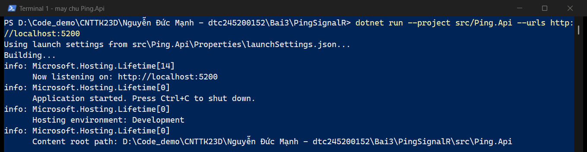
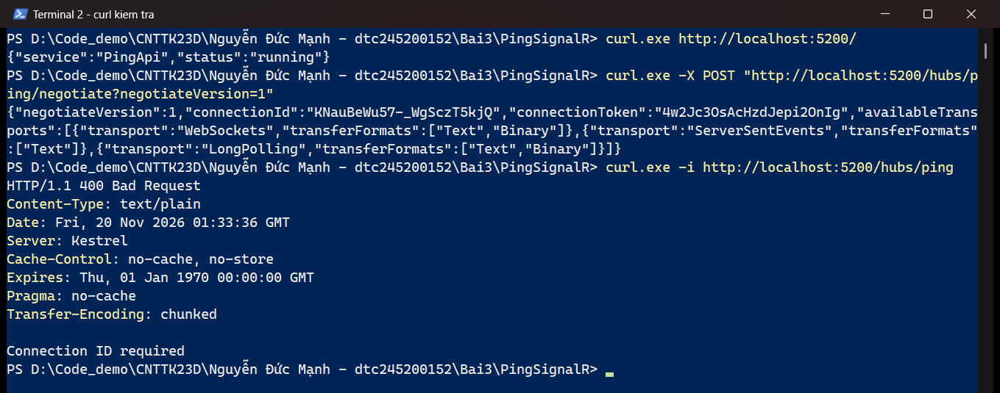
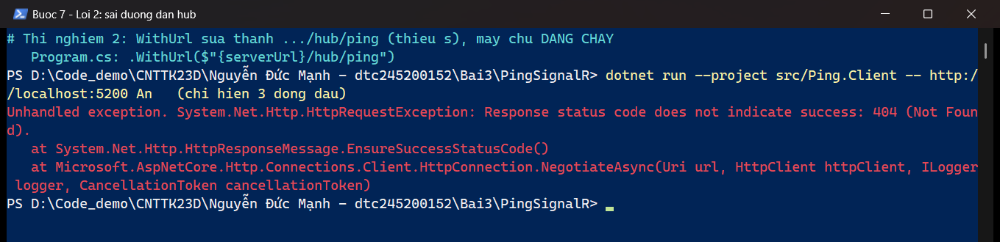
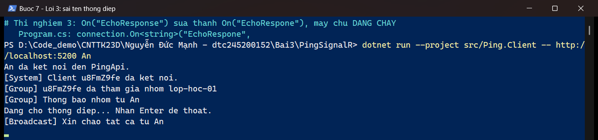
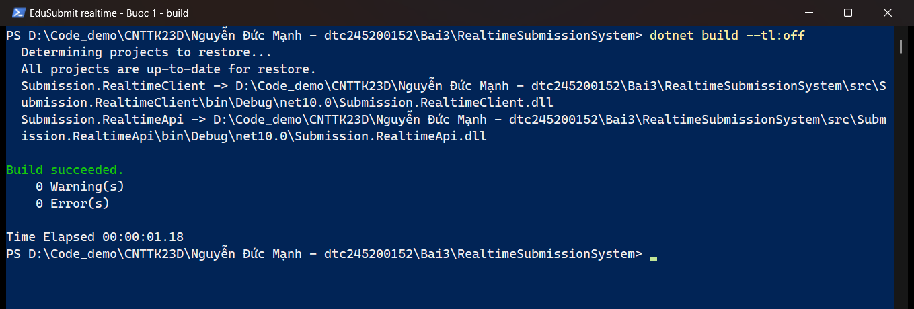

# Bài 3 – SignalR: truyền thông thời gian thực

Họ tên: Nguyễn Đức Mạnh       MSSV: dtc245200152       Lớp: CNTT K23D

Cấu trúc thư mục:

```
Bai3/
├── README.md        (nhật ký này)
├── anhchupminhchung/ (ảnh minh chứng từng bước)
└── PingSignalR/
    ├── PingSignalR.slnx
    └── src/Ping.Api, Ping.Client
```

---

# Phần 1 – PingSignalR

## Bước 1: tạo solution, 2 project, thêm gói SignalR cho máy khách


Lệnh đã chạy:

```powershell
mkdir PingSignalR
cd PingSignalR
dotnet new sln -n PingSignalR
dotnet new web -n Ping.Api -o src/Ping.Api
dotnet new console -n Ping.Client -o src/Ping.Client
dotnet sln add src/Ping.Api/Ping.Api.csproj
dotnet sln add src/Ping.Client/Ping.Client.csproj
dotnet add src/Ping.Client package Microsoft.AspNetCore.SignalR.Client --version 10.0.15
dotnet new gitignore
dotnet build
```

Thấy: `Build succeeded`, `0 Warning(s)`, `0 Error(s)`; `Ping.Client.csproj` có dòng `PackageReference ... SignalR.Client ... 10.0.15`.

Giải thích: chỉ máy khách cần thêm gói `Microsoft.AspNetCore.SignalR.Client`; máy chủ dùng `Microsoft.AspNetCore.App` đã có sẵn SignalR. Build khi chưa viết code để chắc chắn cài đặt và mạng (NuGet) không có vấn đề.

(Ảnh dùng `dotnet build --tl:off` để .NET 10 in đầy đủ dòng `0 Warning(s)` / `0 Error(s)`.)

## Bước 2: máy chủ thêm hub SignalR, kiểm tra negotiate bằng curl

Code `src/Ping.Api/Program.cs`: thêm `builder.Services.AddSignalR();` (trước `Build()`) và `app.MapHub<PingHub>("/hubs/ping");`, lớp `PingHub : Hub` đặt cuối tệp.

Terminal 1 – máy chủ chạy ở cổng 5200:



Terminal 2 – ba lệnh kiểm tra:



Thấy:
- `GET /` → `{"service":"PingApi","status":"running"}`: endpoint REST vẫn chạy song song với hub.
- `POST /hubs/ping/negotiate?negotiateVersion=1` → có `connectionId`, `connectionToken` và `availableTransports` gồm **WebSockets, ServerSentEvents, LongPolling**.
- `GET /hubs/ping` → `400 Bad Request`, `Connection ID required`.

Giải thích: negotiate là bước bắt tay – máy chủ cấp mã kết nối và báo các cách truyền tải nó hỗ trợ; máy khách chọn cách tốt nhất (thường là WebSockets). Hub không trả lời như REST: gọi thẳng `/hubs/ping` mà chưa có `connectionId` thì bị 400.

## Bước 3: phương thức Echo – máy chủ trả lời riêng người vừa gọi

Thay lớp `PingHub` trong `src/Ping.Api/Program.cs`:

```csharp
sealed class PingHub : Hub
{
    public async Task Echo(string message)
    {
        await Clients.Caller.SendAsync("EchoResponse", $"Echo: {message}");
    }
}
```


Thấy: build `0 Error(s)`; máy chủ chạy lại ở `http://localhost:5200`.

Giải thích: mỗi phương thức `public` của hub là thứ máy khách gọi được qua `InvokeAsync("Echo", ...)`. Mẫu câu gửi: `Clients.<ai nhận>.SendAsync("<TÊN thông điệp>", dữ liệu)`. `Clients.Caller` chỉ gửi cho kết nối vừa gọi. Chưa test được bằng curl vì hub cần máy khách SignalR (bước 4). Sau mỗi lần sửa `Program.cs` phải Ctrl+C và chạy lại máy chủ, nếu không máy chủ vẫn chạy code cũ.

## Bước 4: máy khách – Build → On → Start → Invoke

Code `src/Ping.Client/Program.cs`: `HubConnectionBuilder().WithUrl(".../hubs/ping").WithAutomaticReconnect().Build()`, đăng ký `connection.On<string>("EchoResponse", ...)`, `await connection.StartAsync()`, rồi `await connection.InvokeAsync("Echo", ...)`.

Terminal 1 – máy chủ (trái), Terminal 2 – máy khách An (phải):


Lệnh máy khách: `dotnet run --project src/Ping.Client -- http://localhost:5200 An`

Thấy: `An da ket noi den PingApi.` rồi `[Echo] Echo: Xin chao SignalR tu An`.

Giải thích: `InvokeAsync("Echo", ...)` gửi lời gọi LÊN hub (tên phải khớp tên phương thức C#). Hub gửi `"EchoResponse"` XUỐNG; hàm `On` đã đăng ký in ra dòng `[Echo]`. Hai chiều đi trên cùng một kết nối. `On` phải đăng ký trước `StartAsync` để không lỡ tin; chỉ gọi hub được sau khi `StartAsync` xong. Máy chủ chưa in gì thêm vì hub chưa ghi nhật ký (bước 6 thêm).

## Bước 5: phát rộng (All) và nhóm (Group)

Thêm vào `PingHub`: `Broadcast` (`Clients.All`, thông điệp `BroadcastMessage`), `JoinGroup` (`Groups.AddToGroupAsync`), `SendToGroup` (`Clients.Group`, thông điệp `GroupMessage`). Máy khách thêm 2 dòng `On` trước `StartAsync` và 3 lời gọi `JoinGroup("lop-hoc-01")`, `SendToGroup`, `Broadcast` sau `Echo`.

Chạy 3 terminal theo thứ tự: máy chủ → An → Bình. Trái: An (chạy trước), phải: Bình (chạy sau):


Thấy:
- **An** nhận tin của Bình: `[Group] s8Qx7oyn da tham gia nhom lop-hoc-01`, `[Group] Thong bao nhom tu Binh`, `[Broadcast] Xin chao tat ca tu Binh`.
- **An KHÔNG nhận** `[Echo] ... tu Binh`, vì Echo dùng `Clients.Caller`.
- **Bình** chỉ thấy tin của chính mình, không thấy tin An gửi trước khi Bình vào (SignalR không lưu tin cũ).

Giải thích 3 phạm vi gửi: `Clients.Caller` = chỉ người gọi; `Clients.Group(tên)` = chỉ thành viên nhóm; `Clients.All` = mọi kết nối đang mở, kể cả người gửi.

Thử thách 3 phút (An, Bình trong nhóm `lop-hoc-01`; Chi không ở nhóm nào):

| Lời gọi | An | Bình | Chi | Phạm vi |
|---|---|---|---|---|
| ① An gọi `Echo("hi")` | ✓ | ✗ | ✗ | `Clients.Caller` |
| ② Chi gọi `SendToGroup("lop-hoc-01", "x")` | ✓ | ✓ | ✗ | `Clients.Group` |
| ③ Bình gọi `Broadcast("y")` | ✓ | ✓ | ✓ | `Clients.All` |

Câu ②: Chi gửi được vào nhóm nhưng Chi không nhận, vì Chi không phải thành viên nhóm (hub ví dụ không kiểm tra quyền gửi).

## Bước 6: vòng đời kết nối và tự kết nối lại

Máy chủ thêm `OnConnectedAsync` / `OnDisconnectedAsync` (in `[Hub] + ... ket noi`, gửi `SystemMessage` cho tất cả). Máy khách thêm `On("SystemMessage")` và 3 sự kiện `Reconnecting`, `Reconnected`, `Closed`.

Trước khi tắt máy chủ – máy chủ in `[Hub] + hX8OHTyo ket noi`, An nhận `[System] Client hX8OHTyo da ket noi.`:


Thí nghiệm: tắt máy chủ (Ctrl+C), vài giây sau chạy lại. Trái: An, phải: máy chủ chạy lại:


Thấy: An in `[Lifecycle] Dang ket noi lai...` rồi `[Lifecycle] Da ket noi lai: _-2n_BG1` và `[System] Client _-2n_BG1 da ket noi.`; máy chủ mới in `[Hub] + _-2n_BG1 ket noi`.

Giải thích:
- `WithAutomaticReconnect()` thử lại theo lịch mặc định 0 s, 2 s, 10 s, 30 s; hết 4 lần thì `Closed`.
- **ConnectionId đổi** (`hX8OHTyo` → `_-2n_BG1`): máy chủ coi đây là kết nối MỚI.
- **Nhóm bị mất**: nhóm gắn với ConnectionId cũ; muốn ở lại nhóm phải gọi lại `JoinGroup` trong `Reconnected`.
- **Tin gửi lúc rớt mạng bị mất hẳn**: SignalR không lưu tin để gửi lại.

## Bước 7: ba thí nghiệm lỗi

Dự đoán (ghi TRƯỚC khi chạy):

| # | Thao tác | Dự đoán |
|---|---|---|
| 1 | Chạy máy khách khi máy chủ đã tắt | `StartAsync` ném `HttpRequestException` không kết nối được; `WithAutomaticReconnect` không giúp vì kết nối chưa từng mở |
| 2 | Sửa `WithUrl` thành `/hub/ping` (thiếu `s`) | Lỗi ngay ở bước negotiate: `404 (Not Found)` |
| 3 | Sửa `On("EchoResponse")` thành `On("EchoRespone")` | Không có lỗi nào, chỉ là không in dòng `[Echo]` |

Kết quả chạy thật:

Thí nghiệm 1 – máy chủ chưa chạy:


Thí nghiệm 2 – sai đường dẫn hub `/hub/ping`:



Thí nghiệm 3 – sai tên thông điệp `EchoRespone`:



| # | Dự đoán | Kết quả thật | Đúng/Sai | Giải thích |
|---|---|---|---|---|
| 1 | `HttpRequestException` không kết nối được | `HttpRequestException: No connection could be made because the target machine actively refused it. (localhost:5200)` – chương trình dừng | Đúng | `StartAsync` phải gọi negotiate tới máy chủ; không có tiến trình nào nghe cổng 5200 nên bị từ chối ngay. `WithAutomaticReconnect` chỉ cứu kết nối ĐÃ mở, không áp dụng cho lần mở đầu tiên. |
| 2 | 404 ở bước negotiate | `HttpRequestException: Response status code does not indicate success: 404 (Not Found)` tại `HttpConnection.NegotiateAsync` | Đúng | Máy chủ chỉ `MapHub` ở `/hubs/ping`; gọi `/hub/ping/negotiate` không có tuyến nào nên 404. Đường dẫn trong `WithUrl` phải khớp từng chữ với `MapHub`. |
| 3 | Không lỗi, không có dòng `[Echo]` | Kết nối bình thường, có `[System]`, `[Group]`, `[Broadcast]` nhưng **không có `[Echo]`**, không có thông báo lỗi nào | Đúng | Hub vẫn gửi `"EchoResponse"`, nhưng máy khách lại nghe `"EchoRespone"`; SignalR bỏ qua thông điệp không ai đăng ký, không báo lỗi. Đây là lỗi khó phát hiện nhất: khi "không nhận được gì", việc đầu tiên là so tên thông điệp hai phía. |

Sau mỗi thí nghiệm code đã được trả về như cũ và build lại `0 Error(s)`.

### Tổng hợp Phần 1 – 4 phạm vi gửi

| Phạm vi | Ai nhận | Dùng ở PingSignalR |
|---|---|---|
| `Clients.All` | Mọi kết nối đang mở | `Broadcast`, `SystemMessage` |
| `Clients.Caller` | Chỉ người vừa gọi hub | `Echo` |
| `Clients.Group(tên)` | Thành viên nhóm | `JoinGroup`, `SendToGroup` |
| `Clients.Client(id)` | Một ConnectionId cụ thể | (chưa dùng) |

Bốn trụ cột: ① `AddSignalR` + `MapHub` ở máy chủ · ② phương thức hub gửi bằng `Clients.X.SendAsync` · ③ `HubConnectionBuilder` + `On` + `StartAsync` ở máy khách · ④ chọn đúng phạm vi người nhận.

---

# Phần 2 – EduSubmit nhận thông báo trạng thái thời gian thực (RealtimeSubmissionSystem)

Ý chính: giữ nguyên REST của Bài 2 để tạo và đọc lượt nộp; thêm hub `/hubs/submissions` để máy chủ **đẩy** trạng thái `processing`, `graded` tới đúng nhóm `submission:{id}`. Máy chủ cổng **5000**.

Thiết kế kênh thời gian thực (khung 4 câu hỏi, trả lời trước khi code):

| Câu hỏi | Trả lời | Code tương ứng |
|---|---|---|
| ① Sự kiện nào kích hoạt thông điệp? | Mỗi lần trạng thái lượt nộp đổi: received → processing → graded | `UpdateStatusAsync(id, status, ...)` |
| ② Gửi cho ai? | Chỉ máy khách đang theo dõi đúng lượt nộp đó, không dùng `Clients.All` | `Clients.Group("submission:{id}")` |
| ③ Gửi kèm dữ liệu gì? | Mã lượt nộp, trạng thái mới, thời điểm đổi | `record SubmissionStatusMessage(Guid SubmissionId, string Status, DateTimeOffset UpdatedAt)` |
| ④ Mất kết nối thì lấy lại trạng thái thế nào? | SignalR không lưu tin; gọi lại REST | `GET /api/submissions/{id}` |

## EduSubmit – Bước 1: tạo solution RealtimeSubmissionSystem

```powershell
mkdir RealtimeSubmissionSystem; cd RealtimeSubmissionSystem
dotnet new sln -n RealtimeSubmissionSystem
dotnet new web -n Submission.RealtimeApi -o src/Submission.RealtimeApi
dotnet new console -n Submission.RealtimeClient -o src/Submission.RealtimeClient
dotnet sln add src/Submission.RealtimeApi/Submission.RealtimeApi.csproj
dotnet sln add src/Submission.RealtimeClient/Submission.RealtimeClient.csproj
dotnet add src/Submission.RealtimeClient package Microsoft.AspNetCore.SignalR.Client --version 10.0.15
dotnet new gitignore
dotnet build
```



Thấy: `Build succeeded`, `0 Error(s)`. Giải thích: máy chủ là template `web` (REST Bài 2 + hub), máy khách là `console` + gói SignalR Client (HttpClient + HubConnection).
