# Bài 3 – SignalR: truyền thông thời gian thực

Họ tên: Nguyễn Đức Mạnh       MSSV: dtc245200152       Lớp: CNTT K23D

Cấu trúc thư mục:

```
Bai3/
├── README.md        (nhật ký này)
├── anhchupminhchung/ (ảnh minh chứng từng bước)
└── PingSignalR/
    ├── PingSignalR.slnx
    └── src/Ping.Api, Ping.Client
```

---

# Phần 1 – PingSignalR

## Bước 1: tạo solution, 2 project, thêm gói SignalR cho máy khách


Lệnh đã chạy:

```powershell
mkdir PingSignalR
cd PingSignalR
dotnet new sln -n PingSignalR
dotnet new web -n Ping.Api -o src/Ping.Api
dotnet new console -n Ping.Client -o src/Ping.Client
dotnet sln add src/Ping.Api/Ping.Api.csproj
dotnet sln add src/Ping.Client/Ping.Client.csproj
dotnet add src/Ping.Client package Microsoft.AspNetCore.SignalR.Client --version 10.0.15
dotnet new gitignore
dotnet build
```

Thấy: `Build succeeded`, `0 Warning(s)`, `0 Error(s)`; `Ping.Client.csproj` có dòng `PackageReference ... SignalR.Client ... 10.0.15`.

Giải thích: chỉ máy khách cần thêm gói `Microsoft.AspNetCore.SignalR.Client`; máy chủ dùng `Microsoft.AspNetCore.App` đã có sẵn SignalR. Build khi chưa viết code để chắc chắn cài đặt và mạng (NuGet) không có vấn đề.

(Ảnh dùng `dotnet build --tl:off` để .NET 10 in đầy đủ dòng `0 Warning(s)` / `0 Error(s)`.)

## Bước 2: máy chủ thêm hub SignalR, kiểm tra negotiate bằng curl

Code `src/Ping.Api/Program.cs`: thêm `builder.Services.AddSignalR();` (trước `Build()`) và `app.MapHub<PingHub>("/hubs/ping");`, lớp `PingHub : Hub` đặt cuối tệp.

Terminal 1 – máy chủ chạy ở cổng 5200:


Terminal 2 – ba lệnh kiểm tra:


Thấy:
- `GET /` → `{"service":"PingApi","status":"running"}`: endpoint REST vẫn chạy song song với hub.
- `POST /hubs/ping/negotiate?negotiateVersion=1` → có `connectionId`, `connectionToken` và `availableTransports` gồm **WebSockets, ServerSentEvents, LongPolling**.
- `GET /hubs/ping` → `400 Bad Request`, `Connection ID required`.

Giải thích: negotiate là bước bắt tay – máy chủ cấp mã kết nối và báo các cách truyền tải nó hỗ trợ; máy khách chọn cách tốt nhất (thường là WebSockets). Hub không trả lời như REST: gọi thẳng `/hubs/ping` mà chưa có `connectionId` thì bị 400.

## Bước 3: phương thức Echo – máy chủ trả lời riêng người vừa gọi

Thay lớp `PingHub` trong `src/Ping.Api/Program.cs`:

```csharp
sealed class PingHub : Hub
{
    public async Task Echo(string message)
    {
        await Clients.Caller.SendAsync("EchoResponse", $"Echo: {message}");
    }
}
```


Thấy: build `0 Error(s)`; máy chủ chạy lại ở `http://localhost:5200`.

Giải thích: mỗi phương thức `public` của hub là thứ máy khách gọi được qua `InvokeAsync("Echo", ...)`. Mẫu câu gửi: `Clients.<ai nhận>.SendAsync("<TÊN thông điệp>", dữ liệu)`. `Clients.Caller` chỉ gửi cho kết nối vừa gọi. Chưa test được bằng curl vì hub cần máy khách SignalR (bước 4). Sau mỗi lần sửa `Program.cs` phải Ctrl+C và chạy lại máy chủ, nếu không máy chủ vẫn chạy code cũ.

## Bước 4: máy khách – Build → On → Start → Invoke

Code `src/Ping.Client/Program.cs`: `HubConnectionBuilder().WithUrl(".../hubs/ping").WithAutomaticReconnect().Build()`, đăng ký `connection.On<string>("EchoResponse", ...)`, `await connection.StartAsync()`, rồi `await connection.InvokeAsync("Echo", ...)`.

Terminal 1 – máy chủ (trái), Terminal 2 – máy khách An (phải):

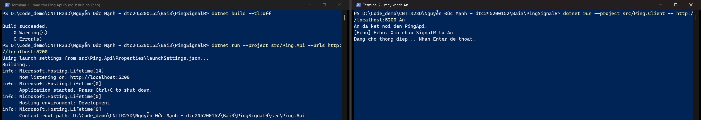

Lệnh máy khách: `dotnet run --project src/Ping.Client -- http://localhost:5200 An`

Thấy: `An da ket noi den PingApi.` rồi `[Echo] Echo: Xin chao SignalR tu An`.

Giải thích: `InvokeAsync("Echo", ...)` gửi lời gọi LÊN hub (tên phải khớp tên phương thức C#). Hub gửi `"EchoResponse"` XUỐNG; hàm `On` đã đăng ký in ra dòng `[Echo]`. Hai chiều đi trên cùng một kết nối. `On` phải đăng ký trước `StartAsync` để không lỡ tin; chỉ gọi hub được sau khi `StartAsync` xong. Máy chủ chưa in gì thêm vì hub chưa ghi nhật ký (bước 6 thêm).

## Bước 5: phát rộng (All) và nhóm (Group)

Thêm vào `PingHub`: `Broadcast` (`Clients.All`, thông điệp `BroadcastMessage`), `JoinGroup` (`Groups.AddToGroupAsync`), `SendToGroup` (`Clients.Group`, thông điệp `GroupMessage`). Máy khách thêm 2 dòng `On` trước `StartAsync` và 3 lời gọi `JoinGroup("lop-hoc-01")`, `SendToGroup`, `Broadcast` sau `Echo`.

Chạy 3 terminal theo thứ tự: máy chủ → An → Bình. Trái: An (chạy trước), phải: Bình (chạy sau):

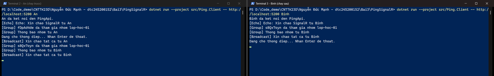

Thấy:
- **An** nhận tin của Bình: `[Group] s8Qx7oyn da tham gia nhom lop-hoc-01`, `[Group] Thong bao nhom tu Binh`, `[Broadcast] Xin chao tat ca tu Binh`.
- **An KHÔNG nhận** `[Echo] ... tu Binh`, vì Echo dùng `Clients.Caller`.
- **Bình** chỉ thấy tin của chính mình, không thấy tin An gửi trước khi Bình vào (SignalR không lưu tin cũ).

Giải thích 3 phạm vi gửi: `Clients.Caller` = chỉ người gọi; `Clients.Group(tên)` = chỉ thành viên nhóm; `Clients.All` = mọi kết nối đang mở, kể cả người gửi.

Thử thách 3 phút (An, Bình trong nhóm `lop-hoc-01`; Chi không ở nhóm nào):

| Lời gọi | An | Bình | Chi | Phạm vi |
|---|---|---|---|---|
| ① An gọi `Echo("hi")` | ✓ | ✗ | ✗ | `Clients.Caller` |
| ② Chi gọi `SendToGroup("lop-hoc-01", "x")` | ✓ | ✓ | ✗ | `Clients.Group` |
| ③ Bình gọi `Broadcast("y")` | ✓ | ✓ | ✓ | `Clients.All` |

Câu ②: Chi gửi được vào nhóm nhưng Chi không nhận, vì Chi không phải thành viên nhóm (hub ví dụ không kiểm tra quyền gửi).

## Bước 6: vòng đời kết nối và tự kết nối lại

Máy chủ thêm `OnConnectedAsync` / `OnDisconnectedAsync` (in `[Hub] + ... ket noi`, gửi `SystemMessage` cho tất cả). Máy khách thêm `On("SystemMessage")` và 3 sự kiện `Reconnecting`, `Reconnected`, `Closed`.

Trước khi tắt máy chủ – máy chủ in `[Hub] + hX8OHTyo ket noi`, An nhận `[System] Client hX8OHTyo da ket noi.`:

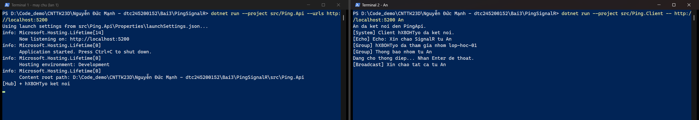

Thí nghiệm: tắt máy chủ (Ctrl+C), vài giây sau chạy lại. Trái: An, phải: máy chủ chạy lại:

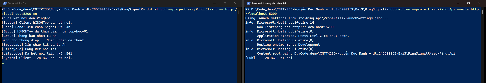

Thấy: An in `[Lifecycle] Dang ket noi lai...` rồi `[Lifecycle] Da ket noi lai: _-2n_BG1` và `[System] Client _-2n_BG1 da ket noi.`; máy chủ mới in `[Hub] + _-2n_BG1 ket noi`.

Giải thích:
- `WithAutomaticReconnect()` thử lại theo lịch mặc định 0 s, 2 s, 10 s, 30 s; hết 4 lần thì `Closed`.
- **ConnectionId đổi** (`hX8OHTyo` → `_-2n_BG1`): máy chủ coi đây là kết nối MỚI.
- **Nhóm bị mất**: nhóm gắn với ConnectionId cũ; muốn ở lại nhóm phải gọi lại `JoinGroup` trong `Reconnected`.
- **Tin gửi lúc rớt mạng bị mất hẳn**: SignalR không lưu tin để gửi lại.

## Bước 7: ba thí nghiệm lỗi

Dự đoán (ghi TRƯỚC khi chạy):

| # | Thao tác | Dự đoán |
|---|---|---|
| 1 | Chạy máy khách khi máy chủ đã tắt | `StartAsync` ném `HttpRequestException` không kết nối được; `WithAutomaticReconnect` không giúp vì kết nối chưa từng mở |
| 2 | Sửa `WithUrl` thành `/hub/ping` (thiếu `s`) | Lỗi ngay ở bước negotiate: `404 (Not Found)` |
| 3 | Sửa `On("EchoResponse")` thành `On("EchoRespone")` | Không có lỗi nào, chỉ là không in dòng `[Echo]` |

Kết quả chạy thật:

Thí nghiệm 1 – máy chủ chưa chạy:

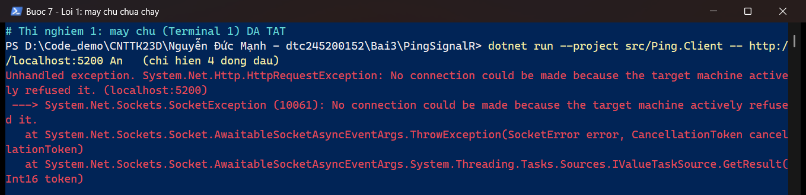

Thí nghiệm 2 – sai đường dẫn hub `/hub/ping`:


Thí nghiệm 3 – sai tên thông điệp `EchoRespone`:


| # | Dự đoán | Kết quả thật | Đúng/Sai | Giải thích |
|---|---|---|---|---|
| 1 | `HttpRequestException` không kết nối được | `HttpRequestException: No connection could be made because the target machine actively refused it. (localhost:5200)` – chương trình dừng | Đúng | `StartAsync` phải gọi negotiate tới máy chủ; không có tiến trình nào nghe cổng 5200 nên bị từ chối ngay. `WithAutomaticReconnect` chỉ cứu kết nối ĐÃ mở, không áp dụng cho lần mở đầu tiên. |
| 2 | 404 ở bước negotiate | `HttpRequestException: Response status code does not indicate success: 404 (Not Found)` tại `HttpConnection.NegotiateAsync` | Đúng | Máy chủ chỉ `MapHub` ở `/hubs/ping`; gọi `/hub/ping/negotiate` không có tuyến nào nên 404. Đường dẫn trong `WithUrl` phải khớp từng chữ với `MapHub`. |
| 3 | Không lỗi, không có dòng `[Echo]` | Kết nối bình thường, có `[System]`, `[Group]`, `[Broadcast]` nhưng **không có `[Echo]`**, không có thông báo lỗi nào | Đúng | Hub vẫn gửi `"EchoResponse"`, nhưng máy khách lại nghe `"EchoRespone"`; SignalR bỏ qua thông điệp không ai đăng ký, không báo lỗi. Đây là lỗi khó phát hiện nhất: khi "không nhận được gì", việc đầu tiên là so tên thông điệp hai phía. |

Sau mỗi thí nghiệm code đã được trả về như cũ và build lại `0 Error(s)`.

### Tổng hợp Phần 1 – 4 phạm vi gửi

| Phạm vi | Ai nhận | Dùng ở PingSignalR |
|---|---|---|
| `Clients.All` | Mọi kết nối đang mở | `Broadcast`, `SystemMessage` |
| `Clients.Caller` | Chỉ người vừa gọi hub | `Echo` |
| `Clients.Group(tên)` | Thành viên nhóm | `JoinGroup`, `SendToGroup` |
| `Clients.Client(id)` | Một ConnectionId cụ thể | (chưa dùng) |

Bốn trụ cột: ① `AddSignalR` + `MapHub` ở máy chủ · ② phương thức hub gửi bằng `Clients.X.SendAsync` · ③ `HubConnectionBuilder` + `On` + `StartAsync` ở máy khách · ④ chọn đúng phạm vi người nhận.

---

# Phần 2 – EduSubmit nhận thông báo trạng thái thời gian thực (RealtimeSubmissionSystem)

Ý chính: giữ nguyên REST của Bài 2 để tạo và đọc lượt nộp; thêm hub `/hubs/submissions` để máy chủ **đẩy** trạng thái `processing`, `graded` tới đúng nhóm `submission:{id}`. Máy chủ cổng **5000**.

Thiết kế kênh thời gian thực (khung 4 câu hỏi, trả lời trước khi code):

| Câu hỏi | Trả lời | Code tương ứng |
|---|---|---|
| ① Sự kiện nào kích hoạt thông điệp? | Mỗi lần trạng thái lượt nộp đổi: received → processing → graded | `UpdateStatusAsync(id, status, ...)` |
| ② Gửi cho ai? | Chỉ máy khách đang theo dõi đúng lượt nộp đó, không dùng `Clients.All` | `Clients.Group("submission:{id}")` |
| ③ Gửi kèm dữ liệu gì? | Mã lượt nộp, trạng thái mới, thời điểm đổi | `record SubmissionStatusMessage(Guid SubmissionId, string Status, DateTimeOffset UpdatedAt)` |
| ④ Mất kết nối thì lấy lại trạng thái thế nào? | SignalR không lưu tin; gọi lại REST | `GET /api/submissions/{id}` |

## EduSubmit – Bước 1: tạo solution RealtimeSubmissionSystem

```powershell
mkdir RealtimeSubmissionSystem; cd RealtimeSubmissionSystem
dotnet new sln -n RealtimeSubmissionSystem
dotnet new web -n Submission.RealtimeApi -o src/Submission.RealtimeApi
dotnet new console -n Submission.RealtimeClient -o src/Submission.RealtimeClient
dotnet sln add src/Submission.RealtimeApi/Submission.RealtimeApi.csproj
dotnet sln add src/Submission.RealtimeClient/Submission.RealtimeClient.csproj
dotnet add src/Submission.RealtimeClient package Microsoft.AspNetCore.SignalR.Client --version 10.0.15
dotnet new gitignore
dotnet build
```


Thấy: `Build succeeded`, `0 Error(s)`. Giải thích: máy chủ là template `web` (REST Bài 2 + hub), máy khách là `console` + gói SignalR Client (HttpClient + HubConnection).

## EduSubmit – Bước 2: REST của Bài 2 + UpdatedAt + khóa dữ liệu

Code `src/Submission.RealtimeApi/Program.cs`: giữ nguyên REST Bài 2 (`GET /api/assignments`, `POST /api/assignments/{id}/submissions` với 404 → 400 CLOSED → 400 INVALID → 201, `GET /api/submissions/{id}`, `ApiError`), thêm trường `UpdatedAt` vào `SubmissionDto` và `lock (submissionsLock)` khi đọc/ghi danh sách.

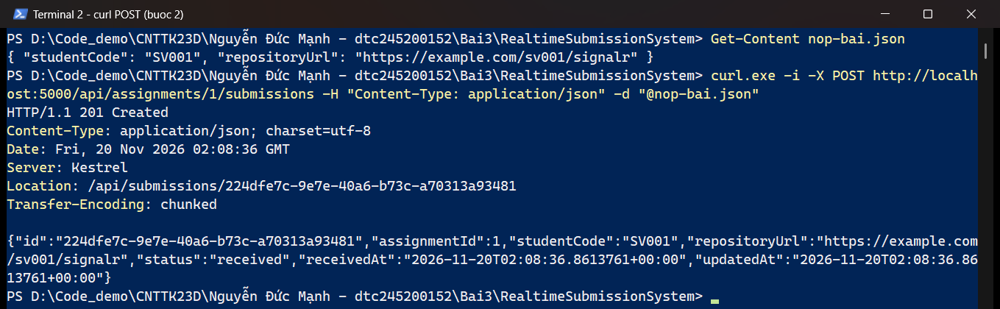

Thấy: `201 Created`, header `Location: /api/submissions/{id}`, body có `"status":"received"` và `"updatedAt"`.

Giải thích: `UpdatedAt` là thời điểm đổi trạng thái gần nhất, máy khách so sánh để biết tin nào mới hơn. `lock` vì ở bước 4 tác vụ chấm nền và các yêu cầu HTTP cùng sửa danh sách; chỉ một luồng được đọc/ghi tại một thời điểm. REST là **nguồn sự thật** (câu ④).

## EduSubmit – Bước 3: hub mỏng, đưa kết nối vào nhóm của lượt nộp

Thêm `builder.Services.AddSignalR()`, `app.MapHub<SubmissionHub>("/hubs/submissions")`, lớp `SubmissionHub` chỉ có `WatchSubmission(id)` (thêm kết nối vào nhóm) và lớp `SubmissionGroups` sinh tên nhóm `submission:{id}`.

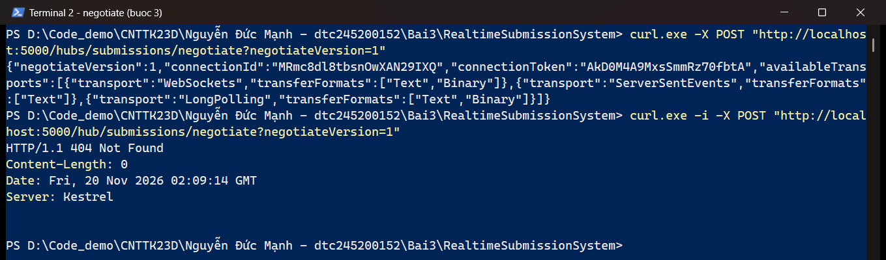

Thấy: negotiate ở `/hubs/submissions` trả `connectionId` + 3 cách truyền tải; `/hub/submissions` trả `404 Not Found`.

Giải thích: hub **mỏng** – không tạo, không chấm bài; nghiệp vụ nằm ở REST và tác vụ nền. Dùng nhóm theo lượt nộp vì 2 lý do: **riêng tư** (sinh viên không thấy trạng thái bài của người khác) và **tiết kiệm băng thông** (chỉ gửi đúng người, thay vì `Clients.All` gửi cho tất cả rồi máy khách tự lọc). Nhóm do máy chủ quản lý. `SubmissionGroups` là chỗ duy nhất sinh tên nhóm nên hai phía không lệch tên (câu ②).

## EduSubmit – Bước 4: IHubContext + mô phỏng chấm bài ở nền

- POST nhận thêm `IHubContext<SubmissionHub> hubContext` và gọi `_ = SimulateGradingAsync(...)` (chạy nền, không `await`) rồi trả `201` ngay.
- `SimulateGradingAsync`: chờ 1 giây → `processing`, chờ 2 giây → `graded`.
- `UpdateStatusAsync`: (1) cập nhật dữ liệu trong `lock` bằng `with { Status, UpdatedAt }`, (2) tạo `SubmissionStatusMessage` chỉ 3 trường, (3) `hub.Clients.Group("submission:{id}").SendAsync("SubmissionStatusChanged", msg)`.

Terminal 2 – POST rồi GET 3 lần (chưa cần máy khách):

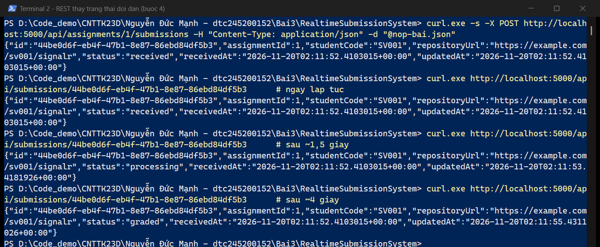

Terminal 1 – máy chủ in khi đẩy thông báo:

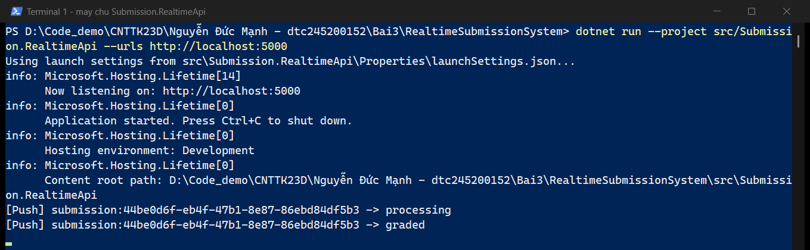

Thấy: POST trả `received` ngay; GET ngay lập tức → `received`, sau ~1,5 giây → `processing`, sau ~4 giây → `graded`; `updatedAt` tăng dần. Máy chủ in `[Push] submission:... -> processing` và `-> graded`.

Giải thích:
- `IHubContext` là "loa phát" của hub dùng được **ngoài** hub (trong tác vụ nền). Không truyền đối tượng hub vào tác vụ nền được vì hub chỉ sống trong một lời gọi.
- **Lưu trước, đẩy sau**: ai đọc REST ngay khi nhận tin đều thấy đúng trạng thái.
- Chỉ gửi 3 trường (mã lượt nộp, trạng thái, thời điểm), không gửi cả `SubmissionDto` (câu ①, ③).
- REST luôn biết trạng thái đúng; SignalR chỉ giúp máy khách biết **sớm** hơn mà không phải hỏi lại. Hệ thật sẽ thay `Task.Delay` bằng hàng đợi + worker (Bài 6).

## EduSubmit – Bước 5: máy khách mở hai kênh và gắn "chuông" chờ graded

Code `src/Submission.RealtimeClient/Program.cs` phần 1: `HttpClient` (kênh REST, `BaseAddress = http://localhost:5000`) và `HubConnectionBuilder().WithUrl(".../hubs/submissions").WithAutomaticReconnect()` (kênh SignalR); `connection.On<SubmissionStatusMessage>("SubmissionStatusChanged", ...)` in thông báo và bấm chuông `TaskCompletionSource` khi nhận `graded`; `StartAsync()`. Các record DTO khai báo ở cuối tệp, cùng hình dạng JSON với máy chủ.

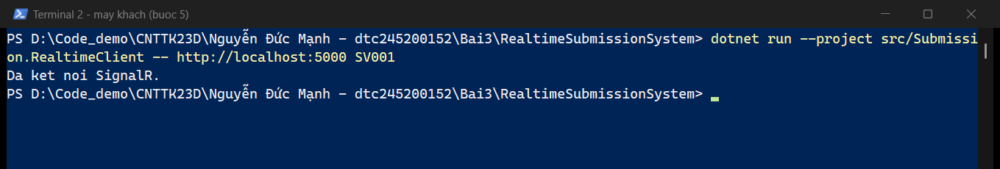

Thấy: máy khách in `Da ket noi SignalR.`

Giải thích: một URL gốc dùng cho cả hai kênh. `On<SubmissionStatusMessage>` – SignalR tự chuyển JSON thành record. `TaskCompletionSource` là một `Task` "bấm tay": hoàn tất khi gọi `TrySetResult`, dùng để chờ một sự kiện (thông báo `graded`).

## EduSubmit – Bước 6: tạo bằng REST, theo dõi bằng SignalR, chốt lại bằng REST

Code máy khách phần 2: (1) `GET /api/assignments` chọn bài đầu tiên → (2) `POST` tạo lượt nộp, kiểm tra mã `201` trước khi đọc body (lỗi thì in `ApiError`) → (3) `InvokeAsync("WatchSubmission", id)` vào nhóm → (4) `Task.WhenAny(chuông graded, 10 giây)` → (5) `GET /api/submissions/{id}` đọc lại.

Terminal 1 – máy chủ (trái), Terminal 2 – máy khách SV001 (phải):

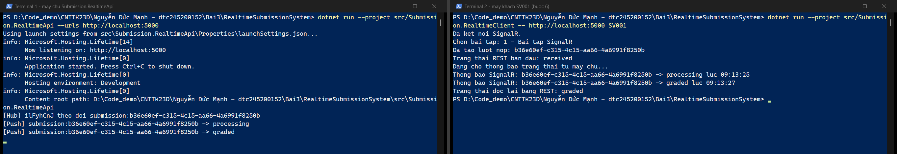

Kết quả máy khách (8 dòng):

```
Da ket noi SignalR.
Chon bai tap: 1 - Bai tap SignalR
Da tao luot nop: b36e60ef-c315-4c15-aa66-4a6991f8250b
Trang thai REST ban dau: received
Dang cho thong bao trang thai tu may chu...
Thong bao SignalR: b36e60ef-... -> processing luc 09:13:25
Thong bao SignalR: b36e60ef-... -> graded luc 09:13:27
Trang thai doc lai bang REST: graded
```

Thấy: 2 dòng "Thong bao SignalR" cách nhau 2 giây, đến từ máy chủ mà máy khách **không hề hỏi**; máy khách tự thoát sau khi đọc lại `graded`. Máy chủ in `[Hub] ... theo doi submission:...` → `[Push] ... processing` → `[Push] ... graded`.

Giải thích: thứ tự đúng là **nghe → nối → tạo → theo dõi → đọc lại** (`On` → `StartAsync` → POST → `WatchSubmission(id)` → GET). `WatchSubmission` chỉ gọi được sau POST vì cần id. Trạng thái cuối luôn lấy từ REST (quy tắc vàng) – push để nhanh, REST để chắc.

## EduSubmit – Bước 7: năm thí nghiệm phân tán

Dự đoán (ghi TRƯỚC khi chạy):

| # | Thí nghiệm | Dự đoán |
|---|---|---|
| 1 | Chạy 2 máy khách SV001 và SV002 cùng lúc | Mỗi máy khách chỉ nhận thông báo của lượt nộp mình vừa tạo, không thấy của người kia |
| 2 | Chạy máy khách khi máy chủ chưa chạy | `HttpRequestException` không kết nối được, dừng ngay ở `StartAsync` |
| 3 | Sửa `WithUrl` thành `/hub/submissions` | Lỗi `404 (Not Found)` ở bước negotiate |
| 4 | Sửa `On("SubmissionStatusChanged")` thành `On("SubmissionStatusChange")` | Không có lỗi, không có dòng "Thong bao SignalR"; sau 10 giây in "Qua thoi gian cho thong bao graded."; REST vẫn đọc ra `graded` |
| 5 | Chờ 4 giây rồi mới gọi `WatchSubmission` | Không nhận thông báo nào (đã chấm xong trước khi vào nhóm); hết 10 giây; REST đọc ra `graded` |

Kết quả chạy thật:

Thí nghiệm 1 – hai máy khách SV001 (trái) và SV002 (phải) cùng lúc:

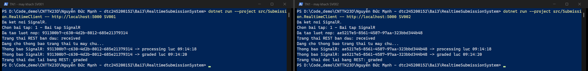

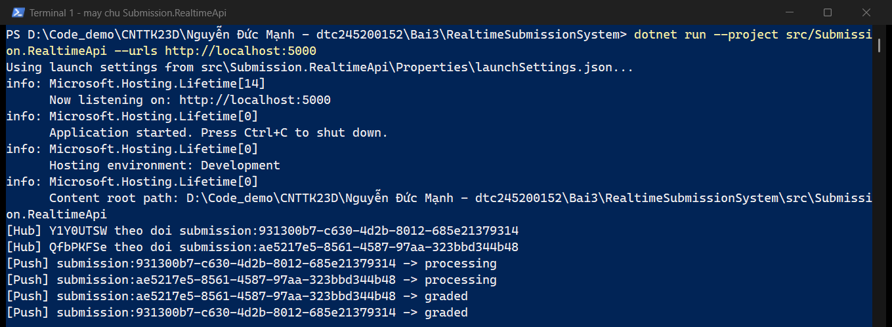

Thí nghiệm 2 – máy chủ chưa chạy:

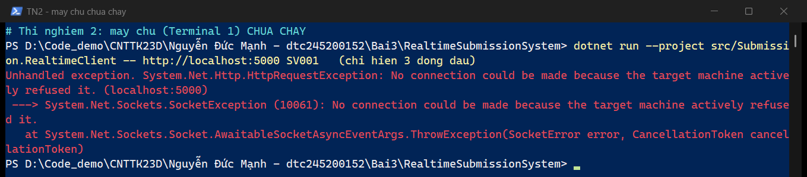

Thí nghiệm 3 – sai đường dẫn `/hub/submissions`:

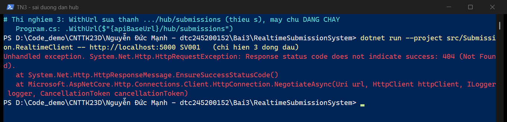

Thí nghiệm 4 – sai tên sự kiện `SubmissionStatusChange`:

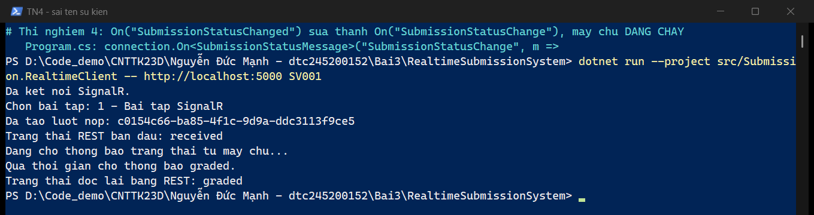

Máy chủ thí nghiệm 4 – vẫn `[Push] ... processing` và `-> graded` dù máy khách không in gì: tin đã gửi đúng nhóm, chỉ là máy khách nghe sai tên nên bỏ qua.

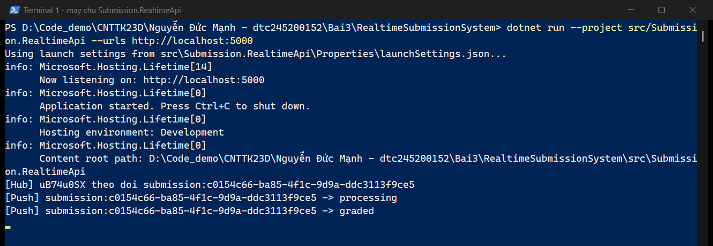

Thí nghiệm 5 – chờ 4 giây rồi mới `WatchSubmission` (máy khách, rồi máy chủ):

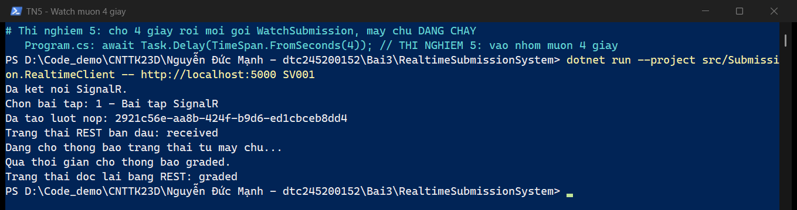

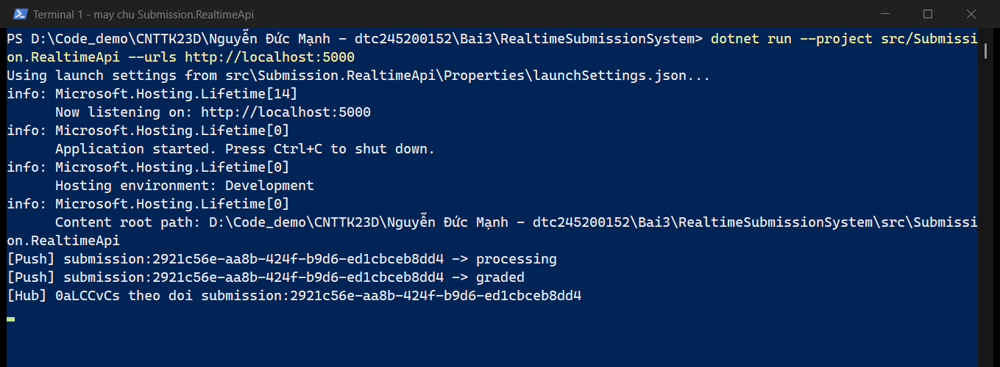

| # | Dự đoán | Kết quả thật | Đúng/Sai | Giải thích |
|---|---|---|---|---|
| 1 | Mỗi máy khách chỉ thấy lượt nộp của mình | SV001 chỉ nhận thông báo của `931300b7`, SV002 chỉ nhận của `ae5217e5`; máy chủ in 2 dòng `[Hub] ... theo doi` với 2 nhóm khác nhau | Đúng | Nhóm `submission:{id}` tách người nhận: máy chủ chỉ đẩy tới kết nối đã `WatchSubmission` đúng id. Riêng tư và không tốn băng thông như `Clients.All`. |
| 2 | `HttpRequestException` không kết nối được | `HttpRequestException: No connection could be made because the target machine actively refused it. (localhost:5000)` | Đúng | `StartAsync` gọi negotiate tới cổng 5000 nhưng không có tiến trình nào nghe. Lần nối **đầu tiên** không được tự thử lại; `WithAutomaticReconnect` chỉ cứu kết nối đã mở. |
| 3 | 404 ở bước negotiate | `HttpRequestException: Response status code does not indicate success: 404 (Not Found)` tại `HttpConnection.NegotiateAsync` | Đúng | Máy chủ chỉ `MapHub` ở `/hubs/submissions`; `/hub/submissions/negotiate` không có tuyến. Đường dẫn `WithUrl` phải khớp `MapHub`. |
| 4 | Không lỗi, hết 10 giây, REST ra graded | Không có lỗi, **không có dòng "Thong bao SignalR"**; in `Qua thoi gian cho thong bao graded.`; `Trang thai doc lai bang REST: graded` | Đúng | Máy chủ vẫn gửi `"SubmissionStatusChanged"` nhưng máy khách nghe `"SubmissionStatusChange"`; SignalR bỏ qua thông điệp không ai đăng ký, không báo lỗi. Sai tên chiều xuống = **im lặng**. Nhờ bước GET đọc lại nên vẫn có trạng thái đúng. |
| 5 | Không nhận tin nào, REST ra graded | Không có dòng "Thong bao SignalR", hết 10 giây; REST đọc ra `graded`. Máy chủ in `[Push] processing`, `[Push] graded` **trước** `[Hub] ... theo doi` | Đúng | Chấm xong sau 3 giây nhưng máy khách vào nhóm sau 4 giây: tin đã gửi cho nhóm lúc chưa có ai → **lỡ tin**, SignalR không lưu để gửi lại. **REST là nguồn sự thật**: luôn đọc lại bằng GET khi kết thúc hoặc khi nối lại. |

Bài học chung: thông điệp thời gian thực có thể bị lỡ. Thiết kế đúng = **push để nhanh + REST để chắc**. Sau mỗi thí nghiệm code đã được trả về như cũ, build `0 Error(s)`.

## EduSubmit – Bước 8: requests.http gom các ca REST và bước bắt tay của hub

Tệp `RealtimeSubmissionSystem/requests.http` có **10 ca** (9 ca theo slide + ca bài tập đã đóng). Có thể bấm **Send Request** từng ca trong VS Code (REST Client); ảnh dưới chạy lần lượt cùng 10 ca bằng `curl.exe` và so mã trạng thái với mong đợi:

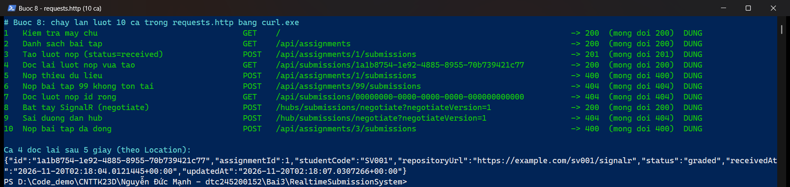

| Ca | Yêu cầu | Mong đợi | Thực tế |
|---|---|---|---|
| 1 | `GET /` | 200 | 200 |
| 2 | `GET /api/assignments` | 200 | 200 |
| 3 | `POST /api/assignments/1/submissions` hợp lệ | 201 + Location | 201 |
| 4 | `GET /api/submissions/{id}` (theo Location) | 200, sau 5 giây `graded` | 200, `graded` |
| 5 | POST thiếu `studentCode`, `repositoryUrl` | 400 | 400 |
| 6 | `POST /api/assignments/99/submissions` | 404 | 404 |
| 7 | `GET /api/submissions/0000...` | 404 | 404 |
| 8 | `POST /hubs/submissions/negotiate` | 200 + connectionId | 200 |
| 9 | `POST /hub/submissions/negotiate` (sai hub) | 404 | 404 |
| 10 | `POST /api/assignments/3/submissions` (bài đã đóng) | 400 | 400 |

---

# Trả lời 3 câu hỏi đầu giờ

**1. Máy chủ có thể chủ động báo cho máy khách không?**
Có, nếu máy khách mở sẵn một **kết nối lâu dài** (WebSocket qua SignalR). Máy chủ gửi bằng `Clients.Group("submission:{id}").SendAsync("SubmissionStatusChanged", msg)`; khi gửi từ ngoài hub (tác vụ chấm nền) thì dùng `IHubContext<SubmissionHub>`. Trong bài: máy khách không hỏi lại mà vẫn nhận `processing` rồi `graded` (bước 6).

**2. REST và SignalR chia việc thế nào?**
REST **tạo và đọc** tài nguyên với mã trạng thái rõ ràng (POST 201/400/404, GET 200/404) và là **nguồn sự thật**. SignalR chỉ **đẩy các thay đổi** phát sinh sau yêu cầu ban đầu (received → processing → graded) để máy khách biết sớm, không phải polling. SignalR **không thay thế** REST: tạo lượt nộp bằng REST, theo dõi bằng SignalR, chốt trạng thái cuối bằng REST.

**3. Đứt mạng đúng lúc máy chủ báo graded thì sao?**
Tin đó **mất** – SignalR không lưu tin để gửi lại (thí nghiệm 5 cho thấy vào nhóm muộn là lỡ tin). `WithAutomaticReconnect` nối lại với **ConnectionId mới** nên nhóm cũ cũng mất; máy khách phải gọi lại `WatchSubmission(id)` và gọi `GET /api/submissions/{id}` để lấy trạng thái cuối. **Push để nhanh, REST để chắc.**

---

# Danh sách kiểm tra trước khi mở PR

| Yêu cầu | Đạt |
|---|---|
| `dotnet build` cả 2 solution: 0 Error(s) | ✔ |
| Không commit `bin/`, `obj/` (`.gitignore`) | ✔ |
| `requests.http` đủ 9 ca (có 10 ca) | ✔ |
| README: kết quả chạy máy khách 8 dòng | ✔ (bước 6) |
| README: 5 thí nghiệm (dự đoán + thật) | ✔ (bước 7) |
| README: trả lời 3 câu hỏi đầu giờ | ✔ |
| Mỗi bước ≥ 1 commit | ✔ |
| PR: "Bai3 - dtc245200152 - Nguyễn Đức Mạnh" | (khi nộp) |
