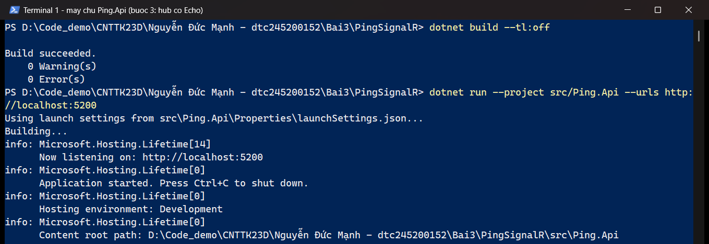

# Bài 3 – SignalR: truyền thông thời gian thực

Họ tên: Nguyễn Đức Mạnh       MSSV: dtc245200152       Lớp: CNTT K23D

Cấu trúc thư mục:

```
Bai3/
├── README.md        (nhật ký này)
├── anh/             (ảnh minh chứng từng bước)
└── PingSignalR/
    ├── PingSignalR.slnx
    └── src/Ping.Api, Ping.Client
```

---

# Phần 1 – PingSignalR

## Bước 1: tạo solution, 2 project, thêm gói SignalR cho máy khách


Lệnh đã chạy:

```powershell
mkdir PingSignalR
cd PingSignalR
dotnet new sln -n PingSignalR
dotnet new web -n Ping.Api -o src/Ping.Api
dotnet new console -n Ping.Client -o src/Ping.Client
dotnet sln add src/Ping.Api/Ping.Api.csproj
dotnet sln add src/Ping.Client/Ping.Client.csproj
dotnet add src/Ping.Client package Microsoft.AspNetCore.SignalR.Client --version 10.0.15
dotnet new gitignore
dotnet build
```

Thấy: `Build succeeded`, `0 Warning(s)`, `0 Error(s)`; `Ping.Client.csproj` có dòng `PackageReference ... SignalR.Client ... 10.0.15`.

Giải thích: chỉ máy khách cần thêm gói `Microsoft.AspNetCore.SignalR.Client`; máy chủ dùng `Microsoft.AspNetCore.App` đã có sẵn SignalR. Build khi chưa viết code để chắc chắn cài đặt và mạng (NuGet) không có vấn đề.

(Ảnh dùng `dotnet build --tl:off` để .NET 10 in đầy đủ dòng `0 Warning(s)` / `0 Error(s)`.)

## Bước 2: máy chủ thêm hub SignalR, kiểm tra negotiate bằng curl

Code `src/Ping.Api/Program.cs`: thêm `builder.Services.AddSignalR();` (trước `Build()`) và `app.MapHub<PingHub>("/hubs/ping");`, lớp `PingHub : Hub` đặt cuối tệp.

Terminal 1 – máy chủ chạy ở cổng 5200:


Terminal 2 – ba lệnh kiểm tra:


Thấy:
- `GET /` → `{"service":"PingApi","status":"running"}`: endpoint REST vẫn chạy song song với hub.
- `POST /hubs/ping/negotiate?negotiateVersion=1` → có `connectionId`, `connectionToken` và `availableTransports` gồm **WebSockets, ServerSentEvents, LongPolling**.
- `GET /hubs/ping` → `400 Bad Request`, `Connection ID required`.

Giải thích: negotiate là bước bắt tay – máy chủ cấp mã kết nối và báo các cách truyền tải nó hỗ trợ; máy khách chọn cách tốt nhất (thường là WebSockets). Hub không trả lời như REST: gọi thẳng `/hubs/ping` mà chưa có `connectionId` thì bị 400.

## Bước 3: phương thức Echo – máy chủ trả lời riêng người vừa gọi

Thay lớp `PingHub` trong `src/Ping.Api/Program.cs`:

```csharp
sealed class PingHub : Hub
{
    public async Task Echo(string message)
    {
        await Clients.Caller.SendAsync("EchoResponse", $"Echo: {message}");
    }
}
```



Thấy: build `0 Error(s)`; máy chủ chạy lại ở `http://localhost:5200`.

Giải thích: mỗi phương thức `public` của hub là thứ máy khách gọi được qua `InvokeAsync("Echo", ...)`. Mẫu câu gửi: `Clients.<ai nhận>.SendAsync("<TÊN thông điệp>", dữ liệu)`. `Clients.Caller` chỉ gửi cho kết nối vừa gọi. Chưa test được bằng curl vì hub cần máy khách SignalR (bước 4). Sau mỗi lần sửa `Program.cs` phải Ctrl+C và chạy lại máy chủ, nếu không máy chủ vẫn chạy code cũ.
