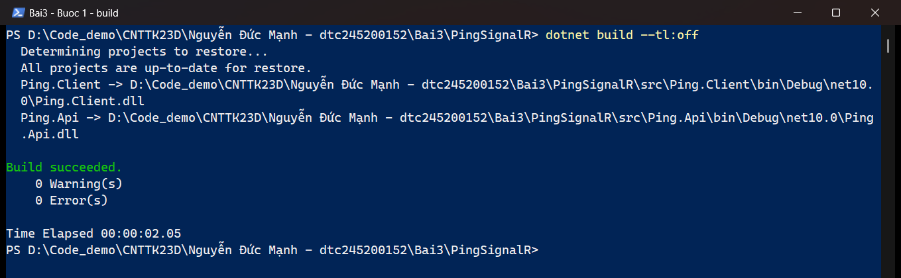

# Bài 3 – SignalR: truyền thông thời gian thực

Họ tên: Nguyễn Đức Mạnh       MSSV: dtc245200152       Lớp: CNTT K23D

Cấu trúc thư mục:

```
Bai3/
├── README.md        (nhật ký này)
├── anh/             (ảnh minh chứng từng bước)
└── PingSignalR/
    ├── PingSignalR.slnx
    └── src/Ping.Api, Ping.Client
```

---

# Phần 1 – PingSignalR

## Bước 1: tạo solution, 2 project, thêm gói SignalR cho máy khách



Lệnh đã chạy:

```powershell
mkdir PingSignalR
cd PingSignalR
dotnet new sln -n PingSignalR
dotnet new web -n Ping.Api -o src/Ping.Api
dotnet new console -n Ping.Client -o src/Ping.Client
dotnet sln add src/Ping.Api/Ping.Api.csproj
dotnet sln add src/Ping.Client/Ping.Client.csproj
dotnet add src/Ping.Client package Microsoft.AspNetCore.SignalR.Client --version 10.0.15
dotnet new gitignore
dotnet build
```

Thấy: `Build succeeded`, `0 Warning(s)`, `0 Error(s)`; `Ping.Client.csproj` có dòng `PackageReference ... SignalR.Client ... 10.0.15`.

Giải thích: chỉ máy khách cần thêm gói `Microsoft.AspNetCore.SignalR.Client`; máy chủ dùng `Microsoft.AspNetCore.App` đã có sẵn SignalR. Build khi chưa viết code để chắc chắn cài đặt và mạng (NuGet) không có vấn đề.

(Ảnh dùng `dotnet build --tl:off` để .NET 10 in đầy đủ dòng `0 Warning(s)` / `0 Error(s)`.)
