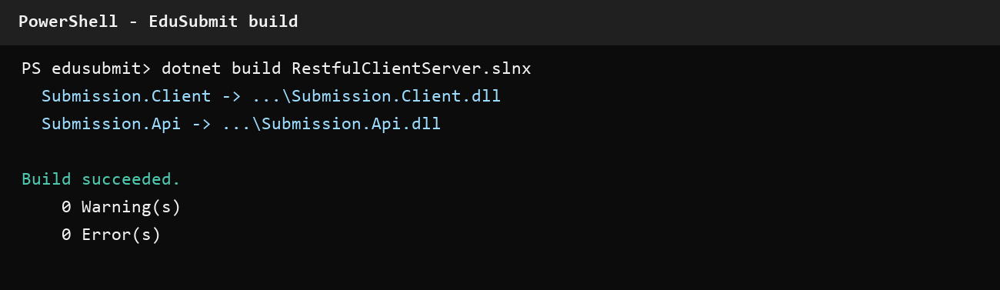
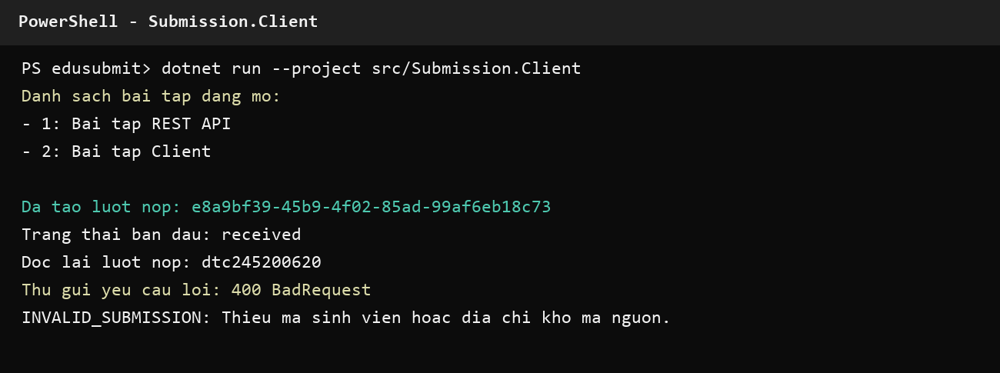
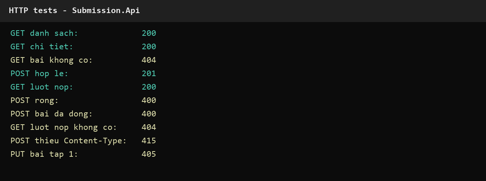
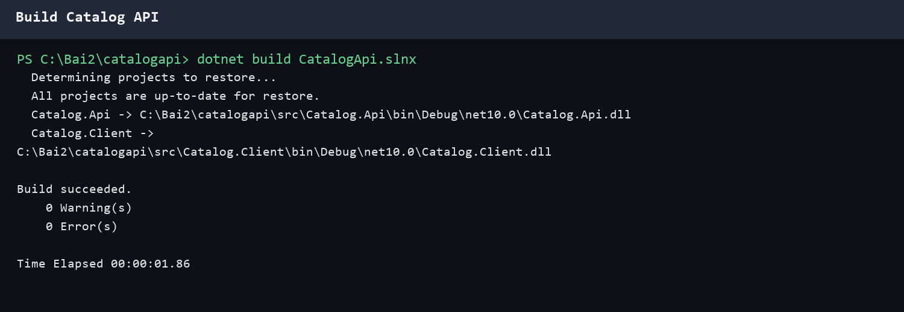
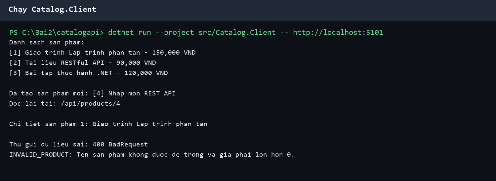
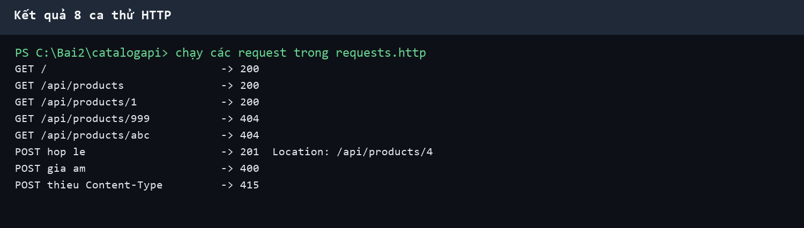

# Bài 2 - RESTful API

Bài gồm `edusubmit` là phần nộp chính và `catalogapi` là phần thực hành Catalog.

## EduSubmit

### Cách chạy

Trong thư mục `edusubmit`:

```powershell
dotnet build RestfulClientServer.slnx
dotnet run --project src/Submission.Api --no-launch-profile --urls http://localhost:5000
```

Mở terminal khác rồi chạy client:

```powershell
dotnet run --project src/Submission.Client -- http://localhost:5000
```

Mở `requests.http` bằng REST Client và bấm **Send Request** để thử 7 request.

### Kết quả

Build không có lỗi:



Client chạy đủ 4 phần: xem bài tập, nộp bài, đọc lại và thử gửi sai:



Các mã trạng thái đã thử:



### Bảng phá thử

| Ca thử | Mong đợi | Thực tế |
| --- | --- | --- |
| `GET /api/assignments` | 200, mảng bài tập | 200 |
| `GET /api/assignments/1` | 200 | 200 |
| `GET /api/assignments/999` | 404, `ASSIGNMENT_NOT_FOUND` | 404, đúng mã lỗi |
| POST bài 1, dữ liệu hợp lệ | 201, có `Location` | 201, có `Location` |
| POST bài 1, body rỗng | 400, `INVALID_SUBMISSION` | 400, đúng mã lỗi |
| POST bài 999 | 404, `ASSIGNMENT_NOT_FOUND` | 404, đúng mã lỗi |
| POST thiếu `Content-Type` | 415 | 415 |
| POST JSON hỏng | 400 | 400 |
| POST thiếu `repositoryUrl` | 400, `INVALID_SUBMISSION` | 400, đúng mã lỗi |
| `PUT /api/assignments/1` | 405 | 405 |
| POST bài 3 đã đóng | 400, `ASSIGNMENT_CLOSED` | 400, đúng mã lỗi |
| GET lượt nộp vừa tạo | 200 | 200 |
| GET lượt nộp không có | 404, `SUBMISSION_NOT_FOUND` | 404, đúng mã lỗi |

### Trả lời 3 câu hỏi

#### 1. Vì sao URI dùng danh từ, còn hành động do phương thức HTTP đảm nhận?

URI dùng để chỉ tài nguyên như `assignments` và `submissions`. Hành động dùng phương thức HTTP: GET để đọc, POST để tạo. Ví dụ nộp bài dùng `POST /api/assignments/1/submissions`, không dùng `/submitAssignment`.

#### 2. Stateless thể hiện ở đâu trong code?

Mỗi request có đủ dữ liệu để server xử lý. `assignmentId` nằm trên URI, còn `studentCode` và `repositoryUrl` nằm trong body. Server không cần nhớ phiên của client giữa hai lần gọi.

#### 3. Vì sao client và server khai báo DTO riêng mà vẫn khớp nhau?

Hai bên trao đổi bằng JSON nên chỉ cần tên trường và kiểu dữ liệu giống nhau. DTO là hợp đồng dữ liệu, không cần dùng chung một project hay một lớp C#.

## Catalog API

Phần Catalog vẫn nằm trong thư mục `catalogapi`. Chạy bằng cổng 5100:

```powershell
dotnet build CatalogApi.slnx
dotnet run --project src/Catalog.Api --no-launch-profile --urls http://localhost:5100
dotnet run --project src/Catalog.Client -- http://localhost:5100
```

Kết quả cũ của phần Catalog:






