# Bài 3 - Giao tiếp thời gian thực với SignalR

Phần đã hoàn thành: **PingSignalR - bước 1 đến bước 7** và **EduSubmit realtime - bước 1 đến bước 8**.

## Trả lời 3 câu hỏi đầu giờ

### 1. Máy chủ có thể chủ động báo cho máy khách không?

Có. Khi máy khách duy trì một kết nối SignalR, máy chủ có thể chủ động gửi thông điệp bằng `Clients.Caller`, `Clients.All` hoặc `Clients.Group(...).SendAsync(...)` mà không cần máy khách liên tục hỏi lại.

### 2. REST và SignalR chia việc như thế nào?

REST phù hợp để tạo và đọc tài nguyên, đồng thời trả về mã trạng thái HTTP rõ ràng. SignalR bổ sung kênh đẩy thông báo theo thời gian thực khi trạng thái thay đổi; SignalR không thay thế REST.

### 3. Nếu đứt mạng đúng lúc máy chủ gửi thông báo thì sao?

Thông báo có thể bị mất vì SignalR không lưu hàng đợi để phát lại. Máy khách dùng `WithAutomaticReconnect()` để nối lại, tham gia lại nhóm nếu cần và gọi REST để đọc trạng thái cuối cùng.

## Hợp đồng của PingHub

| Máy khách gọi | Máy chủ gửi về | Phạm vi nhận | Ý nghĩa |
| --- | --- | --- | --- |
| `Echo(message)` | `EchoResponse` | `Clients.Caller` | Trả lời riêng người gọi |
| `Broadcast(message)` | `BroadcastMessage` | `Clients.All` | Phát cho mọi kết nối |
| `JoinGroup(groupName)` | `GroupMessage` | `Clients.Group` | Tham gia và báo cho nhóm |
| `SendToGroup(groupName, message)` | `GroupMessage` | `Clients.Group` | Gửi tin cho thành viên nhóm |
| Kết nối hoặc ngắt kết nối | `SystemMessage` | `Clients.All` | Thông báo vòng đời kết nối |

## Bước 1: tạo solution, thêm gói và build

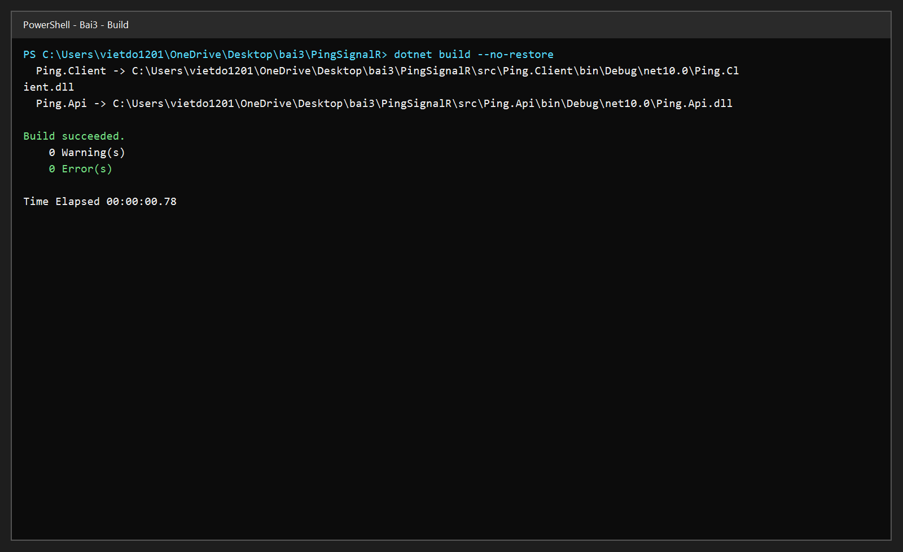

**Thấy:** `dotnet build --no-restore` báo `Build succeeded`, `0 Warning(s)` và `0 Error(s)` cho cả `Ping.Api` và `Ping.Client`.

**Giải thích:** solution và hai project đã được cấu hình đúng; máy khách đã tham chiếu gói `Microsoft.AspNetCore.SignalR.Client`.

## Bước 2: chạy máy chủ và negotiate

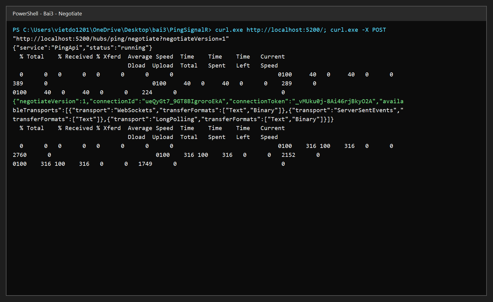

**Thấy:** endpoint `/` trả trạng thái `running`; lệnh POST tới `/hubs/ping/negotiate` trả `connectionId`, `connectionToken` và ba cơ chế truyền tải.

**Giải thích:** negotiate là bước bắt tay đầu tiên. Máy chủ cho biết có thể dùng `WebSockets`, `ServerSentEvents` hoặc `LongPolling`.

## Bước 3-4: Echo bằng Clients.Caller

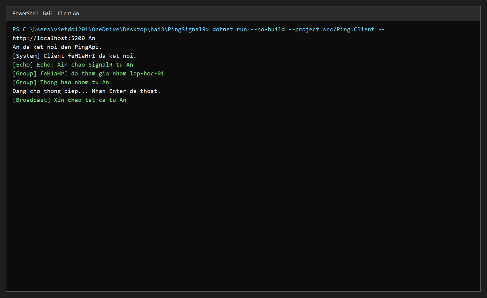

**Thấy:** máy khách An kết nối thành công và in `[Echo] Echo: Xin chao SignalR tu An`.

**Giải thích:** máy khách gọi `InvokeAsync("Echo", ...)`; hub trả `EchoResponse` bằng `Clients.Caller`, nên chỉ kết nối vừa gọi nhận được phản hồi Echo.

## Bước 5: Broadcast và Group với hai máy khách

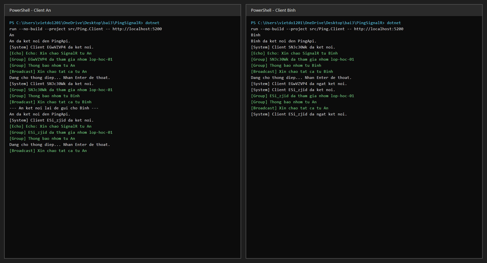

**Thấy:** cửa sổ An nhận `Group` và `Broadcast` từ Binh; cửa sổ Binh cũng nhận `Group` và `Broadcast` từ An. Tin Echo chỉ xuất hiện ở máy khách đã gọi.

**Giải thích:** `Clients.All` gửi cho mọi kết nối đang mở, còn `Clients.Group("lop-hoc-01")` chỉ gửi cho các kết nối đã tham gia nhóm. `Clients.Caller` không phát Echo sang máy khách còn lại.

## Bước 6: vòng đời và tự kết nối lại

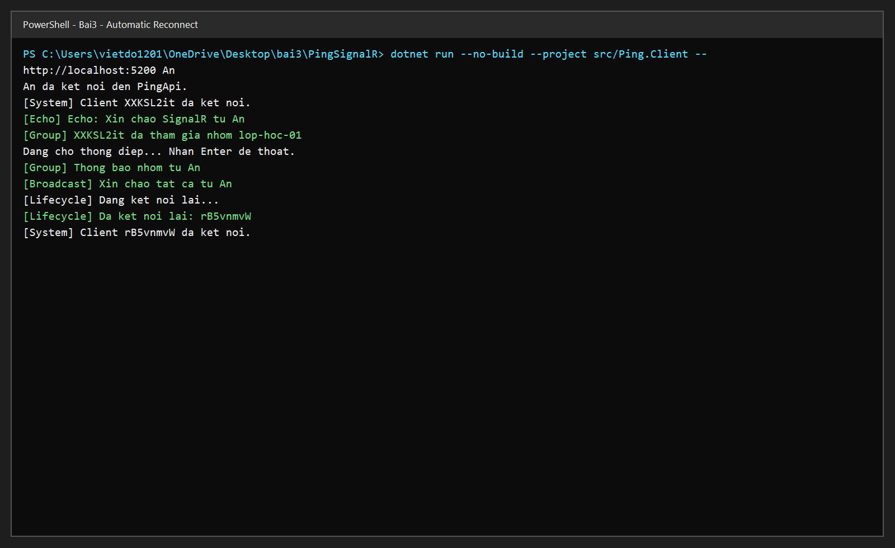

**Thấy:** sau khi máy chủ dừng rồi chạy lại, máy khách in `[Lifecycle] Dang ket noi lai...` và `[Lifecycle] Da ket noi lai: ...` với `ConnectionId` mới.

**Giải thích:** `WithAutomaticReconnect()` chỉ hoạt động sau khi một kết nối đã được mở. Khi nối lại, SignalR tạo kết nối mới; nhóm gắn với `ConnectionId` cũ nên ứng dụng thực tế cần tham gia lại nhóm.

## Bước 7: ba thí nghiệm lỗi cố ý

### Lỗi 1: máy chủ chưa chạy

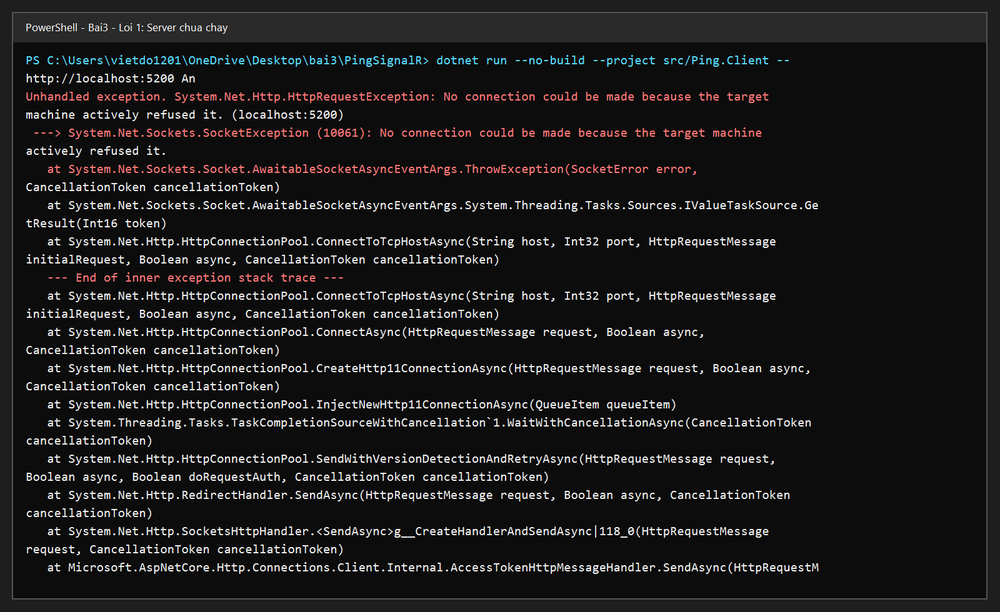

**Thấy:** `StartAsync()` ném `HttpRequestException` với thông báo máy đích từ chối kết nối tại `localhost:5200`.

**Giải thích:** `WithAutomaticReconnect()` không cứu được lần kết nối đầu tiên; nó chỉ thử nối lại một kết nối đã mở thành công trước đó.

### Lỗi 2: sai đường dẫn hub

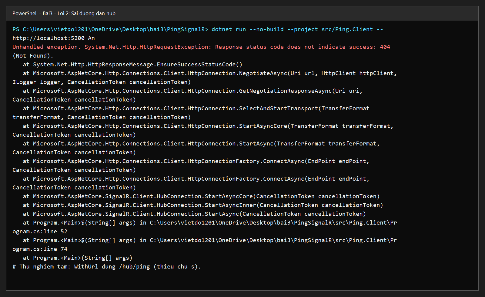

**Thấy:** khi thử tạm `/hub/ping` thay cho `/hubs/ping`, bước negotiate trả `404 (Not Found)`.

**Giải thích:** URL trong `WithUrl(...)` phải khớp chính xác với tuyến đã đăng ký bằng `MapHub<PingHub>("/hubs/ping")`.

### Lỗi 3: sai tên thông điệp

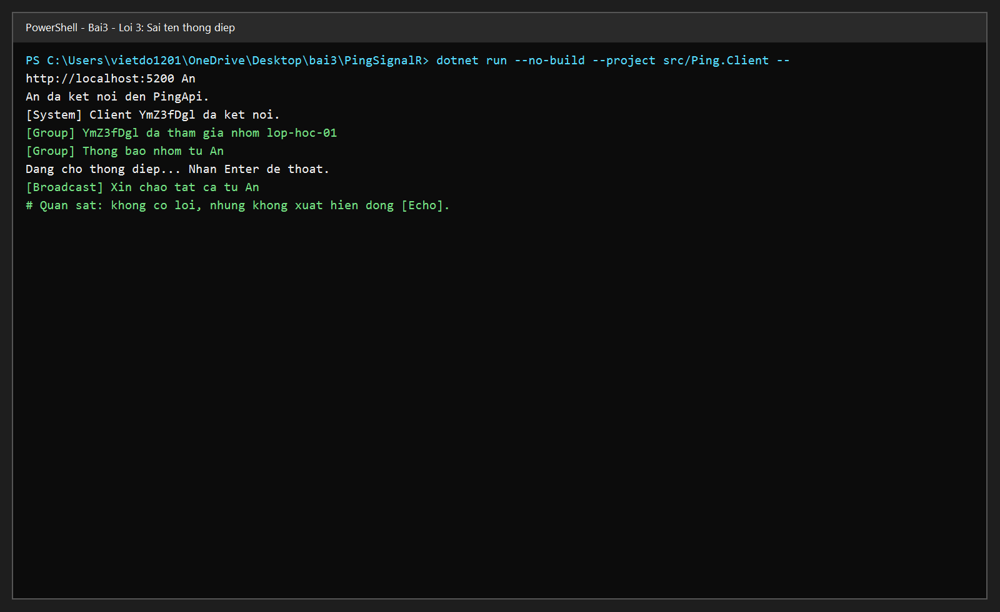

**Thấy:** khi đăng ký tạm `On("EchoRespone")`, chương trình không báo lỗi nhưng không xuất hiện dòng `[Echo]`; các tin `Group` và `Broadcast` vẫn nhận bình thường.

**Giải thích:** tên trong `SendAsync` và `On` là hợp đồng chuỗi, không được trình biên dịch kiểm tra. Sai tên ở chiều máy chủ gửi xuống gây lỗi im lặng.

## Nhật ký thí nghiệm bước 7

| Thí nghiệm | Dự đoán | Kết quả thật | Bài học |
| --- | --- | --- | --- |
| Máy chủ chưa chạy | Máy khách không mở được kết nối | `HttpRequestException`, connection refused | Lần kết nối đầu không tự thử lại |
| Sai `/hub/ping` | Không tìm thấy hub | `404 (Not Found)` tại negotiate | Đường dẫn phải khớp `MapHub` |
| Sai `EchoRespone` | Không nhận được Echo | Không lỗi, không có dòng `[Echo]` | Tên thông điệp chiều xuống sai sẽ im lặng |

## Kết luận

PingSignalR đã kiểm chứng được ba phạm vi gửi `Caller`, `All`, `Group`, vòng đời kết nối và cơ chế tự kết nối lại. Kết quả cũng cho thấy hợp đồng SignalR phụ thuộc vào tên phương thức, tên thông điệp và đúng đường dẫn hub.

---

# Phần 3 - EduSubmit realtime

## Thiết kế trước khi code

### 1. Sự kiện nào kích hoạt thông điệp?

Thông điệp được gửi mỗi khi trạng thái lượt nộp thay đổi theo chuỗi `received → processing → graded`. Với bài tập mở rộng, trạng thái cuối có thể là `failed` nếu URL repository không bắt đầu bằng HTTPS.

### 2. Gửi cho ai?

Máy chủ gửi bằng `Clients.Group("submission:{id}")` cho đúng nhóm đang theo dõi lượt nộp đó. Cách này giữ riêng tư dữ liệu và tiết kiệm băng thông hơn `Clients.All`.

### 3. Gửi kèm dữ liệu gì?

Thông điệp `SubmissionStatusMessage` chỉ gồm mã lượt nộp, trạng thái mới và thời điểm cập nhật: `SubmissionId`, `Status`, `UpdatedAt`.

### 4. Mất kết nối thì lấy lại trạng thái thế nào?

Máy khách tham gia lại nhóm sau khi kết nối lại và gọi `GET /api/submissions/{id}`. REST là nguồn sự thật vì SignalR không lưu lại những thông điệp đã bị lỡ.

## Luồng xử lý

1. Máy khách đăng ký `On("SubmissionStatusChanged")`.
2. Máy khách mở kết nối bằng `StartAsync()`.
3. REST tạo lượt nộp và trả `201 Created` với trạng thái `received`.
4. Máy khách gọi `WatchSubmission(id)` để vào nhóm `submission:{id}`.
5. Tác vụ nền lưu trạng thái mới rồi dùng `IHubContext` đẩy `processing` và `graded`.
6. Máy khách gọi REST lần cuối để chốt trạng thái.

## Bước 1: tạo RealtimeSubmissionSystem và build

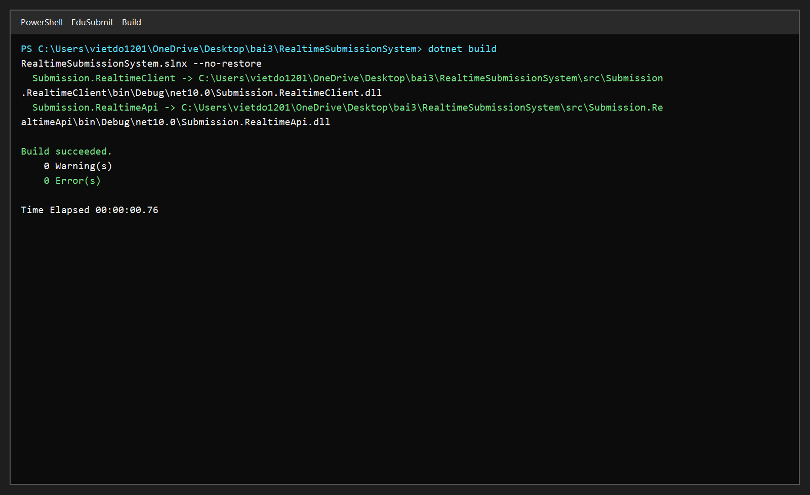

**Thấy:** `RealtimeSubmissionSystem.slnx` build thành công cả `Submission.RealtimeApi` và `Submission.RealtimeClient`, không có warning hoặc error.

**Giải thích:** máy chủ dùng Web SDK có sẵn SignalR; máy khách tham chiếu `Microsoft.AspNetCore.SignalR.Client` phiên bản `10.0.15`.

## Bước 2 và 4: REST là nguồn sự thật

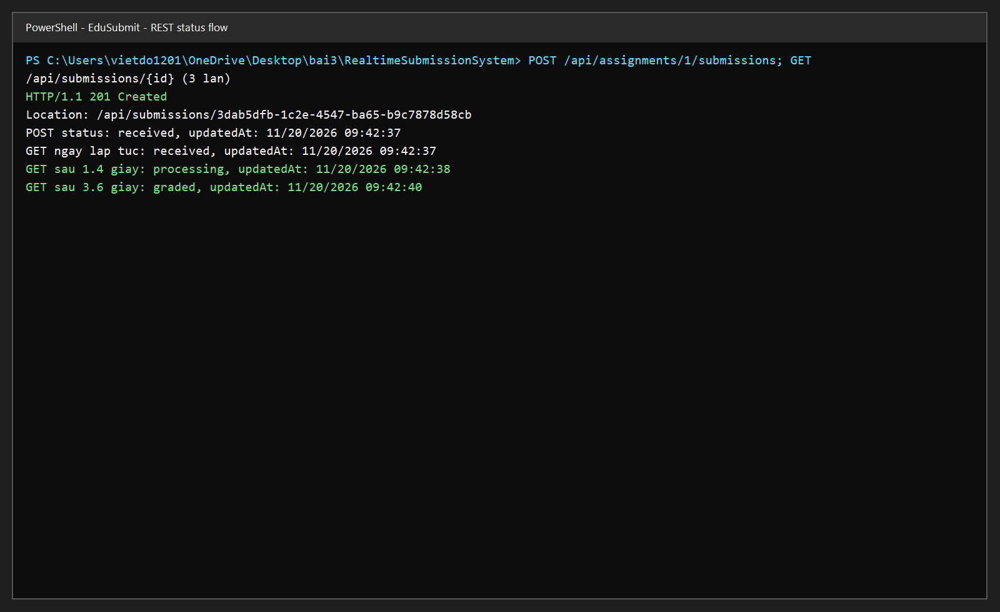

**Thấy:** POST trả `201 Created` và `Location`; ba lần GET lần lượt thấy `received`, `processing`, `graded`, đồng thời `UpdatedAt` tăng dần.

**Giải thích:** POST trả ngay sau khi lưu `received`. Tác vụ nền đổi sang `processing` sau khoảng 1 giây và `graded` sau khoảng 3 giây. Dữ liệu được lưu trước khi thông báo SignalR được gửi.

## Bước 3: SubmissionHub và nhóm submission:{id}

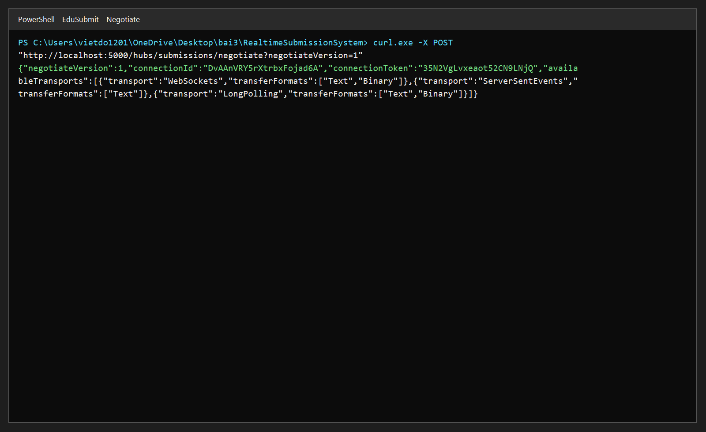

**Thấy:** POST tới `/hubs/submissions/negotiate` trả `connectionId`, `connectionToken` và ba cơ chế truyền tải.

**Giải thích:** `WatchSubmission(id)` chỉ đưa kết nối vào nhóm `submission:{id}`. Hub không chứa nghiệp vụ tạo hoặc chấm bài.

## Bước 5-6: máy khách dùng REST và SignalR

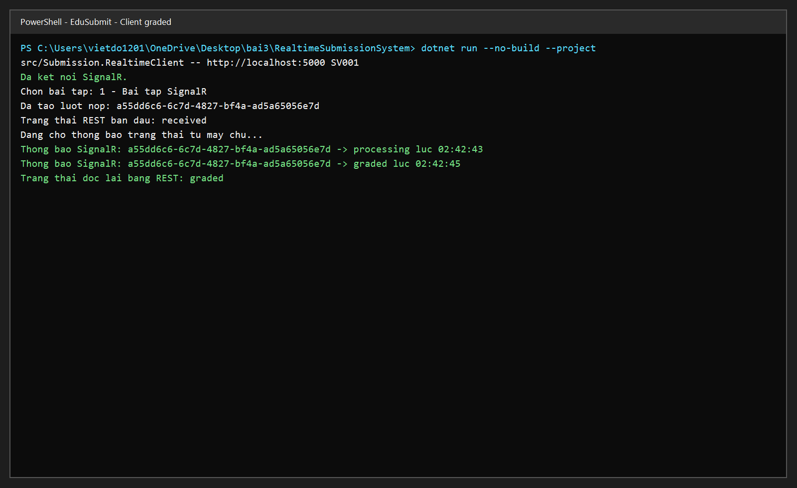

**Thấy:** máy khách in đủ 8 dòng: kết nối SignalR, chọn bài, tạo lượt nộp, trạng thái REST ban đầu, chờ thông báo, nhận `processing`, nhận `graded` và đọc lại REST là `graded`.

**Giải thích:** REST tạo và đọc tài nguyên; SignalR đẩy hai thay đổi trạng thái mà máy khách không phải polling. `TaskCompletionSource` hoàn tất khi nhận trạng thái cuối.

## Bước 8: requests.http đủ 9 ca

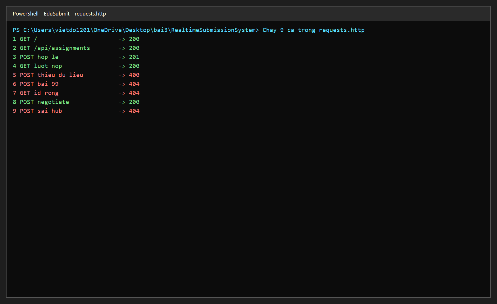

| Ca | Kết quả |
| --- | --- |
| `GET /` | `200` |
| `GET /api/assignments` | `200` |
| POST hợp lệ | `201` |
| GET lượt nộp | `200` |
| POST thiếu dữ liệu | `400` |
| POST bài 99 | `404` |
| GET ID rỗng | `404` |
| POST negotiate | `200` |
| POST sai hub | `404` |

**Giải thích:** các mã trạng thái phân biệt rõ tạo thành công, dữ liệu không hợp lệ, tài nguyên không tồn tại và sai đường dẫn hub.

## Bài tập 2: trạng thái failed

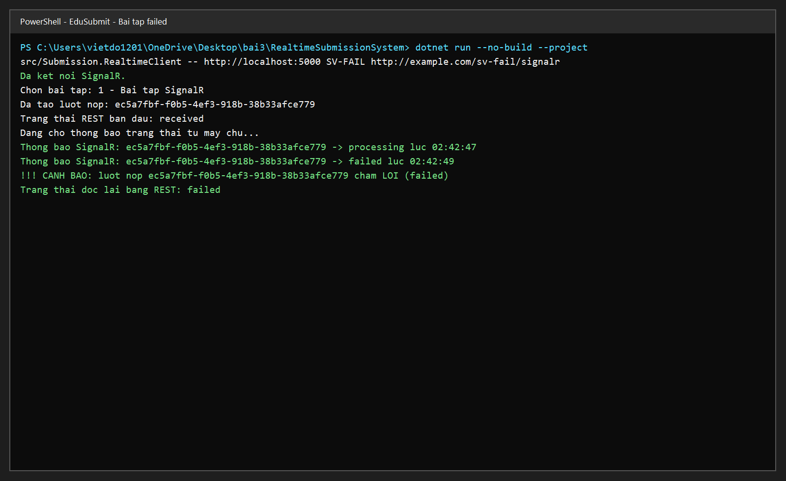

**Thấy:** repository dùng HTTP chuyển từ `received` sang `processing`, sau đó `failed`; client in cảnh báo và REST cũng trả `failed`.

**Giải thích:** trạng thái cuối phụ thuộc vào URL repository. Thông điệp vẫn gửi đúng ba trường tối thiểu và client xử lý `failed` như một trạng thái kết thúc.

## Bước 7: năm thí nghiệm phân tán

### Thí nghiệm 1: hai máy khách cùng lúc

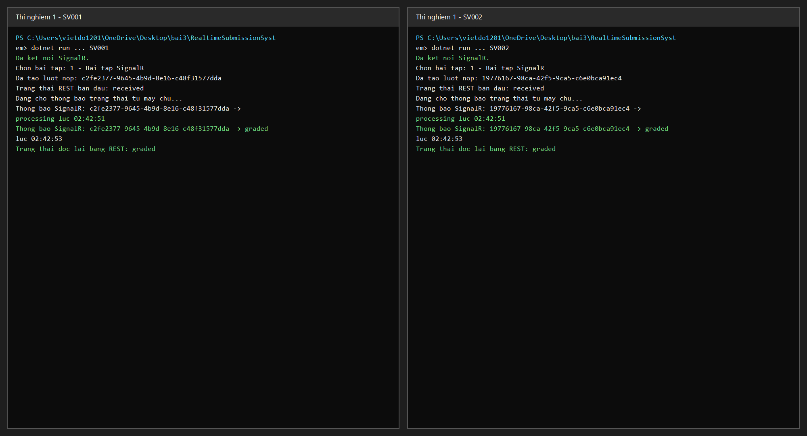

**Dự đoán:** mỗi máy khách chỉ nhận thông báo của lượt nộp do chính nó tạo.

**Kết quả thật:** SV001 và SV002 nhận hai ID khác nhau; mỗi cửa sổ chỉ in `processing` và `graded` của ID tương ứng.

**Giải thích:** nhóm `submission:{id}` tách người nhận, tránh lộ dữ liệu và không gửi thừa thông điệp.

### Thí nghiệm 2: máy chủ chưa chạy

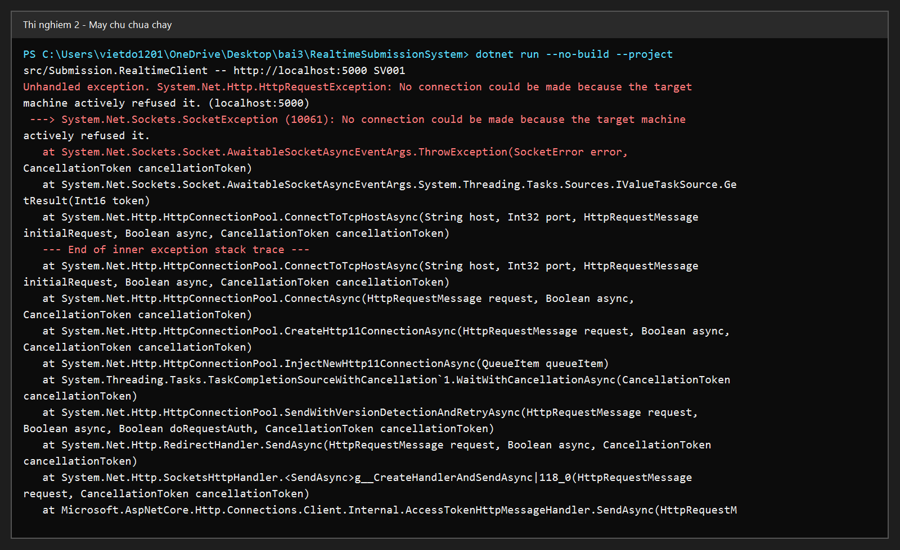

**Dự đoán:** máy khách không thể mở kết nối đầu tiên.

**Kết quả thật:** `StartAsync()` ném `HttpRequestException` với lỗi connection refused tại `localhost:5000`.

**Giải thích:** `WithAutomaticReconnect()` chỉ áp dụng cho kết nối đã mở thành công, không tự cứu lần kết nối đầu.

### Thí nghiệm 3: sai đường dẫn hub

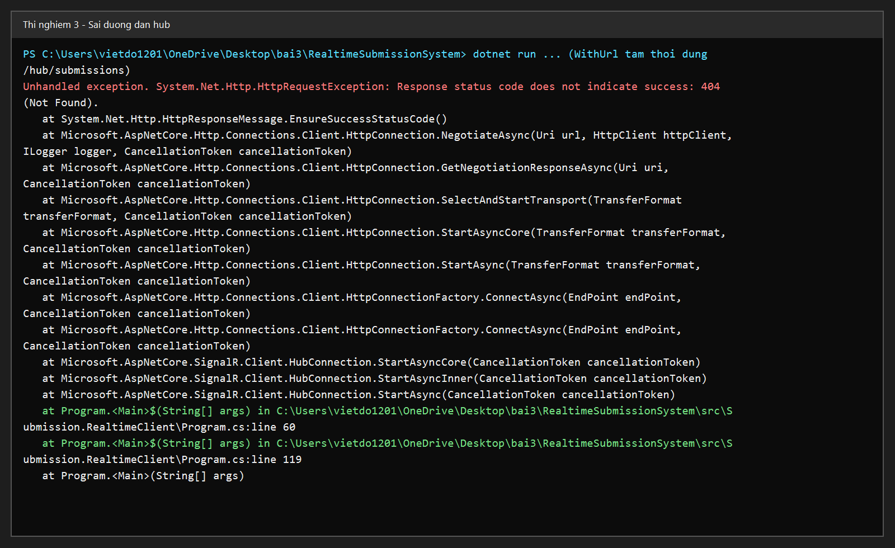

**Dự đoán:** negotiate không tìm thấy endpoint.

**Kết quả thật:** dùng tạm `/hub/submissions` trả `404 (Not Found)`.

**Giải thích:** `WithUrl` phải khớp chính xác với `MapHub<SubmissionHub>("/hubs/submissions")`.

### Thí nghiệm 4: sai tên sự kiện

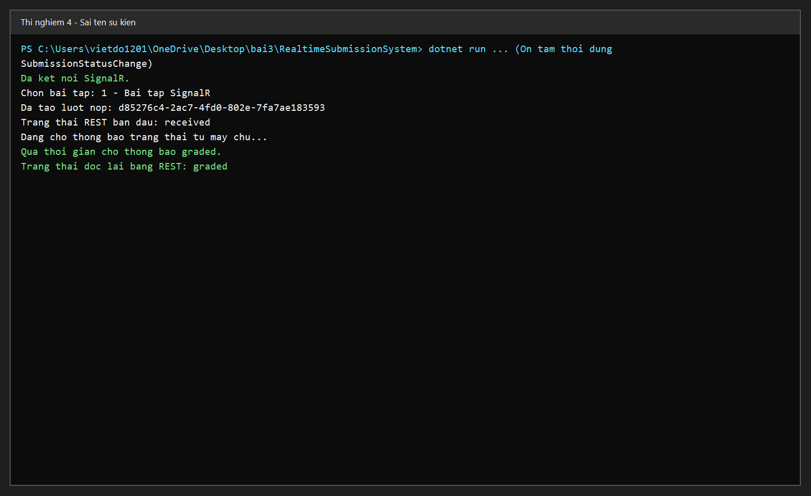

**Dự đoán:** không có lỗi kết nối nhưng client không nhận hai thông báo trạng thái.

**Kết quả thật:** sau 10 giây client báo quá thời gian chờ, không có dòng `Thong bao SignalR`, nhưng REST đọc lại vẫn là `graded`.

**Giải thích:** tên trong `SendAsync` và `On` không khớp gây lỗi im lặng. REST vẫn giữ trạng thái đúng.

### Thí nghiệm 5: WatchSubmission muộn 4 giây

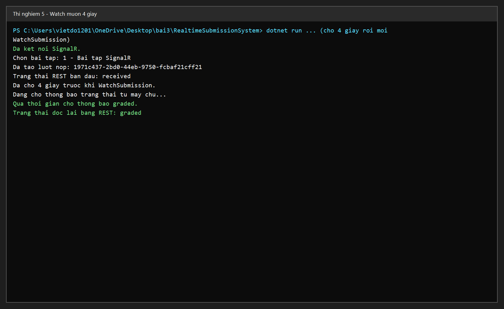

**Dự đoán:** client vào nhóm sau khi tác vụ nền đã gửi xong nên sẽ bỏ lỡ thông báo.

**Kết quả thật:** không nhận được `processing` hoặc `graded`, hết thời gian chờ, nhưng GET cuối vẫn trả `graded`.

**Giải thích:** SignalR không phát lại thông điệp cũ cho thành viên vào nhóm muộn. Thiết kế đúng là dùng push để biết nhanh và REST để chắc chắn.

## Bảng tổng hợp năm thí nghiệm

| Thí nghiệm | Dự đoán | Kết quả thật | Bài học |
| --- | --- | --- | --- |
| Hai máy khách | Mỗi máy chỉ thấy lượt nộp riêng | Hai ID và hai luồng riêng | Nhóm theo ID tách người nhận |
| Máy chủ chưa chạy | Không kết nối được | `HttpRequestException` | Lần nối đầu không tự thử lại |
| Sai `/hub/submissions` | Negotiate lỗi | `404 Not Found` | URL phải khớp `MapHub` |
| Sai tên sự kiện | Không nhận push | Timeout, REST vẫn `graded` | Sai tên chiều xuống gây im lặng |
| Watch muộn 4 giây | Bỏ lỡ thông báo | Timeout, REST vẫn `graded` | Tin realtime có thể bị lỡ |

## Kết luận EduSubmit

EduSubmit kết hợp đúng hai kênh: REST để tạo và đọc trạng thái chắc chắn, SignalR để đẩy thay đổi nhanh tới đúng nhóm. `IHubContext` cho phép tác vụ nền gửi thông điệp từ bên ngoài hub; cập nhật dữ liệu trước rồi mới phát giúp REST và thông báo luôn nhất quán.

---

# Câu hỏi ôn tập và thảo luận

## 1. Polling khác push ở số yêu cầu và độ trễ thế nào?

Polling bắt máy khách gửi yêu cầu lặp lại dù trạng thái chưa đổi, nên tốn nhiều request và độ trễ phụ thuộc chu kỳ hỏi. Push giữ một kết nối và máy chủ gửi ngay khi có sự kiện, vì vậy ít request thừa và độ trễ thấp hơn.

## 2. Phân biệt ba MEP theo hướng khởi tạo và số thông điệp

| MEP | Bên khởi tạo | Số thông điệp |
| --- | --- | --- |
| Yêu cầu - phản hồi | Máy khách gửi yêu cầu | Một yêu cầu, một phản hồi |
| Đẩy dữ liệu | Máy chủ gửi khi có sự kiện | Nhiều thông điệp trên kết nối đã mở |
| Truyền luồng | Một bên mở luồng | Nhiều phần dữ liệu liên tục theo thời gian |

## 3. WebSocket và SignalR là giao thức hay thư viện?

WebSocket là giao thức giữ một kết nối hai chiều lâu dài sau bước bắt tay HTTP. SignalR là thư viện cấp cao của ASP.NET Core, cung cấp hub, nhóm, định danh kết nối, gọi phương thức, kết nối lại và tự chọn cơ chế truyền tải.

## 4. SignalR có các cơ chế truyền tải dự phòng nào?

SignalR ưu tiên `WebSockets`, sau đó thử `Server-Sent Events`, cuối cùng dùng `Long Polling` khi các cơ chế trước không khả dụng.

## 5. Vì sao dùng nhóm submission:{id} thay vì gửi tất cả?

Nhóm chỉ gửi trạng thái tới máy khách đang theo dõi đúng lượt nộp, tránh lộ dữ liệu của sinh viên khác và giảm số thông điệp truyền trên mạng.

## 6. IHubContext cho phép làm gì?

`IHubContext<SubmissionHub>` cho phép endpoint REST, tác vụ nền hoặc dịch vụ nằm ngoài lớp hub gửi thông điệp qua `Clients.All`, `Clients.Group` hoặc các phạm vi khác.

## 7. On<T> dùng để làm gì? Nếu bỏ đi thì sao?

`On<T>("TênSựKiện", handler)` đăng ký hàm xử lý thông điệp từ máy chủ và chuyển JSON thành kiểu `T`. Nếu không đăng ký hoặc tên không khớp `SendAsync`, kết nối vẫn hoạt động nhưng thông điệp bị bỏ qua mà không có lỗi rõ ràng.

## 8. REST và SignalR chia việc thế nào? Vì sao không dùng SignalR để tạo lượt nộp?

REST tạo và đọc tài nguyên, trả mã trạng thái, `Location` và dữ liệu có thể truy vấn lại. SignalR chỉ đẩy các thay đổi phát sinh sau đó; dùng SignalR để tạo lượt nộp sẽ làm mất các đặc tính rõ ràng và đáng tin cậy của HTTP.

## 9. WithAutomaticReconnect có tác dụng gì?

`WithAutomaticReconnect()` thử mở lại một kết nối đã từng hoạt động khi bị gián đoạn. Nó không tự cứu lần kết nối đầu tiên và kết nối mới có `ConnectionId` mới, nên máy khách phải tham gia lại nhóm.

## 10. Mất kết nối đúng lúc báo graded thì làm gì?

Thông điệp `graded` có thể bị mất. Sau khi nối lại, máy khách gọi lại `WatchSubmission(id)` và `GET /api/submissions/{id}` để lấy trạng thái cuối từ REST.

## Thảo luận 1: hàng trăm sinh viên cùng theo dõi

Nên tạo nhóm theo từng `submission:{id}`. Phát cho tất cả rồi để máy khách lọc vừa tốn băng thông vừa làm lộ dữ liệu không liên quan.

## Thảo luận 2: hai trường hợp polling phù hợp hơn SignalR

1. Dữ liệu thay đổi rất ít và ứng dụng chấp nhận cập nhật chậm, ví dụ kiểm tra báo cáo mỗi 15 phút.
2. Hạ tầng không cho phép giữ kết nối lâu dài hoặc máy khách chỉ chạy tác vụ ngắn theo lịch, ví dụ một cron job kiểm tra trạng thái mỗi giờ.

## Thảo luận 3: chạy nhiều bản sao API thì nhóm trong bộ nhớ gặp vấn đề gì?

Mỗi bản sao chỉ biết các kết nối và nhóm trong bộ nhớ của chính nó, nên thông điệp có thể không tới máy khách đang nối vào bản sao khác. Cần dùng backplane chung như Redis hoặc dịch vụ Azure SignalR để đồng bộ việc phát thông điệp giữa các bản sao.

---

# Checklist trước khi nộp

- [x] Hai solution, bốn project build `0 Error(s)`.
- [x] Bảy yêu cầu kiểm tra cuối bài đạt.
- [x] `requests.http` đủ 9 ca, có `200`, `201`, `400`, `404` và negotiate.
- [x] README có kết quả hai máy khách, ba câu đầu giờ và câu hỏi ôn tập.
- [x] README có năm thí nghiệm với dự đoán, kết quả thật và giải thích.
- [x] Có bài tập mở rộng trạng thái `failed`.
- [x] Có `.gitignore` loại `bin/`, `obj/` và `.vs/`.

## Nộp bài trên GitHub

- Tối thiểu 8 commit theo từng bước.
- Tiêu đề Pull Request: `Bai3 - dtc245200620 - Ngô Thị Như Quỳnh`.
