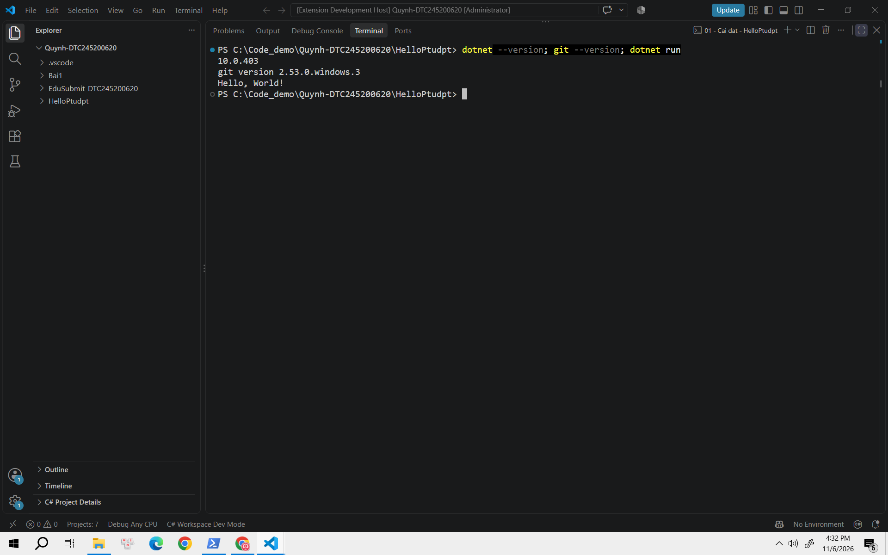
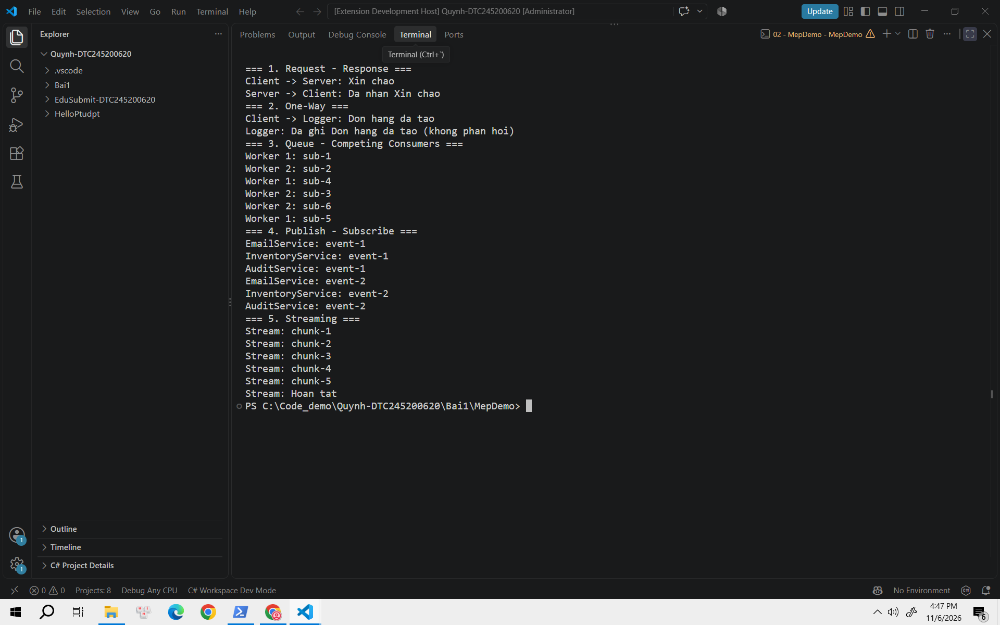
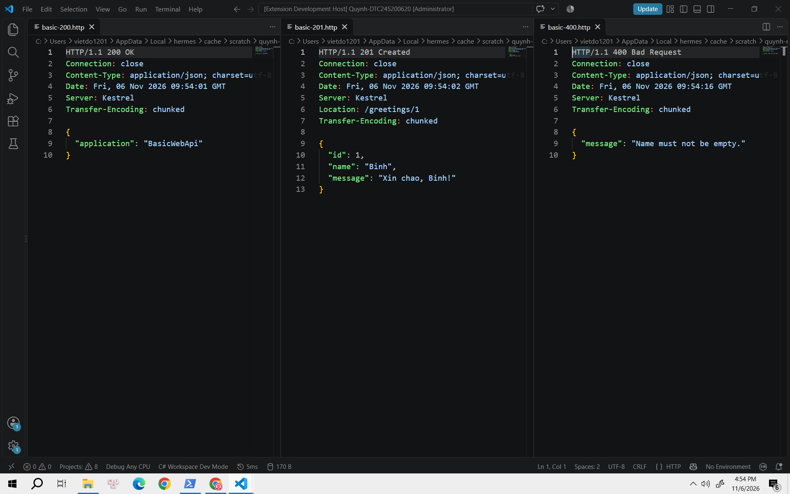
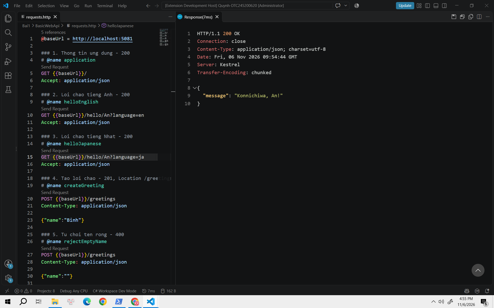
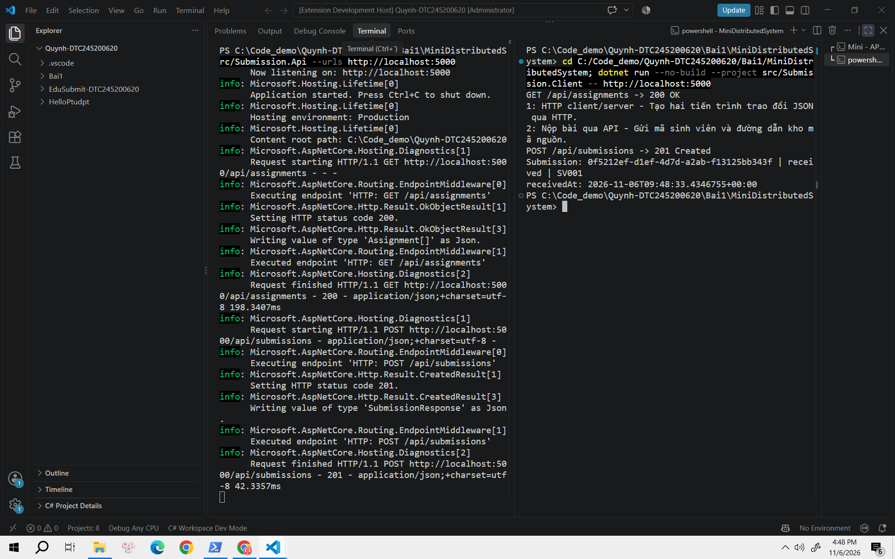
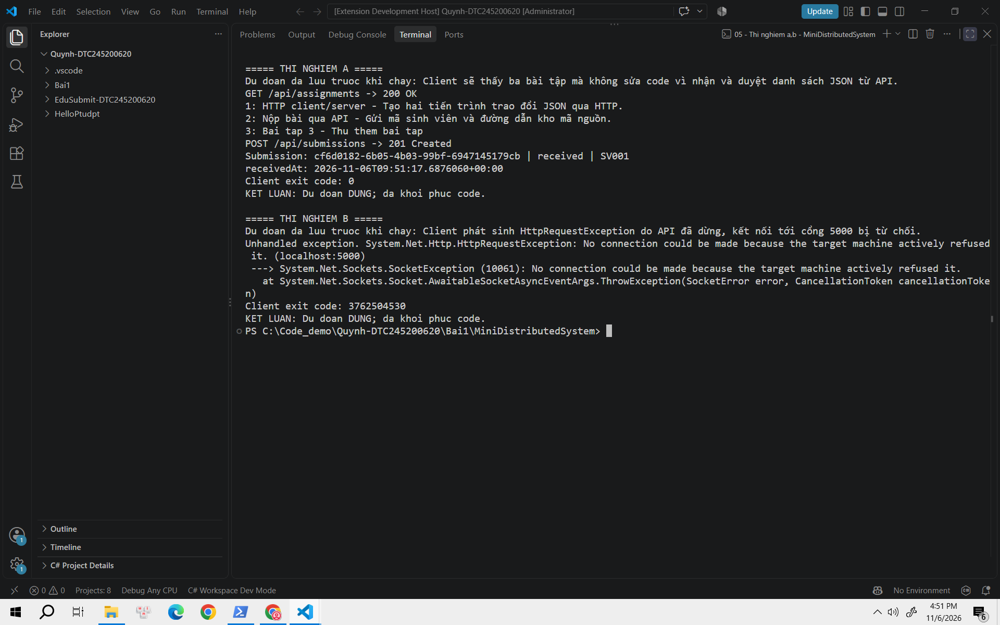
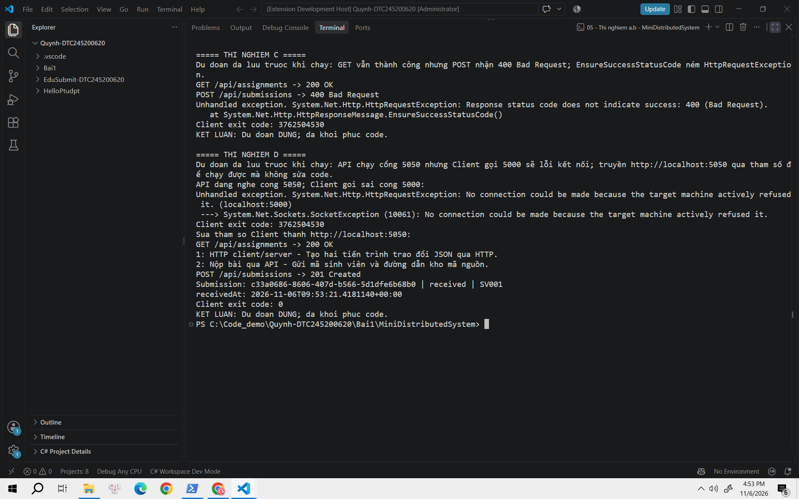
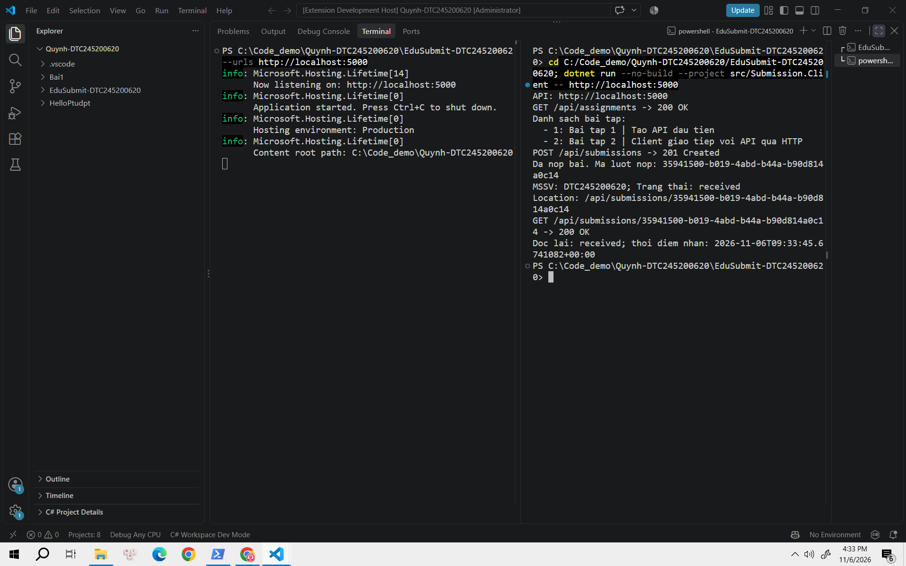
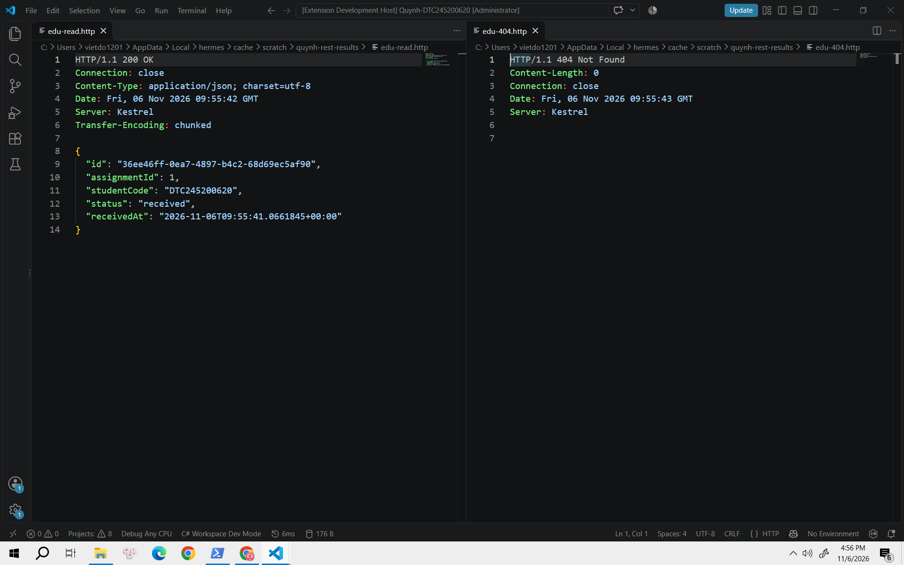
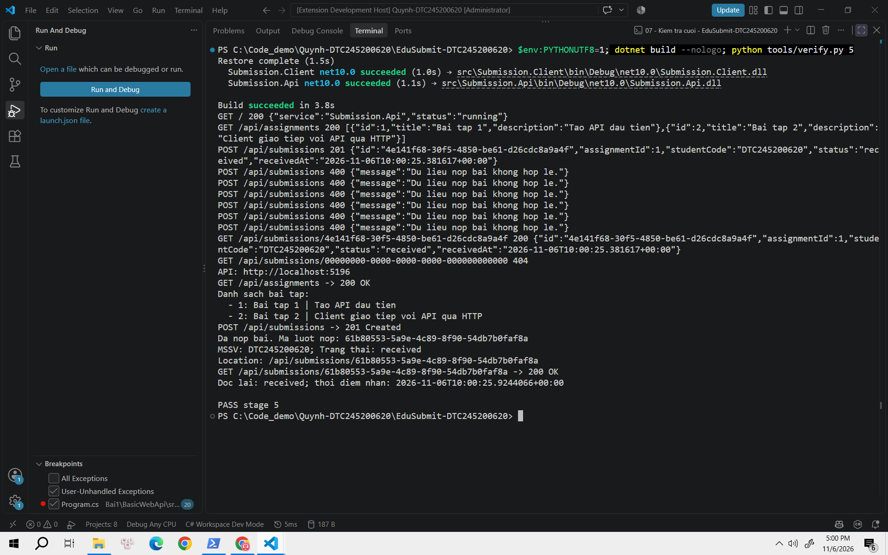

# Bài 1 – Tổng quan hệ thống và MEP

Họ tên: **Ngô Thị Như Quỳnh**  
MSSV: **DTC245200620**  
Lớp: **CNTT K23D**

## 1. Cài đặt

- Kết quả kiểm tra .NET 10 SDK: `dotnet --version` trả về `10.0.403`.
- Kết quả kiểm tra Git: `git --version` trả về `git version 2.53.0.windows.3`.
- VS Code có các extension C# Dev Kit, C#, .NET Install Tool và REST Client.
- Kết quả chạy HelloPtudpt: `dotnet run` in ra `Hello, World!`.
- Thư mục thực hành: `C:\Code_demo\Quynh-DTC245200620`.



## 2. MepDemo (Bước 7)

Đã chạy cả năm mô hình bằng `dotnet run`; kiểm tra thêm từng mô hình bằng `dotnet run -- 1`, `dotnet run -- 3` và `dotnet run -- 4`.

- **Câu hỏi 1:** Ở MEP 3, mỗi bài nộp `sub-x` được đúng **một worker** xử lý trong lần chạy. Hai worker cùng đọc một hàng đợi và chia nhau sáu bài nộp, không phải mỗi worker xử lý lại toàn bộ danh sách.
- **Câu hỏi 2:** Ở MEP 4, mỗi sự kiện được gửi đến cả **ba dịch vụ**: `EmailService`, `InventoryService` và `AuditService`. Cả `event-1` và `event-2` đều xuất hiện tại ba dịch vụ.
- **Mô tả 5 MEP:**
  1. **Request–Response:** Bên gửi phát yêu cầu, bên nhận xử lý và gửi lại phản hồi tương ứng.
  2. **One-Way:** Bên gửi chuyển thông điệp đi mà không chờ một thông điệp phản hồi nghiệp vụ từ bên nhận.
  3. **Queue-Based:** Thông điệp được đưa vào hàng đợi; các worker cạnh tranh lấy việc, mỗi phần tử được một worker nhận trong minh họa này.
  4. **Publish–Subscribe:** Bên phát công bố sự kiện lên một chủ đề, các bên đăng ký đều nhận được sự kiện đó.
  5. **Streaming:** Dữ liệu được chuyển và xử lý lần lượt từng phần, không cần chờ có toàn bộ dữ liệu mới bắt đầu nhận.



## 3. BasicWebApi (Bước 8)

Build thành công và chạy API tại `http://localhost:5081`:

```powershell
dotnet build
dotnet run --project src/BasicWebApi --urls http://localhost:5081
```

### Kết quả kiểm thử bằng REST Client

| Yêu cầu | Mã trạng thái thực tế | Nội dung chính |
|---|---|---|
| `GET /` | `200 OK` | `{"application":"BasicWebApi"}` |
| `GET /hello/An?language=en` | `200 OK` | `{"message":"Hello, An!"}` |
| `GET /hello/An?language=ja` | `200 OK` | `{"message":"Konnichiwa, An!"}` |
| `POST /greetings` với `{"name":"Binh"}` | `201 Created` | Có `id: 1`, `name: "Binh"`, `message: "Xin chao, Binh!"` và `Location: /greetings/1` |
| `POST /greetings` với `{"name":""}` | `400 Bad Request` | `{"message":"Name must not be empty."}` |

Ảnh dưới mở đồng thời ba phản hồi đã lưu từ REST Client, thể hiện rõ các mã 200, 201 và 400.





### Trả lời câu hỏi mục 8.4

1. **`builder.Services.AddSingleton<...>()` phải đứng trước `builder.Build()`.** Các dịch vụ cần được đăng ký trong giai đoạn cấu hình để hệ thống dependency injection tạo bộ cung cấp dịch vụ khi build ứng dụng. Sau `Build()`, bộ sưu tập dịch vụ đã trở thành chỉ đọc nên không đăng ký bổ sung theo cách này được.
2. Trong `/hello/{name}?language=en`, **`name` lấy từ route**: `/hello/An` cung cấp giá trị `An`. **`language` lấy từ query string**: `?language=en` cung cấp giá trị `en`.
3. POST hợp lệ tạo một tài nguyên lời chào mới nên dùng **`Results.Created` – 201 Created**. Phản hồi có thêm header `Location` chỉ địa chỉ tài nguyên vừa tạo. `200 OK` thể hiện thành công nói chung nhưng không diễn đạt rõ việc tạo mới tài nguyên như 201.

### Thêm ngôn ngữ thứ ba và debug

- Nhánh xử lý `language=ja` trả về `Konnichiwa, {name}!`; REST Client đã nhận `Konnichiwa, An!`.
- Đặt breakpoint tại dòng `var greeting = greetings.Create(request.Name);`.
- Gửi POST tên `Binh`: chương trình dừng tại breakpoint, đọc được `request.Name = "Binh"`.
- Chạy từng dòng qua lệnh tạo lời chào: `greeting.Id = 1`; tiếp tục chạy để API hoàn tất request.

## 4. MiniDistributedSystem (Bước 9)

Build thành công. API và Client chạy ở hai tiến trình riêng:

```powershell
# Terminal API
dotnet run --project src/Submission.Api --urls http://localhost:5000

# Terminal Client
dotnet run --project src/Submission.Client -- http://localhost:5000
```

Client đọc được hai bài tập, POST trả `201 Created`, nhận mã lượt nộp dạng GUID và trạng thái `received`. Một mã nhận được khi chạy là `0f5212ef-d1ef-4d7d-a2ab-f13125bb343f`.



### Trả lời ba câu hỏi

1. Client gọi hai endpoint, mỗi lần gọi là một cặp request–response:
   - `GET http://localhost:5000/api/assignments` → `200 OK`, body JSON chứa danh sách bài tập.
   - `POST http://localhost:5000/api/submissions` → `201 Created` khi dữ liệu hợp lệ, body chứa mã lượt nộp và trạng thái `received`. Trong thí nghiệm gửi mã sinh viên rỗng, cùng endpoint trả `400 Bad Request`.
2. **Client không tham chiếu project API và không gọi trực tiếp hàm của API.** Hai phía thống nhất hợp đồng dữ liệu: đường dẫn, HTTP method, các trường JSON như `assignmentId`, `studentCode`, `repositoryUrl` và cấu trúc phản hồi. Mỗi project khai báo các record của riêng mình để chuyển đổi JSON; trùng cấu trúc dữ liệu không có nghĩa là dùng chung mã nguồn trực tiếp.
3. Truyền địa chỉ API qua `-- http://localhost:5000` giúp đổi máy chủ hoặc cổng mà không sửa và biên dịch lại code. Dấu `--` tách tham số của `dotnet run` khỏi tham số truyền cho Client. Điều này cũng giúp kiểm thử với API ở `http://localhost:5050`.

Đã thử bốn request trong `requests.http`: kiểm tra dịch vụ và danh sách bài tập nhận 200, nộp hợp lệ nhận 201, nộp với mã sinh viên chỉ chứa khoảng trắng nhận 400.

## 5. Thí nghiệm lỗi (Bước 10)

Dự đoán được ghi trước khi chạy. Mỗi thí nghiệm thay đổi riêng một điều kiện và khôi phục mã nguồn sau khi kiểm tra.

| # | Dự đoán | Thực tế | Đúng/Sai | Giải thích |
|---|---|---|---|---|
| a | Thêm bài tập thứ ba tại API thì Client thấy ba bài tập, không phải sửa code Client. | Sau khi thêm `Assignment(3, "Bai tap 3", "Thu them bai tap")` và chạy lại API, GET trả 200; Client in đủ ba bài tập, POST trả 201 và trạng thái `received`. | Đúng | Client nhận một danh sách JSON rồi duyệt từng phần tử, không viết cứng số lượng bài tập là hai. Cấu trúc từng phần tử vẫn giữ nguyên nên hợp đồng dữ liệu không thay đổi. |
| b | Dừng API rồi chạy Client sẽ phát sinh lỗi kết nối. | `HttpRequestException: No connection could be made because the target machine actively refused it. (localhost:5000)`; lỗi bên trong là `SocketException (10061)`. Không nhận được HTTP response. | Đúng | Không còn tiến trình lắng nghe cổng 5000. Giao tiếp mạng phụ thuộc máy chủ, cổng và kết nối nên có thể thất bại trước cả khi có HTTP response. Gọi hàm nội bộ không phụ thuộc đường truyền hoặc máy chủ từ xa, dù bản thân hàm vẫn có thể phát sinh lỗi logic. |
| c | Đổi `StudentCode: "SV001"` thành `StudentCode: ""` làm POST nhận 400; `EnsureSuccessStatusCode()` ném ngoại lệ. | GET danh sách vẫn trả `200 OK`; POST trả `400 Bad Request`. Client phát sinh `HttpRequestException: Response status code does not indicate success: 400 (Bad Request).` tại `EnsureSuccessStatusCode()`. | Đúng | `EnsureSuccessStatusCode()` kiểm tra phản hồi thuộc dải 2xx; nếu không thì ném ngoại lệ. API phải tự kiểm tra dữ liệu vì Client có thể có lỗi hoặc gửi dữ liệu sai, không được dựa vào việc Client đã kiểm tra. |
| d | API ở 5050 nhưng Client gọi 5000 sẽ lỗi; đổi tham số địa chỉ Client sang 5050 sẽ chạy được mà không sửa code. | API chạy `http://localhost:5050`. Client gọi 5000 bị từ chối kết nối; chạy lại với `-- http://localhost:5050` thì GET trả 200, POST trả 201 và nhận `received`. | Đúng | URL Client phải trỏ đúng endpoint mà API đang lắng nghe. Địa chỉ được cấu hình qua tham số nên chỉ thay lệnh chạy, không cần đổi mã nguồn. |





## 6. Dự án EduSubmit tự làm (Bước 11–12)

- Thư mục dự án: `C:\Code_demo\Quynh-DTC245200620\EduSubmit-DTC245200620`.
- Solution: `EduSubmit.slnx`, gồm `src/Submission.Api` và `src/Submission.Client`.
- Hai project không có `ProjectReference`, giao tiếp qua HTTP và JSON.
- **Kết quả chạy API:** Build thành công, không có cảnh báo hoặc lỗi; API lắng nghe `http://localhost:5000`. `GET /` trả `{"service":"Submission.Api","status":"running"}`.
- **Kết quả chạy Client:** Đọc được hai bài tập; POST với `studentCode: "DTC245200620"` nhận 201, in GUID và trạng thái `received`; tiếp tục GET theo GUID vừa tạo và đọc lại dữ liệu khớp với phản hồi POST.
- **Kết quả kiểm thử `requests.http`:** Sáu request đã được chạy bằng REST Client, kết quả như bảng dưới.
- **Phần tham khảo:** Khung khai báo record, các trường dữ liệu và các phương thức `GetFromJsonAsync`, `PostAsJsonAsync`, `EnsureSuccessStatusCode`, `ReadFromJsonAsync` trong hướng dẫn Bài 1.
- **Kết quả bài mở rộng:** API lưu lượt nộp hợp lệ trong `List<SubmissionResult>`, truy xuất theo GUID; tìm thấy trả 200, không tìm thấy trả 404. Client gọi GET để đọc lại lượt nộp vừa tạo. Dữ liệu chỉ lưu trong bộ nhớ và mất khi API dừng.

| Request | Kết quả thực tế |
|---|---|
| `GET /` | `200 OK`, thông tin dịch vụ đang chạy |
| `GET /api/assignments` | `200 OK`, hai bài tập có `id`, `title`, `description` |
| `POST /api/submissions` hợp lệ | `201 Created`, có `Location`, GUID, MSSV, trạng thái `received` và thời điểm nhận |
| `POST /api/submissions` với `studentCode` rỗng | `400 Bad Request` |
| `GET /api/submissions/{id}` với ID vừa tạo | `200 OK`, dữ liệu giống lượt nộp vừa tạo |
| `GET /api/submissions/00000000-0000-0000-0000-000000000000` | `404 Not Found` |





### Luồng thông điệp

```text
Client --(HTTP GET /api/assignments)--> API: request–response
Client <--(200 OK + danh sách bài tập JSON)-- API

Client --(HTTP POST /api/submissions + JSON)--> API: request–response
Client <--(201 Created + Location + lượt nộp JSON)-- API

Client --(HTTP GET /api/submissions/{id})--> API: request–response
Client <--(200 OK + lượt nộp JSON / 404 Not Found)-- API
```

**Lưu ý khi kiểm thử:** `repositoryUrl` đang là địa chỉ minh họa `https://example.com/edu-submit-demo`, không phải repository đã nộp. Phần tạo Git repository, commit, tag `bai1` và đẩy GitHub chưa thực hiện.

## 7. Khó khăn gặp phải và cách giải quyết

| Khó khăn | Nguyên nhân | Cách giải quyết |
|---|---|---|
| Client không kết nối được API khi đổi cổng. | API lắng nghe 5050 nhưng Client vẫn gọi 5000. | Đọc dòng `Now listening on`, truyền đúng URL bằng `-- http://localhost:5050`. |
| POST thất bại với mã sinh viên rỗng. | API kiểm tra dữ liệu và trả 400; Client gọi `EnsureSuccessStatusCode()` nên phát sinh ngoại lệ. | Gửi lại MSSV hợp lệ, giữ kiểm tra tại máy chủ; phân biệt lỗi HTTP 400 với lỗi chưa kết nối được máy chủ. |
| Chưa rõ route và query được lấy ở đâu. | Cùng xuất hiện trong URL nên dễ nhầm. | Đối chiếu `/hello/{name}` với `?language=...`; thử `en` và `ja` để quan sát phản hồi. |
| Cần xác định giá trị biến khi POST tạo lời chào. | Chỉ xem response chưa biết giá trị tại từng bước xử lý. | Dùng breakpoint, quan sát `request.Name = "Binh"`, chạy từng dòng để thấy `greeting.Id = 1`, sau đó tiếp tục chương trình. |
| Cần xác nhận code sau thí nghiệm đã trở về bình thường. | Thay mảng bài tập, sửa MSSV hoặc cổng có thể ảnh hưởng lần chạy sau. | Khôi phục code sau mỗi thí nghiệm, build lại và chạy kiểm thử tổng hợp. |


