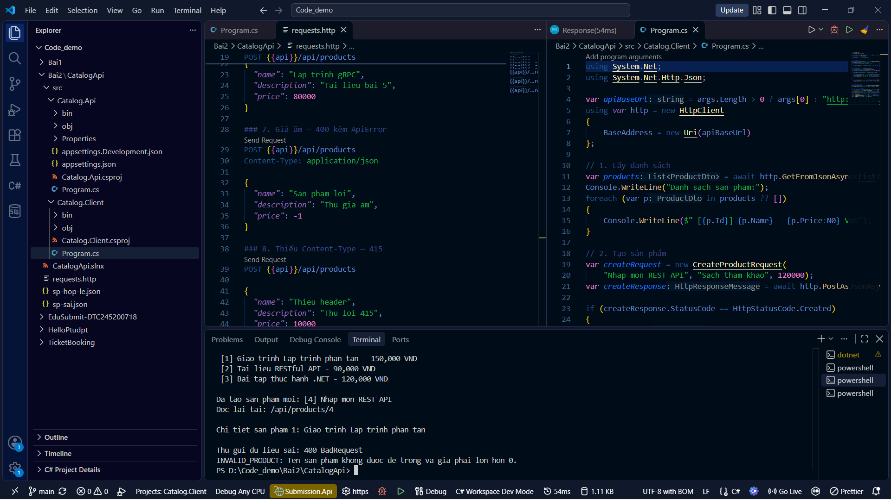

# Bài 2 – RESTful API cho tương tác client–server

Sinh viên: **Thân Đình Nguyên – dtc245200718**.

## Nội dung

- `CatalogApi/`: bài thực hành Catalog.Api và Catalog.Client trên lớp.
- `EduSubmit/`: bài áp dụng gồm `Submission.Api`, `Submission.Client` và `requests.http`.

## Cách chạy EduSubmit

Yêu cầu .NET SDK 10. Mở hai terminal tại `Bai2/EduSubmit`:

```powershell
dotnet build
dotnet run --project src/Submission.Api --urls http://localhost:5000
```

Terminal thứ hai:

```powershell
dotnet run --project src/Submission.Client -- http://localhost:5000
```

Mở `EduSubmit/requests.http` trong VS Code và bấm **Send Request** từng mục theo thứ tự; request đọc lại dùng ID từ POST thành công. Dữ liệu chỉ lưu trong RAM, tắt API sẽ mất lượt nộp.

## Kết quả dự kiến và bảng phá thử

| Ca | Yêu cầu | Kết quả mong đợi | Giải thích |
| --- | --- | --- | --- |
| 1 | GET `/api/assignments` | 200 | Danh sách bài tập |
| 2 | GET `/api/assignments/1` | 200 | Bài tập có thật |
| 3 | GET `/api/assignments/999` | 404 `ASSIGNMENT_NOT_FOUND` | Mã bài tập không tồn tại |
| 4 | POST bài 1 với mã SV và URL hợp lệ | 201 + `Location` | Tạo lượt nộp |
| 5 | GET `Location` vừa nhận | 200 | Đọc lại lượt nộp vừa tạo |
| 6 | POST bài 1 với mã SV rỗng | 400 `INVALID_SUBMISSION` | Thiếu dữ liệu |
| 7 | POST bài 3 đã đóng | 400 `ASSIGNMENT_CLOSED` | Sai quy tắc nghiệp vụ |
| 8 | POST bài 999 | 404 `ASSIGNMENT_NOT_FOUND` | Bài tập không tồn tại |

Máy khách in bốn nấc: danh sách bài tập đang mở → nộp bài và nhận 201 → đọc lại từ `Location` → gửi sai và in `INVALID_SUBMISSION` mà không sập. Các mã trên là **kết quả dự kiến theo code**; cần chạy trên máy có .NET để lấy ảnh kết quả thực tế.

Ảnh kết quả thực tế của phần Catalog đã chạy trên lớp:



Ảnh chạy EduSubmit mới cần được bổ sung sau khi chạy trên máy có .NET SDK 10.

## Ba câu hỏi giải thích

1. **Vì sao URI dùng danh từ, hành động do phương thức HTTP đảm nhận?** `assignments` và `submissions` là tài nguyên; `GET /api/assignments/1` đọc, còn `POST /api/assignments/1/submissions` tạo một lượt nộp. Client hiểu hành động từ phương thức và địa chỉ tài nguyên.
2. **Stateless thể hiện ở đâu?** POST mang `assignmentId` trên URI, `studentCode` và `repositoryUrl` trong JSON. Server xử lý yêu cầu từ những dữ liệu đó, không nhớ một phiên đăng nhập hay lựa chọn bài tập của Client giữa các lần gọi. Server vẫn lưu lượt nộp trong RAM để đọc lại.
3. **Vì sao mỗi bên khai báo DTO riêng mà vẫn khớp?** API và Client là hai tiến trình, không tham chiếu project của nhau. `AssignmentDto`, `SubmissionDto`, `ApiError` có tên trường và kiểu tương ứng khi chuyển thành JSON; hai bên trao đổi qua hợp đồng JSON thay vì chia sẻ đối tượng C#.
