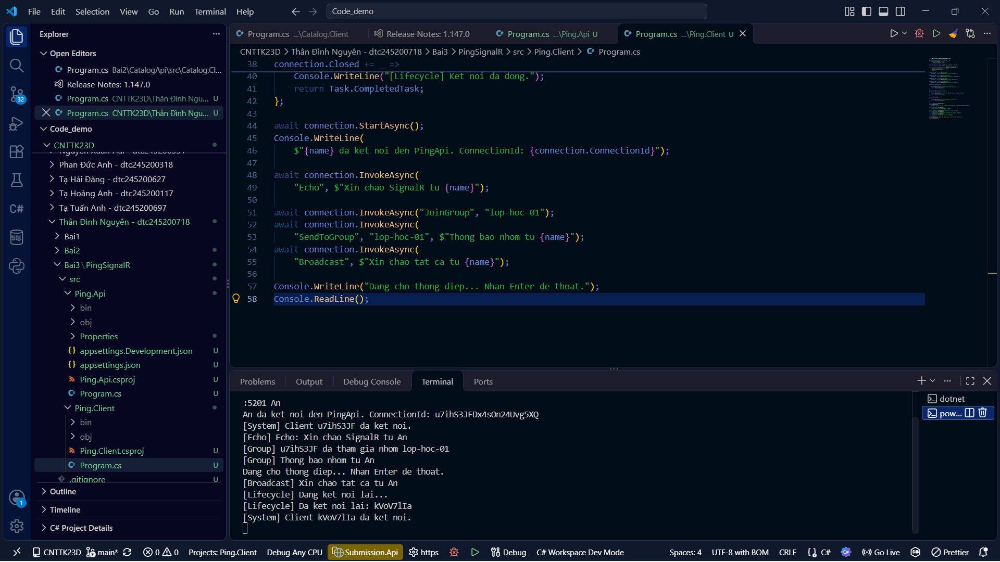

## PingSignalR – Bước 6: Kết nối lại

Khi tắt rồi chạy lại API, Client báo đang kết nối lại và tạo ConnectionId mới.

## PingSignalR – Bước 7: Thí nghiệm lỗi

| Thử nghiệm | Dự đoán | Kết quả thực tế | Giải thích |
|---|---|---|---|
| Tắt API rồi chạy Client | Không kết nối được | `Connection refused` | `StartAsync` cần API đang chạy; tự kết nối lại chỉ áp dụng sau khi đã kết nối thành công. |
| Đổi `/hubs/ping` thành `/hub/ping` | Báo không tìm thấy hub | `404 Not Found` | Đường dẫn Client gọi không khớp `MapHub` ở API. |
| Đổi `EchoResponse` thành `EchoRespone` | Không nhận Echo | Client vẫn chạy nhưng không có dòng `[Echo]` | Tên thông điệp đăng ký bằng `On` không khớp tên API gửi. |

