## PingSignalR – Bước 6: Kết nối lại

Khi tắt rồi chạy lại API, Client báo đang kết nối lại và tạo ConnectionId mới.


## PingSignalR – Bước 7: Thí nghiệm lỗi

| Thử nghiệm | Dự đoán | Kết quả thực tế | Giải thích |
|---|---|---|---|
| Tắt API rồi chạy Client | Không kết nối được | `Connection refused` | `StartAsync` cần API đang chạy; tự kết nối lại chỉ áp dụng sau khi đã kết nối thành công. |
| Đổi `/hubs/ping` thành `/hub/ping` | Báo không tìm thấy hub | `404 Not Found` | Đường dẫn Client gọi không khớp `MapHub` ở API. |
| Đổi `EchoResponse` thành `EchoRespone` | Không nhận Echo | Client vẫn chạy nhưng không có dòng `[Echo]` | Tên thông điệp đăng ký bằng `On` không khớp tên API gửi. |

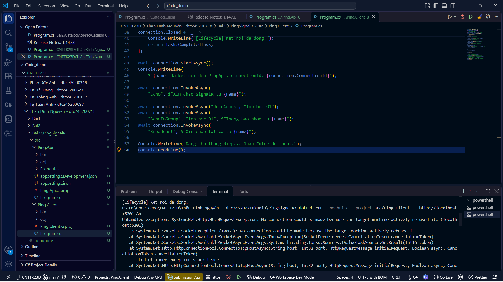
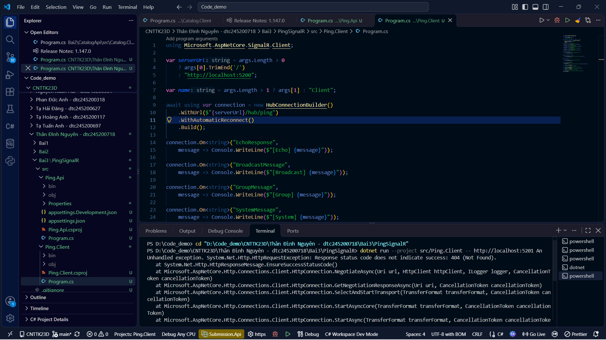
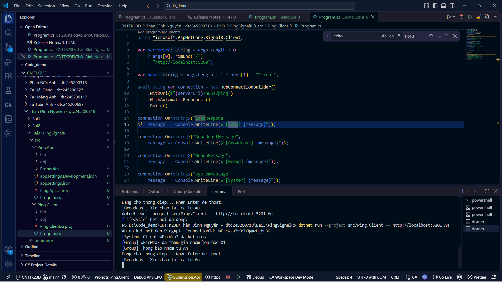
## RealtimeSubmissionSystem

### Cách chạy

Mở terminal tại thư mục `Bai3\RealtimeSubmissionSystem`. Chạy API trước, sau đó mở terminal thứ hai để chạy Client:

```powershell
dotnet build RealtimeSubmissionSystem.slnx
dotnet run --project src/Submission.RealtimeApi --urls http://localhost:5000
```

```powershell
dotnet run --project src/Submission.RealtimeClient -- http://localhost:5000 DTC245200718
```

API dùng REST để tạo và đọc lượt nộp. Hub SignalR ở `/hubs/submissions` để báo trạng thái `processing` và `graded`.

### Kết quả chạy

Client kết nối SignalR, đọc danh sách bài tập, tạo lượt nộp với trạng thái REST ban đầu là `received`, đăng ký theo dõi lượt nộp đó, nhận lần lượt hai thông báo `processing` và `graded`. Cuối cùng, Client gọi REST đọc lại và nhận `graded`.

File `RealtimeSubmissionSystem/requests.http` có 9 request đã chạy: GET `/` và danh sách trả `200`; POST hợp lệ trả `201`; GET lượt nộp trả `200`; dữ liệu thiếu trả `400`; bài tập và lượt nộp không tồn tại trả `404`; negotiate đúng trả `200`, sai đường dẫn hub trả `404`.

### Năm thí nghiệm bước 7

| Thí nghiệm | Dự đoán | Kết quả quan sát | Giải thích |
| --- | --- | --- | --- |
| Hai Client SV001 và SV002 chạy cùng lúc | Mỗi Client nhận trạng thái lượt nộp của mình | Hai Client tạo hai ID khác nhau và nhận `processing`, `graded` cho ID tương ứng | Mỗi lượt nộp có nhóm SignalR `submission:{id}` riêng. |
| Chạy Client khi API tắt | Không thể kết nối | `Connection refused` ở `localhost:5000` | `WithAutomaticReconnect` không tự thử lại lần kết nối đầu tiên. |
| Đổi hub thành `/hub/submissions` | Không tìm thấy hub | Lỗi `404 Not Found` khi kết nối | Đường dẫn Client không khớp `/hubs/submissions` trên API. |
| Đổi tên nhận thành `SubmissionStatusChange` | Không nhận cập nhật | Không có thông báo SignalR; sau 10 giây hết thời gian chờ, REST vẫn trả `graded` | Tên sự kiện ở Client phải khớp chính xác tên API gửi. |
| Chờ 4 giây rồi mới `WatchSubmission` | Lỡ các thông báo đã gửi | Không nhận `processing` hay `graded`; REST đọc lại được `graded` | Client vào nhóm sau khi API đã gửi thông báo; SignalR không phát lại tin cũ. |

Sau thí nghiệm, Client đã được sửa lại đường dẫn hub và tên sự kiện đúng; bỏ thời gian chờ 4 giây và chỉ gọi `WatchSubmission` một lần.

### Trả lời ba câu hỏi đầu giờ

**1. Máy chủ có thể chủ động báo cho máy khách không?** Có. Client mở kết nối SignalR; khi trạng thái thay đổi, API dùng `IHubContext` gửi thông báo tới nhóm của lượt nộp mà không cần Client liên tục hỏi.

**2. Có REST rồi, vì sao cần SignalR?** REST dùng để tạo và đọc lượt nộp, đồng thời trả mã `200`, `201`, `400`, `404`. SignalR đẩy thông báo trạng thái mới ngay khi có thay đổi. Client vẫn đọc lại REST để xác nhận trạng thái cuối.

**3. Nếu mất mạng đúng lúc báo `graded` thì sao?** Client có thể lỡ thông báo đó. Sau khi kết nối lại, Client cần đăng ký theo dõi lại lượt nộp và gọi `GET /api/submissions/{id}` để biết trạng thái hiện tại. `WithAutomaticReconnect` chỉ nối lại, không phát lại thông báo đã lỡ.
### Ảnh minh chứng RealtimeSubmissionSystem

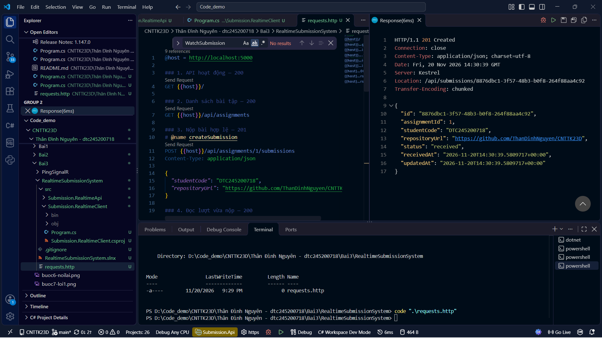
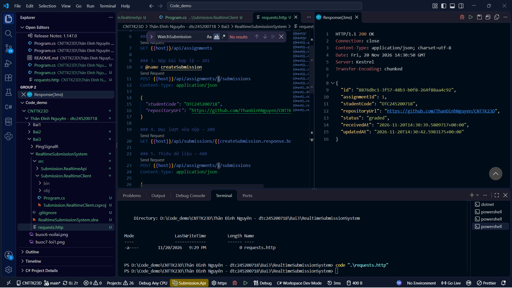
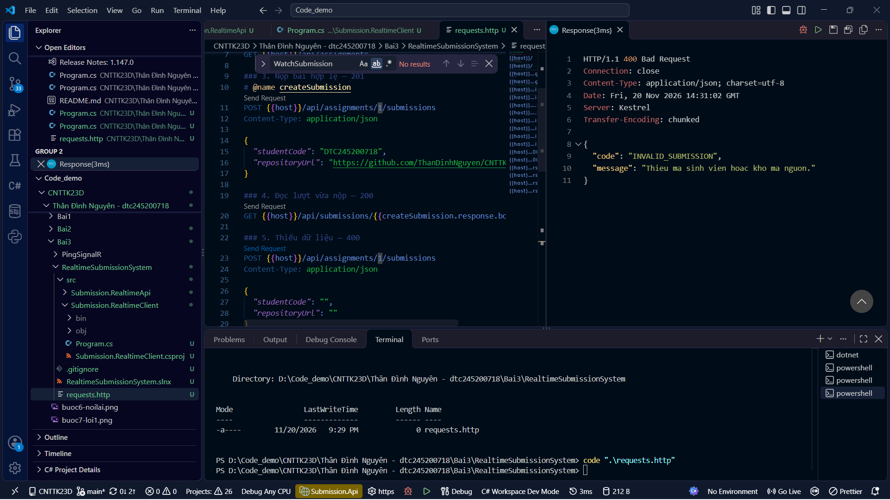
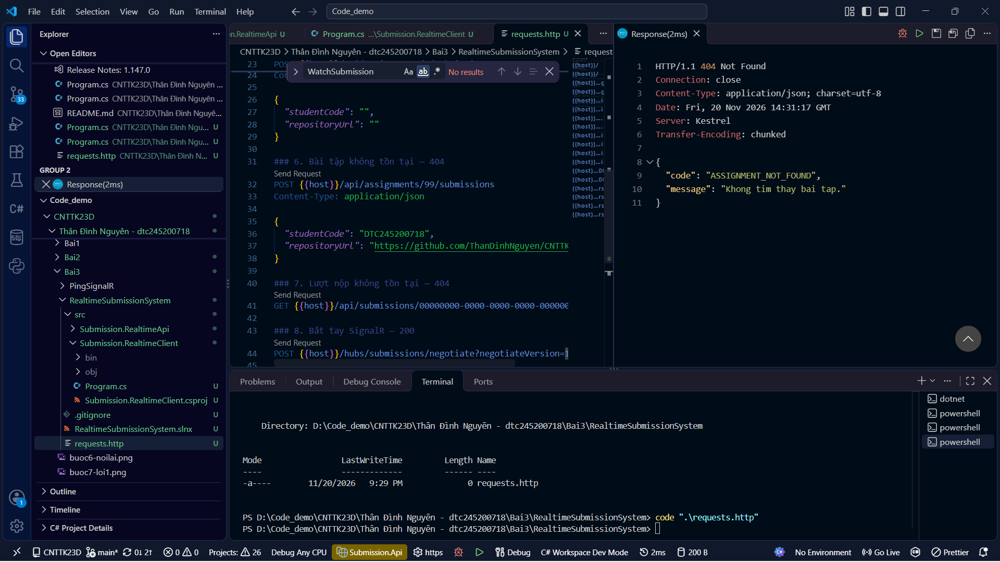
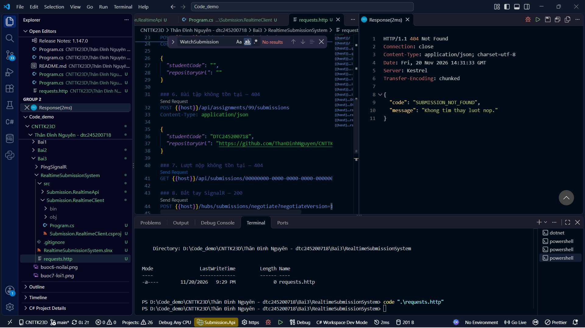

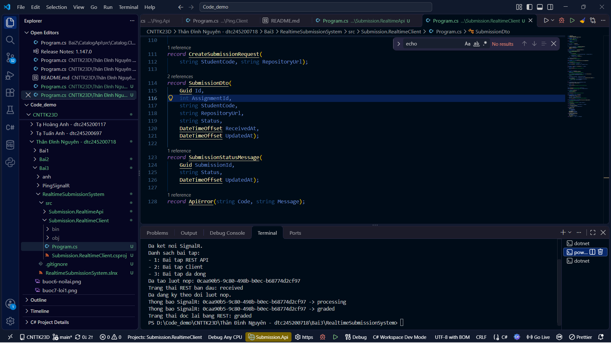

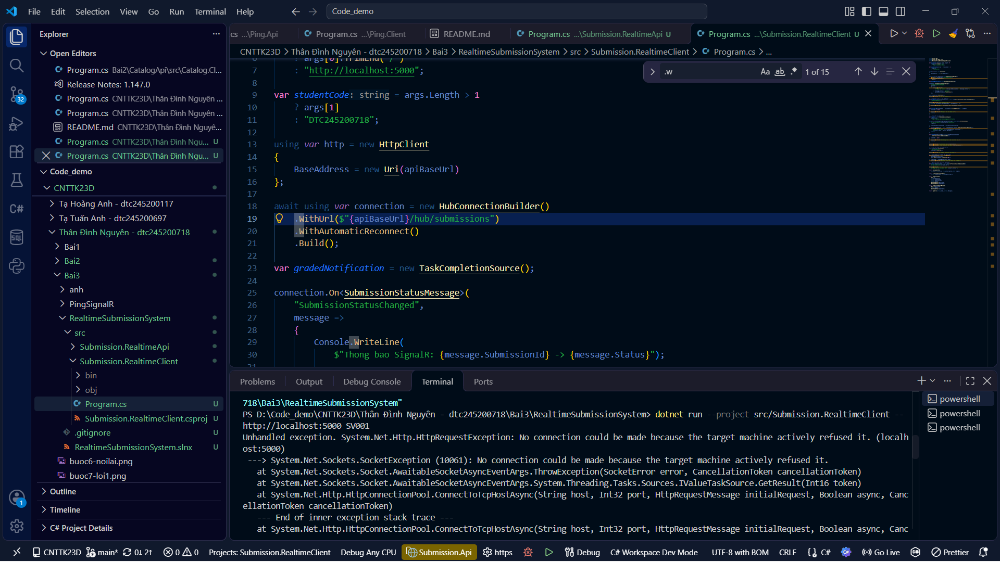
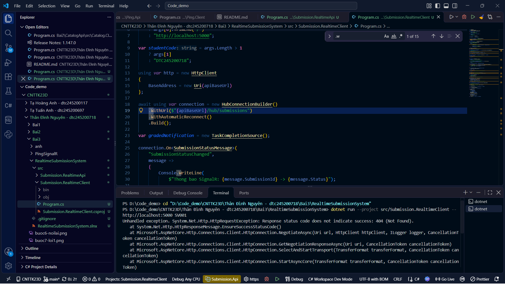
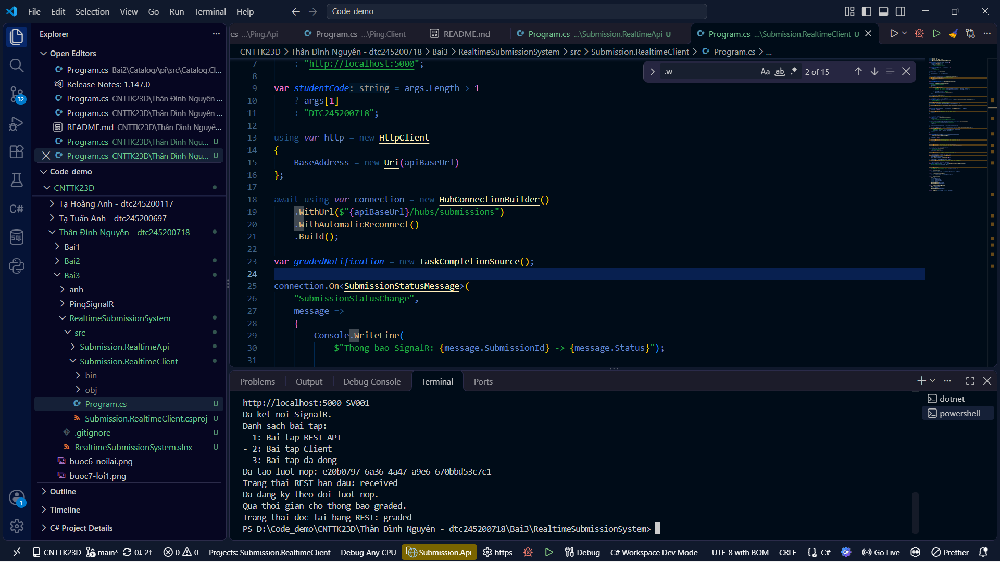
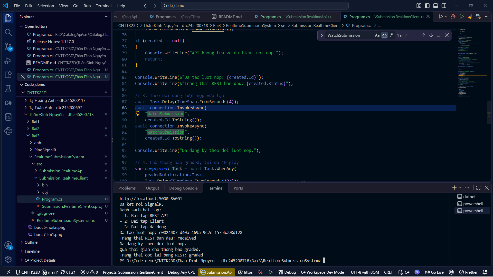