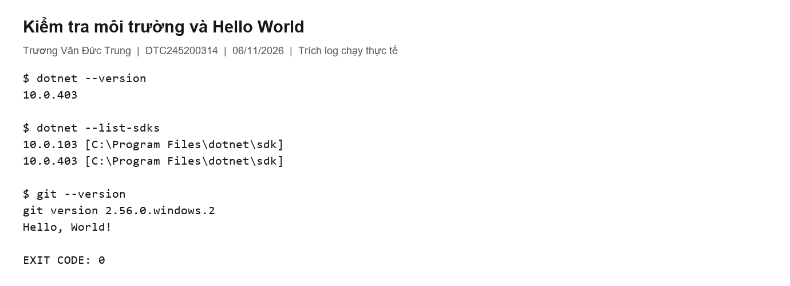
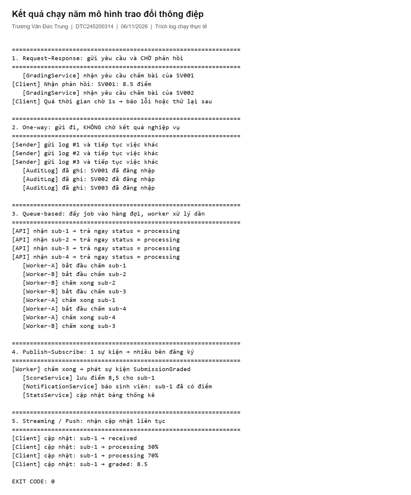
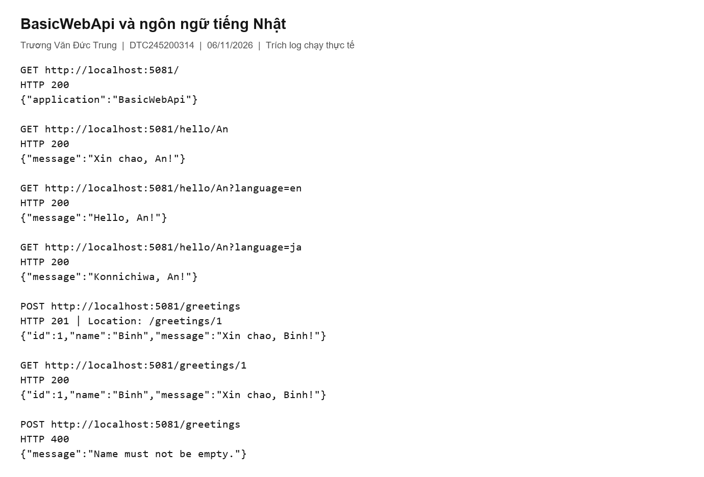
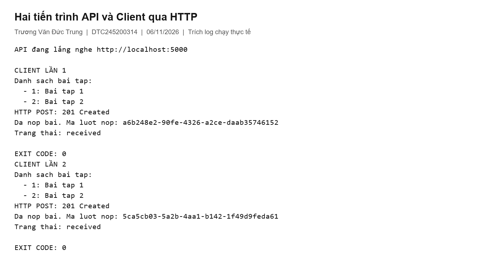
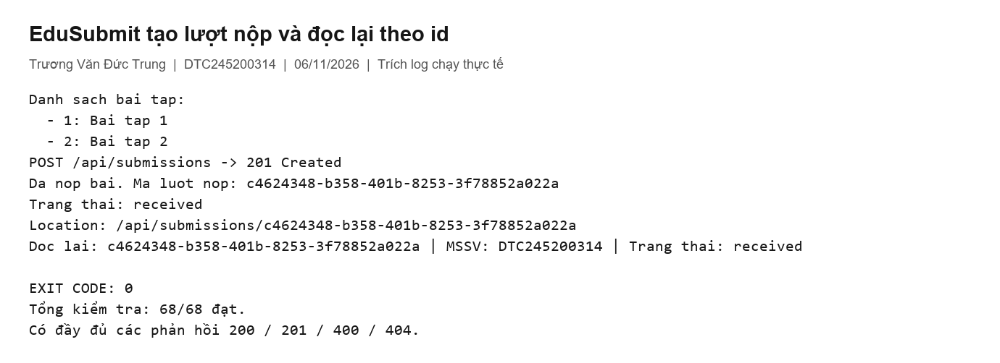
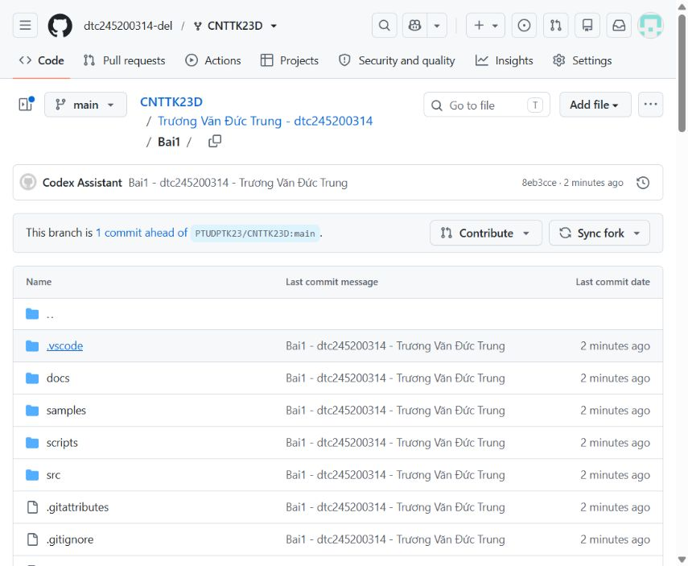
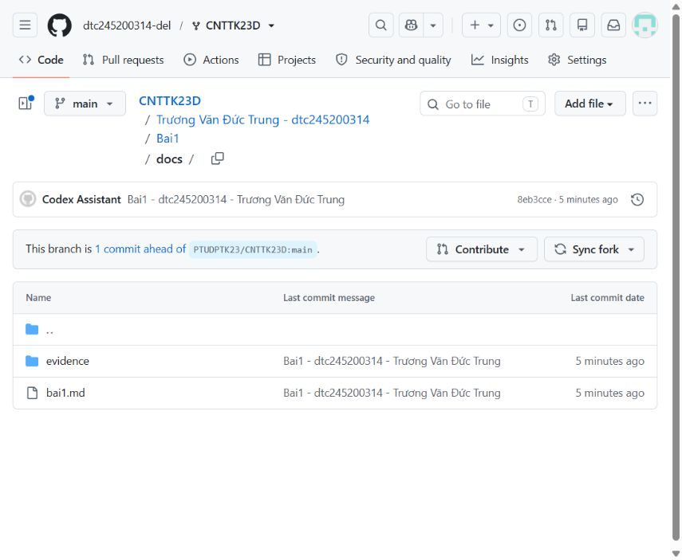
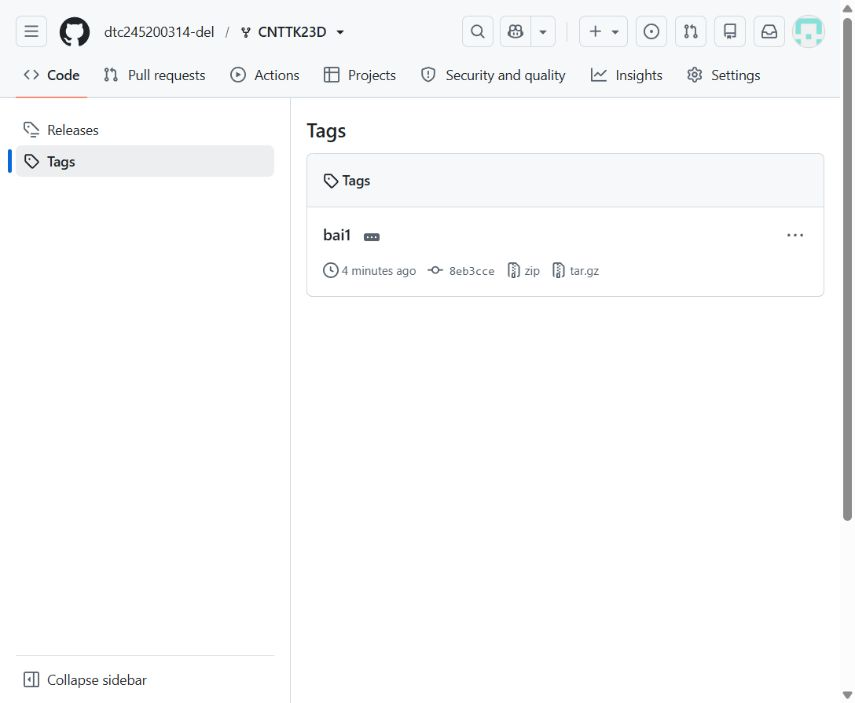
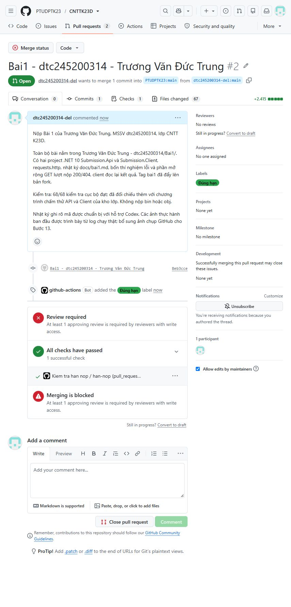

# Bài 1 Tổng quan hệ thống và MEP

**Họ tên:** Trương Văn Đức Trung  
**MSSV:** DTC245200314  
**Lớp:** CNTT K23D  
**GitHub:** https://github.com/dtc245200314-del  
**Ngày thực hành:** 06/11/2026

Nhật ký ghi lại quá trình chạy mẫu, xây dựng EduSubmit, thử lỗi và kiểm tra phần mở rộng. Mã nguồn được xây dựng theo tài liệu Bài 1 với sự hỗ trợ của Codex. Thư mục MepDemo là mẫu được cung cấp; BasicWebApi và MiniDistributedSystem được dựng theo đặc tả trong tài liệu.

## 1. Cài đặt

Máy có .NET SDK `10.0.403`, đồng thời có bản `10.0.103`; Git `2.56.0.windows.2` và VS Code. Đã kiểm tra danh sách extension: C# Dev Kit, C#, .NET Install Tool và REST Client đều có trên máy.

Đã biên dịch và chạy `samples/HelloPtudpt`; kết quả là `Hello, World!`. Các project dùng `net10.0` và các thư viện đi kèm SDK, không có package NuGet ngoài.



[Log môi trường](evidence/00-moi-truong.txt) · [Log Hello World](evidence/01-hello.txt)

Các hình minh chứng thực hành ở mục 1–6 được tạo từ log chạy thật để đọc kết quả thuận tiện; đây là ảnh trình bày bản ghi, không phải ảnh chụp thao tác trong VS Code hoặc REST Client. Mục 9 dùng ảnh chụp trực tiếp từ GitHub.

## 2. MepDemo Bước 7

Đã chạy toàn bộ năm MEP và chạy riêng các lựa chọn `1`, `3`, `4`.

1. **MEP 3:** mỗi `sub-x` được đúng **một worker** xử lý. Hai worker đọc cạnh tranh từ cùng một channel; chúng chia công việc, không nhận bản sao của mỗi job.
2. **MEP 4:** một sự kiện `SubmissionGraded` được gửi đến **ba subscriber**: ScoreService, NotificationService và StatsService.
3. Mô tả từng MEP:

| MEP | Mô tả |
|---|---|
| Request–response | Bên gửi chờ phản hồi; có thể gặp timeout khi phản hồi quá chậm. |
| One-way | Bên gửi đưa thông điệp đi rồi tiếp tục, không chờ kết quả nghiệp vụ. |
| Queue-based | Job được đưa vào hàng đợi và chia cho các worker xử lý. |
| Publish–subscribe | Một sự kiện được phân phối đến nhiều subscriber độc lập. |
| Streaming hoặc push | Client nhận nhiều cập nhật liên tiếp trong một luồng. |



[Log toàn bộ MEP](evidence/02-mep-all.txt)

`await auditLog` trong demo one-way chỉ đợi để chương trình kết thúc gọn gàng. `WaitAsync` ở demo 1 giới hạn thời gian chờ của client; nó không tự hủy tác vụ chấm đang chạy. InMemoryEventBus của mẫu gọi subscriber tuần tự trong cùng tiến trình và không cung cấp cơ chế lưu bền hay xử lý lỗi như broker thật.

## 3. BasicWebApi Bước 8

Đã chạy API ở cổng 5081 và kiểm tra các trường hợp:

| Request | Kết quả thực tế |
|---|---|
| `GET /` | 200, `application` là `BasicWebApi` |
| `GET /hello/An` | 200, `Xin chao, An!` |
| `GET /hello/An?language=en` | 200, `Hello, An!` |
| `GET /hello/An?language=ja` | 200, `Konnichiwa, An!` |
| `POST /greetings` tên Binh | 201, Location `/greetings/1` |
| `POST /greetings` tên rỗng | 400, `Name must not be empty.` |
| Đọc lại Location vừa nhận | 200, đúng lời chào đã tạo |

**Trả lời câu hỏi 8.4**

- `builder.Services.AddSingleton<GreetingService>()` đứng trước `builder.Build()`. Các đăng ký dependency injection cần được hoàn tất trước khi xây dựng ứng dụng và service provider.
- `name` lấy từ route segment `{name}`; `language` lấy từ query string sau dấu `?`.
- POST hợp lệ tạo tài nguyên mới nên trả `201 Created`, kèm `Location` để chỉ địa chỉ tài nguyên. `200 OK` thường dùng khi đọc dữ liệu hoặc thực hiện thành công một thao tác không biểu thị việc tạo mới.



Đã chuẩn bị cấu hình debug trong `.vscode/launch.json`. Vị trí breakpoint là `var greeting = service.Create(...)` trong `samples/BasicWebApi/src/BasicWebApi/Program.cs`; hướng dẫn thao tác nằm trong README của mẫu.

## 4. MiniDistributedSystem Bước 9

Đã chạy API và Client ở hai tiến trình độc lập, API nghe cổng 5000. Client in hai bài tập, GUID mới và `Trang thai: received`. Chạy client hai lần sinh hai GUID khác nhau.



**Client gọi những endpoint nào?**

| Method | URL | Mã phản hồi |
|---|---|---|
| GET | `http://localhost:5000/api/assignments` | 200 |
| POST | `http://localhost:5000/api/submissions` | 201 khi dữ liệu hợp lệ |

Mỗi lần gọi gồm một HTTP request riêng và một response riêng. Với bài chính có phần mở rộng, client gọi thêm `GET /api/submissions/{id}` và nhận 200.

**Hai bên thống nhất bằng gì?** Client không tham chiếu project hoặc mã nguồn API. Hai bên thống nhất bằng hợp đồng HTTP: method, đường dẫn, cấu trúc JSON, kiểu dữ liệu và mã trạng thái. Các record được khai báo riêng tại mỗi project.

**Vì sao truyền địa chỉ API qua tham số?** Địa chỉ thay đổi tùy máy và cổng triển khai. Truyền URL giúp chuyển môi trường mà không phải sửa hoặc biên dịch lại code.

## 5. Thí nghiệm lỗi Bước 10

Dự đoán được ghi trong [tệp dự đoán](evidence/05-du-doan-truoc-thi-nghiem.json) trước khi chạy thí nghiệm. Sau khi thử, mã của mẫu đã được khôi phục về trạng thái ban đầu.

| Thí nghiệm | Dự đoán trước khi chạy | Kết quả thực tế | Đúng hay sai | Giải thích |
|---|---|---|---|---|
| a. API thêm bài tập 3 | Client hiện ba bài, không cần sửa client. | Client in `3: Bai tap 3`; nộp bài thành công. | Đúng | Client duyệt danh sách JSON trả về, không cố định số phần tử. |
| b. Tắt API rồi chạy client | Client gặp lỗi kết nối. | `HttpRequestException`, kết nối bị từ chối; client kết thúc với mã lỗi. | Đúng | Gọi qua mạng phụ thuộc tiến trình máy chủ và kết nối. Gọi hàm nội bộ không có lỗi kết nối mạng này, nhưng vẫn có thể gặp exception khác. |
| c. StudentCode rỗng | API trả 400; EnsureSuccessStatusCode báo lỗi. | Client in `400 BadRequest`, sau đó ném `HttpRequestException` tại `EnsureSuccessStatusCode`. | Đúng | Máy chủ tự kiểm tra dữ liệu vì có thể được gọi bởi bất kỳ client nào. EnsureSuccessStatusCode ném lỗi khi response nằm ngoài dải 200–299. |
| d. API 5050, client gọi 5000 | Gọi cổng cũ thất bại; truyền URL 5050 sẽ chạy được. | Lần gọi 5000 thất bại; chạy client với `http://localhost:5050` nhận `received`. | Đúng | Cổng là một phần địa chỉ đích; sửa tham số chạy, không sửa code. |

[Log a](evidence/05a-client.txt) · [Log b](evidence/05b-api-tat.txt) · [Log c](evidence/05c-mssv-rong.txt) · [Log d sau sửa URL](evidence/05d-dung-cong.txt)

## 6. Dự án EduSubmit Bước 11 và 12

Solution có đúng hai project chính `Submission.Api` và `Submission.Client`. Các record và route được xây dựng theo đặc tả mục 11.2–11.3. Đã tham khảo tài liệu hướng dẫn và MepDemo; các mẫu còn thiếu được dựng lại từ đặc tả, không ghi nhận việc tự gõ hoàn toàn không có hỗ trợ.

API cung cấp:

- `GET /`: tên dịch vụ và trạng thái.
- `GET /api/assignments`: danh sách hai bài tập.
- `POST /api/submissions`: kiểm tra dữ liệu, tạo GUID, đặt `received`, ghi thời điểm UTC, trả 201 và Location.
- `GET /api/submissions/{id:guid}`: trả 200 nếu tìm thấy, 404 nếu không có.

Phần mở rộng dùng `List<SubmissionResult>` để lưu trong bộ nhớ. Các truy cập danh sách được bảo vệ bằng `lock` để tránh thao tác đồng thời không an toàn. Client đọc lại lượt nộp vừa tạo qua một request GET riêng và in kết quả.

Luồng thông điệp:

```text
Client -- HTTP GET /api/assignments -------> API
Client <-- 200 + danh sách JSON ------------ API
Client -- HTTP POST /api/submissions ------> API
Client <-- 201 + Location + lượt nộp ------- API
Client -- HTTP GET /api/submissions/{id} --> API
Client <-- 200 + lượt nộp đã lưu ----------- API
```

Tất cả các lần gọi trên dùng request–response. `async/await` giúp chờ I/O mà không biến luồng này thành queue hoặc publish–subscribe.



**Kiểm thử thực tế:** 68/68 kiểm tra đạt, gồm biên dịch các project, MEP, BasicWebApi, hai tiến trình MiniDistributedSystem, bốn thí nghiệm và API/Client chính. Đã kiểm tra thêm JSON hỏng trả 400, Content-Type không phù hợp trả 415, GUID và thời điểm hợp lệ, Location đúng, đọc lại đúng và id không tồn tại trả 404.

Đã chạy thêm các kiểm tra trong chương trình chấm thử của kho lớp: build, GET, POST 201/400, client in danh sách/GUID/received, GET lượt nộp 200/404 và client đọc lại đều đạt. [Kết quả chương trình chấm thử](evidence/kiem-tra-theo-bo-cham-lop.json).

[Kết quả 68 kiểm tra](evidence/ket-qua-kiem-thu.json) · [Bản ghi HTTP](evidence/http-transcript.json)

## 7. Khó khăn và cách giải quyết

- Gói đầu vào thiếu BasicWebApi và MiniDistributedSystem: dựng lại dựa trên đặc tả trong tài liệu và kiểm tra từng hành vi được yêu cầu.
- Lệnh build trong môi trường hạn chế quyền không hoàn tất: chạy biên dịch trong ngữ cảnh có quyền phù hợp; toàn bộ các project build thành công, không có cảnh báo hoặc lỗi biên dịch.
- API và client phải dùng cùng cổng: kiểm tra dòng địa chỉ lắng nghe và truyền URL đúng cho client.
- Dữ liệu sai phải được kiểm tra ở API: dùng kiểm tra chuỗi rỗng, id không dương và bài tập không tồn tại; client kiểm tra mã HTTP trước khi đọc phản hồi thành công.
- Dữ liệu đang lưu trong bộ nhớ: sau khi khởi động lại API cần tạo lượt nộp mới trước khi thử đọc lại. Cơ chế lưu bền là nội dung phát triển ở các bài sau.

## 8. Câu hỏi tự kiểm tra

**Ứng dụng phân tán khác monolithic ở đâu?** Các thành phần phân tán có thể chạy trong các tiến trình hoặc máy khác nhau, giao tiếp qua mạng và gặp lỗi độc lập. Trong Bài 1, ranh giới nằm giữa tiến trình API và tiến trình Client; cả hai có thể cùng chạy trên một máy.

**Năm MEP và mô hình của EduSubmit?** Request–response, one-way, queue-based, publish–subscribe và streaming/push. EduSubmit Bài 1 dùng request–response qua HTTP.

**Queue khác publish–subscribe thế nào?** Trong nhóm consumer cạnh tranh của queue, một job được giao cho một worker tại một thời điểm; ví dụ chia bài nộp để chấm. Pub/sub phân phối cùng sự kiện tới nhiều subscriber; ví dụ kết quả chấm được dịch vụ điểm, thông báo và thống kê cùng xử lý. Broker thực tế có thể giao lại thông điệp khi lỗi nên consumer vẫn cần xem xét trùng lặp.

**Ý nghĩa mã trạng thái?** 200: yêu cầu thành công và trả dữ liệu; 201: tạo tài nguyên mới; 400: dữ liệu yêu cầu không hợp lệ; 404: không tìm thấy tài nguyên tại địa chỉ đã gọi.

**Vì sao kiểm tra mã trạng thái trước khi đọc phản hồi?** Phản hồi lỗi có thể có cấu trúc khác dữ liệu thành công. Kiểm tra mã giúp xử lý đúng lỗi và tránh giải tuần tự một đối tượng sai hợp đồng.

## 9. Viết nhật ký và nộp bài Bước 13

Theo thông báo nộp bài mới của lớp, bài được nộp bằng Fork và Pull Request. Repository fork là https://github.com/dtc245200314-del/CNTTK23D, bài nằm trong `Trương Văn Đức Trung - dtc245200314/Bai1/`.

Đã đẩy mã nguồn và `docs/bai1.md` lên GitHub, cùng tag `bai1`. Tag đánh dấu phiên bản mã và nhật ký đã kiểm thử; ảnh chụp xác nhận nộp bài được bổ sung trong commit sau đó. Toàn bộ thay đổi chỉ nằm trong thư mục sinh viên, không bao gồm `bin`, `obj`.

**PR nộp bài:** https://github.com/PTUDPTK23/CNTTK23D/pull/2  
**Tiêu đề:** Bai1 - dtc245200314 - Trương Văn Đức Trung  
**Thời điểm mở PR:** 08:55:12 ngày 06/11/2026, giờ Việt Nam.  
**Trạng thái đã xác nhận:** Open, hệ thống lớp gắn nhãn **Đúng hạn**. PR đang chờ giảng viên xem xét; chưa có điểm chính thức.

Ảnh chụp trực tiếp trang mã nguồn trên nhánh `main`:



Ảnh chụp thư mục `docs` có `bai1.md` và thư mục minh chứng:



Ảnh chụp trang Tags có `bai1`:



Ảnh chụp PR đã mở và nhãn xác nhận đúng hạn:


