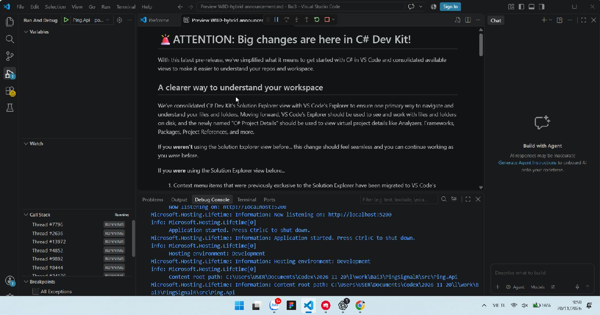
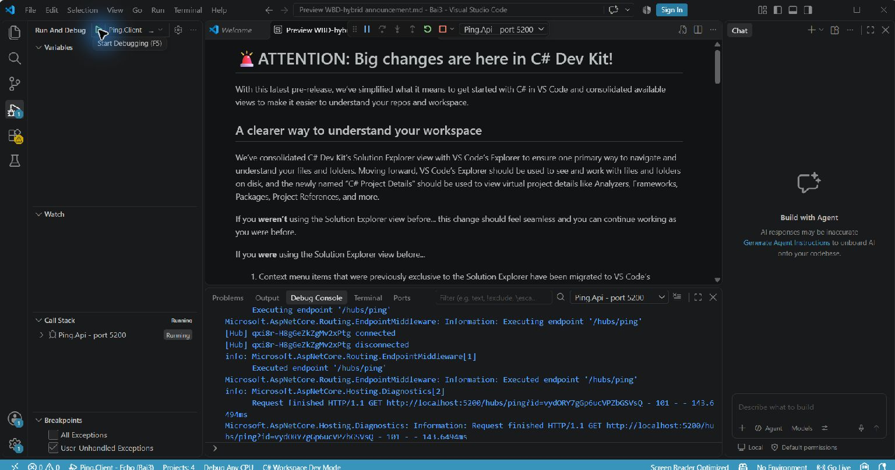

# Bài 3 - SignalR

Mã sinh viên: dtc245200314  
Sinh viên: Trương Văn Đức Trung

Bài làm có hai solution: PingSignalR minh họa hub, các phạm vi gửi, nhóm và vòng đời kết nối; RealtimeSubmissionSystem kết hợp REST với SignalR để báo trạng thái chấm bài.

## Chạy bài

Yêu cầu .NET SDK 10.0. Build hai solution:

    dotnet build PingSignalR/PingSignalR.slnx
    dotnet build RealtimeSubmissionSystem/RealtimeSubmissionSystem.slnx

### PingSignalR

Mở một terminal chạy API ở cổng 5200:

    dotnet run --project PingSignalR/src/Ping.Api --urls http://localhost:5200

Mở terminal khác. Client kết nối, gọi Echo rồi chờ Enter để thoát:

    dotnet run --project PingSignalR/src/Ping.Client -- http://localhost:5200

Để thử Broadcast và Group trên hai kết nối, chạy hai client với tùy chọn --interactive. Gõ join lop-hoc-01 ở cả hai cửa sổ, sau đó thử broadcast Thong bao ca lop hoặc group lop-hoc-01 Tin rieng cua nhom.

    dotnet run --project PingSignalR/src/Ping.Client -- http://localhost:5200 --interactive

### EduSubmit realtime

Chạy API ở cổng 5000:

    dotnet run --project RealtimeSubmissionSystem/src/Submission.RealtimeApi --urls http://localhost:5000

Chạy client ở terminal khác:

    dotnet run --project RealtimeSubmissionSystem/src/Submission.RealtimeClient -- http://localhost:5000 DTC245200314 https://github.com/dtc245200314-del/CNTTK23D

Client đăng ký sự kiện trước khi mở kết nối, tạo lượt nộp qua REST, gọi WatchSubmission để vào nhóm của lượt nộp, chờ processing và graded, rồi đọc trạng thái cuối qua GET. Để tạo hai lượt nộp trên một kết nối, thêm --watch-two. Để làm cho lượt nộp thứ hai thất bại và so sánh hai nhóm, thêm --watch-two --fail-second. Tùy chọn --late-watch chờ bốn giây trước khi vào nhóm để minh họa rằng SignalR không phát lại tin cũ.

Trong VS Code, chọn các cấu hình `Submission.RealtimeApi - port 5000`, `Submission.RealtimeClient - EduSubmit` hoặc các cấu hình thí nghiệm trong `.vscode/launch.json`. Client cũng hỗ trợ `--wrong-hub-path` và `--wrong-event-name` để tái hiện hai lỗi tương ứng.

## Thiết kế

### Bốn câu hỏi

1. Sự kiện: trạng thái lượt nộp đổi từ received sang processing rồi sang graded hoặc failed.
2. Người nhận: chỉ các kết nối đã gọi WatchSubmission cho đúng id, trong nhóm submission:{id}.
3. Dữ liệu gửi: SubmissionStatusMessage gồm SubmissionId, Status và UpdatedAt; không gửi toàn bộ SubmissionDto.
4. Mất kết nối: SignalR tự nối lại sau khi kết nối đã được thiết lập. Khi nối lại, client đăng ký lại nhóm đang theo dõi. Client luôn gọi GET /api/submissions/{id} để đọc trạng thái có thẩm quyền; SignalR không lưu hay phát lại thông báo đã lỡ.

REST tạo lượt nộp, trả mã trạng thái HTTP và lưu trạng thái hiện tại. SignalR chỉ đẩy thay đổi tới đúng nhóm sau khi dữ liệu REST đã được cập nhật. POST trả về received ngay; tác vụ nền giả lập chấm bài và phát processing, graded hoặc failed sau đó.

Trong PingSignalR, máy khách gọi Echo, Broadcast, JoinGroup và SendToGroup. Hub dùng Caller, All và Group; OnConnectedAsync và OnDisconnectedAsync phát thông báo vòng đời. Client dùng WithAutomaticReconnect và tham gia lại nhóm sau khi kết nối được khôi phục.

## Năm thí nghiệm phân tán

Ghi dự đoán trước khi chạy từng thí nghiệm. Kết quả, giải thích và ảnh chụp từ các lần chạy được lưu tại [RealtimeSubmissionSystem/docs/thuc-nghiem.md](RealtimeSubmissionSystem/docs/thuc-nghiem.md).

| Thí nghiệm | Dự đoán |
| --- | --- |
| Hai máy khách theo dõi hai lượt nộp cùng lúc | Mỗi máy chỉ nhận trạng thái của lượt nộp trong nhóm mình. |
| Chạy client khi API tắt | Lần kết nối đầu thất bại; tự nối lại chỉ áp dụng sau khi kết nối đầu đã thành công. |
| Sửa URL hub thành /hub/submissions | Kết nối SignalR thất bại khi negotiate vì đường dẫn không khớp MapHub. |
| Sửa tên sự kiện ở On thành SubmissionStatusChange | Client không báo lỗi về tên sự kiện, nhưng không nhận được trạng thái terminal và hết thời gian chờ. |
| Chờ bốn giây mới gọi WatchSubmission | Tin processing và graded đã được gửi; client không nhận được tin cũ, nhưng GET REST vẫn trả trạng thái cuối. |

## requests.http

Tệp RealtimeSubmissionSystem/requests.http có chín ca: GET dịch vụ, GET danh sách bài tập, POST lượt nộp hợp lệ, GET lượt nộp, POST thiếu dữ liệu, POST với bài tập không tồn tại, GET id không tồn tại, negotiate SignalR đúng đường dẫn và negotiate sai đường dẫn.

## Ghi chú

Không đưa bin/ hoặc obj/ vào Git. Ảnh chụp màn hình chạy ứng dụng được lưu dưới `PingSignalR/docs/evidence/` và `RealtimeSubmissionSystem/docs/evidence/`.

## Ảnh chụp PingSignalR

