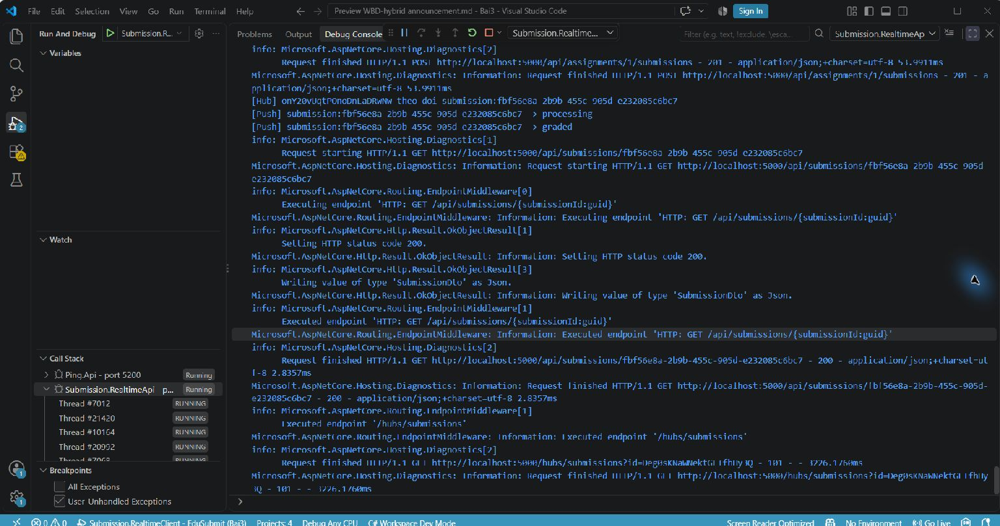
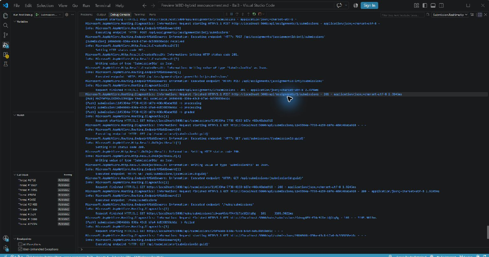
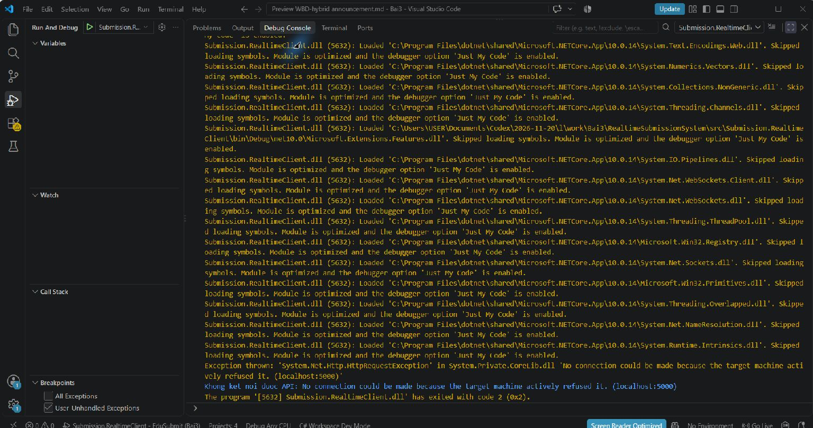
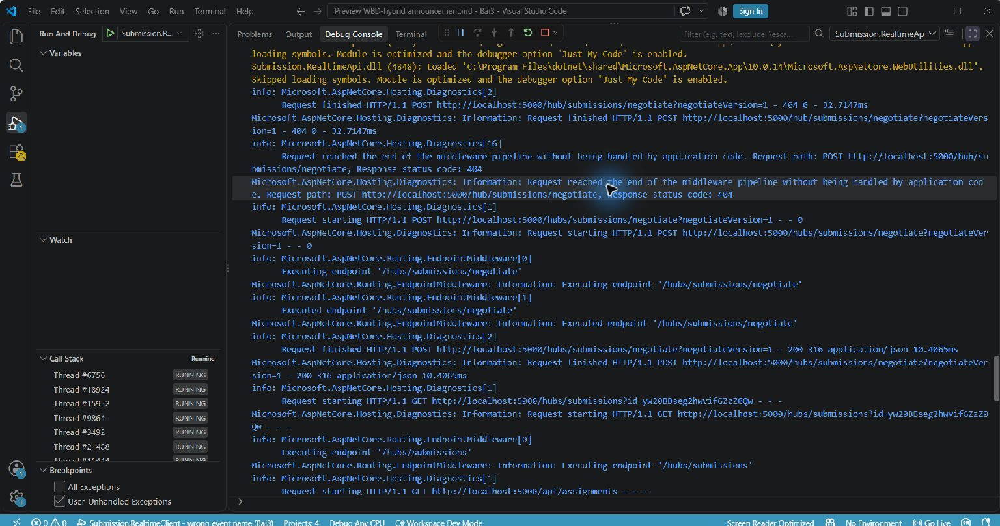
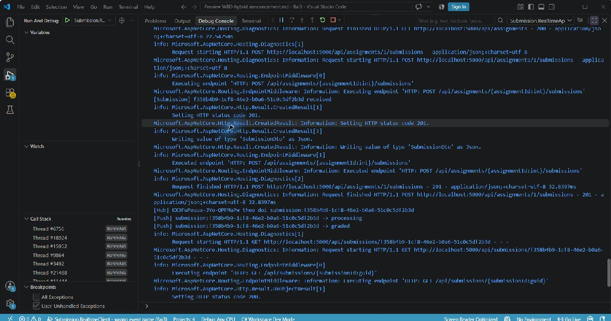
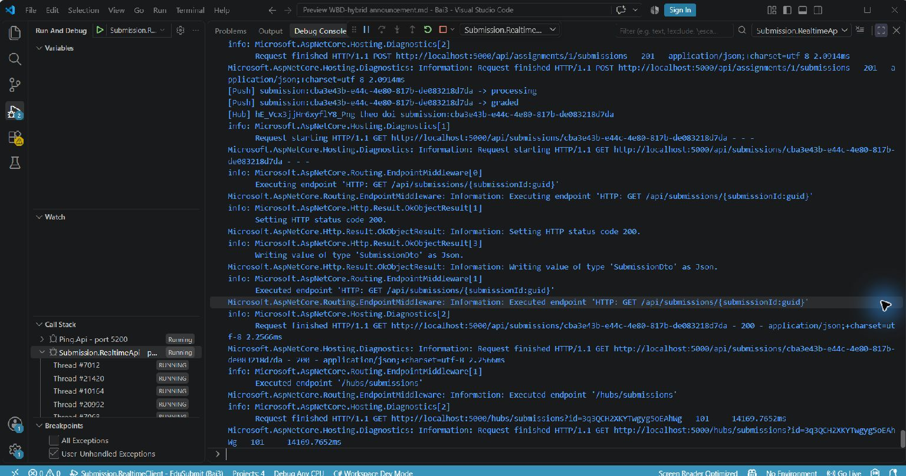

# Kết quả năm thí nghiệm phân tán

Ngày chạy: 20/11/2026. API được khởi động trong VS Code ở `http://localhost:5000`; client dùng cùng cấu hình URL và tài khoản GitHub của người nộp.

| Thí nghiệm | Dự đoán | Kết quả quan sát | Giải thích |
| --- | --- | --- | --- |
| Hai tiến trình client riêng theo dõi hai lượt nộp cùng lúc | Mỗi tiến trình chỉ nhận thông báo trong nhóm `submission:{id}` của lượt mình. | Hai client độc lập tạo hai ID khác nhau. Cả hai nhận `processing`; client thứ nhất nhận `graded`, client thứ hai nhận `failed`. Mỗi client đọc lại đúng trạng thái của ID mình qua REST. | Mỗi tiến trình có một kết nối SignalR và chỉ tham gia nhóm của ID nó tạo. URL HTTP của lượt thứ hai khiến trạng thái cuối là `failed`. |
| API tắt | Kết nối đầu sẽ thất bại; tự nối lại không chạy vì client chưa kết nối thành công lần nào. | Khi API dừng trong VS Code, client báo `No connection could be made because the target machine actively refused it. (localhost:5000)` và thoát mã 2. | `WithAutomaticReconnect` chỉ xử lý mất kết nối sau khi đã kết nối ban đầu; lần gọi `StartAsync` thất bại ngay. |
| Sai URL hub, bật `--wrong-hub-path` | Negotiate tới `/hub/submissions` không khớp với `MapHub` và trả 404. | Client báo HTTP 404; log API ghi `POST /hub/submissions/negotiate` trả 404. Không có lượt nộp mới. | Đường dẫn hub phải khớp chính xác `/hubs/submissions`. |
| Sai tên sự kiện, bật `--wrong-event-name` | Hub vẫn kết nối và client có thể vào nhóm, nhưng handler không chạy vì tên sự kiện khác. | Server phát `processing` và `graded`. Client chờ hết thời gian, không nhận callback, sau đó GET REST trả `graded`. | SignalR dispatch sự kiện theo tên chuỗi; `SubmissionStatusChange` không khớp `SubmissionStatusChanged`. GET REST là nguồn đọc trạng thái cuối. |
| Chờ 4 giây trước khi gọi `WatchSubmission`, bật `--late-watch` | Các sự kiện đã gửi trước khi vào nhóm sẽ không được phát lại. | Client không thấy callback `processing` hoặc `graded`, hết thời gian chờ rồi GET REST vẫn trả `graded`. | SignalR group chỉ nhận thông báo trong thời gian kết nối đã tham gia nhóm; máy chủ không lưu hàng đợi thông báo cho client đến trễ. |

## Kiểm tra REST

Đã gửi thủ công chín request trong `requests.http`; kết quả trên API đang chạy:

| Request | Mã HTTP | Kết quả |
| --- | ---: | --- |
| `GET /` | 200 | Dịch vụ đang chạy |
| `GET /api/assignments` | 200 | Trả hai bài tập mẫu, mỗi bài có `IsOpen` |
| `POST /api/assignments/1/submissions` hợp lệ | 201 | Có `Location` và status ban đầu `received` |
| `GET /api/submissions/{id}` | 200 | Sau 4 giây trả status `graded` |
| POST thiếu trường bắt buộc | 400 | Payload bị từ chối |
| POST bài tập `999` | 404 | Bài tập không tồn tại |
| GET ID không tồn tại | 404 | Lượt nộp không tồn tại |
| POST negotiate `/hubs/submissions` | 200 | SignalR negotiate thành công |
| POST negotiate `/hub/submissions` | 404 | Đường dẫn sai |

Theo hướng dẫn từng bước, `POST` còn kiểm tra bài tập có đang mở hay không trước khi xác thực các trường bắt buộc. Hai bài mẫu hiện được cấu hình mở để client chọn bài đầu tiên và chạy luồng nhận bài.

## Ảnh chụp

### Luồng nhận bài và chấm bài

### Hai lượt nộp trong hai nhóm

### API tắt

### Sai đường dẫn hub

### Sai tên sự kiện

### Đăng ký nhóm trễ

