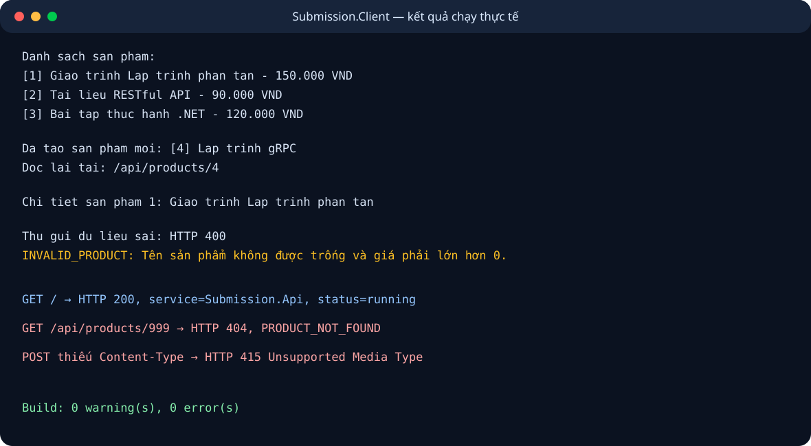

# Bài 2 — RESTful API và HTTP Client

## Cấu trúc

- `Submission/src/Submission.Api`: máy chủ Minimal API, có 4 endpoint: `GET /`, `GET /api/products`, `GET /api/products/{id:int}`, `POST /api/products`.
- `Submission/src/Submission.Client`: HTTP client chạy 4 bước: đọc danh sách, tạo sản phẩm, đọc chi tiết, gửi dữ liệu sai để đọc lỗi.
- `Submission/requests.http`: 7 request kiểm tra API.

## Chạy trong VS Code

Mở terminal tích hợp của VS Code tại thư mục `Bai2/Submission`.

Terminal 1 — chạy máy chủ:

```sh
dotnet run --project src/Submission.Api -- --urls http://localhost:5100
```

Chờ thấy `Now listening on: http://localhost:5100` và `Application started`.

Terminal 2 — chạy client:

```sh
dotnet run --project src/Submission.Client -- http://localhost:5100
```

Để gọi riêng từng ca, mở `requests.http` và bấm **Send Request** trên từng request. Có thể chạy các request sau khi máy chủ đang nghe ở cổng 5100.

## Kết quả chạy client

```text
Danh sach san pham:
  [1] Giao trinh Lap trinh phan tan - 150.000 VND
  [2] Tai lieu RESTful API - 90.000 VND
  [3] Bai tap thuc hanh .NET - 120.000 VND

Da tao san pham moi: [4] Lap trinh gRPC
Doc lai tai: /api/products/4

Chi tiet san pham 1: Giao trinh Lap trinh phan tan

Thu gui du lieu sai: HTTP 400
INVALID_PRODUCT: Tên sản phẩm không được trống và giá phải lớn hơn 0.
```

## Bảng ca thử

| # | Request | Kết quả mong đợi | Nơi xử lý |
|---|---|---|---|
| 1 | `GET /` | 200, JSON báo service đang chạy | Endpoint health check |
| 2 | `GET /api/products` | 200, danh sách ban đầu có 3 sản phẩm | Handler GET danh sách |
| 3 | `GET /api/products/1` | 200, sản phẩm có `id = 1` | Handler GET chi tiết |
| 4 | `GET /api/products/999` | 404, body `ApiError` mã `PRODUCT_NOT_FOUND` | Handler từ chối vì không tìm thấy |
| 5 | POST JSON hợp lệ | 201, sản phẩm mới và header `Location` | Handler tạo sản phẩm |
| 6 | POST với giá âm | 400, body `ApiError` mã `INVALID_PRODUCT` | Handler từ chối dữ liệu nghiệp vụ |
| 7 | POST thiếu `Content-Type` | 415, framework từ chối trước handler | ASP.NET Core đọc body |

## Ba câu hỏi tự kiểm tra

1. **Tắt máy chủ rồi chạy client thì chuyện gì xảy ra?** Client không kết nối được và nhận `HttpRequestException`; API phải chạy trước client.
2. **Chạy client hai lần khi máy chủ vẫn chạy thì dữ liệu thay đổi ra sao?** Mỗi lần POST hợp lệ thêm một sản phẩm vào danh sách trong bộ nhớ máy chủ; GET sau đó nhìn thấy sản phẩm mới. Dữ liệu mất khi khởi động lại máy chủ.
3. **Đổi URL client sang cổng 5999 thì vì sao lỗi?** Máy chủ đang lắng nghe ở cổng 5100, nên client và server phải dùng cùng địa chỉ; gọi sai cổng sẽ bị từ chối kết nối.

## Ảnh kết quả

Ảnh dưới đây trình bày output ghi nhận từ lần chạy thực tế của client và các request HTTP đã kiểm tra.


