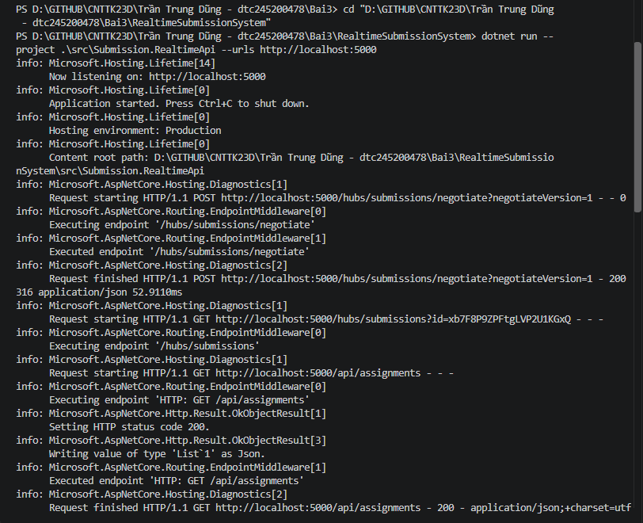
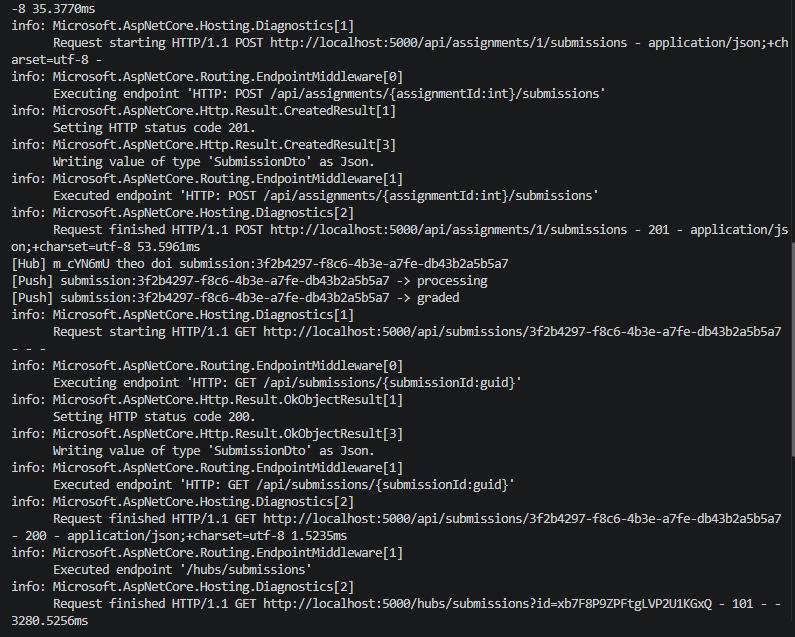
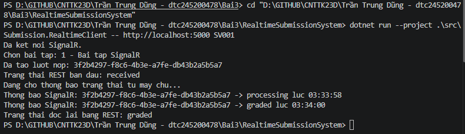
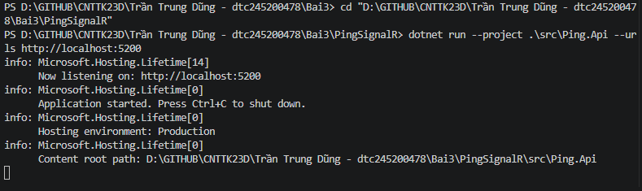
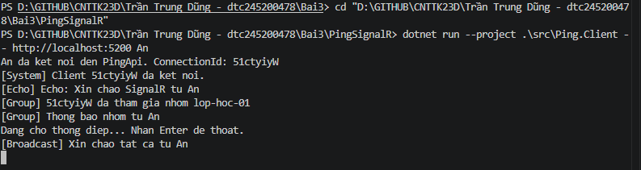

# Bài 3 - SignalR

Bài làm theo slide Bài 3, gồm hai solution độc lập:

- `PingSignalR/`: `Ping.Api` (hub `/hubs/ping`, cổng 5200) và `Ping.Client`.
- `RealtimeSubmissionSystem/`: REST + `SubmissionHub` (hub `/hubs/submissions`, cổng 5000) và máy khách kết hợp `HttpClient` với SignalR.

## Build

Mở PowerShell tại thư mục `Bai3`:

```powershell
dotnet build .\PingSignalR\PingSignalR.slnx
dotnet build .\RealtimeSubmissionSystem\RealtimeSubmissionSystem.slnx
```

## PingSignalR

Terminal 1:

```powershell
dotnet run --project .\PingSignalR\src\Ping.Api --urls http://localhost:5200
```

Terminal 2, rồi mở Terminal 3 để quan sát tin nhóm và broadcast giữa hai máy khách:

```powershell
dotnet run --project .\PingSignalR\src\Ping.Client -- http://localhost:5200 An
dotnet run --project .\PingSignalR\src\Ping.Client -- http://localhost:5200 Binh
```

`Echo` dùng `Clients.Caller`; `Broadcast` dùng `Clients.All`; `JoinGroup`/`SendToGroup` dùng `Clients.Group`. Hub ghi vòng đời kết nối, client bật tự kết nối lại. Sau khi reconnect, kết nối mới có `ConnectionId` khác và không còn thuộc nhóm cũ.

## EduSubmit realtime

Terminal 1:

```powershell
dotnet run --project .\RealtimeSubmissionSystem\src\Submission.RealtimeApi --urls http://localhost:5000
```

Terminal 2:

```powershell
dotnet run --project .\RealtimeSubmissionSystem\src\Submission.RealtimeClient -- http://localhost:5000 SV001
```

Có thể truyền URL repo không bắt đầu bằng `https://` làm tham số thứ ba để thử trạng thái `failed` và cảnh báo đỏ:

```powershell
dotnet run --project .\RealtimeSubmissionSystem\src\Submission.RealtimeClient -- http://localhost:5000 SV002 http://example.com/repo
```

REST tạo lượt nộp và giữ trạng thái nguồn sự thật. Tác vụ nền đổi trạng thái `received → processing → graded` (hoặc `failed`) rồi đẩy `SubmissionStatusChanged` tới nhóm `submission:{id}`. Máy khách đăng ký sự kiện trước khi kết nối, tạo lượt nộp, theo dõi nhóm, chờ trạng thái cuối và GET lại REST. Khi kết nối lại, client đăng ký lại nhóm đang theo dõi.

Chín request REST/negotiate nằm trong `RealtimeSubmissionSystem/requests.http`.

## Nhật ký và câu hỏi đầu giờ

### Kết quả chạy máy khách EduSubmit

Đã chạy máy khách mặc định; kết quả quan sát:

```text
Da ket noi SignalR.
Chon bai tap: 1 - Bai tap SignalR
Da tao luot nop: <guid>
Trang thai REST ban dau: received
Dang cho thong bao trang thai tu may chu...
Thong bao SignalR: <guid> -> processing luc <time>
Thong bao SignalR: <guid> -> graded luc <time>
Trang thai doc lai bang REST: graded
```

Lần chạy kiểm chứng thực tế in đủ hai push `processing` và `graded`, sau đó REST trả `graded`. GUID và thời gian thay đổi theo mỗi lần chạy. Chạy với URL repo `http://example.com/repo` cũng đã nhận `failed`, cảnh báo đỏ và REST trả `failed`. Ping client đã in `[Echo]`, `[Group]`, `[Broadcast]` và `[System]`.


### Ba thí nghiệm PingSignalR

| Thí nghiệm | Kết quả cần thấy | Bài học |
|---|---|---|
| Tắt API rồi chạy client | `HttpRequestException` / connection refused tại `StartAsync` | Tự kết nối lại chỉ áp dụng sau khi đã mở kết nối |
| Đổi `/hubs/ping` thành `/hub/ping` | HTTP 404 ở negotiate | URL client phải khớp `MapHub` |
| Đổi tên nghe `EchoResponse` thành `EchoRespone` | Không lỗi, nhưng không xuất hiện `[Echo]` | Tên sự kiện chiều xuống sai thì thường im lặng |

### Kiểm tra HTTP đã chạy

| Ca | Mã quan sát |
|---|---:|
| `GET /` | 200 |
| `GET /api/assignments` | 200 |
| `POST` lượt nộp hợp lệ | 201 |
| `POST` thiếu dữ liệu | 400 |
| `POST` assignment 999 | 404 |
| `GET` id không phải GUID | 404 |
| `POST /hubs/submissions/negotiate` | 200 |
| `POST /hub/submissions/negotiate` | 404 |
| Đọc lại sau chấm nền | 200, trạng thái `graded` |
### Năm thí nghiệm phân tán

| Thí nghiệm | Dự đoán trước khi chạy | Kết quả cần quan sát | Giải thích |
|---|---|---|---|
| Hai client SV001/SV002 cùng chạy | Mỗi client chỉ thấy trạng thái của lượt mình | Hai GUID khác nhau, thông báo được tách theo nhóm | Nhóm `submission:{id}` giới hạn người nhận |
| Client khi API tắt | Lỗi kết nối ngay lúc `StartAsync` | `HttpRequestException` / connection refused | `WithAutomaticReconnect` không thử lại lần kết nối đầu |
| Đổi URL thành `/hub/submissions` | Bắt tay thất bại | HTTP 404 ở negotiate | URL phải khớp `MapHub` |
| Đổi tên On thành `SubmissionStatusChange` | Không có lỗi nhưng hết thời gian chờ | REST vẫn đọc được trạng thái cuối | Tên sự kiện chiều xuống sai không được phát hiện tự động |
| Gọi Watch muộn 4 giây | Bỏ lỡ push | REST trả `graded` | SignalR không lưu thông điệp; REST là nguồn sự thật |

Bảng này ghi dự đoán và kết quả cần xác nhận; chưa ghi nhận ảnh chụp terminal cho các thí nghiệm.

### Trả lời ba câu hỏi

1. **Máy chủ có thể chủ động báo không?** Có. Máy khách mở kết nối SignalR trước; máy chủ dùng `IHubContext` để gửi khi sự kiện xảy ra.
2. **REST và SignalR chia việc thế nào?** REST tạo lượt nộp và đọc trạng thái hiện tại. SignalR gửi thay đổi phát sinh tới máy khách đang theo dõi. SignalR bổ sung, không thay REST.
3. **Mất mạng đúng lúc báo `graded` thì sao?** Thông báo có thể bị lỡ. Client nối lại, theo dõi lại nhóm và gọi `GET /api/submissions/{id}` để đọc trạng thái cuối.

## Mô hình giao tiếp

Polling là các yêu cầu lặp lại do client khởi tạo, thường có nhiều phản hồi không đổi. Push là thông điệp do server gửi khi sự kiện xảy ra. Streaming là chuỗi thông điệp liên tục. WebSocket là giao thức hai chiều lâu dài; SignalR là thư viện .NET dùng hub, nhóm, reconnect và dự phòng qua Server-Sent Events/Long Polling.

## Ảnh minh chứng chạy thật

Các ảnh dưới đây do người học chụp từ terminal khi chạy các ứng dụng.

### EduSubmit realtime

API đã negotiate hub và xử lý lượt nộp, gửi hai push rồi phục vụ GET trạng thái cuối:





Máy khách nhận `processing`, `graded`, sau đó đọc lại `graded` qua REST:



### PingSignalR






